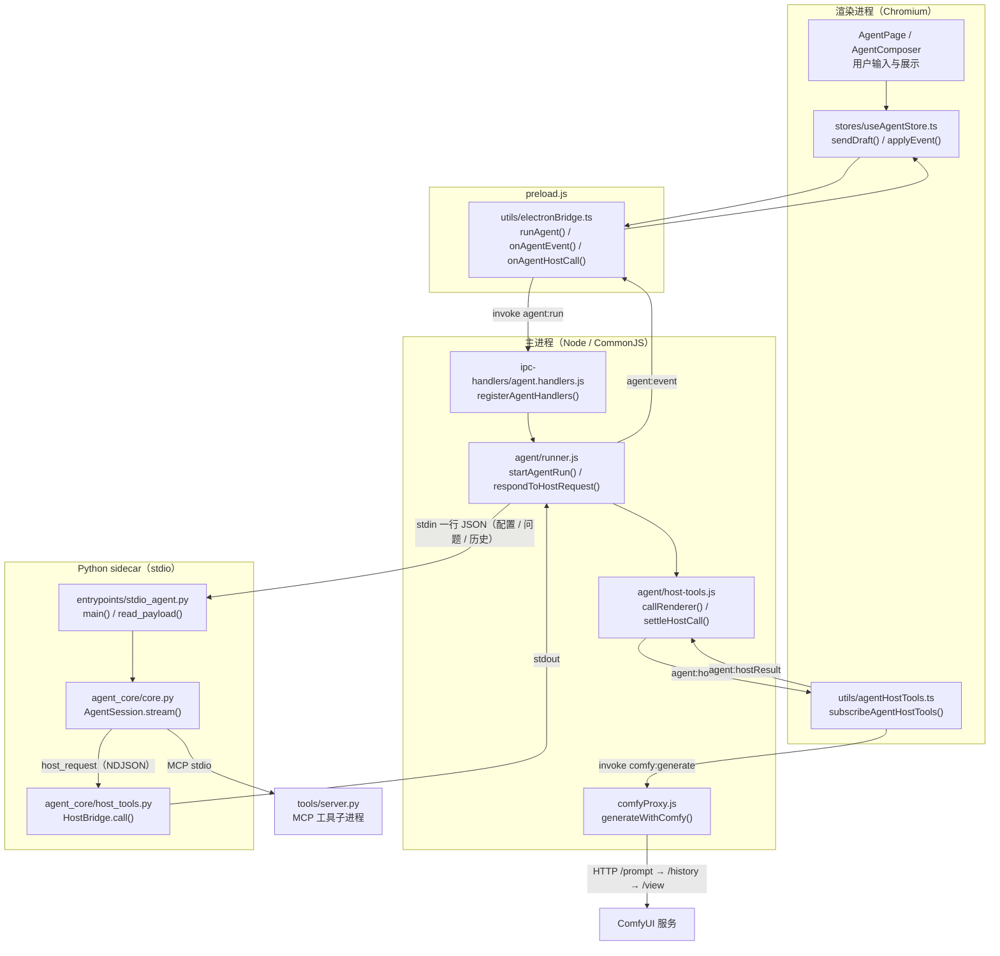
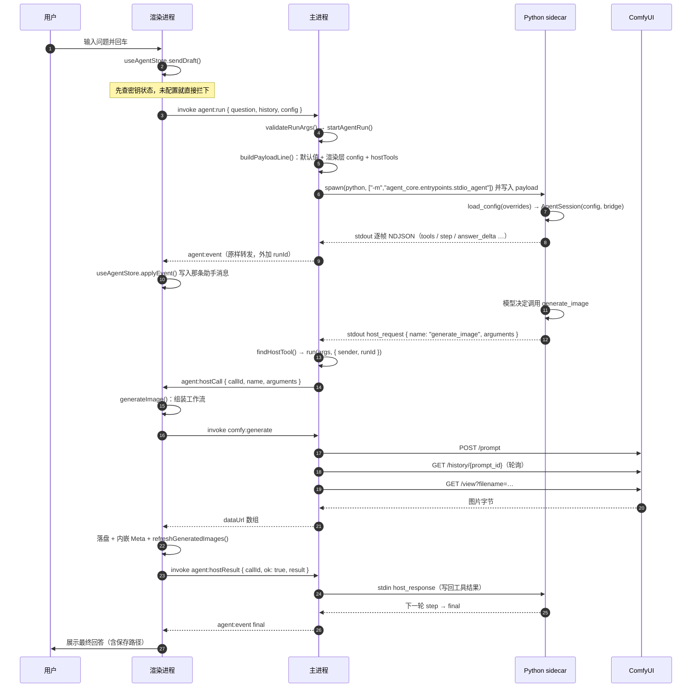
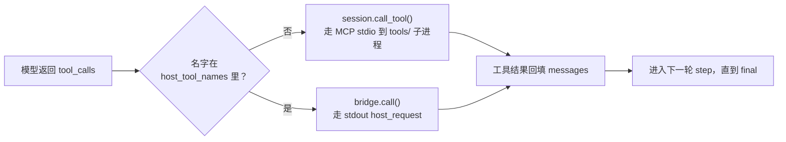
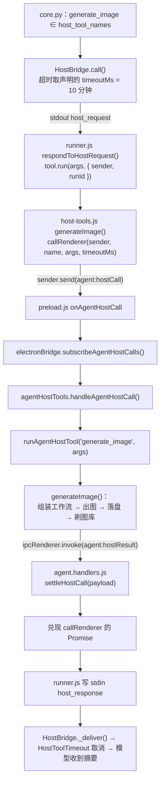
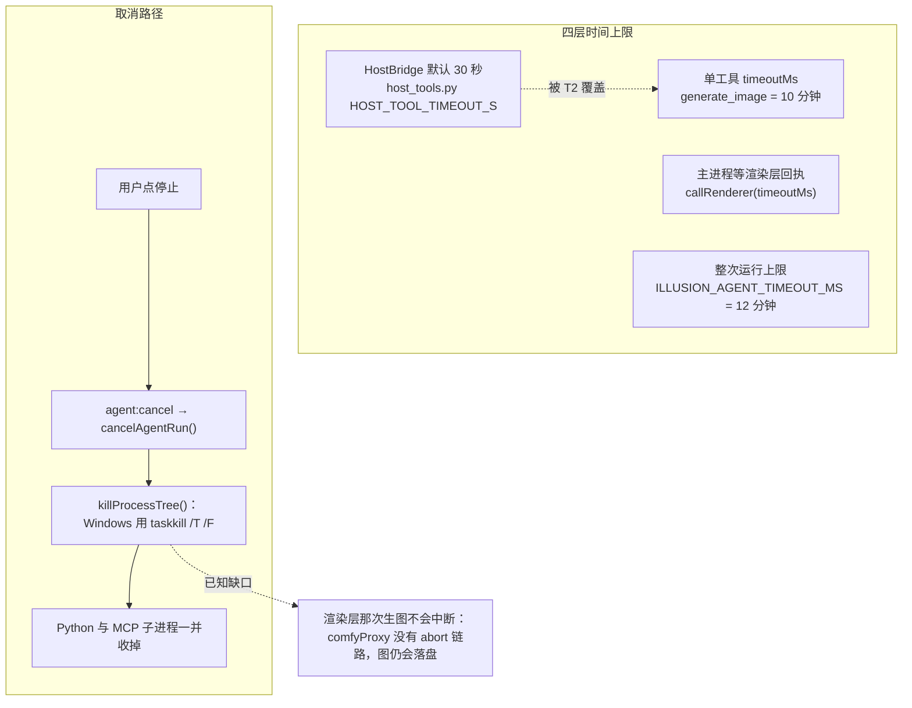
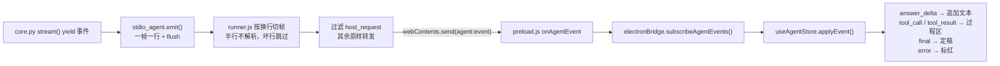

# Agent 调用链与工作流程（流程图）

配套文档：`docs/agent-call-chain.docx`（同一套内容的分类整理与文件方法速查）。
本文只放**流程图**，用 Mermaid 编写；在支持 Mermaid 的编辑器里直接预览，也可粘贴到
GitHub / VS Code / Typora 里渲染。

---

## 0. 参与者与边界

| 参与者 | 运行环境 | 职责 | 代码位置 |
|---|---|---|---|
| 渲染进程 | Chromium（Next.js + React） | UI、Zustand 状态、工作流组装、落盘与图库刷新 | `apps/next/src` |
| preload | Chromium 扩展上下文 | **唯一**的桥：把 invoke / 事件订阅暴露成 `window.electronAPI` | `apps/electron/preload.js` |
| 主进程 | Node.js（手写 CommonJS） | 窗口、文件、IPC、拉起 Python、代理 ComfyUI | `apps/electron` |
| Python sidecar | Python 3.13 | 模型与工具循环，逐行吐 NDJSON 事件 | `apps/agent` |
| MCP 工具进程 | Python 3.13 | 纯本地只读工具（计算、目录、上下文） | `apps/agent/tools` |
| ComfyUI | 外部 HTTP 服务 | 真正出图 | 用户自建，默认 `127.0.0.1:8188` |

三条通道要分清，后面每张图都会用到：

1. **invoke 通道**：渲染 → 主，一问一答，统一返回 `IpcResult`；
2. **事件通道**：主 → 渲染，单向推送（`agent:event`、`video:progress`）；
3. **宿主桥通道**：Python ↔ 主 ↔ 渲染，是本轮新增的一条**双向**通道。

---

## 1. 全链路总览



一句话概括：**渲染进程发起，主进程做桥，Python 做脑袋，宿主桥让 Python 反过来指挥应用。**

---

## 2. 一次提问的完整时序



---

## 3. 两类工具的分派：MCP 工具 vs 宿主工具



| 维度 | MCP 工具 | 宿主工具 |
|---|---|---|
| 声明在哪 | Python：`tools/*/\*_tools.py` 的 `@mcp.tool()` | 主进程：`apps/electron/agent/host-tools.js` 的 `HOST_TOOLS` |
| 谁执行 | Python 子进程 | 主进程，或渲染进程（转发） |
| 走哪条通道 | MCP stdio（Python ↔ Python） | stdout `host_request` → stdin `host_response` |
| 模型怎么知道 | `session.list_tools()` | payload 里的 `hostTools` 声明 |
| 超时 | 无（同步等待） | 默认 30 秒；可按工具用 `timeoutMs` 放宽 |
| 适用 | 纯本地只读能力（计算、列目录） | **应用专属能力**（本地模型索引、生图、图库…） |

> 纪律：同一个名字**不要**两边都声明 —— 会同时出现在模型的工具表里，且宿主工具的
> 分派优先级由名字集合决定，行为会变得难以预期。

---

## 4. 宿主工具形态一：主进程直接执行

以 `list_local_models` 为例（读取设置里的模型目录，扫盘后返回清单）：

```mermaid
flowchart LR
  M["模型 tool_call:<br/>list_local_models"] --> C1["core.py：<br/>name ∈ host_tool_names"]
  C1 --> C2["HostBridge.call(name, args, timeout)"]
  C2 -->|"stdout host_request"| C3["runner.js:<br/>respondToHostRequest()"]
  C3 --> C4["host-tools.js:<br/>findHostTool(name).run(args, ctx)"]
  C4 --> C5["readSettingsPaths()<br/>读用户数据文档 settings.paths"]
  C5 --> C6["modelScanner.scanModelsInDirectory()"]
  C6 --> C7["拼成人读文本"]
  C7 -->|"stdin host_response"| C8["HostBridge._deliver()<br/>兑现 pending future"]
  C8 --> C9["core.py 回填 tool 消息"]
```



要点：主进程**已经有**这份能力（同一个扫描器），所以整件事在本进程内闭环，
不经过渲染进程。

---

## 5. 宿主工具形态二：转渲染层执行（`generate_image`）



回执约定（三条，违约都会表现为「卡住」而不是「报错」）：

1. 成功与失败**都要**回执，`ok:false` 时 `error` 只放一句可读原因；
2. 回给模型的只有**路径与摘要**，绝不回 data URL（几 MB 的 base64 会灌爆上下文）；
3. 订阅端必须常驻（挂在 `AppShell`），挂在 `/agent` 页会在切页后漏掉请求。

---

## 6. 生图流水线内部（渲染层 + 主进程）

```mermaid
flowchart LR
  A["模型入参<br/>prompt / series / model / 尺寸"] --> B["toWorkflowParams()<br/>脏值一律当没填"]
  B --> C["resolveImageWorkflowParams()<br/>拉 /models 列表 + 路径推导，补全模型名"]
  C --> D["buildImagePrompt()<br/>模板 JSON + 参数填槽 + LoRA 链"]
  D --> E["generateWithComfy()（渲染层封装）"]
  E -->|"invoke comfy:generate"| F["ipc-handlers/comfy.handlers.js"]
  F --> G["comfyProxy.generateWithComfy()"]
  G --> G1["queuePrompt() → POST /prompt"]
  G1 --> G2["waitForHistory() → GET /history/{id}"]
  G2 --> G3["fetchFileDataUrl() → GET /view"]
  G3 --> H["返回 dataUrl 数组"]
  H --> I["saveGeneratedImagesToDisk()"]
  I --> I1["embedComfyPromptInPngBlob()<br/>写 prompt 块 + 独立版本标记块"]
  I1 --> I2["invoke files:saveGeneratedImages"]
  I2 --> J["buildGeneratedImageMeta()<br/>记录参数与工作流"]
  J --> K["refreshGeneratedImages()<br/>图库刷新"]
  K --> L["useGenerationNoticeStore.succeed()<br/>右上角通知"]
```



这条链路与创建页点「生成」用的是**同一批函数**，区别只有触发者，所以出图结果、
图库归档、内嵌 Meta 完全一致。

---

## 7. 超时与取消



超时后的表现统一是**模型收到一段「工具执行失败：…」文本**，据此换个说法继续答，
而不是整次 run 挂死。

---

## 8. 事件回流与 UI 状态



| 事件 | 载荷要点 | UI 处理 |
|---|---|---|
| `tools` | 工具清单（含宿主工具） | 显示「识别到 N 个工具」 |
| `step` | 轮次 | 过程区分隔 |
| `reasoning_delta` | 推理文本增量 | 折叠区 |
| `answer_delta` | 回答增量 | 追加到正文 |
| `tool_call` | 名字 + 参数 | 过程区一行 |
| `tool_result` | 结果文本 | 过程区展开 |
| `final` | 全文 + 步数 | 定稿 |
| `error` | 文案 | 标红并结束 |

---

## 9. 一页速查

```
用户提问
  → useAgentStore.sendDraft()
  → electronBridge.runAgent()          [invoke agent:run]
  → agent.handlers.registerAgentHandlers()
  → runner.startAgentRun() → buildPayloadLine()  [stdin]
  → stdio_agent.main() → load_config() → AgentSession.stream()
      ├─ MCP 工具  → tools/ 子进程
      └─ 宿主工具  → host_request → runner.respondToHostRequest()
                     ├─ 主进程直接做（list_local_models）
                     └─ callRenderer() → agent:hostCall
                        → agentHostTools.generateImage()
                           → comfyProxy（出图）
                           → saveGeneratedImagesToDisk（落盘）
                        → agent:hostResult → host_response
  → agent:event 逐帧回流 → useAgentStore.applyEvent()
  → final
```
