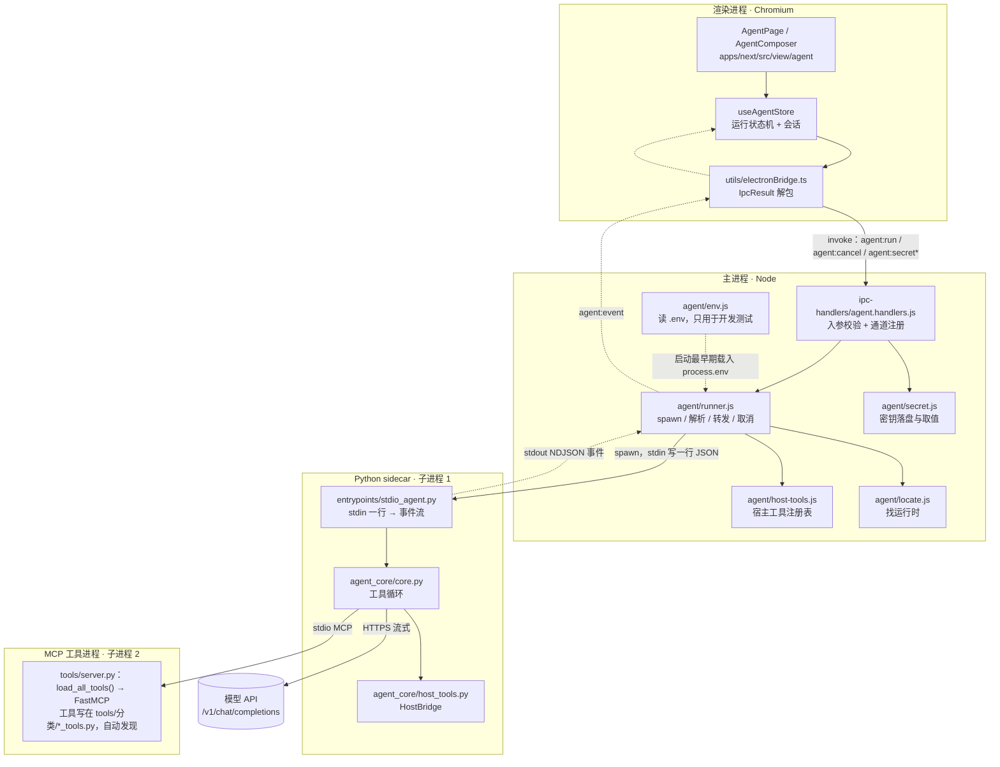
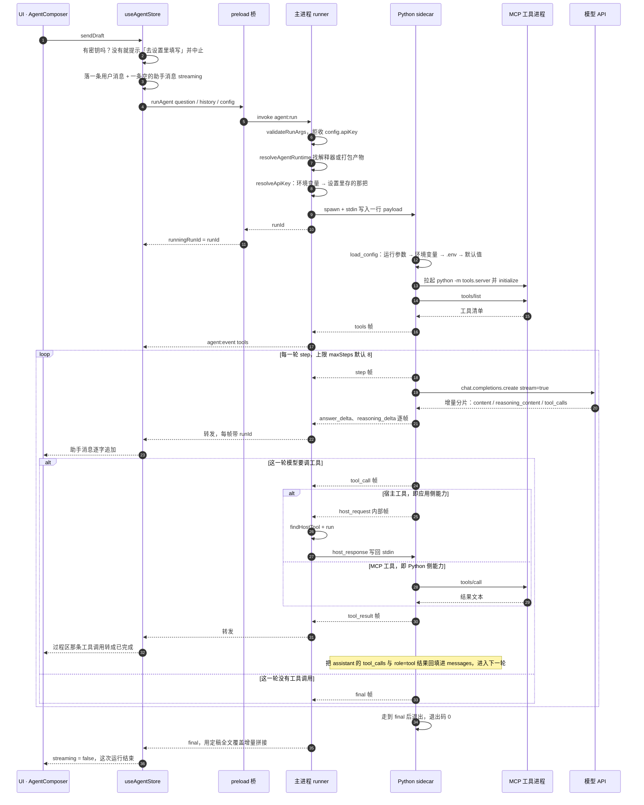
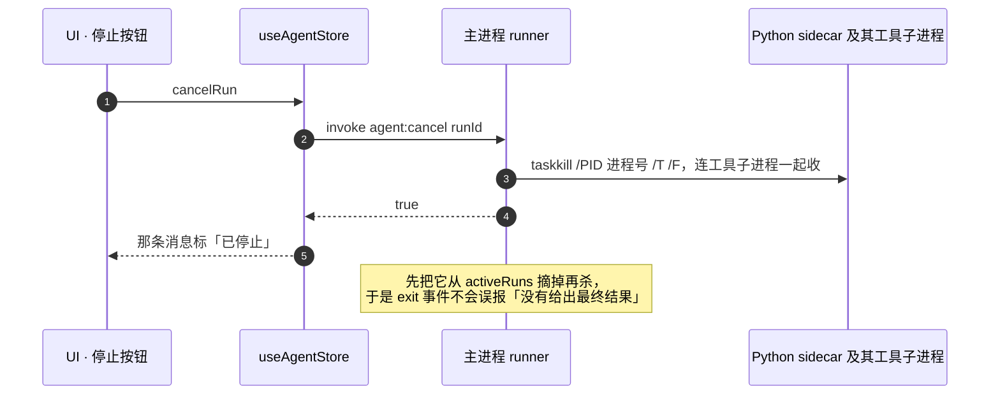
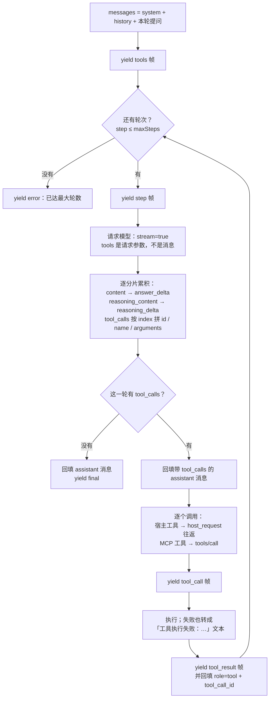
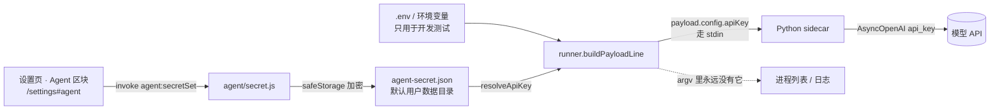

# Agent 消息流：从按下回车到最后一帧

> 这份文档回答一个问题：**一条消息在系统里经过谁、以什么形状传递、在哪一步可能断**。
> 相邻文档：`docs/agent-integration.md`（怎么接进来的、当时为什么这么选）、`docs/testing-gates.md`（门禁全貌）。
> 协议字段的**单一事实来源**是 `packages/shared/src/types/agent.ts`（事件帧）与
> `packages/shared/src/ipc-channels.ts`（通道名）。正文里每个方框都标了文件位置；
> 改代码前请先过一遍第 9 节的「不变量清单」。

## 0. 先记住这一句

**模型只跟 Python 说话，应用能力只跟主进程说话**，两边共用同一根 stdin/stdout 管道，
用每帧 JSON 的 `type` 区分三类东西：给 UI 的事件、给宿主的工具请求、给宿主的工具响应。

这一句同时定下了三件事：

1. 密钥可以只走 stdin —— 永远不进 `argv`、不进进程列表、不进日志（第 7 节）；
2. 应用侧能力（模型扫描 / 图片 Meta / 图库列表）不必在 Python 里重写一份，
   否则同一件事会有两个判据、迟早分叉；
3. **取消必须连整棵进程树收**，因为 Python 自己还会再拉起一个 MCP 工具进程。

### 0.1 文字版（渲染不出图时看这段）

```text
AgentComposer 按发送 / 回车
└─ useAgentStore.sendDraft()
   ├─ 密钥检查：没配 → 提示「去设置里填写」并中止（不拉起进程）
   ├─ 落一条用户消息 + 一条空的助手消息（streaming）
   └─ electronBridge.runAgent  →  preload  →  invoke agent:run
      └─ agent.handlers.validateRunArgs（拒收 config.apiKey）
         └─ runner.startAgentRun()
            ├─ locate.resolveAgentRuntime()   找解释器 / 打包产物
            ├─ secret.resolveApiKey()         环境变量 → 设置里存的那把
            ├─ spawn(python -m agent_core.entrypoints.stdio_agent)
            ├─ child.stdin.write(payload 一行 JSON)      ← 密钥只在这里
            └─ 开始逐行解析 child.stdout
               └─ stdio_agent：readline 一行 → load_config → HostBridge.start
                  └─ core.AgentSession.__aenter__
                     ├─ 拉起 python -m tools.server（子进程 2）并 initialize
                     └─ tools/list → 工具清单
                     └─ stream()：
                        tools 帧
                        └─ 每轮 step：
                           ├─ 请求模型（stream=true）→ answer_delta / reasoning_delta
                           ├─ 有 tool_calls？
                           │  ├─ 宿主工具：stdout host_request
                           │  │            → runner.respondToHostRequest
                           │  │            → stdin host_response
                           │  └─ MCP 工具：session.call_tool → tools/server.py
                           │     （工具本身在 tools/分类/*_tools.py，registry 导入即注册）
                           │  └─ tool_result 帧 + 回填 role=tool
                           └─ 没有 tool_calls → final 帧，退出码 0
                  ← 每帧 stdout 一行，runner 解析后补 runId
               ← sender.send(agent:event)
      ← preload.onAgentEvent → useAgentStore.applyEvent（按 runId 过滤）
   ← 界面更新那条助手消息（正文 / 过程区 / 红字 / 已停止）
```

## 1. 参与者与通道



| 通道 | 方向 | 载体 | 说明 |
|---|---|---|---|
| IPC invoke | 渲染 → 主 | `ipcRenderer.invoke` | 一律返回 `IpcResult`；跨边界不抛异常 |
| IPC 事件推送 | 主 → 渲染 | `webContents.send` | 单向，与 `video:progress` 同款 |
| payload 行 | 主 → sidecar | `child.stdin` 的**一行** JSON | 配置 + 问题 + 历史；**密钥只在这里** |
| 事件帧 | sidecar → 主 → 渲染 | `stdout` 的 NDJSON | 一行一帧、写完立即 flush |
| 宿主工具请求 | sidecar → 主 | **同一个 stdout** 上的内部帧 | 主进程**不转发**给 UI |
| 宿主工具响应 | 主 → sidecar | **同一个 stdin** 写回 | 所以写 payload 时不能 `end()` |
| MCP JSON-RPC | sidecar ↔ 工具进程 | 子进程 stdio | 由 `mcp` 库负责，本项目不手写 |
| 模型调用 | sidecar → 云 | HTTPS 流式 | 只出现在 `core.py` |
| `stderr` | sidecar → 主 | 主进程控制台，前缀 `[AGENT:stderr]` | **日志专用，不参与协议** |

## 2. 一次提问的完整时序



取消走的是另一条路，不占用事件流：



## 3. 每一条消息的形状

### 3.1 渲染层 → 主进程

```jsonc
// invoke agent:run —— AgentRunOptions，见 packages/shared/src/types/agent.ts
{
  "question": "算一下 (26+18)*3-7",
  "history": [{ "role": "user", "content": "……" }],
  "config": {
    "permission": "readonly",
    "allowedRoots": ["D:\\...\\Output"]
    // 注意：这里不允许出现 apiKey —— 校验器会直接返回 INVALID_ARGUMENT
  }
}
```

设置页那条支线走同一个桥，但只交换状态摘要，永远不回原值：

```jsonc
{ "configured": true, "source": "stored", "protection": "safeStorage", "tail": "abcd" }
```

### 3.2 主进程 → sidecar：payload（stdin 的一行）

```jsonc
{
  "question": "算一下 (26+18)*3-7",
  "history": [],
  "config": {
    "baseUrl": "https://api.siliconflow.cn/v1",   // AGENT_DEFAULTS
    "model": "deepseek-ai/DeepSeek-V4-Flash",
    "maxSteps": 8,
    "permission": "readonly",
    "apiKey": "sk-……",                            // 只从这里进来
    "hostTools": [
      { "name": "list_local_models", "description": "……", "parameters": { "type": "object" } }
    ]
  }
}
```

`hostTools` 由 `runner.js` 放在**最后**合并，调用方覆盖不掉 —— 这是刻意的：
「Agent 能调哪些应用侧能力」不该由渲染层说了算。

### 3.3 sidecar → 主进程 → 渲染层：事件帧

一行一帧，`type` 是判别字段。主进程转发时**每帧补一个 `runId`**：

| `type` | 字段 | UI 上会变成什么 |
|---|---|---|
| `tools` | `tools[]`（名称 + 描述首行） | 标题栏「识别到 N 个工具」 |
| `step` | `step` | 不单独渲染（工具与思考已经说明进展） |
| `reasoning_delta` | `step`、`text` | 过程区的「思考」 |
| `answer_delta` | `step`、`text` | 正文逐字追加 |
| `tool_call` | `step`、`id`、`name`、`arguments` | 过程区的工具调用（调用中…） |
| `tool_result` | `step`、`id`、`name`、`output` | 同一条变成已完成 + 输出文本 |
| `final` | `text`、`steps` | 定稿：用全文覆盖增量拼接 |
| `error` | `message` | 消息上那行红字 |

### 3.4 宿主工具桥：同一根管道上的双向帧

```jsonc
// sidecar → 主进程（走 stdout，runner 识别后**不转发**给 UI）
{ "type": "host_request", "id": "3f9c…", "name": "list_local_models", "arguments": { "kind": "lora" } }

// 主进程 → sidecar（写回 stdin，id 必须原样带回）
{ "type": "host_response", "id": "3f9c…", "ok": true, "result": "本地模型清单……" }
```

## 4. Python 侧的工具循环

`agent_core/core.py` 的 `stream()` 是整条链路的心脏。它把「一次提问」拆成
「最多 `maxSteps` 轮」的循环，每轮要么收口成 `final`，要么带着工具结果再转一圈：



四个容易写错、写错就症状诡异的地方（本仓库都踩过或专门加固过）：

1. **`tools` 是请求参数，不是消息** —— 塞进 messages 会让模型完全不调工具；
2. **流式 `tool_calls` 必须按 `index` 累积分片** —— 只取最后一片会丢参数；
3. **带 `tool_calls` 的 assistant 消息要原样回填** —— 否则下一次请求 400；
4. **每条 `role="tool"` 必须带对 `tool_call_id`** —— 一条调用配一条结果，对不上就 400。

## 5. 谁负责哪一段生命周期

| 层 | 手里有什么 | 超时 / 收尾 |
|---|---|---|
| 渲染层 `useAgentStore` | `runId`、助手消息 id | 只认当前 `runId`，**迟到的帧一律丢弃**（取消 / 重开后旧帧不污染新消息） |
| 主进程 `runner.js` | 子进程句柄、`activeRuns: Map` | 整体超时默认 5 分钟（`ILLUSION_AGENT_TIMEOUT_MS`）：到点发 `error` 帧 + 收进程树 |
| Python `HostBridge` | `_pending: Map<id, Future>` | 等宿主响应默认 30 秒；超时 / 失败都变成「工具执行失败」文本交给模型兜底 |
| Python `stdio_agent` | 一次运行 | 异常一律转成 `error` 帧；**退出码 0 = 走到 final，1 = 出错过早结束** |

两处「先摘再杀」的细节，都是为了让收尾不产生假消息：

- `finish()` 里才 `stdin.end()`：payload 写完就 end 会**掐断宿主工具桥**，
  症状是模型一调工具就等到 30 秒超时；
- `cancelAgentRun()` 先 `activeRuns.delete(runId)` 再杀进程，
  于是 `exit` 回调里 `cancelled = !activeRuns.has(runId) && !sawFinal` 成立，
  **不会**误报「Agent 进程退出且没有给出最终结果」。

## 6. 失败时会发生什么

每一层都只负责把自己那一段变成可读信息，**不向上抛异常、不泄露堆栈**：

| 断在哪 | 表现 | 用户看到 |
|---|---|---|
| 渲染层：没配密钥 | `sendDraft` 在拉起进程之前返回 false，置 `missingNotice` | 「还没配置 API Key → 去设置里填写」 |
| 主进程：找不到运行时 | `startAgentRun` 返回 `{ ok: false, error }`，handler 抛错 → `IpcResult` 失败 | 那条助手消息上标红 |
| 主进程：进程起不来 | `spawn` 的 `error` 事件 → `error` 帧（带 `runtime.source`） | 同上 |
| Python：import / 配置 / 协议异常 | 捕获后 emit `{"type":"error"}`，退出码 1 | 红字 + 原因 |
| 模型侧：401 / 400 / 网络 | 异常冒到 `run()` 的 except → `error` 帧 | 「…ClientError…」之类原文 |
| 单个工具失败 | **不中断**：转成「工具执行失败：…」文本作为 `tool_result` 回填，让模型自己兜底 | 过程区里那条工具显示失败文本，对话继续 |
| 跑满 `maxSteps` | `error` 帧：「已达最大轮数 N，模型仍在请求工具」 | 红字 |
| 进程退出但没走到 final | `exit` 回调补一条 `error` 帧 | 「Agent 进程退出（exit=N）且没有给出最终结果」 |

## 7. 密钥的路径（只走 stdin）



顺带一条：`agent:run` 的校验器**显式拒绝** `config.apiKey`。渲染层哪天开始传密钥，
会当场失败而不是留个「看起来能用」的口子。

## 8. dev 与打包版的差异

只有三处不一样，其余完全同一条链路：

| | 开发态 | 打包态 |
|---|---|---|
| 运行时 | `apps/agent/.venv/Scripts/python.exe` | `resources/agent/.venv/Scripts/python.exe`（`locate.js` 的 `AGENT_DIR` 算出来正好是 `<安装目录>/resources/agent`） |
| MCP 工具 server 的 cwd | `apps/agent` | `resources/agent` |
| `.env` 位置 | 工作区根 | **exe 同目录**（`getAppRootDir()` = 安装目录） |

`locate.js` 的查找顺序（先专后通用）：手动指定 → `ILLUSION_AGENT_PYTHON` →
打包产物 `iris-agent.exe` → 开发态 venv → 系统 PATH 的 `python`。
**降级是静默的**，所以打包版必须靠 `pnpm check:packaged-agent` 断言
「解析出来的运行时落在 `resources/agent` 之内」。

## 9. 改这块代码前先看的不变量

| 不变量 | 违反后的症状 | 谁在钉它 |
|---|---|---|
| 写 payload 之后**不要** `stdin.end()` | 模型一调工具就等到 30 秒超时 | 注释 + `smoke-agent` 系列 |
| 密钥只走 stdin，永不进 `argv` | 密钥进进程列表 / 日志 | `validateRunArgs` + `verify-electron-modules` |
| IPC 通道名以 shared 的 `ipc-channels.ts` 为准 | 渲染层 invoke 一个没注册的通道 → **静默挂起** | `verify-electron-modules` 的通道一致性 + 注册检查 |
| 事件帧字段两端一致（Python ↔ TS） | 字段名漂移 → UI 少一块内容，不报错 | `types/agent.ts` 的注释 + `verify-agent-events.js` |
| `runId` 过滤迟到帧 | 取消后旧帧污染新消息 | `useAgentStore.applyEvent` |
| 工具失败也要回填 `role=tool` | 少一条结果 → 下一轮请求 400 | `core.py` 的 try/except |
| `stdout` 只走协议，日志走 `stderr` | 混进 stdout 的日志会被当成坏行丢掉（不致命，但丢帧） | `runner.js` 的坏行处理 |
| 取消要连进程树收 | 留下孤儿 MCP 进程，下次运行卡在单实例锁 | `killProcessTree` + `cancelAllAgentRuns`（应用退出时） |

## 10. 怎么验证这条链路的每一段

| 想验的东西 | 命令 | 要不要花钱 |
|---|---|---|
| MCP 工具挂上了没有（两秒钟，不用 Electron） | `apps\agent\.venv\Scripts\python.exe apps\agent\scripts\check_tools.py` | 否 |
| 主进程模块 / 通道 / 密钥存储契约 | `pnpm verify` | 否 |
| 事件序列与字段（真拉起 Python） | `npx electron scripts/verify-agent-events.js` | 否（假模型） |
| preload → IPC → 落盘的整趟往返 | `npx electron scripts/smoke-ipc-result.js` | 否 |
| 「没配密钥」的拦截与引导 | `npx electron scripts/smoke-agent-key.js` | 否 |
| 打包版那棵树能不能跑 | `pnpm run pack` 之后 `pnpm check:packaged-agent` | 否（假模型） |
| 真实模型端到端 | 应用里点一次提问（设置页填好 key） | **是** |

假模型（`fakeLlm`）覆盖的是**除模型本身以外**的全部链路：进程、协议、工具循环、
宿主桥、事件转发。所以「跑一次真模型」验证的其实只有两件事：
`AsyncOpenAI` 的鉴权与流式分片、以及模型愿不愿意调工具。
