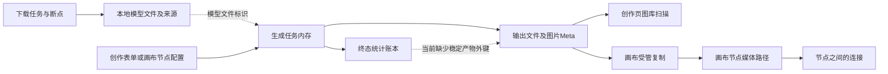
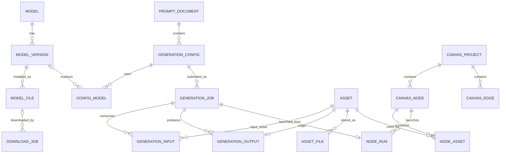

# 高频业务数据关系与原子表方案

日期：2026-11-11。依据当前代码只读核对。本文件是逻辑数据设计，尚未迁移代码或用户数据，不引入 SQLite、ORM 或另一套存储。原子表可先表示为现有版本化 JSON 内的独立集合；逻辑独立不等于每张表一个文件。

## 当前实际状态

| 用户叫法 | 实际数据 | 当前落点 | 主要关联方式 |
| --- | --- | --- | --- |
| 模型下载历史 | 下载任务、公开请求、断点、归属文件 | Electron userData/model-download-queue.json；完成文件及.civitai.json | 任务ID、路径、来源modelId/versionId、可选SHA256 |
| 正在生成/最近任务卡 | 提示词、状态、尺寸、savedPaths、预览、模型快照 | useGenerationTaskStore内存；终态卡有数量限制 | 本地任务ID、真实保存路径 |
| 图片生成统计历史 | 终态、三个时间、实际图片数量、主模型/LoRA快照 | illusion-realm.json → generationHistory.records | 本地任务ID；不保存提示词、输出路径或图片字节 |
| 创作页历史/图库 | 输出文件夹与文件清单；外部导入也可出现 | 磁盘扫描，historyFolders只存目录选择、输出策略及手动顺序 | 文件路径、目录路径；不是另一份完整生成任务账本 |
| 图片生成参数 | 正负提示词、seed、采样、尺寸、LoRA、实际API Prompt | 支持的生成图片内illusionRealmMeta及prompt元数据；兼容旧旁车 | 远端promptId、时间、imageIndex、路径；外部文件可能完全没有Meta |
| 无限画布 | workspace、节点、连线、参数、媒体引用、场景/合成快照 | illusion-realm.json → infiniteCanvas；便携工程归档 | workspace.id、node.id、edge.id、media.path |
| 当前创作草稿 | 比例、提示词分类、模板等持久化部分及运行期表单值 | createForm分段与对应表单store | 分类/模板ID；不能当成过去每次生成的完整历史 |
| 关键词 | 快捷短语、分类quickWords、模型trainedWords、提示词正文 | 用户文档、模型来源sidecar、图片Meta/节点正文 | 目前并无统一关键词主表 |

下载队列不是完整的不可变审计历史：removed在恢复时过滤，当前任务契约也没有完整创建/完成时间。生成统计明确是本机记录，不按登录账户自动区分云端历史，音频不进入当前图片统计。远端图片与其他执行器需逐条核对接入，不能假设全部写入同一账本。

虚线表示当前主要依靠名称/路径或尚不完整的关联，不是已经存在统一外键。生成账本只有数量，不能从账本可靠反查全部文件。画布收到新结果会回填media，多结果追加节点；受管复制后的路径可能与原图库文件不同，需要区分同一产物与不同磁盘副本。

## 目标关系

一句话：任务记录“做过什么”，配置记录“当时怎样做”，资产记录“得到了什么”，文件记录“现在放哪”，画布节点记录“怎样使用它”。

GENERATION_OUTPUT只表示生成来源，外部导入资产可以没有这条记录。MODEL_VERSION与CONFIG_MODEL关联可暂时为空：旧图片只有模型文件标识时，不能按同名擅自认领成本地某个版本。CANVAS_EDGE两端分别引用同工程节点；图中为可读性省去双端连线。

## 原子表字段目录

PK是本表稳定ID；FK是别表稳定ID。以下都是拟议字段，不能当成当前代码已有字段。除明确列出的版本化快照外，不在一列放多个ID或逗号拼接列表。

### 资产、文件和模型

| 表 | 原子字段（核心） | 唯一性/职责 |
| --- | --- | --- |
| asset | asset_id PK、media_kind、origin_kind、created_at、deleted_at可空 | 一个逻辑产物；不是文件路径，也不是画布节点 |
| asset_file | file_id PK、asset_id FK、folder_id FK、file_name、byte_size、modified_at、content_hash可空、availability、ownership | 一个真实副本；同资产可有图库与画布两个副本；缺文件保留记录 |
| folder | folder_id PK、parent_id FK可空、storage_root_id、name | 一个目录；完整路径通过根与父链解析，不复制到所有关系中 |
| model | model_id PK、name、model_type | 模型目录实体，不把主模型/LoRA“本次使用角色”混进其身份 |
| model_version | version_id PK、model_id FK、provider、external_version_id可空、version_name、base_family | 来源版本；外部ID须带provider命名空间，纯本地模型不伪造外部ID |
| model_file | model_file_id PK、version_id FK、folder_id FK、file_name、loader_kind、byte_size、sha256可空、availability | 一个本地权重文件；不与普通媒体资产混表 |

图片/视频/音频的真实探测值采用按类型的一对一附表：image_info(asset_id PK/FK,width,height)、video_info(asset_id PK/FK,width,height,duration_ms,fps_num,fps_den)、audio_info(asset_id PK/FK,duration_ms,sample_rate,channels)。未知值留空，不把生成意图当成已探测事实。file缩略图与原件关联另按派生资源记录，不能用预览图替换原件身份。

### 下载与生成

| 表 | 原子字段（核心） | 唯一性/职责 |
| --- | --- | --- |
| download_job | download_id PK、model_file_id FK可空、target_folder_id FK、requested_file_name、expected_sha256可空、public_source_url、status、created_at、finished_at可空、error_code可空 | 下载尝试；失败也保留，不能强制已有成功模型文件 |
| download_checkpoint | download_id PK/FK、temporary_locator、etag可空、last_modified可空、received_bytes、total_bytes、revision | 续传检查点；允许清理，不删除任务历史 |
| generation_job | job_id PK、config_id FK、media_kind、status、created_at、started_at可空、finished_at可空、error_code可空 | 本地任务；远端promptId不是此主键 |
| generation_attempt | attempt_id PK、job_id FK、sequence、provider、external_request_id可空、status、started_at、finished_at可空 | 一任务多个请求/批次子执行；不能假设本地任务与远端请求一对一 |
| generation_config | config_id PK、schema_version、workflow_id、prompt_id FK、requested_count、mode | 提交时冻结的公共配置；修改草稿不能改旧历史 |
| image_config | config_id PK/FK、width、height、seed_mode、seed_value可空、steps、cfg、sampler、scheduler、quality可空 | 图片配置；供应商不适用字段保持可空，由对应能力校验 |
| video_config | config_id PK/FK、width、height、fps_num、fps_den、duration_ms、quality可空 | 视频配置意图，与video_info真实媒体值分开 |
| config_model | binding_id PK、config_id FK、slot_key、version_id FK可空、model_file_id FK可空、role、loader_kind、submitted_model_name、strength可空、position | 一行一个模型槽；提交名是历史证据，非可变显示名副本 |
| generation_input | input_id PK、job_id FK、asset_id FK、input_role、position、reference_alias | 一行一个输入；顺序冻结，不能用文件名或当前连线排序重算旧任务 |
| generation_output | output_id PK、job_id FK、attempt_id FK可空、asset_id FK、output_index、saved_at | 一行一个实际保存产物；失败/取消仍可有部分产物 |

执行所需的实际API Prompt另存job_payload(job_id PK/FK,schema_version,payload)，payload是有版本的外部协议文档，并非把常查字段塞回万能JSON。图片内Meta继续保留便携副本；数据库/JSON索引与图片Meta的冲突需明确来源与版本，不能互相静默覆盖。

### 画布与草稿

| 表 | 原子字段（核心） | 唯一性/职责 |
| --- | --- | --- |
| canvas_project | project_id PK、name、schema_version、workspace_folder_id FK可空、created_at、updated_at | 工程身份独立于标题；当前workspace.id仅在存在时可作为迁移候选 |
| canvas_node | node_id PK、project_id FK、kind、title、x、y、card_style、card_width、card_height、created_at | 节点实例；同一资产可被多个节点独立使用 |
| canvas_edge | edge_id PK、project_id FK、source_node_id FK、target_node_id FK、source_port、target_port | 仅描述当前图关系；两端同工程，不复制文件或提示词 |
| node_asset | node_id FK、asset_id FK、role、position | PK(node_id,role,position)；区分显示产物、手动参考图等；连线输入不重复物化，提交时再冻结generation_input |
| node_run | job_id PK/FK、node_id FK可空、project_id FK可空、node_id_snapshot、project_id_snapshot | 记录任务来源；删节点可清活动外键，保留历史来源ID而非删任务 |
| generation_draft | draft_id PK、media_kind、workflow_id、prompt_id FK、updated_at | 创建页/节点当前可变输入；不与已提交generation_config共用可变对象 |
| draft_owner | draft_id PK/FK、create_scope可空、node_id FK可空 | 两类归属二选一；节点草稿不串进创作页全局草稿 |

草稿参数按图片/视频分型保存，模型与输入参考采用一行一项的附表，沿用config对应字段形状，但不与冻结快照共享可变行。导演台scene与原视频合成工程属于各自版本化文档，以node_id为归属；本阶段不把外部完整编辑器协议拆散重写。

### 关键词、提示词和标签

| 表 | 原子字段（核心） | 唯一性/职责 |
| --- | --- | --- |
| prompt_document | prompt_id PK、positive_text、negative_text、created_at | 确切正文；冻结历史后不可被模板/词库修改；保留空格、大小写、顺序、权重 |
| prompt_section | section_id PK、prompt_id FK、category_key、label_snapshot、content、position | 分类组装内容；全文由原规则生成，不能擅自按逗号拆散提示词语法 |
| keyword | keyword_id PK、text、language、normalized_search_text | 可复用词条；搜索归一化不覆盖原字面值 |
| quick_phrase | phrase_id PK、keyword_id FK、prompt_text、cover_asset_id FK可空 | #快捷入口与一段提示词的映射，不等同于普通标签 |
| model_keyword | version_id FK、keyword_id FK、position | PK(version_id,keyword_id)；模型触发词属于版本，不代表用户曾实际使用 |
| prompt_keyword_usage | usage_id PK、prompt_id FK、keyword_id FK、section_id FK可空、position、applied_weight可空、inserted_text_snapshot | 只记录明确插入来源，旧正文不能靠分词猜造使用事实 |
| tag | tag_id PK、name | 用户整理标签，与生成指令无关 |
| asset_tag / model_tag | asset_id或model_id FK、tag_id FK | 两张有类型的关系表；不使用无外键约束的万能target_type/target_id |

模板库和默认分类库仍是独立可编辑实体，应用模板时生成新的草稿/提交快照。word的多次出现可按usage_id区分，不能用(keyword_id,prompt_id)唯一约束误去重正文。@资源是输入资产引用：显示文件前缀名只是标签，真正应保存input_id/asset_id，不能当成普通关键词。

## 同名属性必须区分

| 表面相同 | 实际差异 | 规则 |
| --- | --- | --- |
| id | 本地任务ID、远端promptId、节点ID、来源modelId | 各自命名空间；显式FK连接，不通用一个id |
| name/title | 文件名、节点标题、模型名、工程名 | 名称可改，ID不改；文件前缀同步属于明确的改名事务 |
| width/height | 节点UI尺寸、请求像素、真实媒体像素 | 三种字段分表；改UI不改文件 |
| status | 下载状态、生成状态、文件可用性 | 各自枚举/状态机；不建立全局万能status |
| createdAt/modifiedAt | 入队、开始、完成、文件修改、生成Meta时间 | 迁移统一单位但保留语义；文件mtime不能充当生成时间 |
| count | 请求张数、实际输出数、图库当前文件数 | 分别存请求、由输出行汇总、由目录扫描统计 |
| model/LoRA | 模型版本身份、磁盘权重、任务中的角色与权重 | 主表记身份，绑定表记本次用法；同名不自动合并 |
| prompt/keyword/tag | 精确生成正文、可复用词条、整理标签 | 不按同一字符串强制合表；用户标签不自动发给模型 |
| path/url | 可变本地位置、临时Blob、公开来源、服务地址 | 路径不是主键；Blob/凭据不进工程关系表 |

## 独立、删除和依赖规则

1. 创作历史是查询视图：generation_job + generation_output + asset/file。图库则是asset/file + folder；导入文件无需伪造生成任务。
2. 生成统计是终态任务与输出事实的汇总；兼容当前取消整体排除、失败可有部分产出的统计口径。旧账本images是历史汇总快照，迁移时不能因为文件已删就改成零。
3. 当前账本无文件列表，旧生成图片无可靠本地job_id时保持未关联；不能只凭文件名、时间相近或远端promptId猜一个唯一任务。
4. 删画布节点只删节点及其边/关系，不删任务、模型、资产或物理文件。文件清理由独立的引用与归属检查决定；保留工程/历史引用不能被误删。
5. 删下载队列卡不删已安装权重；卸载权重只改本地文件状态，保留来源与历史使用快照。后续若提供“彻底删除历史”，必须是独立明确操作。
6. 资产文件改名/移动只改file位置及对应显示绑定，不改asset_id；当前路径引用实现需渐进迁移，不能假设已生效。
7. 一个画布复制节点沿用asset_id，但节点参数独立；生成新结果分配新asset_id。相同内容哈希只提示重复，不强制合并有不同生成来源的逻辑资产。
8. 高频下载速度、百分比、Blob URL、播放位置、焦点、选中、高亮和未提交输入草稿优先放运行期状态；下载检查点按必要边界写盘。缩略图缓存可重建，不计入权威业务关系。
9. 输入文生图/图生图/参考生成数量规则在提交事务统一校验；外键正确不等于业务输入数量合法。
10. 一次创建产物、登记输出、回填节点应有共同提交/补偿边界。操作系统文件操作不天然属于JSON事务，失败需要明确可恢复状态，不声称“撤销节点=撤销文件移动”。
11. 本机scope与登录account分开，旧历史保持本机归属；不自动把所有旧文件分给当前登录用户。未来若启用云端同步，需要独立所有权、权限和冲突设计。

落地顺序：定义ID与迁移对照 → 资产/文件 → 模型/版本与下载 → 冻结生成配置与产物关系 → 画布ID引用 → 关键词显式使用关系 → 用查询视图替换重复历史。先保留旧字段兼容读，再验证双读一致，最后才删除旧字段。迁移需要独立任务授权、回滚与样本反证，本次尚未执行。

## 代码依据

- packages/shared/src/types/model-download.ts；schemas/model-download.schema.ts
- apps/electron/src/main/modules/models/downloads/model-download-persistence.js
- packages/shared/src/schemas/generation-history.schema.ts
- apps/next/src/stores/useGenerationTaskStore.ts；use-generation-history-store.ts
- packages/shared/src/types/generatedImageMeta.ts；historyFolder.ts
- apps/next/src/view/create/CreateHistorySidebar.tsx；stores/useHistoryFolderStore.ts
- packages/shared/src/schemas/infinite-canvas.schema.ts
- apps/next/src/view/infinite-canvas/canvas-image-job.ts；canvas-local-generation.ts；use-canvas-image-generation.ts
- packages/shared/src/types/userData.ts；quickPhrase.ts；promptTabs.ts；localModel.ts

验证范围：代码与契约静态核对，未扫描用户私密历史，未执行数据迁移，未以测试宣称新表已落地。纯文档变更，业务/测试增量注释率不适用。
