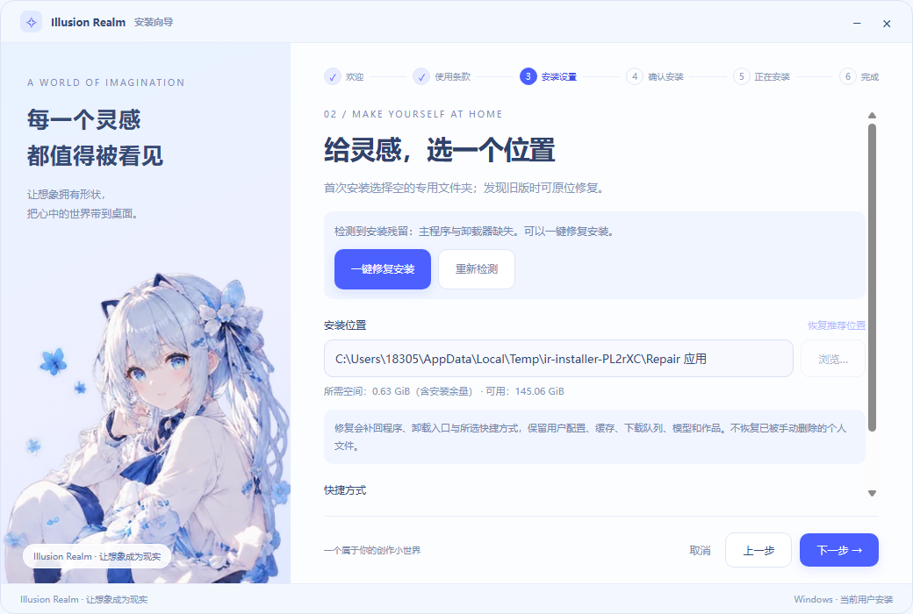
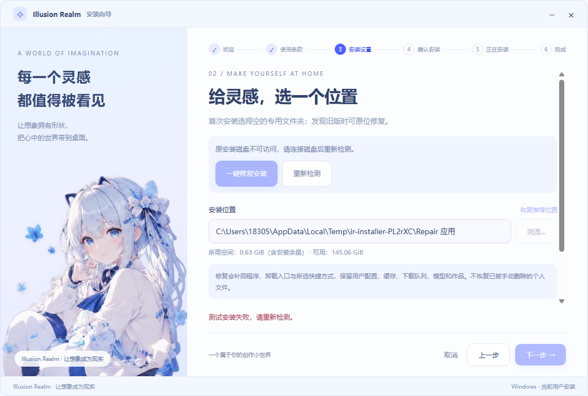

# 安装器自动检测与一键修复

2026-10-28。解决手动删除安装目录文件后，重新运行 Setup 因系统残留登记而拒绝安装的问题。

## 用户流程

Setup 自动读取本产品的当前用户/全用户、32/64 位安装与卸载记录，并对照原位置的主程序、app.asar、卸载器。

| 状态 | 界面行为 |
| --- | --- |
| 未发现登记 | 普通安装，选择空的专用文件夹 |
| 原位置缺件或目录已删 | 显示缺件原因，可一键修复 |
| 基本程序存在 | 允许主动原位修复其他发行文件 |
| 盘离线、权限/路径异常、地址冲突、全用户安装 | 明确原因并阻断；环境恢复后重新检测 |

已有安装锁定原位置。修复继续沿用许可、快捷方式和最终确认页；真正执行前再次诊断，覆盖发行文件、补回卸载入口和所选快捷方式。检测本身只读。

**修复不会先运行旧卸载器或清空安装目录，保留额外用户配置、队列、模型与作品。不恢复已被手动删除的个人文件，也不清理 AppData、不迁移用户数据。** 客户端仍运行时提示正常关闭，不强制终止。

## 实现边界

- `installer/diagnosis.cjs`：固定 UUID 的系统 Registry API 只读查询，Unicode JSON，四视图兼容；Electron 通过 original-fs 检查真实 asar 文件。
- `installer/service.cjs`、`main.cjs`：复用原目录/权限/空间/引擎摘要检查，统一首次与修复预检，完成后复核实际登记和必要文件。
- `renderer.cjs`、`installer.html/css`：沿用六步向导添加重新检测与修复状态，没有第二套安装窗口。
- `scripts/prepare-repair-engine.cjs`：从当前 builder 模板生成受控 NSIS 脚本，修复标志跳过旧卸载，保留原生释放/注册逻辑；锚点变化立即失败，不静默回退。
- `installer/engine.nsh`：修复参数、非强杀的占用检查、原快捷方式选择。
- `scripts/build-installer.cjs`：仍构建内层引擎与外层单文件 Setup，不上传或发布。

自定义脚本使用 NSIS WriteUninstaller；当前无代码签名配置，不能宣称已签名。未来启用签名必须补齐独立卸载器签名链。

## 实际验证与限制

- 安装向导真实 Electron 冒烟 **33/33 通过**：许可、预检、Unicode 地址、失败恢复、原位置锁定、修复参数、blocked、窄窗口。
- `node scripts/verify-installer-repair.cjs` **通过**：用随机 GUID 的真实小型 NSIS 包依次验证部分删除、整目录删除、完整目录修复和实际卸载器执行。配置、下载队列、模型、作品四类标记逐字保留。测试仅清理自身随机登记和缓存。
- 完整构建输出为 `apps/electron/release/setup/Illusion-Realm-Setup-0.1.0.exe`。内部 staging、engine 和 win-unpacked 不作为用户附件。

未覆盖真实用户已有安装的覆盖执行、管理员全用户修复、真实杀毒拦截、断盘过程与签名验证。小型原生包不包含可运行的真实客户端，不能冒充完整目标机安装启动验收。

本轮合并注释范围和基线见 [审计](implementation-2026-10-28-comment-audit.json)，业务 70.13%、测试 70.32%。示例注释解释“登记收据与磁盘实物”的区别，以及为什么修复不能先拆掉旧安装目录。

