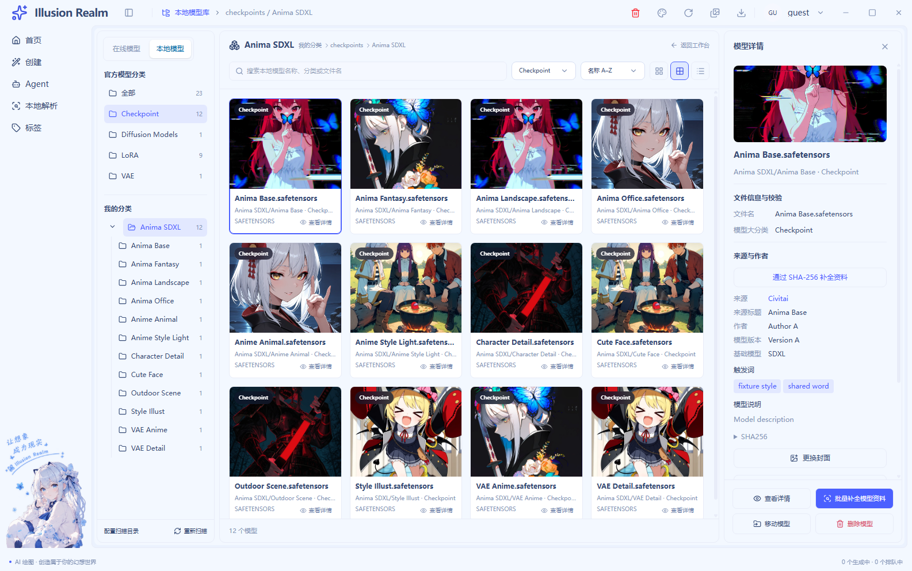
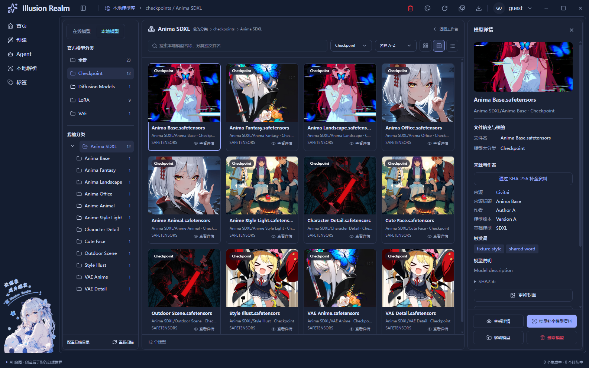

# 本地模型库：三面板目录浏览

2026-10-28。后续工具栏调整见[补充交付](local-model-toolbar-2026-10-28.md)。已按确认图重做布局；本地库仍在 `/tools/models/civitai` 的“本地模型”入口。视频编辑器保持 UI-02 已完成、UI-03–UI-08 待办。

## 界面与浏览规则

- 左侧：官方模型分类、数量与真实文件夹树。任意层目录可分别展开或进入。
- 中间：名称、层级、返回工作台；第一行搜索、排序与批量补全，第二行移动、删除与视图密度；内容区**只展示模型卡片**。
- 右侧：模型封面、文件信息、来源、作者和说明；管理按钮已移至中间页头，资料过长只滚动详情内容。
- 点击文件夹，显示该目录及**全部后代**的模型。搜索是“官方类型 ∩ 当前目录及后代 ∩ 关键词”，不跨到其他目录。
- 首次进入展示全库模型；一份权重一张卡，后缀与完整文件身份保留。同目录的多份权重不再合成一张卡。
- 页头品牌旁移除宣传语，换为当前本地库及相对目录门牌。中间名称右侧提供返回工作台。沿用唯一 AppShell、导航、账户与窗口控件。
- 宽屏为三张独立面板；窄屏保留目录和模型区，管理按钮位于中间页头，详情沿用资源弹窗，按真实 main 边界对齐。

文件大小和修改时间已由扫描 stat 补齐。当前支持名称、日期、大小、标记四字段与递增/递减；标记只读本地已保存的触发词，缺失项始终置后。没有伪造网上发布时间。

## 修改文件与复用

| 文件 | 职责与复用边界 |
| --- | --- |
| `apps/next/src/view/toolBox/Tool/civitai/local-model-library.tsx` | 三面板装配、递归范围筛选、文件选择、现有详情与目录操作接线 |
| 同目录 `local-model-library.module.css` | 仅限本地库的比例、四列卡片、面板内滚动、主题与窄屏布局 |
| 同目录 `model-folder-navigation.tsx` | 官方根、计数、目录树；每个分支自管开合 |
| 同目录 `model-library-labels.ts` | 树、工具栏、卡片共用类型展示名称；不改变实际路径和目录身份 |
| 同目录 `local-model-recovery-batch.tsx` | 紧凑按钮通过参数使用原批量队列；结果、停止和重试复用原面板 |
| 同目录 `local-model-metadata-details.tsx` | 来源标题通过参数注入，版本读取与单项恢复继续使用原 hook |
| 同目录 `civitai-page.tsx` | 在线/本地切换保留；在线页自带内边距，不受本地工作区重排影响 |
| `apps/next/src/hooks/use-app-main-inset.ts` | 从原 Agent 弹窗提取相同几何测量机制，共用 ResizeObserver 和快照读取 |
| `apps/next/src/hooks/use-agent-model-dialog.ts` | 沿用原焦点逻辑，改为调用相同测量器；业务状态不合并 |
| `apps/next/src/stores/use-model-library-location-store.ts` | 只发布相对目录门牌，按实例身份清理，不持久化 |
| `apps/next/src/components/window-titlebar.tsx` | 原标题栏消费目录门牌，保留账户、任务、主题与系统按钮 |
| `apps/next/src/app/tools/models/civitai/page.tsx`、`apps/next/src/app/workspace-shell.css` | 明确 workspace 宿主；只取消该路由的重复留白，纯全局规则放在全局样式中 |
| `apps/next/src/i18n/locales/{zh-CN,en}/toolBox.ts` | 同步目录、排序、视图、返回及文件信息文案 |
| `scripts/smoke-local-model-metadata.js` | 隔离目录、真实扫描、真实 preload/IPC 和运行截图回归 |

继续复用 `ToolPageFrame` 的 workspace 参数、`ContextMenuShell`、`ResourceCoverImage`、`ResourceDialogShell`、原资料恢复 store、分类编辑器、批量移动/删除对话框。设置模型分组与 Agent 生成参数保持原契约；扫描版本新增可选 bytes/modifiedAt 供本地排序。

## 操作与安全边界

原移动/删除 API 操作整个文件夹。对同目录多权重或子目录仍有其他权重的单文件卡片，继续禁用该操作并解释原因，清空选择与退出仍可用；没有声称实现任意单文件移动/删除。

补全入口只打开面板，首次也不会创建队列；新批次必须点击面板内“开始”。已有结果时入口只打开结果窗口，避免再次读取 GB 级权重。关闭结果窗口不停止任务，停止只阻止后续提交，已提交文件安全结束。完成基准仍要求来源可读且封面可解码，只有 JSON 不算补全。

空文件夹不在现有模型扫描结果内，暂不展示。文件夹、权重与来源都来自原扫描和读取链路，界面不直接访问 Node 或磁盘。

## 上一轮验证（工具栏调整前）

- Next 静态构建通过；指纹 `e8b20d6b0ffb06b119459e65a0719601194401a5d03879e4b698f58fe41947e9`。
- `pnpm typecheck` 通过。
- `pnpm lint`：0 error，33 条既有 warning。
- `smoke-local-model-metadata.js`：**39/39**。三面板位置、右侧两行按钮、全库与父目录递归、深层目录、文件身份、共享目录保护、门牌、主题、密度、窄屏 main 对齐、来源隔离、哈希补全、跨页、停止/重试、LoRA 提示词消费者均通过。
- `smoke-video-editor-ui.js`：**49/49**。标题栏与共享宿主修改后，UI-02、legacy、GIF 布局继续通过。
- `smoke-agent-providers.js`：**17/17**。提取几何测量后，Agent 服务商弹窗和紧凑 main 对齐继续通过。
- 双语键一致性、硬编码文案和英文基线检查通过。
- `pnpm check` 在既有三条未引用翻译键停止：`auth.verifySuccess`、`common.localeNameSelf`、`create.generationTasks.active`。因此不宣称整仓检查通过；它前面的类型和 Electron 模块验证通过。

图片来自隔离 Temp 模型夹具与仓库既有样例封面，截图是实际 `app://` Electron 页面，不是静态设计稿。本轮未验证真实 Civitai 账号网络、模型推理、真实用户模型移动/删除、安装包覆盖安装。Windows 符号链接测试因权限不足明确跳过。尚未重新制作包含本轮 UI 的安装包。

## 上一轮注释审计

本轮独立基线为修改前的定向文件快照 `ir-model-layout-baseline`，保留工作区更早修改；新增文件全文统计、已有文件只统计本轮新增/替换行。JS/TS/JSX 经语法解析识别注释，混合行只计代码；人工核对职责、边界和测试解释。

业务 C=383、B=159，**70.66%**；测试 C=197、B=84，**70.11%**。逐文件数字见 [审计数据](model-library-layout-comment-audit.json)。所有本轮普通逻辑函数的有效代码行未超过 30 行。

例如，“给搜索划定书架”的注释解释目录与后代的范围交集；门牌发布者身份注释解释旧页面清理为何不能擦掉新页面路径；冒烟说明明确检查 `naturalWidth`，避免把失败图片的 `complete=true` 当成加载成功。

## 真实运行图

