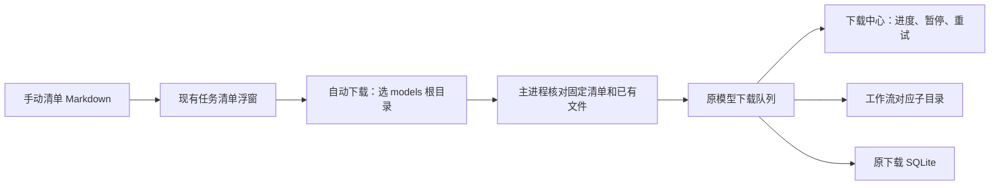

# Anima 任务清单：手动与自动下载

2026-11-15。本轮只接通现有两份 Anima 安装清单，不自动执行生成、不下载其他工作流，也不改动用户已有模型文件。

## 用户怎么用

1. 点击顶栏「任务清单」。默认是「手动下载」，原来的 Markdown 图文步骤、勾选、截图预览和全屏阅读都保留。
2. 切到「自动下载」，先选择正在使用的 ComfyUI 的 **models 文件夹**。这会复用设置中的模型根目录；可以先在设置里配置，再来下载。
3. 点击「下载这一组」，或「一键下载全部所需文件」。当前包括 Anima 主模型、文本编码器、VAE 三个文件。
4. 打开顶栏「下载管理」看进度、暂停、重试或移除。关闭任务清单不影响已提交任务。

同日追加：逐文件状态现已放到对应文件旁，并在清单上方显示核对与入队数量。已有文件必须实际 SHA256 一致才会提示无需下载，详见 [侧栏品牌与下载核对更新](./sidebar-header-download-status-2026-11-15.md)。下文验证表记录的是首次接入结果，追加更新的验证和截图以该文档为准。

ComfyUI 在另一台电脑时，选择本机目录不能把文件传到那台电脑。下载完成后，仍需让实际运行的 ComfyUI 能发现这些文件。来源站点的授权、网络、磁盘空间也需要可用。

## 路径与内容身份

路径来自随项目提供的 `apps/next/src/data/comfy/imageWorkflower/Anima/标准anima生成流.json`，下面都相对于选中的 models 根目录。

| 文件用途 | 官方来源文件名 | 工作流要求的实际保存位置 |
| --- | --- | --- |
| 主模型 | anima-aesthetic-v1.1.safetensors | diffusion_models/Anima/anima_aestheticV11/anima_aestheticV11.safetensors |
| 文本编码器 | qwen_3_06b_base.safetensors | text_encoders/Anima/anima_baseV10_txt/anima_baseV10_txt.safetensors |
| VAE | qwen_image_vae.safetensors | vae/Anima/qwen_image_vae/qwen_image_vae.safetensors |

主模型和文本编码器使用工作流已有的本地别名。文件身份以完整 SHA256 为准，不能因为名字相同就算安装成功。

- 文件已存在：实际读取文件，增量计算 SHA256；一致才跳过，不一致保留原文件并报告冲突。
- 只有旧来源 sidecar：提前报告冲突，避免下载完数 GB 后才发现不能提交。
- 文件正在下载：沿用原任务编号，不重复下载；暂停或失败项可恢复原任务。
- 没有文件：下载到任务自己的 `.part`，完整摘要通过后才无覆盖提交模型和来源记录。
- 子目录中的链接或越界路径不作为下载目标。根目录必须来自主进程读取到的已保存设置。

固定来源、完整摘要、大小和路径在 `packages/shared/src/data/setup-downloads.json`。核对证据：

- [Civitai 官方 Anima 项目元数据](https://civitai.red/api/v1/models/2458426)
- [Anima 固定提交的 split_files](https://huggingface.co/circlestone-labs/Anima/tree/6e0b2da2112573380abfb6a1435a60a994b254f2/split_files)

本轮比对的是模型元数据和 LFS 摘要，没有实际下载约 5.63 GB 的官方权重。网络来源未来可能改变或需要授权，失败原因继续在原下载管理里显示。

## 复用和数据关系

自动入口只提交内置文件编号，通过现有 preload、IPC、下载管理器、传输器和下载中心执行。没有第二个下载引擎或第二份进度列表。

最多三条同时下载；内置安装任务超过槽位先等待，空出位置后自动开始。普通 C 站下载入口保持原并发规则。重启时，等待或传输中的任务恢复为可继续状态，用户在下载中心点重试；不会在重开后自动消耗流量。

数据库追加 v5 迁移，不改写 v1–v4：

| 表 | 保存什么 | 与原表的关系 |
| --- | --- | --- |
| download_job | 下载身份与状态 | 沿用原表 |
| download_resume / download_checkpoint | 原请求、目标、断点和修订号 | 沿用原表 |
| download_setup_asset | 内置安装项编号、是否等待槽位 | download_id 一对一关联 download_job |

媒体或模型字节不入库。保存位置仍为原 Electron userData 下的 `model-download-queue.sqlite`，设置仍走现有用户文档。已有普通下载没有附表记录，恢复形状保持兼容。

以后更新安装版本，应新增稳定编号并追加数据库允许集迁移，同时更新两端校验；不要直接替换旧编号的 URL、SHA 或路径，否则会破坏旧任务的恢复身份。

## 修改文件

| 区域 | 本轮文件与职责 |
| --- | --- |
| 固定清单 | shared 的 setup-downloads.json、setup-download.schema.ts；model-download.schema.ts 验证固定参数 |
| 主进程 | downloads/setup-download-{catalog,paths,files,service}.js：固定参数、目标授权、已有内容核对、批量提交 |
| 原下载管理 | model-download-manager.js：安装项排队；recovery.js、records.js：等待状态与恢复；metadata.js：记录真实依赖类型和原文件名 |
| 数据库 | migration-005.sql、connection.js、download-store.js：安装项一对一附表与恢复 |
| 桥接 | 两份 ipc-channels、model-download.handlers.js、preload/index.js、shared ElectronAPI 和 ModelDownload 类型 |
| 清单界面 | setup-checklist-panel.tsx、setup-download-panel.tsx、use-setup-downloads.ts、utils/setup-downloads.ts |
| 下载界面 | model-download-list.tsx 复用原行组件，显示等待文案 |
| 文档和语言 | 中英四份 guides/anima Markdown；两种语言的 components 和 toolBox 词条 |
| 回归 | verify-setup-downloads.js；smoke-setup-checklist.js；三份 SQLite 验证脚本的 v5 预期 |

## 实际验证

从仓库根执行，Electron 专项串行运行。使用临时模型目录、设置和下载库，没有修改真实模型或下载历史。

| 命令 | 结果 |
| --- | --- |
| pnpm typecheck | 通过 |
| pnpm --filter @illusion-realm/electron check | 通过，无 @ts-nocheck |
| pnpm lint | 通过，0 错误、37 条现有警告 |
| pnpm verify | 通过，通道一致、模块可加载、注册与资源白名单有效 |
| pnpm check:locale-keys / check:i18n / check:i18n:en | 通过 |
| pnpm --filter @illusion-realm/next build | 通过；连续两次构建源码指纹均为 c82be603dd8c |
| pnpm exec electron scripts/verify-setup-downloads.js | 4/4：路径与工作流一致、双端拒绝篡改、实际内容哈希、冲突保护、排队去重、暂停恢复、数据库反读、移除失败边界、自动启动及错误内容拦截 |
| pnpm exec electron scripts/verify-model-downloads.js | 6/6：原下载、真实提交、断点续传、移除和权限边界 |
| pnpm exec electron scripts/verify-sqlite.js | 6/6：真实 Worker、查询、约束、事务、重开和格式反证 |
| pnpm exec electron scripts/verify-sqlite-migration.js | 4/4：旧库升级、备份、原数据与下载队列往返恢复 |
| pnpm exec electron scripts/verify-sqlite-asar.js | 3/3：asar 内 v1–v5 SQL、外部 shared 数据和 Worker 可读 |
| pnpm exec electron scripts/smoke-setup-checklist.js | 34/34：手动指南及英文自动入口回归 |
| pnpm exec electron scripts/smoke-setup-checklist.js --automatic | 10/10：实际页面选目录、分组/全部提交、原下载中心、暂停、真实深色主题和窄窗口 |
| pnpm check | 未全通过：停在已有未引用词条 auth.verifySuccess、canvas.reference、canvas.styleTransfer；后续串联检查没有借此宣称通过 |

页面专项早期暴露了夹具点击早于动态组件载入、占槽夹具未发首块进度的问题；已分别补上有界元素等待和真实首块响应后重跑通过。没有把超时当成成功。

未验证：官方 GB 级文件完整下载、用户账号权限、真实 ComfyUI 重扫与生成、完整安装器安装。本轮不声称这些已完成。

## 界面证据

浅色提交结果与深色入口为实际应用页面，下载中心显示的是隔离测试任务；不能作为官方权重已安装的证明。

## 注释审计

基线为本轮改动前暂存副本 `ir-setup-download-baseline-20261115`，不把工作区之前的更改算进本任务。已有文件只数本轮新增和替换行，新文件数全文；Markdown、截图、JSON 数据不算源码。

使用 TypeScript 解析树提取注释、按 SQL 行注释识别，区分纯注释和混合代码行，再逐项复核说明内容。统计结果见同目录 `setup-downloads-comment-audit-2026-11-15.json`：

- 业务：有效纯注释 C=28，代码 B=318，8.09%。
- 测试：有效纯注释 C=15，代码 B=232，6.07%。

低于 20%–30% 参考：说明已覆盖固定路径、内容指纹、目录锁、队列、附表、取消和夹具边界；其余主要是复用调用、词条、类型与界面装配，不重复解释或为了比例凑数。新增普通逻辑函数已核对不超过 30 行有效代码。
