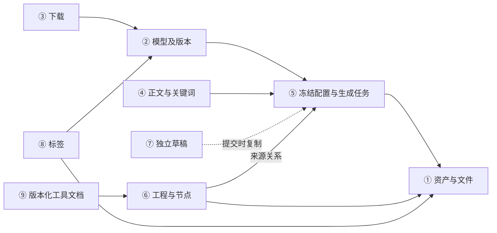

# SQLite 本地数据基础、原子表与 SQL 请求

日期：2026-11-11。本文保留v1基础结构记录。**后续已按用户授权完成v2迁移：44表，生成小票/画布/快捷词与下载接入，设置继续JSON。当前状态、九宫格、实际计数与限制以[迁移实施记录](sqlite-migration-2026-11-11.md)为准。**

## 已完成与现有业务边界

Electron 43.7.1 的 Node 24.21.0 已内置 SQLite 3.53.4，使用 `node:sqlite`。无需安装 SQLite 服务、下载 sqlite3.exe、增加 ORM 或分发第三方原生绑定。本轮为主进程增加匹配的 `@types/node` 24 开发类型，运行时仍使用 Electron 自带引擎。

数据库放在**实际读取的用户 JSON 旁边，同名前缀 `.sqlite`**。位置复用 `user-data.js` 的路径和回落规则，不另外推导软件根：

```text
现有：<用户目录>/illusion-realm.json
新增：<用户目录>/illusion-realm.sqlite
运行时可能出现：illusion-realm.sqlite-wal、illusion-realm.sqlite-shm

自定义示例：D:/MyData/preferences.json → D:/MyData/preferences.sqlite
```

开发态当前默认路径规则对应仓库上级的 `user` 目录，不是源码目录下新建 user。数据库与日志文件已加入 Git 忽略。不能在运行中只复制主 `.sqlite` 文件当作完整备份；WAL 中可能仍有已提交记录。正式备份接口本轮未接入。

初始化和核对：

```powershell
pnpm sqlite:init
pnpm check:sqlite
```

`sqlite:init` 创建或核对真实磁盘库，成功后关闭连接，不启动窗口。现有下载、创作历史、画布保存、用户设置**继续使用原实现**，没有偷偷双写、清空或改读新库。不存在“新库为空，所以用户没有历史”的回落逻辑。

## 九宫格关系总览

九格是九个业务分区，**不是强行只建九张大表**。本轮实际建立 32 张表；格内列出真实表名，跨格只通过稳定 ID 关联。

| ① 资产与位置 | ② 模型与版本 | ③ 下载与续传 |
| --- | --- | --- |
| `folder`、`asset`、`asset_file`<br>一个产物，多份文件；目录单独登记 | `model`、`model_version`、`model_file`<br>模型 → 来源版本 → 本地权重 | `download_job`、`download_checkpoint`<br>尝试历史与可变断点分开；关联②的权重及①的目录 |
| **④ 提示词与关键词** | **⑤ 生成与创作历史** | **⑥ 画布与节点** |
| `prompt_document`、`keyword`、`prompt_keyword_usage`<br>精确正文、词条、明确插入记录分开 | `generation_config`、`config_model`、`generation_job`、`generation_attempt`、`generation_input`、`generation_output`、`job_payload`<br>④正文 + ②模型 → 任务 → ①实际产物 | `canvas_project`、`canvas_node`、`canvas_edge`、`node_asset`、`node_run`<br>节点引用①资产；任务来源连接⑤；删节点保留历史 |
| **⑦ 独立编辑草稿** | **⑧ 整理标签** | **⑨ 外部协议与结构版本** |
| `generation_draft`、`draft_owner`、`draft_model`、`draft_input`<br>创作页或⑥节点二选一归属；提交后复制成⑤快照 | `tag`、`asset_tag`、`model_tag`<br>标签分别关联①资产和②模型，不自动变成提示词 | `project_document`、`schema_migration`<br>外嵌工具文档归⑥节点；结构版本不代表用户数据已迁移 |

主要关系读法：**③下载 → ②模型 → ⑤任务；④正文 → ⑤任务 → ①资产；⑥节点 → ①资产；⑥节点 → ⑤任务来源；⑦草稿 → 提交时复制为⑤冻结配置。**



## 原子表目录

PK 为主键，FK 为外键。多个模型、参考图、标签各存一行关系，不在一个单元格塞逗号列表或 ID 数组。除外部协议载荷外，没有万能 `data_json` 业务主表。以下字段与可执行 `schema.sql` 一致；未列的具体 CHECK、索引与触发器以该文件为准。

| 表 | 核心列与关系 | 删除及独立性 |
| --- | --- | --- |
| folder | folder_id PK；folder_path 唯一 | 被文件或下载引用时限制删除 |
| asset | asset_id PK；media_kind、origin_kind；实际 width/height/duration_ms；created_at/deleted_at | 逻辑产物，不等于磁盘文件或节点 |
| asset_file | file_id PK；asset_id、folder_id FK；file_name、byte_size、content_hash、availability、ownership | 同产物可有多份副本；目录+文件名唯一 |
| model | model_id PK；name、model_type | 名称不是身份，允许来源不同的同名模型 |
| model_version | version_id PK；model_id FK；provider、external_version_id、version_name | 来源与外部版本组合唯一；纯本地外部 ID 可空 |
| model_file | model_file_id PK；version_id、folder_id FK；file_name、loader_kind、sha256 | 权重与媒体文件分表；不存模型字节 |
| download_job | download_id PK；model_file_id 可空 FK；target_folder_id FK；请求名、公开来源标签、状态、起止时间、错误码 | 失败也可登记；移除队列卡不等于删除历史 |
| download_checkpoint | download_id PK/FK；temporary_locator、received_bytes、total_bytes、etag、revision | 可变检查点，较旧 revision 不覆盖新版 |
| prompt_document | prompt_id PK；positive_text、negative_text、created_at | 正文只追加，不 trim 或按逗号重写 |
| keyword | keyword_id PK；text、language、normalized_search_text | 原文与搜索归一化分开 |
| prompt_keyword_usage | usage_id PK；prompt_id、keyword_id FK；position、inserted_text_snapshot | 同一个词出现两次保留两行，不猜测旧正文使用来源 |
| generation_config | config_id PK；prompt_id FK；类型、workflow_id、mode、requested_count、请求宽高/FPS/时长、schema_version | 冻结配置；不使用草稿行充当历史 |
| config_model | binding_id PK；config_id、version_id FK；role、submitted_name、strength、position | 配置+角色+位置唯一；任务创建后冻结 |
| generation_job | job_id PK；config_id FK；status、created_at、started_at、finished_at、error_code | 本地任务 ID 不等于供应商请求 ID |
| generation_attempt | attempt_id PK；job_id FK；sequence、provider、external_request_id | 一个任务多个尝试；任务内序号唯一 |
| generation_input | input_id PK；job_id、asset_id FK；input_role、position、reference_alias | 冻结当次顺序与 @ 名称 |
| generation_output | output_id PK；job_id/attempt_id 复合 FK；asset_id FK 且唯一；output_index、saved_at | 只登记实际保存产物，允许失败任务部分产出 |
| job_payload | job_id PK/FK；schema_version、payload | 完整外部 API Prompt 的版本化协议例外；本轮未开放写入口 |
| canvas_project | project_id PK；name、schema_version、created_at、updated_at | 工程 ID 独立于可改标题 |
| canvas_node | node_id PK；project_id FK；kind、title、x/y、card_width/card_height | 同源多实例各有自己的坐标 |
| canvas_edge | edge_id PK；project_id；双端节点复合 FK；source_port/target_port | 禁止跨工程、自连、重复端口连接；删节点清边 |
| node_asset | node_id、asset_id FK；role、position；PK(node_id,role,position) | 删节点仅清引用，不删资产 |
| node_run | job_id PK/FK；活动 node_id/project_id FK；两个来源 ID 快照 | 删节点后活动外键置空，历史来源快照保留 |
| generation_draft | draft_id PK；prompt_id FK；workflow_id、width/height、updated_at | 当前可变参数与历史冻结参数分开 |
| draft_owner | draft_id PK/FK；create_scope 与 node_id FK 二选一 | 创建页和节点不共用一份可变草稿 |
| draft_model | draft_id、version_id FK；role、position、submitted_name、strength | 一行一个模型槽，不共享冻结绑定 |
| draft_input | draft_id、asset_id FK；input_role、position | 一行一个手动参考输入 |
| tag | tag_id PK；name 唯一 | 整理标签不自动发给模型 |
| asset_tag | asset_id、tag_id FK；二者组合 PK | 资产与标签多对多 |
| model_tag | model_id、tag_id FK；二者组合 PK | 模型与标签多对多，避免万能 target_type/target_id |
| project_document | node_id FK；document_kind；schema_version、body；PK(node_id,document_kind) | 导演台/外嵌视频协议保留完整文档；本轮未开放写入口 |
| schema_migration | version PK；checksum、applied_at | 记录结构初始化，不记录旧数据迁移完成量 |

`width/height` 三种语义分开：资产实际媒体像素、配置请求像素、节点 UI 尺寸。时间全部为 Unix 毫秒；FPS 用分子/分母，支持 30000/1001 等值。未知或不适用保留 NULL。资产的可选探测列仍是单值属性，不因没有拆成一对一子表而违反原子性。

## SQL 请求接口

文件：`apps/electron/src/main/storage/sqlite/client.js`。**主进程内部 API，本轮没有新增渲染层 SQL IPC。** 后续业务接入应暴露对应领域操作，并使用原有 shared schema、权限校验和 IpcResult，而不是暴露 request 或数据库路径。

```js
const { openBusinessDatabase } = require('./storage/sqlite/client');
const { client } = openBusinessDatabase();
try {
  await client.request('status');
  await client.request('batch', [
    { name: 'folder.add', params: ['folder-id', 'D:/Media'] },
    { name: 'asset.add', params: ['asset-id', 'image', 'imported', 1024, 1024, null, Date.now()] },
  ]);
  const firstPage = await client.request('select', {
    name: 'asset.page', params: [null, null, 50],
  });
} finally {
  await client.close();
}
```

动作目录位于 `queries.js`，没有任意 SQL、任意表名或自定义排序字段入口。`params` 只接受 string/有限且安全范围内的 number/null，不接受对象、函数、布尔、媒体 Buffer 或 undefined。输入与结果必须由未来领域服务继续缩窄类型，不能用 any 略过校验。

| 请求 | 行为与边界 |
| --- | --- |
| status | 真实引擎版本、结构版本、外键开关、日志模式、表数；不返回用户路径 |
| select | `{name,params}`，只允许只读目录动作，返回记录数组 |
| batch | 1–100 个命名写动作；整批事务；返回与动作顺序一致的 `{changes:[...]}` |
| explain | 使用相同目录与参数执行 EXPLAIN QUERY PLAN，只允许读取动作 |
| close | 等待前序消息处理，关闭连接和 Worker；重复调用共用收尾 Promise |

写动作包括：`folder.add`、`asset.add`、`file.add`、`model.add`、`version.add`、`modelFile.add`、`download.add`、`checkpoint.put`、`prompt.add`、`keyword.add`、`promptKeyword.add`、`config.add`、`configModel.add`、`job.add/start/finish`、`attempt.add`、`input.add`、`output.add`、`project.add`、`node.add/move/delete`、`edge.add`、`nodeAsset.add`、`nodeRun.add`、`draft.add/update`、`draftOwner.add`、`draftModel.add`、`draftInput.add`、`tag.add`、`assetTag.add`、`modelTag.add`。参数顺序在目录中的显式 INSERT/UPDATE 列表中定义；golden 输入见 `scripts/fixtures/sqlite/canonical.json`。

| 常用读动作 | params，按顺序 | 返回重点 |
| --- | --- | --- |
| asset.page | cursorCreatedAt/null、cursorAssetId/null、limit | 未软删除资产；首屏两个游标均传 null |
| asset.kindPage | mediaKind、cursorCreatedAt/null、cursorAssetId/null、limit | 按媒体类别过滤；改筛选应重置游标 |
| file.page | assetId、afterFileId（首屏空字符串）、limit | 实际副本位置与可用性，不读媒体字节 |
| history.page | cursorCreatedAt/null、cursorJobId/null、limit | 任务及配置引用、正文前512字符、实际 output_count |
| prompt.get | promptId | 一份完整正负正文，按主键加载 |
| download.page | cursorCreatedAt/null、cursorDownloadId/null、limit | 下载尝试历史，不含认证信息 |
| generation.stats | fromMs 包含、toMs 不包含 | completed/failed 任务及实际产物；cancelled 排除 |
| node.page | projectId、afterNodeId（首屏空字符串）、limit | 工程内节点，各实例坐标独立 |
| edge.page | projectId、afterEdgeId（首屏空字符串）、limit | 工程内连线，不推导或生成新连接 |

列表 limit 必须为 1–200 的整数。无匹配返回空数组；写入 changes=0 是“没有修改”，不是又完成一次动作。`checkpoint.put` 会拒绝旧 revision；`job.start/finish` 不重复改写已确认终态。`draft.update` 的时间保护不等于完整的多窗口冲突解决。

## SQL 优化与可靠性

1. **后台线程**：DatabaseSync、建表、磁盘锁等待和查询都在专属 Worker；窗口主进程只处理异步消息。
2. **预编译与绑定**：固定动作缓存 Statement，参数不拼 SQL；缓存数量最多为目录动作数，不按文件名无限增长。
3. **游标分页**：按 `(created_at,id)` 范围继续，避免深层 OFFSET；同毫秒也不漏项。按媒体类别使用 `(media_kind,created_at,id)`。
4. **按查询建索引**：资产、任务、下载的时间索引；工程+节点/边 ID 索引；关系反向外键索引；不重复创建已有唯一索引前缀。
5. **小结果**：历史列表只带正文摘要；完整正文按主键取；不在数据库存图片、视频、音频或模型字节。
6. **小事务**：每批最多100动作、标量内容约1MiB；最多50个在途请求，关闭命令保留名额。不在写事务里等待网络或 UI。
7. **WAL + FULL**：读写快照与有限写锁等待（5秒）；连接页缓存目标8MiB；WAL按1000页自动检查点。不启动就 VACUUM，不关闭可靠性换跑分。
8. **结构与关系保护**：STRICT、CHECK、外键、同工程复合外键、唯一槽位、不可变正文与配置触发器。
9. **无假成功**：COMMIT 后才回执；失败整组回滚。请求30秒总上限后为结果未知并终止实例，不能宣称已取消或自动重试非幂等写入。

结构由 `application_id=0x4952524d`、`user_version=1` 和脚本 SHA256 共同识别。摘要只统一 CRLF/LF，不改写 SQL。陌生数据库、未来版本、旧迁移被改写均拒绝打开并保留文件。后续结构升级应新增迁移，不能改已发布 v1。

## 本轮不存及后续工作

- **不入库**：媒体和权重原件、Base64、API 密钥/令牌/认证头、临时 Blob URL、鼠标选择/悬停、播放位置、每包下载速度。
- **继续原存储**：用户设置、首帧语言、账号、现有下载队列、生成统计、画布和独立工程正文。新库不会替代其权威来源。
- **后续迁移任务**：稳定 ID 对照、文件路径规范化与大小写/符号链接识别、历史数量对照、缺失产物证据、迁移断点、备份恢复和回滚；未授权自动迁移。
- **后续领域适配**：完整采样/种子参数、模型触发词和快捷短语关系、下载恢复网络字段、端口类型及有向环检查、输入图片数量规则、文件落盘补偿、业务 IPC。当前表结构不是全部业务已经接通。
- **未测边界**：人工安装向导、其他操作系统、突然断电、磁盘损坏与网络共享盘、多进程高争用、长期大库性能。不要把单机样本当通用性能保证。

## 验证记录

SQLite 磁盘回归使用真实 Electron 引擎、真实 Worker、真实临时文件；只有业务输入为固定夹具，没有模拟 SQLite 查询返回值。覆盖绑定注入、同毫秒分页、事务回滚、跨工程拒绝、独立草稿归属、过期检查点、冻结快照、删节点保留历史、A/B实例隔离、关闭重开、陌生/未来/漂移格式拒绝及实际查询计划。

初次实测 5000 条索引记录，50批真实事务，约137毫秒，期间主线程计时器执行56次。此数值不含真实媒体生成，没有旧 JSON 对照，不能宣称“提升多少倍”。实际部署环境应再测。

已用临时 asar 归档加载客户端、Worker及 SQL 文件，成功建立磁盘 WAL 数据库；这只验证资源归档加载，并非完整安装器验收。检查、最终初始化结果和注释统计在本文件末尾补记。

### 最终运行结果

| 实际执行 | 结果 | 说明 |
| --- | --- | --- |
| `pnpm sqlite:init` | 通过，退出0 | 已在实际用户 JSON 同目录建立/核对数据库；SQLite 3.53.4、schema 1、foreign_keys=1、wal、32张表；关闭线程后退出 |
| `pnpm check:sqlite` | 通过，6/6，退出0 | 最终 schema 的真实磁盘回归；5000条记录216ms、主线程心跳68次，单次样本不代表普遍性能 |
| `pnpm typecheck` | 通过 | 在本次 `pnpm check` 前段实际执行并通过 |
| Electron `check` | 通过，退出0 | 主进程 tsc，`@ts-nocheck` 为0/105 |
| `pnpm lint` | 通过，0错误、37警告 | 警告位于原有渲染文件；本轮没有修改渲染组件 |
| Next `build` | 通过，退出0 | 29个路由静态导出；已生成最新构建指纹 |
| 最新源码的临时 asar 加载 | 通过，退出0 | 从归档加载客户端、Worker与SQL资源，真实新库返回wal、32张表；未运行完整Windows安装器 |
| `pnpm verify` | 通过 | 本次 `pnpm check` 中执行；内置SQLite没有被误识别为缺失第三方模块 |
| `pnpm check` | **未通过，退出1** | 止于 `check:gates`：`auth.verifySuccess`、`canvas.reference`、`canvas.styleTransfer` 三个未引用词条；本轮没有修改这些词条或其调用方 |
| 单独补跑余下检查 | 9项通过、1项失败 | 输出路径、目录计数、语言决议、冒烟约定、脚本引用、启动语言、i18n、英文基线、双语键通过；Meta失败见下文 |
| `pnpm check:meta` | **未通过，退出1** | `MetaFieldRow.tsx` 的“字段标识已与文案分离（无中文字面量）”断言失败；该文件相对HEAD无修改，属于既有问题。本机缺真实Meta语料，golden corpus明确跳过 |

`pnpm check` 没有全绿；本轮不能据此申请主分支合并。没有将未运行的安装器、人工操作、业务迁移或断电恢复标记为通过。当前没有页面变化，因此交付关系图和数据库运行证据，不用现有页面截图冒充数据库接入完成。

结构摘要核对的是**随包脚本与已登记摘要**，不是对整个数据库进行防篡改认证。外部工具直接改表或删除触发器的检测、完整性巡检、备份恢复属于后续维护能力。

### 增量范围与注释审计

本轮新增源码范围为 `storage/sqlite/` 的6个文件与 `scripts/sqlite-init.js`；测试为 `scripts/verify-sqlite.js`。新增文件按全文统计，旧工作区修改不计入；JSON输入夹具、包配置和文档不计入源码注释率。普通函数的物理代码行扫描未发现超过30行；没有新增 `any` 或 `@ts-nocheck`。

逐文件扫描明细见 [注释审计](./sqlite-foundation-comment-audit-2026-11-11.json)。排除空行、定界符及纯JSDoc类型后，**注释候选**为业务1069行、代码462行（69.82%），测试218行、代码130行（62.64%）。这些是候选比例，包含需要进一步人工精简的重复解释，不能当作有效注释率已经验收。**未达到会话中业务/测试分别至少70%的要求，不标记该项通过，也没有为达到比例继续堆叠说明。** 工作区的注释规范另有20%–30%的已有修改，本轮保留该修改，不拿降低规则作为本次达标证明。

功能基础已可运行；整体交付仍有注释质量/比例与上述既有检查阻塞，不标记“全部验收通过”。后续旧数据迁移应另立任务，先做备份、身份对照和数量反证，再接业务读写；不能因为本轮表已建好直接切换现有页面的数据来源。
