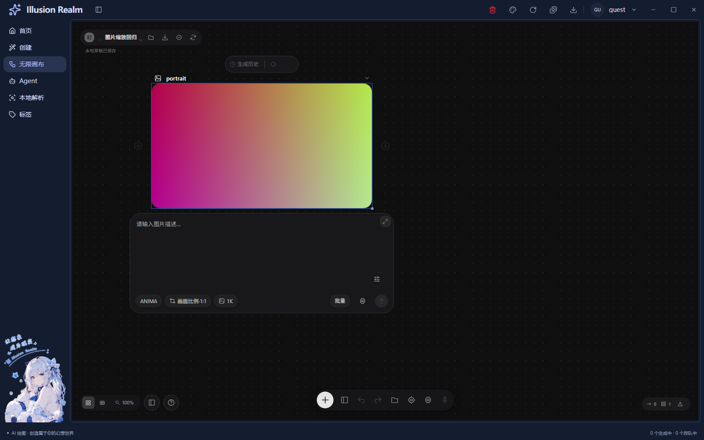
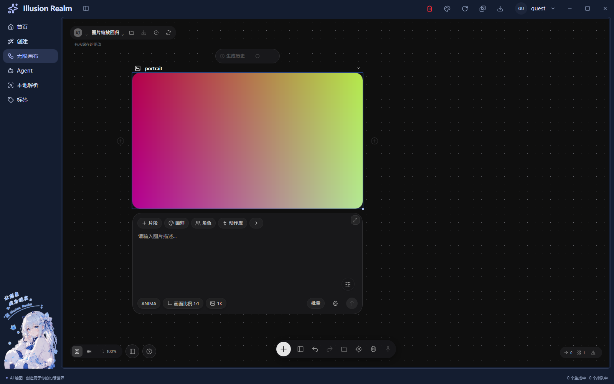
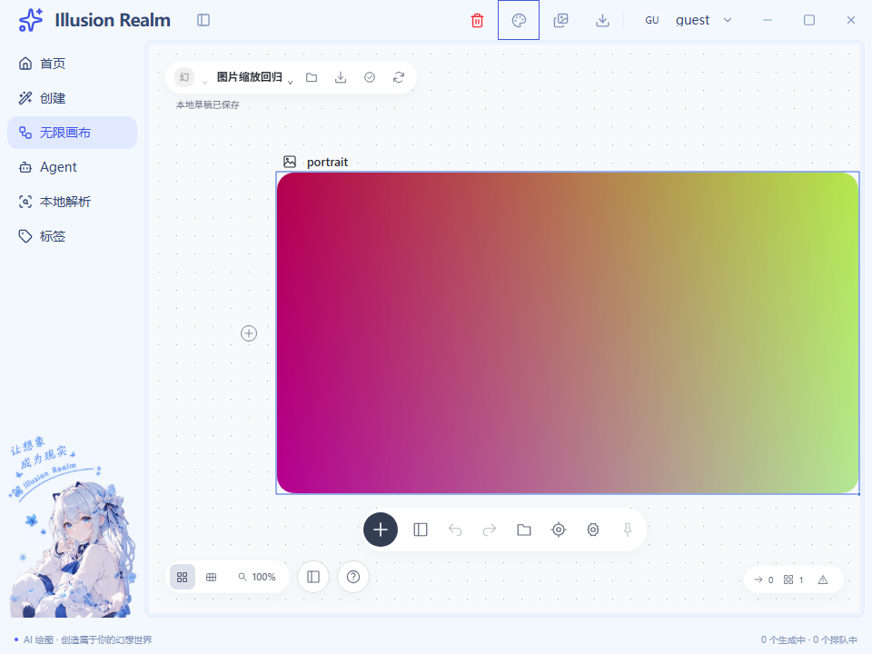
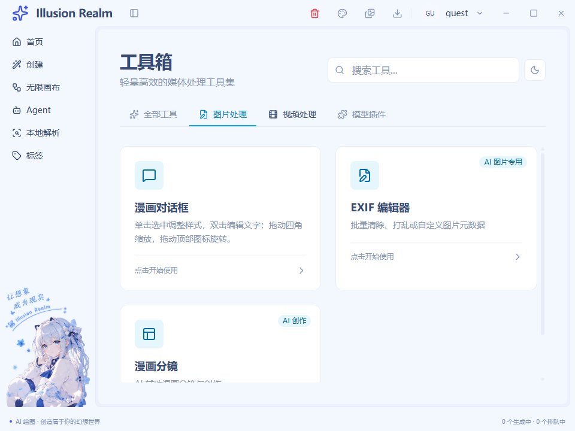
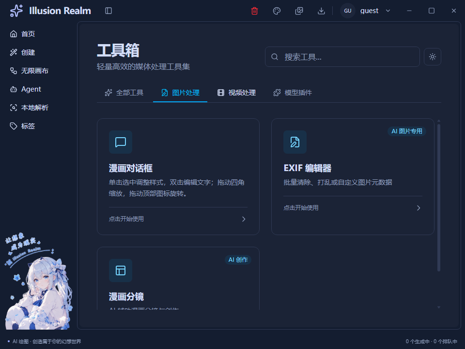

# SQLite 迁移与画布交互交付

2026-11-16 补充：当前结构版本为 v6，共49张表。`migration-006.sql` 扩展 `download_setup_asset.asset_id` 的合法编号格式，让原下载队列可保存 Anima、SDXL、MiniMax 与 SeedVR2 的安装任务。重建附表时复制全部旧行，保留下载身份、等候状态和原主表；资源编号仍由业务清单白名单校验，不开放任意下载地址。`verify-setup-schema-upgrade.js` 已验证 v5→v6 旧行保留、非法编号拒绝与外键完整；`verify-sqlite.js` 的6组磁盘、事务、查询计划与重开回归通过。下文 v2/44表是最初迁移的历史记录。

日期：2026-11-11。用户已授权真正迁移，并确认退出运行中的幻域。本轮保留其他工作区修改，没有提交或上传 GitHub。

## 本机实际结果

已执行 `pnpm sqlite:migrate`，随后再次执行验证幂等。用户主库升级 v2、44 张表，迁入生成小票 3 条、节点 3 个、边 0 条、快捷词 0 条；独立下载库恢复记录 10 条。原始 JSON 字节备份保留，主库 `integrity_check=ok`、外键检查为空。没有移动、删除或重新编码原媒体。迁移工具会拒绝同一 Electron 正在运行时执行；本次没有结束用户进程。

主库路径：实际用户 JSON 同目录、同名前缀 `.sqlite`；本机沿用既有路径解析，不另建源码内 user。下载库：原 Electron userData 目录的 `model-download-queue.sqlite`。下载封面外置 `sqlite-media/download-covers/<内容哈希>.bin`，不是媒体 BLOB。两个数据库分别属于用户业务文档和主进程下载队列，不能描述为同一数据库。

原 JSON 备份：`<原文件>.pre-sqlite-v2.<原字节SHA256前16位>.bak`。备份同名不覆盖，内容不一致明确拒绝。主文档随后正常保存时剔除接管的三个业务段；下载原 JSON 留作历史证据，之后不再写它。

## 九宫格关系表

| ① 原文件与接管账本 | ② 生成记录 | ③ 模型使用关系 |
| --- | --- | --- |
| migration_import 记录来源指纹、时间、数量；document_section 记录段摘要 | generation_receipt：状态、起止时间、图片数量证据 | receipt_model：receipt_id → ②；模型角色、加载器、提交名称各行保存 |
| **④ 画布身份** | **⑤ 节点与边** | **⑥ 素材索引** |
| canvas_state → canvas_project；名字存在性、workspace独立 | canvas_node_detail → canvas_node；canvas_edge_detail → canvas_edge；边关联源/目标节点 | canvas_media_reference → 节点、asset；asset_file → asset、folder；同源多节点共享资产 |
| **⑦ 快捷词** | **⑧ 下载恢复** | **⑨ 协议附表与设置** |
| quick_phrase：独立身份、顺序、关键词、正文、可选图片引用 | download_resume → download_job；download_checkpoint；download_owned_file；download_source_word 各行关联下载id | project_document保存原导演台/合成器协议；节点configuration保存版本化工作流参数；设置、首帧语言与凭据沿用原服务 |

v1 的32张表不重写，追加 `migration-002.sql` 的12张表：migration_import、document_section、generation_receipt、receipt_model、quick_phrase、canvas_state、canvas_node_detail、canvas_edge_detail、canvas_media_reference、download_resume、download_owned_file、download_source_word。

## 原子化与边界

不是将整份用户文档塞入 JSON 列。核心节点、边、几何、文本、文件引用、小票、模型槽和下载归属均分表。现有复杂工作流参数以明确版本的 configuration 附表保存；导演台与合成器沿用 project_document 的原协议 JSON，尚未细拆人物/动画/剪辑内部字段。schema_version=1 表示宿主载荷容器版本，内部文档自己的 version 原样保存。

生成旧小票没有提示词和产物路径，因此只迁移已有数量事实，不补造 generation_output、源任务或真实模型推理。创建页输出目录、图片 Meta、`.ircanvas` 交换文件、模型权重、用户其他设置段均不改写；不能称所有规划中的32张基础表都已接业务。

复用原 USER_DATA_READ/WRITE 与 IpcResult，无新增任意 SQL 或文件能力。Zustand store继续消费同一文档形状；设置 JSON 同步启动链保持不变。下载saveQueue/loadQueue调用方继续原接口，网络、续传及文件归属校验复用原实现。

写入先做领域校验，再 BEGIN IMMEDIATE、绑定参数、反读深对照、提交；失败回滚本批 SQL。第一次接管标记在写锁内重读。未变化分段由内容摘要跳过，模型行读取用 Map 分组避免逐记录过滤整表。目录存在性检查在 Worker，页面主线程不执行 SQL。

SQL 与设置 JSON **不是跨文件原子事务**：SQL成功后设置保存失败，调用明确失败，SQL可能已提交；重复保存可重试，不承诺全体回滚。Worker每次请求范围创建/关闭，避免闲置线程泄漏，但存在启动开销；历史和画布恢复仍整段传输，尚未窗口化或增量patch。下载瞬时速度不入库，恢复器归零；封面孤儿清理未接。未做断电/磁盘故障、超大真实库压力及旧版程序直接降级写入验证。

不要在迁移后用旧版本继续写旧JSON；SQL已成为三个业务段与下载恢复的权威来源。灾难恢复须停应用，保留库和WAL/SHM整体副本，再对照字节备份制定恢复方案，本轮不提供自动降级命令。

## 图片与光标

图片使用 object-fit:cover 铺满卡片，居中裁切只是UI；视频仍contain。四边和右下角使用 React Flow NodeResizeControl，10px透明边缘命中区、对应水平/竖直/对角光标，宽160–1200、高100–900。保存为原data.card，原图和输出参数不变。参数面板不参与尺寸测量；左上边移动由原图引擎处理抓取偏移，一次松手是一笔历史，Escape恢复。

空白选择模式显示箭头；显式手掌和临时Space平移分开。keyup、窗口失焦、指针取消与无按键回窗负责清理临时状态；显式手掌不会被当成Bug清除。工具箱分类仅排除通用hover轮廓，文字高亮、选中下划线和键盘focus-visible保留。

## 本轮实际验证

| 检查 | 结果与边界 |
| --- | --- |
| pnpm typecheck；Electron check | 通过；strict，0个ts-nocheck |
| pnpm lint | 通过，0错误、37条既有警告 |
| Next静态构建 | 通过；源码指纹2338bf922c7804aa19d243cca0ea85db5f3e0892969a5db75087dc4077d48cba |
| check:sqlite | 6/6；真实SQLite3.53.4，v2、44表、WAL；5000索引记录样本161ms、主线程64次心跳，仅本次样本 |
| check:sqlite:migration | 4/4；真实v1升级、原字节备份、行关系、同源实例、null/省略、排序、回滚、坏源拒绝、下载、导演台/合成器协议往返 |
| verify-model-downloads | 6/6；真实本地HTTP流、续传、哈希、归属、封面与移除；不是公网付费下载 |
| verify-sqlite-asar | 2/2；真实asar内SQL、校验依赖、Worker与冷重开；不是完整安装器安装验收 |
| CANVAS_RESIZE_SMOKE=1 | 6/6；正式静态app://、真实PNG、生产preload、隔离SQLite保存重开；鼠标/键盘为Electron自动注入，blur为DOM事件 |
| 原画布回归 | 149/149；串行、正式静态产物；原完整脚本默认仍用隔离JSON，SQLite闭环证据来自上行专项 |
| pnpm check | 退出1，停在既有未引用词条auth.verifySuccess、canvas.reference、canvas.styleTransfer；未称全仓通过 |
| 独立补跑后续检查 | outputpath、foldercount、locale、smoke规则、refs、initlocale、i18n、中英文键通过。Meta退出1：未改动的MetaFieldRow.tsx中文JSX注释被既有检测器计入；真实语料golden缺失明确SKIP |

已核对代码中保留的性能/导入相关旧修改，没有为通过检查重置它们。实际运行截图见下方，不是参考图。人工鼠标手感、真实切出应用后的光标、触屏、Windows系统缩放、完整安装器、长期压力和真实模型服务仍未验，不将CDP/DOM事件称人工通过。

增量有效注释率：业务58/(58+985)=5.56%，测试8/(8+354)=2.21%。两类均低于20%–30%参考范围：本轮主要是明确字段映射、断言与复用接线，已保留事务、失败、清理和协议例外说明，没有为比例重复解释字段名。它们是如实报告的偏离，不称达到参考范围。逐文件及既有文件改动行选择详见 [增量审计](sqlite-migration-comment-audit-2026-11-11.json)；历史70%门槛记录仅为历史，不作为当前阻塞。未因比例补废话。

## 实际截图

| 缩放前 | 缩放后 |
| --- | --- |
|  |  |

