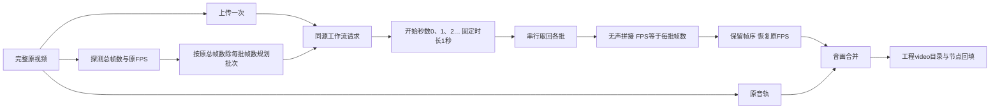

# 视频超分：保留原帧，最后恢复原FPS

当前已支持节点设置：3B/7B、整数倍数×2至×8、三种种子方式，以及默认10、可调整的每批帧数。最新设置、验证和截图见 [超分节点设置](./settings.md)。此前的客户端切片、先降采样到10 FPS的方案均已停用；旧记录只作历史证据。

## 当前流程

1. 本机探测原视频总帧数与原FPS；缺少帧数元数据时真实计帧，不本地切片、不先抽帧。
2. 批次数为 `ceil(原视频总帧数 / 每批帧数)`；每批帧数默认10，允许1至120的整数。完整原视频只上传一次，每批请求均引用它。
3. 使用用户更新的 `utility_seedvr2_3b_int8_upscale_video.json`，在请求副本中接入所选3B/7B模型、倍数和种子，保留原VAE接线。`113:112.fps=每批帧数`、`113:115.duration=1`；开始时间依次为0、1、2……，不修改模板文件。
4. 工作流将全部原帧按所选批帧数作为FPS重组，再切当前一秒；尾批只返回余帧。上一批完成且结果保存后，才提交下一批。
5. 所有无声结果按顺序拼接，使用所选批帧数作为中间FPS，再保留全部帧恢复原视频FPS，最后才合入原音轨。
6. 最终保存到当前工程 `video/` 并回填原超分节点。命名为 `原文件名前缀SeedVR2.mp4`；重名追加序号，不覆盖已有文件。

例如：原视频1秒、60 FPS、60帧，执行6批；中间拼接为6秒、10 FPS；恢复后为1秒、60 FPS，再合入原音轨。没有补帧算法，也不通过降采样丢掉原帧。

## 尾批兼容

本机ComfyUI的 `VideoFromComponents.as_trimmed` 忽略了 `strict_duration=false`，不足一秒时仍报 `Failed to slice video`。应用只在尾批给 `113:112` 输出套一层内置 `ConcatenateVideo`，再交原切片节点。列表对象支持宽松截长，切片参数仍为1秒；没有复制末帧、没有补齐十帧，也不修改用户模板文件或ComfyUI安装目录。

真实ComfyUI测试验证：69帧返回10、10、10、10、10、10、9帧；另用逐帧独立亮度编号验证11帧返回10、1帧，编号顺序与完整源一致。此处绕过7B模型，只验证真实加载、重组、切片、尾批和SaveVideo。

## 实现位置与边界

| 文件 | 作用 |
| --- | --- |
| `apps/next/src/utils/comfy/seedvr2-workflow.ts` | 克隆模板，接入节点配置，推进批次及兼容尾批 |
| `apps/next/src/utils/comfy/run-seedvr2-video.ts` | 一次上传、串行请求、父任务进度、取消及清理 |
| `apps/electron/src/main/modules/ffmpeg/upscale-plan.js` | 探测原视频并按所选批帧数规划范围；替换并删除旧upscale-split.js |
| `apps/electron/src/main/modules/ffmpeg/upscale-media.js` | 反读各批，先拼接、恢复FPS，再合音轨 |
| `apps/electron/src/main/modules/ffmpeg/upscale-sessions.js` | 窗口归属、临时目录、发布命名和重名保护 |
| `packages/shared/src/schemas/video-upscale.schema.ts` | 原IPC保持四个动作，prepare的FPS接受1至120整数 |

prepare返回批次的 `{startTime,startFrame,frames}`、完整总帧数、所选工作流FPS、源FPS及其精确分数。原FPS与工作流FPS分开保存，支持如 `30000/1001` 的帧率。结果数量、每批帧数、所选FPS、分辨率及文件归属均须检查，缺批或错帧不能发布成片。

拼接和恢复FPS分别以H.264 CRF0无损编码；按输入帧序重设时间戳并使用passthrough，禁止封装器自动补丢帧，随后反读验证总帧数与FPS。无损指相对工作流返回视频的解码画面，不能把工作流本身的默认有损封装宣称为全链路无损。两次本地编码会有CPU和临时磁盘开销，成片可能较大。

音轨优先直接复制；MP4容器不兼容时才转AAC。画面按平均源FPS恢复为固定帧率；可变帧率源的逐帧原始时间间隔不保留。成片时长按全部帧与原平均FPS确定。正常完成、失败、取消、所属窗口导航或退出时清理本会话临时目录，不删除原视频；断电、强杀进程的残留不在本轮新增扫描回收范围。ComfyUI自身input/output仍归服务端原管理规则。

## 设置功能之前的验证记录

以下为固定十帧版本的历史记录；当前可调设置的验证、最新构建指纹和注释统计以 [settings.md](./settings.md) 为准。

| 项目 | 结果 |
| --- | --- |
| `pnpm typecheck`、Electron check | 通过；零ts-nocheck |
| `pnpm lint` | 0错误，37项既有警告 |
| `pnpm verify` | 通过，97个通道一致 |
| `node scripts/verify-canvas-generation.js` | 421项通过，包括两端固定FPS校验 |
| `pnpm exec electron scripts/verify-video-upscale.js` | 72项通过；真实FFmpeg，模型用无损2倍缩放替代 |
| `node scripts/verify-seedvr2-workflow-slices.js` | 真实本机ComfyUI通过；完整源复用、固定10 FPS/1秒、9帧和1帧尾批 |
| Next静态构建 | 通过；指纹 `1f5b25296a1f8453c8fdabe1be610535e15868910754fcf91bd70b67848e8d89` |
| 正式静态画布SeedVR2专项 | 29/29；真实preload、IPC、HTTP传输、队列、文件与音画合并，模型为替身 |
| 本轮改动函数长度 | 无超过30行有效代码项 |

FFmpeg验证包括：1秒60帧→6批→恢复60 FPS，63帧余3帧尾批、1帧尾批、静音、有音轨、分数FPS、原容器缺少帧数元数据、同名成片不覆盖、取消、窗口隔离与清理。用逐帧解码指纹对照输入各批与完整源，以及最终成片，验证没有遗漏或重复。

画布运行编号：`2026-11-16T09-31-04-030Z-31288`；通过摘要已追加至 `logs/smoke-runs.log`（2026-11-16T09:31:28.611Z，29/29，exit=0）。成功运行没有另存详细失败日志。实际69帧素材只上传一次，串行7次请求，最终恢复原30 FPS及原音轨，存入工程video目录。截图为本项目实际运行，模型推理由HTTP夹具替代，不代表7B超分画质。

未执行耗时7B GPU推理，因此真实模型画质、显存峰值及耗时未验证。本轮未重跑完整 `pnpm check`；不将各专项通过等同于全仓统一检查通过。完整退出应用再重启，才能同时加载新的主进程和渲染代码。

## 设置功能之前的注释核对

本轮先保存快照 `ir-seedvr2-final-baseline-x6uhs1dz`，保留工作区原修改；只统计本轮新增与替换行，新plan文件统计全文。通过TypeScript语法树区分代码、纯注释和混合行，排除纯类型JSDoc后人工复核。

业务 C=14、B=90，13.46%；测试 C=12、B=111，9.76%。低于20%–30%参考范围：必要说明已覆盖批次、尾批兼容、帧率恢复、音轨、命名与测试替身边界，其余为直接参数与断言，没有为比例加重复注释。逐文件记录与函数检查见 [final-comment-audit.json](./final-comment-audit.json)。
