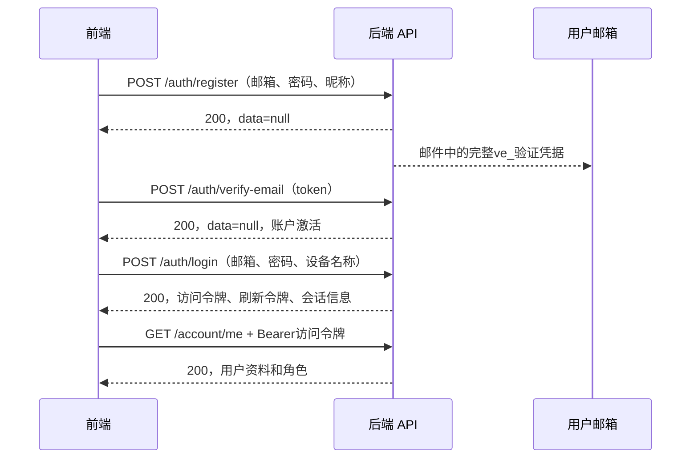

> 前端迁移快照，导出日期：2026-10-14。来源：后端仓库 `architecture/frontend-account-api.md`。包内链接已调整；源码、脚本、本地路径及凭据配置说明均指后端工程，不要求在前端创建或执行。更新时从后端重新导出。

# 前端账户接口接入文档

更新：2026-10-14。适用当前已实现的账户 API；字段和行为以 `AccountController`、`AccountDtos`、`AccountService` 与安全过滤器为依据。示例邮箱、密码、ID、时间及令牌均为占位示例，不是可用账户或真实凭据。

## 1. 登录方式与联调地址

当前只支持 **邮箱＋密码登录**。新账户必须先验证邮箱才能登录。邮箱用于识别账户，`displayName` 是昵称，不能代替邮箱登录。后端会对邮箱去除首尾空白并转为小写；密码原样提交，不自动去空格。建议前端也先规范化邮箱再做格式校验。

没有手机号/短信登录、邮箱验证码免密码登录、QQ/微信/OAuth登录、扫码登录或找回密码接口。QQ邮箱SMTP是平台发件服务，不是QQ第三方登录。角色相同地通过邮箱/密码登录，由后端读取角色，不向登录请求传入角色。

所有业务接口前缀为 `/api/v1`。前端只连接HTTP API，不能读取后端 `.env` 或直连数据库、Redis、SMTP。

| 场景 | API地址与条件 |
| --- | --- |
| 本机默认启动 | `http://127.0.0.1:8080/api/v1`；默认local模式没有账户持久化服务，不可完成真实登录 |
| 本机真实依赖联调 | 启动cloud模式后，按实际端口调用；验证启动脚本可选18080，地址为 `http://127.0.0.1:18080/api/v1` |
| 正式服务 | 尚未部署/提供域名；部署后由前端配置实际HTTPS API地址 |

已有验证服务此前已停止，示例地址不表示服务当前正在运行。后端开发者可按README配置JDK25与本地凭据后执行 `scripts/start-verification.ps1 -Cloud -Port 18080`；`verification`页面用于本地人工验证，不是前端产品登录入口。

**浏览器跨域尚未配置可用的CORS白名单。** 不同端口也是不同源，不要假定从5173等开发端口可直接fetch到18080。浏览器联调优先由前端开发服务器代理 `/api` 到后端，形成同源请求；部署时配置同源反向代理或另行实现并验证明确的CORS白名单。不要使用 `mode: 'no-cors'`。Electron可经受控主进程HTTP/IPC接入，需沿用桌面项目的IPC与凭据存储规范，不能通过关闭webSecurity解决跨域。

## 2. 通用请求与响应

JSON正文请求使用 `Content-Type: application/json`，可附 `Accept: application/json`。严格字段校验已开启，未知字段也可能400；只传文档列出的字段。GET、DELETE和无正文的退出请求不必附Content-Type。

受保护接口附一个请求头：

```http
Authorization: Bearer <accessToken>
```

必须使用访问令牌和大小写为 `Bearer ` 的前缀；不能传刷新令牌、邮箱验证令牌、用户ID或多个Authorization头。注册、重发、激活、登录、刷新无需Authorization，调用这些接口时省略旧访问令牌：即使路由公开，携带失效令牌也会被认证过滤器拒绝。

后端不设置登录Cookie，不提供传统表单登录或HTTP Basic登录。浏览器fetch可用 `credentials: 'omit'`，不靠 `credentials: 'include'`维持会话。

业务成功统一HTTP200：

```json
{
  "success": true,
  "code": "OK",
  "message": "Success",
  "data": null,
  "requestId": "example-request-1"
}
```

有业务返回值时替换 `data`；失败的HTTP状态非2xx：

```json
{
  "success": false,
  "code": "UNAUTHENTICATED",
  "message": "Authentication required",
  "data": null,
  "requestId": "example-request-2"
}
```

同时检查HTTP状态和 `success`，按稳定 `code`映射前端文案，不依赖英文message。响应包含 `X-Request-Id`头及正文requestId；可传1–64字符、仅字母/数字/下划线/连字符的 `X-Request-Id`，非法值由后端替换。requestId用于排查，不是幂等键。

ID、sessionId、revision都是**十进制字符串**，保留为string，不转Number。日期是UTC ISO 8601字符串，如 `2026-10-14T08:00:00Z`，显示时转换到用户时区。账户响应不应缓存到共享缓存；登录、刷新明确 `Cache-Control: no-store`。

## 3. 最短登录流程



邮件箭头表示正常投递路径，不保证一定送达；注册200可能是重复邮箱或冷却响应，不能据此显示“邮箱已经验证”或“注册已完成”。已有已激活账户直接从登录开始。

### 3.1 注册

`POST /api/v1/auth/register`，无需登录。

```json
{
  "email": "user@example.com",
  "password": "Example-password-2026",
  "displayName": "幻域用户"
}
```

| 字段 | 类型 | 限制 |
| --- | --- | --- |
| email | string | 必填、有效邮箱，最多254字符 |
| password | string | 必填，12–128字符；无需前端自行哈希 |
| displayName | string | 必填且非空白，最多100字符 |

成功200、data=null，**不返回账户ID或任何令牌**。账户初始为普通用户、待验证。重复邮箱不会覆盖密码，仍统一空成功响应，不能用它判断邮箱是否已注册。SMTP未配置可能503；提交后的邮件失败也可能503且账户已保留为待验证，后续应引导重发验证邮件，不要自动循环注册。

### 3.2 验证邮件重发

`POST /api/v1/auth/verification/resend`，无需登录：

```json
{ "email": "user@example.com" }
```

email约束同注册。成功200、data=null。未知邮箱、已激活账户、发送额度耗尽或冷却中均可能同样200，不能承诺邮件已送达。注册和重发共享同邮箱60秒冷却；后端每账户一小时最多生成3个验证凭据（含注册），到上限统一空成功响应。

前端可启动60秒“重新发送”倒计时，并显示“如该邮箱需要验证，请查收邮件”。若邮箱已有待验证账户，单纯重复注册不会补发邮件，使用本接口。

### 3.3 邮箱激活

`POST /api/v1/auth/verify-email`，无需登录：

```json
{ "token": "<邮件中的完整ve_凭据>" }
```

token必填非空白，最多64字符。正式凭据为 `ve_`加43个URL安全字符，大小写敏感。邮件正文提供完整凭据，当前不是自动跳转链接，不是六位数字验证码；前端应提供完整凭据粘贴框，不能限制为数字。压测固定码 `123456` **不适用于正式API**。

正常验证有效期默认30分钟，可由后端配置；成功200、data=null，只激活账户，**不会自动登录或返回JWT**。成功后调用登录。无效、到期、已消费或已激活账户的再次验证统一401/UNAUTHENTICATED。前端保留邮箱信息，引导登录或重新发信，不把此处401解释成“现有登录会话过期”。

## 4. 如何登录、登录会返回什么

### 4.1 登录请求

`POST /api/v1/auth/login`，不传Authorization：

```json
{
  "email": "user@example.com",
  "password": "Example-password-2026",
  "deviceName": "Windows 桌面客户端"
}
```

| 字段 | 类型 | 限制/用途 |
| --- | --- | --- |
| email | string | 必填有效邮箱，最多254字符；不是昵称 |
| password | string | 必填，1–128字符；登录接受历史输入，注册要求12–128 |
| deviceName | string | 必填非空白，最多100字符；用于会话列表展示，例如“Chrome 浏览器”，不是机器认证凭据 |

不存在、错误密码、未验证、被停用的账户统一401/UNAUTHENTICATED，后端不会返回具体原因。登录页用“邮箱或密码不正确，或账户尚未激活/不可用”，可提供“重发验证邮件”入口。不能从401推断账号不存在。

### 4.2 登录成功响应

```json
{
  "success": true,
  "code": "OK",
  "message": "Success",
  "data": {
    "tokenType": "Bearer",
    "accessToken": "<后端签发的JWT访问令牌>",
    "accessExpiresAt": "2026-10-14T08:10:00Z",
    "refreshToken": "<后端签发的rt_刷新令牌>",
    "sessionExpiresAt": "2026-11-13T08:00:00Z",
    "sessionId": "123456789012345678"
  },
  "requestId": "example-login-1"
}
```

| data字段 | 类型 | 前端用途 |
| --- | --- | --- |
| tokenType | string，目前固定Bearer | 认证头方案 |
| accessToken | string | JWT；后续受保护API放Authorization头 |
| accessExpiresAt | string，UTC时间 | 访问到期时间，默认登录后10分钟，按实际返回值安排刷新 |
| refreshToken | string | 随机 `rt_`凭据；只用于刷新JSON正文，不是JWT，不放Authorization |
| sessionExpiresAt | string，UTC时间 | 本会话最终到期时间，默认登录后30天；刷新不会延长 |
| sessionId | string | 当前会话ID，用于在会话列表中标注“当前设备” |

响应没有expiresIn、用户名、头像、角色或完整user对象。每次登录会创建一个新的独立会话；避免双击登录或自动重试登录导致多会话。访问JWT不含邮箱或角色；不通过解码JWT展示权限，用户资料另取。

### 4.3 登录后获取用户资料

`GET /api/v1/account/me`，无需正文：

```http
GET /api/v1/account/me
Authorization: Bearer <accessToken>
```

成功200，完整正文示例：

```json
{
  "success": true,
  "code": "OK",
  "message": "Success",
  "data": {
    "id": "123456789012345600",
    "email": "user@example.com",
    "displayName": "幻域用户",
    "bio": null,
    "role": "user",
    "maintainedLibraries": [],
    "status": "active",
    "revision": "2",
    "emailVerifiedAt": "2026-10-14T07:59:00Z",
    "createdAt": "2026-10-14T07:58:00Z"
  },
  "requestId": "example-profile-1"
}
```

`bio`可为null，其余资料字段按示例类型；`emailVerifiedAt`类型保留 `string | null`，正常已验证可登录账户有时间值。`role`为user/maintainer/admin；访客是前端无会话状态，不是后端用户角色。`maintainedLibraries`是数组，值为pose/background/expression，顺序没有保证。status在正常当前账户读取时为active。

普通用户界面只显示自己的功能；维护者和管理员使用独立后台。角色控制UI不替代后端授权，管理员也不能凭角色查看他人私有图片。资料响应不含passwordHash、avatarUrl或socialLinks，前端暂不能依赖这些字段。

## 5. 刷新与会话恢复

`POST /api/v1/auth/refresh`，不传Authorization：

```json
{ "refreshToken": "<当前最新rt_刷新令牌>" }
```

refreshToken必填非空白、最多64字符。成功200，data形状与登录的Tokens完全相同：返回新accessToken和**新refreshToken**，sessionId及sessionExpiresAt维持原会话。一次刷新成功后，旧refreshToken立即不可再用；旧accessToken在原有效期内可继续使用，除非会话/账户已撤销。

前端必须统一管理刷新：

1. 按accessExpiresAt提前刷新（例如到期前30秒），或受保护请求401时尝试一次刷新。所有并发请求共享一个正在进行的刷新Promise；同一凭据跨标签页/渲染进程也要集中刷新或加协调锁。
2. 成功后一起替换整组令牌；等待的请求使用新accessToken。读取请求可重试一次，写请求确认幂等与业务语义后再决定，不能无界自动重试。
3. 刷新401表示会话/账户失效或凭据已用，清理登录状态并引导重新登录。503/429不直接解释为用户被退出，暂停操作并按Retry-After或有界退避处理。
4. 网络中断时可能后端已轮换而客户端未收到响应；旧凭据可能无法再用，不反复重放。同一请求结果不明时应引导重新登录，不能宣称自动恢复必定成功。
5. 退出或切换账户时取消/忽略旧的刷新任务；迟到响应不能恢复已经退出的账户。

应用重启后如有安全持久化的refreshToken，可通过刷新获取新访问令牌，然后读取/account/me。后端不保存浏览器Cookie来自动恢复，也不需要记住密码。浏览器示例只把令牌放内存；“记住登录”需另行设计安全持久化。Electron优先把刷新令牌保存在主进程受控的系统安全存储，通过最小IPC接口使用，不写日志、URL、普通配置文件或渲染进程localStorage。

JWT到期时间只是上限：退出、改密码、封禁、角色变更等会让未到期访问令牌也失效，前端仍需处理401。

## 6. 退出和会话管理

下表均需要Authorization: Bearer访问令牌。

| 方法与完整路径 | 请求 | HTTP200时data | 行为 |
| --- | --- | --- | --- |
| POST /api/v1/auth/logout | 无正文 | null | 撤销当前会话，当前访问及刷新凭据随后均不可用 |
| POST /api/v1/auth/logout-all | 无正文 | null | 撤销该账户全部会话，当前设备也退出 |
| GET /api/v1/account/me/sessions | 无正文 | SessionView[] | 最多100条，按创建时间和ID降序；含撤销/到期记录 |
| DELETE /api/v1/account/me/sessions/{id} | 路径ID为string，无正文 | null | 撤销自己某一会话；他人或不存在的会话404 |

SessionView数据项：

```json
{
  "id": "123456789012345678",
  "deviceName": "Windows 桌面客户端",
  "expiresAt": "2026-11-13T08:00:00Z",
  "revokedAt": null,
  "createdAt": "2026-10-14T08:00:00Z"
}
```

SessionView.id是会话ID，不是用户ID；revokedAt为时间或null。不能只看revokedAt=null就认为可用，还需判断expiresAt。列表不含访问/刷新原值、摘要或IP字段。

正常退出先调用服务端撤销，成功后清理本地令牌、资料与当前账户私有缓存。即使退出网络失败，也允许用户本地退出并丢弃令牌，但应明确服务器撤销尚未确认；仅删除本地缓存不等于会话已撤销。访问过期时，正常退出可先集中刷新一次再撤销，或通过另一个有效会话管理撤销。

## 7. 资料与密码修改

`PATCH /api/v1/account/me`，Bearer认证：

```json
{
  "displayName": "新昵称",
  "bio": "我的个人简介",
  "expectedRevision": "2"
}
```

displayName必填非空白、最多100字符；bio可null、最多1000字符；expectedRevision必填正整数十进制字符串（最多20位，需符合后端无符号范围），使用最近Profile.revision。成功data为完整新Profile，保存新revision。此PATCH不是任意字段合并：每次必须提供displayName和expectedRevision，bio省略/传null会清空简介。冲突409/REVISION_CONFLICT时重新读取并让用户确认，不自动用新revision覆盖他人的变更。

`POST /api/v1/account/me/password`，Bearer认证：

```json
{
  "currentPassword": "Example-password-2026",
  "newPassword": "Another-example-password-2026"
}
```

currentPassword必填1–128字符，newPassword必填12–128字符。成功200、data=null，**全部会话撤销，包括当前会话**；清空本地令牌并要求用新密码登录。当前密码错误401，此处不应盲目触发刷新或反复提交。当前没有“忘记密码”流程。

## 8. 管理后台账户权限接口

仅管理员可调用 `PATCH /api/v1/admin/accounts/{id}/access`，Bearer认证：

```json
{
  "role": "maintainer",
  "maintainedLibraries": ["pose"],
  "status": "active",
  "expectedRevision": "2"
}
```

所有字段必填。role只允许user/maintainer/admin；status只允许active/disabled；maintainedLibraries必须数组、最多3项，只允许pose/background/expression；非maintainer角色必须传空数组。expectedRevision为目标账户资料修订号。成功data为目标账户完整Profile，目标旧会话撤销；不能修改自己的权限或直接激活未验证账户。普通用户/维护者调用403，冲突409，非法目标状态/字段400。

目前没有账户列表、按ID读取他人资料、创建管理员或公开提权接口；独立后台完整管理页面尚不能只凭此接口实现。不要在普通客户端放入管理员令牌或后端密钥。

## 9. 错误与限流处理

| HTTP / code | 前端处理 |
| --- | --- |
| 400 INVALID_ARGUMENT | 检查JSON结构、必填字段、格式、长度和未知字段 |
| 401 UNAUTHENTICATED | 按调用场景处理：登录失败/激活凭据失败/当前密码错误；仅受保护会话请求适用一次刷新策略 |
| 403 FORBIDDEN | 已登录但无权，隐藏或禁用相关操作；不反复刷新 |
| 404 NOT_FOUND | 资源不存在或不允许披露，如别人的会话/私有资源 |
| 409 REVISION_CONFLICT | 重读资料并提示冲突 |
| 429 RATE_LIMITED | 读Retry-After秒数，倒计时、禁用提交，停止自动重试 |
| 503 SERVICE_UNAVAILABLE | 后端依赖不可用，稍后重试；如返回Retry-After则遵循，保留待恢复的前端状态 |
| 500 INTERNAL_ERROR | 显示通用失败和requestId，避免自动重复写入 |
| 405 METHOD_NOT_ALLOWED / 415 UNSUPPORTED_MEDIA_TYPE | 修正HTTP方法或Content-Type |

当前cloud认证POST共享每IP30次/60秒和所有实例共600次/60秒限流；注册/重发同邮箱60秒冷却、最多4个并行任务。429响应头Retry-After当前为60；Redis故障入口503通常携带Retry-After=5，但其他503路径可能没有该头。正文没有retryAfterSeconds字段，前端从响应头读取并准备缺失时的有界退避。限流也覆盖登录、刷新、激活，不要每个组件独立高频刷新或轮询登录。

注册200不表示创建了新账户，激活200不表示登录了，登录200才返回令牌。密码、令牌和Authorization头不能记录到调试日志、埋点、错误上报、URL或共享缓存。切换账户后清理上一账户资料/图片/收藏等私有缓存。

## 10. TypeScript登录示例

下面示例使用同源 `/api/v1`；只演示邮箱登录后读取资料，不自动刷新或持久化令牌。完整刷新管理按第5节实现。上线前仍需按实际前端工程增加运行时响应校验、超时与账户状态管理。

```ts
export type ApiResponse<T> =
  | { success: true; code: 'OK'; message: string; data: T; requestId: string }
  | { success: false; code: string; message: string; data: null; requestId: string };

export interface Tokens {
  tokenType: 'Bearer';
  accessToken: string;
  accessExpiresAt: string;
  refreshToken: string;
  sessionExpiresAt: string;
  sessionId: string;
}

export interface Profile {
  id: string;
  email: string;
  displayName: string;
  bio: string | null;
  role: 'user' | 'maintainer' | 'admin';
  maintainedLibraries: Array<'pose' | 'background' | 'expression'>;
  status: 'active' | 'disabled' | 'pending_verification' | 'deleted';
  revision: string;
  emailVerifiedAt: string | null;
  createdAt: string;
}

export class ApiError extends Error {
  constructor(
    public readonly status: number,
    public readonly code: string,
    public readonly requestId: string,
    public readonly retryAfter: string | null,
  ) {
    super(code); // 不附带请求正文、密码、令牌或原始响应。
  }
}

const API_BASE = '/api/v1'; // 浏览器同源代理；部署按实际地址配置。

async function request<T>(path: string, init: RequestInit): Promise<T> {
  const response = await fetch(`${API_BASE}${path}`, {
    ...init,
    credentials: 'omit',
    cache: 'no-store',
  });
  const result = (await response.json()) as ApiResponse<T>;
  if (!response.ok || !result.success) {
    throw new ApiError(response.status, result.code, result.requestId,
      response.headers.get('Retry-After'));
  }
  return result.data;
}

export function login(email: string, password: string, deviceName: string) {
  return request<Tokens>('/auth/login', {
    method: 'POST',
    headers: { 'Content-Type': 'application/json' },
    body: JSON.stringify({ email: email.trim().toLowerCase(), password, deviceName }),
  }); // 不附Authorization。
}

export function getMe(accessToken: string) {
  return request<Profile>('/account/me', {
    method: 'GET',
    headers: { Authorization: `Bearer ${accessToken}` },
  });
}

// 在受控会话管理器中使用；不要console.log(tokens)或写入localStorage。
// const tokens = await login(email, password, 'Chrome 浏览器');
// 更新内存会话状态后，const profile = await getMe(tokens.accessToken);
```

网络异常或代理返回非JSON时，上面request会抛出fetch/JSON解析异常；前端应显示“网络或服务异常”，不要把它误判为401。TypeScript断言不是运行时校验，实际接入可用现有shared/Zod约束校验响应。

## 11. 范围与交付核对

本文件详细覆盖全部当前账户Controller接口。已实现的图片/收藏读取路径及分页字段另见 [账户与私有权限契约](references/account-stage-two.md)；图片上传/下载签发、创建收藏夹、官方库发布、头像编辑、邮箱修改、社交资料修改及找回密码尚未实现，不能据此规划可调用接口。

本次仅新增前端文档并交叉核对源码，不修改接口或重新发送邮件、注册账户、连接云服务。此前真实验证证据见 [HTTP账户验证](references/http-account-verification.md) 与 [Redis注册验证](references/redis-registration-verification.md)，其测试通过不代表已有正式部署域名或CORS接入完成。
