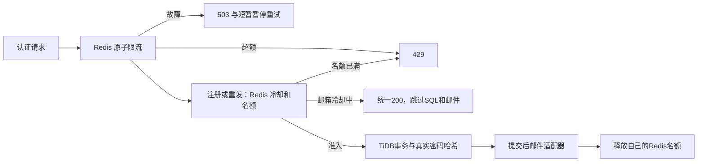

> 前端迁移快照，导出日期：2026-10-14。来源：后端仓库 `architecture/redis-registration-verification.md`。包内链接已调整；源码、脚本、本地路径及凭据配置说明均指后端工程，不要求在前端创建或执行。更新时从后端重新导出。

# Redis认证并发控制与真实验证

2026-10-12，用户要求Redis承担主要并发请求。本次实现认证请求的Redis限流、注册/重发冷却及准入，并以真实Upstash和TiDB验证。未扩大到图片缓存、官方库缓存、对象存储、部署或消息队列。

## 实现

`RedisAuthTraffic`通过Spring Data Redis/Lettuce运行Lua：所有认证POST共享每IP30次/60秒和总计600次/60秒；注册/重发共享同邮箱60秒冷却、最多4个并行任务。计数与TTL、冷却与随机租约均原子写入，120秒过期任务可回收，完成时只释放自己的随机ID。cloud默认启用；local不创建Redis连接，保留原来的单实例内存限流。



Redis不存账户密码、验证码原值或JWT，不决定账户存在、激活与私有授权；TiDB事务、唯一邮箱索引、一次性验证和会话当前状态仍保持权威。热点响应缓存/outbox消费器尚未实现，本次减压方式是拦截或抑制突发/重复请求，并非把账户异步写入Redis后宣称注册完成。

Redis连接/命令超时3秒，每实例最多32个在途控制命令，超额429；依赖失败503并暂停5秒后恢复尝试，不无界回落到数据库。释放失败不改变已提交请求结果，租约TTL恢复名额。验证码投递或SQL失败后保留60秒冷却，需等待后重试/重发；统一200不证明邮件投递或账户激活成功。响应429有Retry-After=60，控制器/过滤器产生的503有Retry-After=5。

键格式、TTL、HMAC与同槽标签见 缓存规则（后端仓库参考：`database/redis/cache-rules.md`，未包含在本迁移包），配置见 环境配置（后端仓库参考：`architecture/backend-environment.md`，未包含在本迁移包）。共享实例须使用相同环境前缀和签名密钥，来源不信任转发头。租约只是减压机制，Redis淘汰或任务停顿超过租约可能改变准入数量，不代替数据库正确性。

## 真实测试

JDK25.0.4.1、Boot3.5.16、i7-12700H本机服务与HTTP客户端，远程Upstash `rediss` FULL证书/主机验证，远程TiDB `VERIFY_IDENTITY`。Hikari最多4连接、获取超时5秒；密码PBKDF2仍310000次。未改变数据库结构或执行迁移。

显式云写入测试：`src/test/java/com/illusionrealm/backend/infrastructure/security/RedisRegistrationIT.java`。默认verify不执行；即便显式选择，也须系统属性 `illusion.redis-it.authorized=true`。只绑定127.0.0.1随机端口，启动断言用户表为空；不清理他人账户。每轮使用独立Redis测试版本前缀、UUID虚假邮箱，模拟邮件不调用SMTP。正式路由、Controller、事务、密码编码器及Mapper均为真实实现，未绕过生产安全过滤器。两个独立Redis控制器共享同一命名空间，用来验证跨实例原子状态，并未部署两台服务器。

```powershell
# JDK25，真实.env已配置；所有写库实例应停止。本命令会创建测试账户并清理。
$env:MAVEN_USER_HOME = Join-Path (Get-Location) '.build-tools'
.\mvnw.cmd -B -ntp '-Dmaven.repo.local=.build-tools/repository' '-Dtest=RedisRegistrationIT' '-Dillusion.redis-it.authorized=true' test
```

最终补测BUILD SUCCESS，1项集成测试、0失败/错误/跳过。结果如下：

最终JDK25 Maven Wrapper默认verify也BUILD SUCCESS：38项回归全部通过，包括Redis不可用关闭入口、释放失败保护、以及真实cloud模块的无网络Redis装配。显式选择云测试但不提供授权标志时，验证1项确实跳过且未启动云上下文；这是隔离检查，不是云压测成功。

| 场景 | 并发 | 请求 | 结果 | 全部请求/秒 | P95 ms |
| --- | --- | --- | --- | --- | --- |
| 两控制器共享IP计数 | 16 | 64 | 放行30、拒绝34 | 35.83 | 1388 |
| 两控制器共享邮箱冷却 | 16 | 16 | 仅1次准入 | 128.62 | 123 |
| 人工占满4个名额后的HTTP | 16 | 128 | 全部429，0账户、0注册服务调用 | 63.88 | 757 |
| 不同邮箱HTTP注册突发 | 16 | 64 | 200×4、429×60，无5xx | 9.01 | 3093 |
| 同邮箱注册/重发HTTP冷却 | 16 | 24 | 200×24，0注册/重发服务调用、0新增投递 | 41.84 | 305 |
| 停用本轮Lettuce连接器 | 4 | 8 | 503×8，0注册服务调用 | 不作容量指标 | 4.4 |

直接调用控制器的“放行/拒绝”只是测试分类，不是网络HTTP响应；真实HTTP阶段使用正式API。全局600次上限通过将本轮独立总桶置599后并发2次验证：只有1次放行，总桶为600。该边界探测不测延迟，也不代表600请求的持续吞吐。租约测试预置一个过期任务，准入时实际回收，4个独立有效名额耗尽后，第5次429且不写邮箱冷却；释放后ZSET为空。真实TTL、Lua的TIME/GET/INCR/PEXPIRE/SET/ZSET操作兼容已通过，未用pipeline冒充原子性。

128次全拒绝是刻意占满名额的保护性测试，不能称为63.88次成功注册/秒。64次突发中新账户实际成功率6.25%，其余是主动限流；这改善了过载保护，不证明唯一新用户注册吞吐提高。24次冷却响应均不再进入AccountService，实际约41.84响应/秒，账户数和验证摘要未增长；正式统一200不披露账户是否存在。

本轮创建5个虚假账户（突发4、另一个冷却场景1），每人1份额度和1个验证摘要；冷却中的重发未创建额外令牌。真实邮件令牌的HTTP激活200、再次消费401，outbox总数等于账户数加激活事件1。此套件用模拟投递捕获真实随机令牌，未加入新固定码或生产旁路；前一轮 固定码压力验证（后端仓库参考：`architecture/registration-load-verification.md`，未包含在本迁移包） 是另一个测试。

停用的仅是测试应用的Lettuce连接器，没有关闭或破坏Upstash。真实HTTP503及无SQL调用通过；重启连接器、等待5秒暂停结束后Redis准入成功。这验证本地连接不可用与恢复分支，不代表真实供应商故障演练、丢包或慢超时验证。单元测试另确认释放失败不改变已提交结果、重复释放幂等、错误脱敏以及暂停期间不重复访问依赖。

所有本轮账户/额度/摘要/outbox已事务清理；Redis只删除有限的已知本轮键，并一次EXISTS确认清零，不扫描、KEYS或FLUSHALL。独立TLS数据库连接确认用户相关表为0、官方库入口仍3。脱敏指标在本地忽略目录 `.build-tools/redis-registration-results.json`，首轮保留于 `.build-tools/redis-registration-initial-results.json`。

最终打包JAR又在cloud,verification配置本机启动：liveness/readiness/验证页均200，健康没有details/components；非法注册参数通过真实Redis过滤器后返回400/INVALID_ARGUMENT，未创建账户或发送邮件。这次使用独立smoke命名空间，仅产生60秒TTL限流键；检查结束已停止本轮进程，之前18080验证服务继续保持停止。正式JAR包含Redis控制实现，不包含RedisRegistrationIT、模拟邮件或固定码测试类。

## 限制

真实SMTP吞吐/收件、多进程部署、慢网络/供应商故障、长时间负载及实际服务配额未验证。当前名额只保护注册/重发，登录和激活仍需后续独立容量评审。此前16并发无准入注册出现503的 数据库容量结论（后端仓库参考：`architecture/registration-load-verification.md`，未包含在本迁移包） 仍有效；本次通过不把它改为已解决的SQL性能问题。

下一步应采集连接池等待、密码哈希与SQL阶段耗时，并在选定部署地域和服务预算后测正常放行流量，决定名额和限流阈值；不能直接放大并发或削弱密码算法来提高数字。
