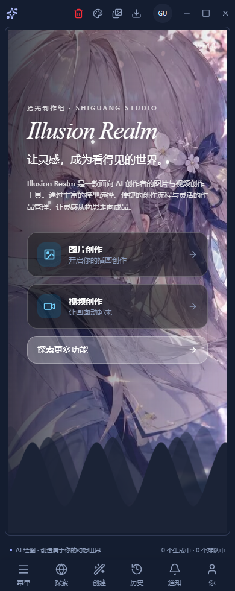

# 恢复原版首页与品牌艺术字

日期：2026-11-01。

按用户决定，首页仅使用原版 `HomeHero`。删除 `view/home/template-v2` 中的组件、配置、样式和专属背景，以及 zh-CN/en 的 `home.v2` 文案。`HomePage` 不再保留模板状态或切换按钮，没有新增用户数据迁移。

原版品牌标题保留真实的 `Illusion Realm` 文本，参考截图采用细衬线斜体、正常字重、收紧字距和有上下限的响应式字号。字体优先系统 Times New Roman，回退 Georgia/serif，不增加联网字体、品牌图片或另一套组件。原背景、遮罩、波浪、卡片、导航、窗口控制和跳转仍由既有组件负责。顶栏品牌未作全局字体修改。

## 修改与复用

- `apps/next/src/view/HomePage.tsx`：直接返回原有 `HomeHero`，移除第二模板状态与导入。
- `apps/next/src/view/home/HomeHero.tsx`：仅修改品牌 h1 的字体样式并说明离线与窄窗边界。
- `apps/next/src/i18n/locales/{zh-CN,en}/home.ts`：删除废弃模板词条，保留原版文案。
- `scripts/lib/check-home-template.js`：复用现有隔离窗口、主题切换、截图和导航能力，将失效的第二模板断言换成原版首页验证；保留原有编辑、蒙版/边缘切换和原生弹窗下拉回归。
- `docs/home-template-v2-2026-11-01.md`：明确标记历史模板已移除，原记录保留为历史证据。

## 实际验证

- `pnpm typecheck` 通过。
- `pnpm lint` 通过，0 errors、33 个既有 warnings；本轮未增加告警。
- `pnpm --filter @illusion-realm/next build` 通过，28 个静态路由；指纹 `34121a00af3037e1c7955941d2ecd347a986bef77aa4d792400ec4a1440f8552`。
- `pnpm check:locale-keys`、`check:i18n`、`check:refs`、`check:smoke` 通过。
- 运行现有 `smoke-prompt-assembly.js` 的首页专项：设置 `LIBRARY_REUSE_ONLY=1`、`HOME_TEMPLATE_ONLY=1`，**14/14 通过**。此范围不代表完整提示词组装/资料库套件通过。
- Electron 核对当前静态导出指纹，深浅主题各验证 1500/900/390px，检查背景实际解码、品牌全称、斜体与正常字重、第二模板/切换入口不存在、页面无横向溢出及探索入口跳转。
- 保留并运行了既有文字编辑三标签、原生弹窗下拉命中与 Escape 焦点回归。
- 实际查看桌面浅色、手机深色运行截图；本轮测试进程已退出。

页面由生产 preload 与真实 `app://app/` 静态导出绘制，用户文档及窗口隔离。夹具未注册的 `account:me`、`models:downloadList` 仍会打印旁路错误；本轮不把此专项当作账户或下载能力验证。

未重打安装包，未验证其他操作系统的实际字体回退、真实模型生成或可见窗口遮挡维度。未重复运行完整 `pnpm check`，上轮记录的无关门禁问题不在此次视觉修改范围。

## 截图

## 增量注释

以本轮前工作区快照为基线，未将历史修改和删除行计入成果。新增/替换行按注释规范计数并核对说明的准确性，详情见 `home-original-wordmark-comment-audit-2026-11-01.json`。

- 业务：C=8，B=2，80.00%。
- 测试：C=51，B=20，71.83%。
- 注释示例：解释系统字体无需远端下载，以及窄窗允许自然换行；测试说明同时检查背景 `complete` 与 `naturalWidth`，防止坏图只显示空标签也通过。
