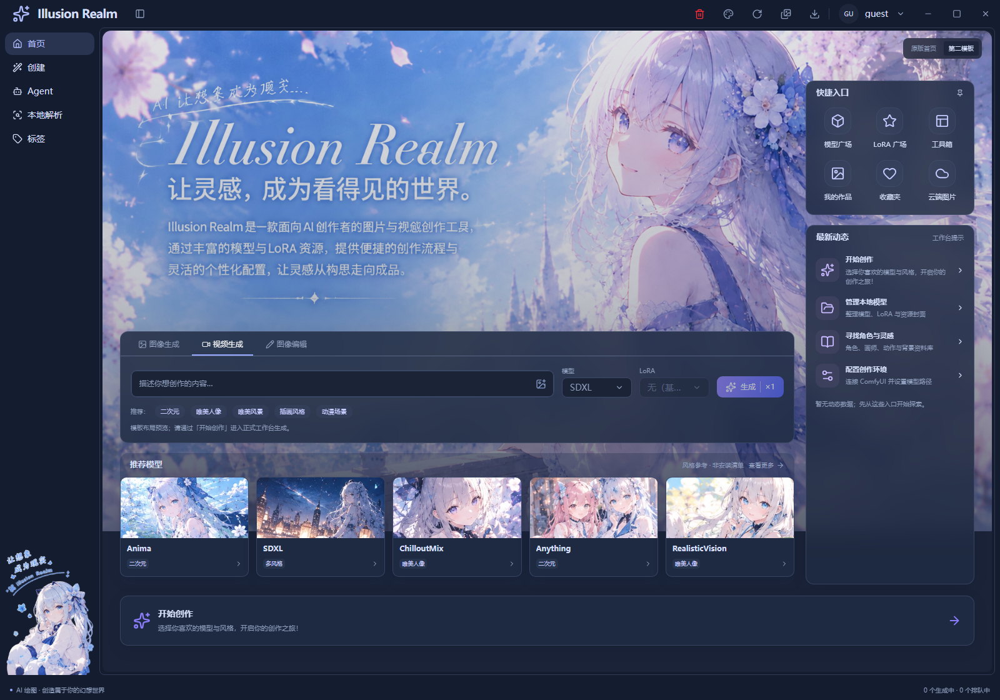
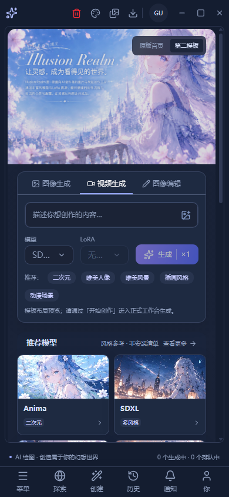
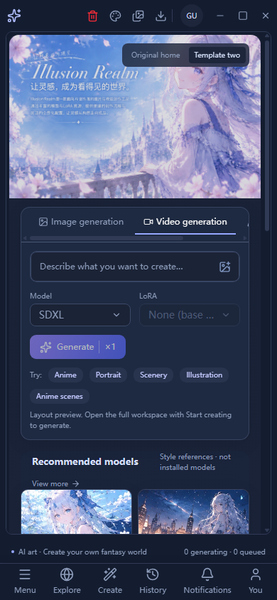

# 首页第二模板与本轮公共 UI 记录

日期：2026-11-01。保留任务开始时工作区的已有修改，没有回滚导航、媒体、模型管理或安装器。

> 当前状态：根据用户后续决定，第二模板、切换入口、专属背景和双语 `home.v2` 文案已移除，首页只保留原版。原版品牌标题改为参考图中的细衬线斜体；见 [恢复原版与艺术字记录](home-original-wordmark-2026-11-01.md)。下文保留历史设计与其他公共功能的实施证据，不代表第二模板仍在产品中。

## 后续调整：背景铺满

按“图片要铺满”的反馈，背景改为覆盖整个可见首页工作区，保持原图比例；背景随 main 滚动保持可见，不按整页内容高度不断放大。桌面按背景实际缩放预留文字区域，手机使用人物位置作为裁切中心。仍复用同一个图片节点和模板样式，没有增加背景组件或全局覆盖。

本次仅修改 `home-v2.module.css`。Next 静态构建通过，首页专项 17/17 通过，人工检查浅色和手机截图。未重新打包安装器。最新截图位于 `screenshots/home-background-fill-2026-11-01/`；前文截图保留作为初版记录。

本次 CSS 增量以调整前工作区文件为基线：有效注释 C=15、代码 B=6，71.43%；测试源码没有改动，测试注释率不适用。这一小轮比例不抵扣前序任务尚未达标的统计。

## 首页第二模板

入口仍是 `/`，沿用 `AppShell`、标题栏、导航和 main 滚动。默认展示第二模板，右上角可以切回原版；两套首页只挂载当前选择的一套。切换偏好不新增持久化字段。

模板专属组件、配置、样式和用户提供的背景集中在：

```text
apps/next/src/view/home/template-v2/
  home-v2.tsx          组合创作栏、推荐卡、快捷入口、工作台提示和页尾入口
  home-v2.module.css   模板局部样式、容器断点、主题和减少动画支持
  config.ts           入口、标签和五张参考卡配置
  backdrop.png        用户提供的图1，保留原有品牌文字
```

`view/HomePage.tsx` 只负责模板切换。新增文案沿用 `home.v2`，同步中英文，没有第二套翻译系统。

组件位于背景品牌文字与分隔装饰下方；右栏使用没有品牌文字的空间。桌面为主体和右栏，窄窗口转为纵向；长下拉选项在本格省略，不覆盖相邻按钮。滚动由现有 main 管理，不把整个首页固定到窗口上。

复用现有 `PromptInput`、`SimpleSelect`、`IconTabButton`、Next `Image` 和 `Link`。同形卡片、区块标题及快捷入口使用配置渲染。输入框通过 `assistant={false}` 关闭模板不需要的助手工具条，避免把一行草稿变成完整生成面板。

### 当前业务边界

- 输入草稿、推荐词、模式和参考模型选择可以操作，但只属于这个模板。
- 生成和 LoRA 下拉明确禁用；底部“开始创作”进入正式 `/create`。
- 模型封面复用项目已有插画，并标明“风格参考 · 非安装清单”。没有伪造安装、下载或生成记录。
- 右侧保留动态区位置，当前显示明确标识的工作台提示，没有虚构用户动态。
- 快捷链接复用现有模型、工具、个人中心和设置路由；没有假装已接通个人中心的特定子标签。

### 移除方式

1. 将 `view/HomePage.tsx` 恢复为只导入并返回原有 `HomeHero`。
2. 删除整个 `view/home/template-v2` 目录。
3. 可一起删除中英文 `home.ts` 的 `v2` 词条，以及 `scripts/lib/check-home-template.js` 和冒烟入口内对应调用。

原版首页和公共组件仍保留，不需要为移除模板回滚应用外壳或资料库代码。

### 真实运行截图

以下是 Electron 通过 `app://app/` 加载静态导出的截图，使用真实页面、preload 和原生主题能力。测试窗口离屏合成，不是用户整个桌面的截图。截图前通过正式按钮确认更新公告，没有移除 DOM 或隐藏遮罩造图。






## 前序两项需求的收尾

### 下拉、卡片和收藏

原生 `<select>` 的使用处改为项目现有 `SimpleSelect`：保留原选项值、保存回调、字体分组和字体预览。共享实现补齐禁用、键盘方向键、Home/End、Escape 归还焦点和窗口边缘定位。原生 `dialog.showModal()` 内的 Portal 留在同一个 dialog 中，实际命中测试确认未被顶层遮挡。

云端上传、图片编辑和收藏夹编辑把请求锁显式传给下拉：外层 `fieldset` 不能禁用已经挂到外面的 Portal。没有合并这些业务的保存或权限流程。

角色、画师、动作、背景、表情共同使用 `LibraryCard`，文本表面使用 `LibraryTextItem`，展示切换使用 `LibraryDisplaySwitch`，收藏和导出使用 `LibraryFavoritesControls`。选择、收藏和详情仍是独立动作。

五库收藏都通过原统一用户文档保存：角色保留原 `characterFavorites` 段并增加已收藏角色快照；画师保留原分组体系；动作、背景、表情共用 `libraryFavorites` 段。导出汇总成一个 JSON，只包含收藏资料、标签、图片地址和分组，不包含用户设置或凭据，也不打包图片字节。

旧角色收藏若只有本地 slug，可从已编码的名字与作品精确恢复；未知在线 slug 不猜测角色，保留身份并提示缺少快照。收藏检索使用完整快照集合，最后才分页。

### 编辑页删项

删除文字改图表单内部重复的文字/蒙版切换和“导出 API 工作流”。文字表单显式读取 text 草稿，避免旧模式状态影响运行。顶部“文字 / 蒙版 / 边缘检测”三个工具保留并通过实际切换检查。生成、停止、原图、随机种子和参数没有替换为演示业务。

## 验证结果

| 检查 | 实际结果 |
| --- | --- |
| `pnpm typecheck` | 通过，包含渲染层和 Electron 类型检查 |
| `pnpm lint` | 通过，无 error；33 条现有 warning |
| Next 静态构建 | 通过，最终指纹 `c1dec5dd50d7999d7a561863aa1ae43f2d3826575ab5ef547e8c684b352f6df4` |
| 双语键检查 | 18 个命名空间一致 |
| 收藏格式反证 | 通过，包含坏字段、未知版本、去重、旧 slug 和完整集合过滤 |
| 画师数据验证 | 通过，40600 条资料、排序、选择及分组生命周期 |
| 资料库与首页联合专项 | 61/61 通过；之后的首页细化另有下列复测 |
| 最终首页专项 | 17/17 通过；浅深主题、900/390 宽度、英文、下拉边界、原版切换、正式创建入口、编辑工具切换和原生弹窗菜单 |
| 提示词助手 | 78/78 通过，包含翻译历史的新共享下拉 |
| 视频按帧导出 | 9/9 通过，包含共享菜单、两处控件同步、真实 FFmpeg 输出探测和取消 |
| 脚本引用与冒烟约定 | 通过 |

Electron 冒烟逐个运行，未结束用户正在使用的开发实例。资料库专项在临时用户目录实际写入、重载并触发浏览器下载；角色使用两页受控回包，远端缩略图使用单像素夹具，所以不能据此声称真实线上搜索或图片服务已联调。

### 未通过与未验证

- `pnpm check` 被既有 3 个未引用词条阻断：`auth.verifySuccess`、`common.localeNameSelf`、`create.generationTasks.active`。前面的类型与 Electron 模块验证通过，后续串联项目不能宣称已运行通过。
- 个人中心完整专项为 99/105：6 个展开导航断言仍要求旧的 127px，当前已有样式为 158.75px；本轮未调整 nav 宽度。排序、收藏、语言等其余已执行断言通过，不能把完整专项标绿。
- 云端图库完整专项为 8/11 后中止：标题栏、main 和封面仍按旧尺寸/颜色断言，之后旧收藏输入流程等待超时。上传默认值、失败保留草稿、重试和主题已通过；后半段收藏管理及其新菜单没有完成该完整套件验证。
- 未打包或运行新的 setup，没有测试在线账号服务、付费模型接口或首页真实生成。
- 首页参考模型不是本机扫描结果；收藏导出没有实现导入或图片离线打包。

## 注释统计与验收缺口

统计基线为任务开始时的工作区快照，而不是 HEAD，排除了此前已有修改。统计新增和替换后的行，删除行、未变上下文、纯定界符及跨文件完全重复说明不计入；JS/TS、JSX、CSS、词条和测试均纳入。逐文件数据见 `library-home-comment-coverage-2026-11-01.json`。

| 范围 | 有效说明候选 C | 代码 B | 比例 |
| --- | ---: | ---: | ---: |
| 业务 | 220 | 766 | 22.31% |
| 测试 | 96 | 305 | 23.94% |

说明内容已核对实现边界，例如用“同一个玻璃展柜”解释原生弹窗的顶层 Portal，用“图书馆名+书号”解释跨库收藏身份。上述比例仍未达到仓库要求的 70%，不能视为完全满足代码注释验收；也不能把统计结果包装成达标或靠重复说明补数字。
