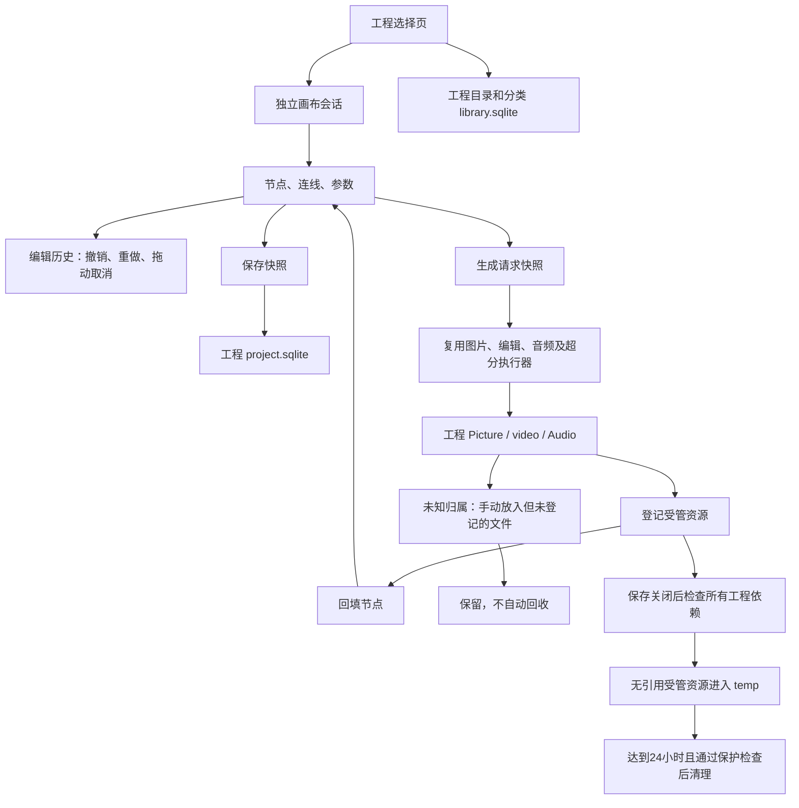

# 无限画布逻辑审查（2026-11-15）

结论：存在局部逻辑冲突，其中两项能造成引用错图或生成结果从画布消失。问题主要发生在不同操作交叉时，不是已经证实 SQLite 整体异常，也不需要据此重写画布。

本轮只审查并新增本报告，未修复业务代码，未删除用户资源，未提交或上传 GitHub。审查基线为本轮工作区，包含原有已修改和未跟踪文件；没有将 HEAD 当作当前产品状态。

## 当前关系与职责

画布复用 React Flow 管理位置、选择和连线；生成复用现有任务执行器；文件归属、资源台账与回收由主进程负责。连线目前主要表达引用关系，并不是自动执行整张节点网的任务调度器。节点撤销和磁盘文件回收也不是同一笔事务。

## 优先修复的两项问题

### L01 / P1：删除或新增前序输入后，已有 @ 引用可能悄悄换图

复现：A、B、C 三张图连接到同一编辑节点；正文使用 `@picture2` 引用 B。删除 A 节点后，正文仍为 `@picture2`，但当前编号表把 C 排到了第二位，装饰与资源解析会转而命中 C。新增 ID 排在前面的连线来源、移除前面的手动附件，也有同类风险。

原因：`canvas-reference-media.ts:44` 每次按当前来源重新生成连续编号；`prompt-media-references.ts:84` 根据类型和数字查找资源；`canvas-reducer.ts:193` 删除节点和边时没有同步迁移提示词的引用身份。稳定的节点 ID 排序只能保证同一份输入集合顺序一致，不能保证集合变化后旧数字仍指向原资源。

本轮直接执行生产 `canvasReferenceMedia`、`findPromptReferenceMedia` 和删除 reducer，确认同一个 `@picture2` 从 B 改指 C，删除命令保留原正文。只替换了文件显示名和 URL 包装，没有替换排序、编号、查找或删除算法；未调用真实模型。

建议：在工程中保存稳定资源身份与正文引用的对应关系，提交时才生成当前服务需要的连续编号；或在每次输入集合变化时，按资源身份同时重写正文。删除被引用资源时应明确提示缺失，不能让后面的资源自动顶替。

### L02 / P1：拖动期间收到生成结果，再取消拖动会把结果一起恢复掉

复现：开始生成 → 在结果返回前按住并拖动节点 → 结果回填 → 尚未松手时按 Esc。预期只取消移动；当前会连同刚回填的媒体一起恢复到拖动前状态。新增的批量结果节点也可能被整张旧快照覆盖。

原因：`use-canvas-image-generation.ts:97` 将结果提交到当前图，生成结束没有等待拖动事务收尾；`canvas-reducer.ts:244` 的拖动取消恢复整份 `state.drag`，其中不仅有位置，还有旧节点数据、边和工程归属。`infinite-canvas-page.tsx:470` 允许生成期间拖动，故两条路径能交叉。单纯在任务开始前检查 `drag` 不能阻止任务执行期间开始拖动。

本轮执行实际生产 `applyResult` 和 reducer：先确认 `media.path` 回填成功，再执行取消，确认该媒体引用变成 `undefined`。没有生成文件，没有改动用户工程。该结果证明状态机冲突；真实鼠标时序尚未人工复现。

建议：拖动取消仅恢复本次手势影响的几何字段；同时明确生成回填如何进入当前拖动的前后历史。不能仅修 Esc 后的显示，否则松手后撤销移动仍可能连带撤回生成结果。

## 其他前后不一致

| 编号 | 级别 | 用户会遇到什么 | 代码证据与建议 |
| --- | --- | --- | --- |
| L03 | P2 | 设置选“双击空白”后，空白右键仍会打开同一添加菜单 | `reference-ui/canvas-settings.tsx:23` 把右键/双击作为二选一；`infinite-canvas-page.tsx:297` 右键处理不检查该设置，`:470` 只控制额外的双击入口。应让选项真正控制行为，或取消已经不符合最新右键需求的旧选项。 |
| L04 | P2 | “现有节点资源”找不到仅作为附件、音频参考或嵌入工具素材存在的文件 | `canvas-project-resources.tsx:104` 只取 `node.data.media`；主进程 `project-archive.js:189` 还统计 `inputImages`、音频参考、导演台图片和合成器资产。保存/删除保护认为这些文件是依赖，选择界面却不列出。建议共用纯数据资源枚举规则，再按用途过滤；若入口只指主输出，应明确命名。 |

L03、L04 来自真实调用链核对，本轮未新增界面自动操作来复现。L04 不等于这些附件会被误删：现有主进程回收枚举反而覆盖了这些引用。

## 已确认的功能缺口与产品语义

这些事实需要明确，但不应全部包装成数据库错误。

| 编号 | 当前事实 | 实际影响 |
| --- | --- | --- |
| G01 | 普通视频生成未接通 | `canvas-node.tsx:164` 仅为图片和音频注入生成回调；`use-canvas-image-generation.ts:120` 同样拒绝普通视频节点。视频虽有工作流、比例、FPS、时长和模型参数，但不能据此认为已具备视频生成闭环。已导入视频的播放、视频超分和视频合成是其他独立能力。 |
| G02 | 文本连线不参与生成正文 | `canvas-model.ts:353` 允许文本连接生成节点；本地 `canvas-image-parameters.ts:73`、编辑流和远端请求使用目标节点自己的 `prompt`，没有读取上游文本 `content`。若文本边只是组织关系，应在交互中说明；若用户期待提示词输入，它就是尚未接通的功能。不能擅自决定拼接顺序和覆盖规则。 |

生成结果首先回填原节点，其他批量结果成为独立卡片，目前没有单独的“生成来源关系”字段。这与此前批量结果独立成卡的要求一致，不能为了展示来源直接补生成输入边，否则可能改变下一次上传的参考图。

## 资源回收：保护正确，但时间承诺要说清楚

- 未登记文件保持未知归属，不因“当前无引用”进入自动回收。本轮资源专项验证了工程根、分类目录和外部原件保留。
- 删除节点后，文件不会立即删除；保存并关闭后才授予回收资格。挂起会话继续保护撤销历史和在途任务，这是现有设计。
- `canvas-library.js:257` 在任何画布会话仍打开或挂起时跳过整轮回收。A 工程长期开着，会延迟 B 工程的回收，包括已经到期的 temp 文件。
- `resource-recycle.js:19` 需要读取所有未删除工程；任一工程不可读会中止整轮。这样能避免误删，但一个坏工程会拖住其他工程清理。
- 到期时间从进入 temp 开始计算（`resource-ledger.js:52`），不是从点击 Delete 开始。运行时每五分钟检查，另有启动补查；应用未运行时不会执行删除。因此“24小时自动删除”应理解为“满24小时后，在应用运行且保护检查允许时清理”。
- 未知文件扫描最多8层、列表最多2000项（`resource-catalog.js:15`、`:66`）。数量截断已有标记；深度截断没有独立提示。列表不等于整个工程磁盘内容的无限制完整视图。

本轮未发现“只因无引用就自动批量删除未知归属文件”的路径。显式选择资源删除、显式删除整个工程，与无引用自动回收是不同授权，不能混为一谈。

生成、导入、图回填和保存也有不同失败边界。文件已完成、节点回填失败时保留成果是保守策略，不应立刻删除文件。但要通过台账和后续回收让用户能找到这些文件；仅凭撤销节点，不能声称磁盘写入已经撤销。

## 本轮实际验证

| 命令或方式 | 结果 | 能证明与不能证明的范围 |
| --- | --- | --- |
| `node scripts/verify-canvas-project.js` | 通过 | 工程格式、模型与拖动算法；包含300节点线性访问反证，不代表实际帧率。 |
| `node scripts/verify-canvas-generation.js` | 248项通过 | 生产纯函数/源码与模板检查；无真实推理。 |
| `node scripts/verify-performance-regressions.js` | 通过 | 异步扫描、缓存隔离和有序原子写入专项。 |
| `pnpm exec electron scripts/verify-canvas-resources.js` | 9/9通过 | 临时工程、真实文件和 SQLite；包括恢复、未知归属、到期清理、跨工程引用和坏库保护。时间由测试注入，未实际等待24小时。 |
| `pnpm exec electron scripts/verify-canvas-global-resources.js` | 6/6通过 | 临时全局库的导入、删除保护、文件身份和部分失败；删除失败分支有故障注入。 |
| `pnpm exec electron scripts/verify-canvas-library.js` | 18/18通过 | 临时工程的保存重开、分类、迁移、新建竞争和目录删除。 |
| L01生产函数独立反证 | 确认问题 | 保留旧正文并重算输入后，`@picture2` 从 B 指向 C。无文件读取、真实上传或模型调用。 |
| L02生产函数独立反证 | 确认问题 | 实际回填成功后，拖动取消恢复旧媒体数据。没有模拟鼠标，也未声称人工验收。 |

三个 Electron 存储专项按顺序运行，未并行启动 Electron。测试前未检测到正在运行的 Electron 进程，没有终止用户应用。首次误用 Node 启动上述三个 Electron 脚本时因缺少 Electron `app` 失败，随后改用正确入口各执行一次并通过；前一次启动错误不计产品断言失败，也不计通过。

本轮没有修改渲染源码，因此没有重新构建或运行静态导出界面冒烟；没有重新运行全量类型、lint、`pnpm check`。上轮记录中的通过结果不当作本轮新结果。上轮全量检查受 `auth.verifySuccess`、`canvas.reference`、`canvas.styleTransfer` 三个未引用词条阻挡，本轮未核销。

## 未验证与建议顺序

1. 先修 L01，覆盖删除、新增、断线、手动附件删除、撤销和重开，确保资源身份与最终 MiniMax 编号一致。
2. 再修 L02，覆盖结果回填与移动/缩放的取消、松手、撤销和重做交叉，不能只禁止某一个键掩盖状态冲突。
3. 统一资源枚举范围，处理 L04；保留主进程现有未知归属和删除保护。
4. 清理 L03 的失效设置语义，再明确 G01、G02 的实际支持范围。
5. 之后再考虑按工程隔离回收阻塞，保留跨工程引用检查；不以追求准时删除为由放宽安全保护。

未人工验证上述交叉操作的完整界面手感、系统文件选择框、真实收费接口、GPU推理、长时间运行或24小时墙钟到期。没有将现存人工待验项改成通过，也不能据本报告声称画布没有其他问题。

本轮仅新增文档。业务代码和测试代码的增量有效注释率均不适用；没有为审查补注释或凑比例。
