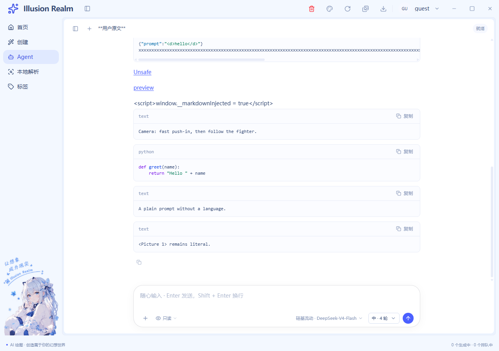
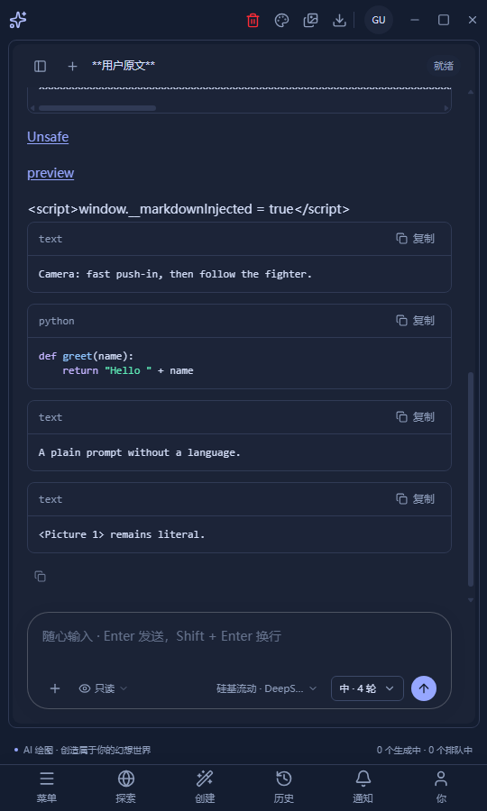
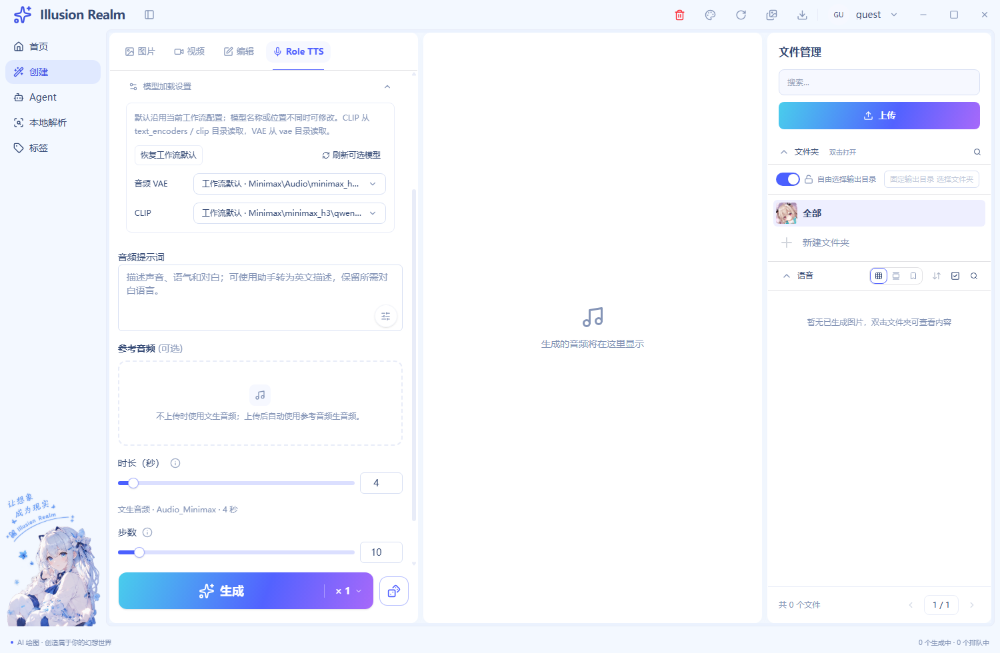
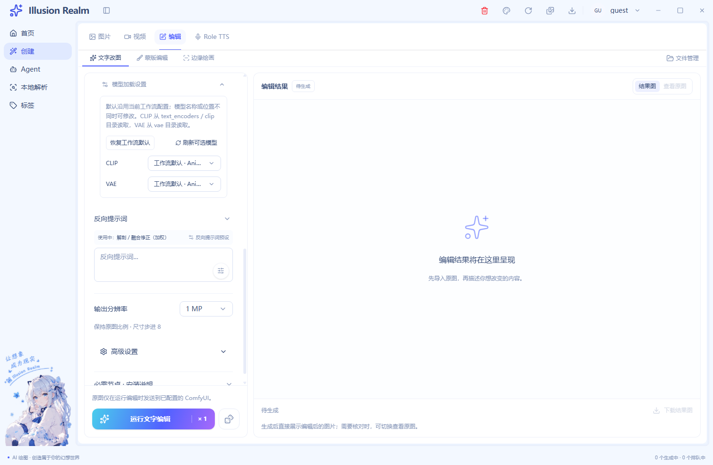
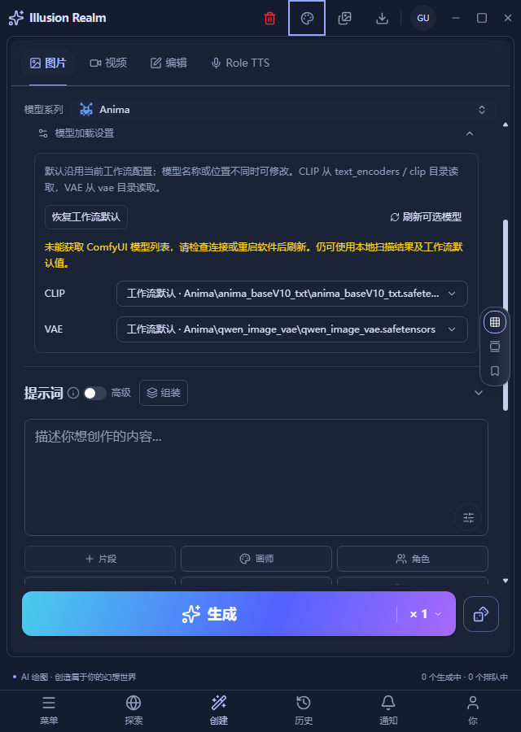

# 四模式辅助模型设置与 Agent 代码块阅读

日期：2026-11-01。范围只包含本轮两个需求，工作区历史修改保留。

## 实际行为

图片、视频、编辑、Role TTS 都复用 `WorkflowModelSettings`。它读取各自真实 API 工作流的 CLIP/VAE 加载槽，保留模板默认名，提供修改、刷新和恢复默认。候选继续使用原 ComfyUI 清单、本地模型扫描、相对路径转换与 `SimpleSelect`。

| 场景 | 加载项与状态边界 |
| --- | --- |
| Anima 图片 | 一个 CLIP、一个 VAE；按图片系列隔离覆盖，提交真实图片构建器 |
| SDXL 图片 | 当前模板由 Checkpoint 自带 CLIP/VAE，显示说明，不虚构独立加载器 |
| 视频 | 继续按当前视频工作流取槽；MiniMax 是 CLIP、视频 VAE、音频 VAE |
| 文字编辑 | 使用 Anima 图片基础图加载槽，仍保留原图参考与编辑专用流程 |
| 蒙版、边缘编辑 | 分别读各自控制图；覆盖应用到最终图，不能把控制节点号传入中间图片图 |
| Role TTS | 有参考、无参考各保存一份覆盖；仅音频 VAE 与 CLIP，内部 `pixel_space` 不展示、不允许改写 |

主模型与 LoRA 的选择继续由原控件负责。模板连接、上传、队列、落盘、进度与取消没有另建实现。未知辅助槽、主模型伪装成辅助覆盖、绝对路径与父目录穿越在构建阶段被拒绝。覆盖只更改本次克隆图，恢复默认使用当前模板值。

Agent 保留 `react-markdown + remark-gfm`，新增 `MarkdownCodeBlock` 与成熟的 `lowlight` 语言库。围栏指定受支持的语言后显示标签和高亮；未指定、`text` 或未知语言回落为普通 `text`。不激进猜测英文镜头描述是什么编程语言。

右上角复制只取当前块正文，保留缩进与内部空行，不带语言、围栏、按钮或其他段落。复制失败有反馈，各块状态独立。行内 code 和整条回复复制保持原行为。高亮树只输出文本与 span，不启用 HTML 执行。超过十万字符的块保留完整正文和复制，跳过同步着色。

## 修改文件与复用

业务文件（相对仓库根）：

- `apps/next/src/view/create/video-model-settings.tsx`：由原视频设置推广为四模式共用组件，保留原回归定位标记。
- `apps/next/src/utils/comfy/video-workflow-models.ts`：共用辅助槽提取、媒体标签与覆盖校验。
- `apps/next/src/view/CreatePage.tsx`、`view/create/VideoCreatePanel.tsx`、`view/create/RoleTtsPanel.tsx`、`components/create-edit/anima-edit-settings.tsx`：实际入口接入，通过模板、覆盖、回调和禁用状态注入差异。
- `apps/next/src/stores/use-audio-create-store.ts`：音频分支草稿与本次队列参数。
- `apps/next/src/utils/comfy/imageWorkflow.ts`、`anima-edit-workflow.ts`、`anima-control-workflow.ts`、`audio-workflow.ts`：将选择应用到真实提交图。
- `apps/next/src/components/MarkdownResponse.tsx`、`markdown-code-block.tsx`：公共代码块阅读控件与原 Markdown 渲染入口。
- `apps/next/src/i18n/locales/zh-CN/create.ts`、`en/create.ts`：通用设置说明与 checkpoint 内置说明。
- `apps/next/package.json`、`pnpm-lock.yaml`：增加 `lowlight`，未增加另一套 Markdown 编辑器。

验证复用 `scripts/verify-anima-control.js`、`verify-minimax-audio.js`、`smoke-minimax-workflow.js` 和 `smoke-agent-markdown.js`。音频回归加载器按依赖真实所属包解析，避免依赖 pnpm 偶然提升；仍执行真实 shared 模块，不替换 schema。

## 已实际运行

| 检查 | 结果 |
| --- | --- |
| `pnpm typecheck` | 通过，随后 `pnpm check` 也完成其类型检查阶段 |
| `pnpm lint` | 0 errors，33 个既有 warnings；本轮新增组件没有 lint 告警 |
| `pnpm --filter @illusion-realm/next build` | 通过，28 个静态路由；源码指纹 `d7117c2f36c6f857607c5251902f00acb73b02ed9e6190d29532167d2d354c7e` |
| `node scripts/verify-anima-control.js` | 通过；含图片、文字、蒙版、边缘、两份音频图的合法覆盖、默认恢复、模板不污染、非法槽与路径拒绝、SDXL 内置边界 |
| `node scripts/verify-minimax-audio.js` | 6/6 组通过，含真实构建器、HTTP 夹具、FIFO、取消与批量冻结 |
| `pnpm exec electron scripts/smoke-agent-markdown.js` | 24/24；真实静态页面、生产 preload、流式消息、块语言、高亮、缩进复制、text 回落、复制失败、两主题及 1920/1280/540/320px |
| `pnpm exec electron scripts/smoke-minimax-workflow.js --loaders-only` | 9/9；四入口字段、图片草稿恢复、重置、离线默认保留与暗色窄窗口 |
| `pnpm verify`（由 check 执行） | 主进程模块、通道、注册与已有契约全部通过 |
| `check:i18n`、`check:i18n:en`、`check:locale-keys` | 通过；双语键一致，硬编码基线未增加 |
| `check:smoke`、`check:refs`、`check:outputpath`、`check:foldercount`、`check:locale`、`check:initlocale` | 分别运行通过 |
| 本轮文件 `git diff --check` | 通过 |

Electron 专项串行执行，均先核对静态导出指纹。窗口、用户目录与 HTTP 服务隔离，测试残留进程已确认退出，没有关闭用户正在运行的客户端。

本轮新增模型专项首次因测试字符串转义错误未能解析，已修正并先执行 `node --check`，随后 9/9 通过；未将首次失败当作产品成功证据。Markdown 冒烟仍会打印夹具未注册 `agent:catalog` 的旁路错误，模型专项会打印夹具未注册 `window:control`；这些不属于本专项验证范围，不能据此声称模型目录或窗口控制实机验证完成。列表失败用例的 `fixture-unavailable` 是主动制造的预期错误。

## 全仓库拦截项

`pnpm check` 未整体通过，停在现有门禁的未引用词条检查：`auth.verifySuccess`、`common.localeNameSelf`、`create.generationTasks.active`。本轮未修改这些词条或它们的调用。

后续检查单独执行，`pnpm check:meta` 的格式往返断言通过，但静态扫描把 `MetaFieldRow.tsx` 中现有 JSX 中文注释识别成了字段文案，退出码为 1；该文件本轮未修改。真实语料 golden baseline 因没有语料按脚本约定跳过，不算已验证。本轮没有顺带修复这些范围外问题。

## 运行截图

均来自 Electron 加载正式 `app://app` 静态页面后的 Chromium 截图，回复与模型清单使用隔离夹具，并非线上模型或真实 GPU 生成证明。

## 未验证边界

- 未加载真实 CLIP/VAE 权重、执行真实 GPU 图片/音频/视频生成，或证明任意模型搭配的兼容性和质量。
- 剪贴板用页面替身记录真实复制链路的参数，覆盖成功与拒绝；没有覆盖用户系统剪贴板，也没有验证当前系统权限。
- 模型页面冒烟覆盖各默认入口；SDXL、蒙版、边缘与有参考音频的提交正确性由真实构建器回归覆盖，未逐项执行这些分支的手动 UI 操作。
- 未执行完整 MiniMax 上传/生成冒烟、安装包重打包、可见窗口遮挡维度或实机键盘辅助技术测试。

## 增量注释率

基线为本轮工作开始前的独立工作区快照，不以 HEAD 吞并历史修改。修改文件只统计本次新增/替换后行，新文件统计全文；含双语 TS 数据，依赖清单与锁文件作为配置不进源码分母。空行、独占定界符、删除行和未变更上下文排除，混合行只计代码。按文件核对注释所描述的职责、路径、模式边界、回包生命周期、测试前提及证明限度。

- 业务：C=289，B=123，`C / (C+B) = 70.15%`。
- 测试：C=235，B=99，`C / (C+B) = 70.36%`。
- 逐文件统计见 `model-loaders-markdown-comment-audit-2026-11-01.json`，业务与测试独立计算。
- 说明示例：用“按插座号更换电器”解释必须核对工作流节点身份；解释“解析器只移除末尾补的一个换行，不能 trim 掉 Python 缩进”；测试说明明确区分真实构建图、隔离 HTTP 夹具和实际 GPU 执行。
