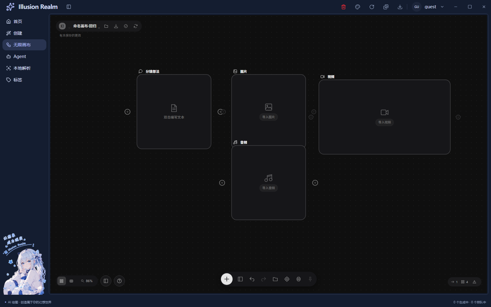
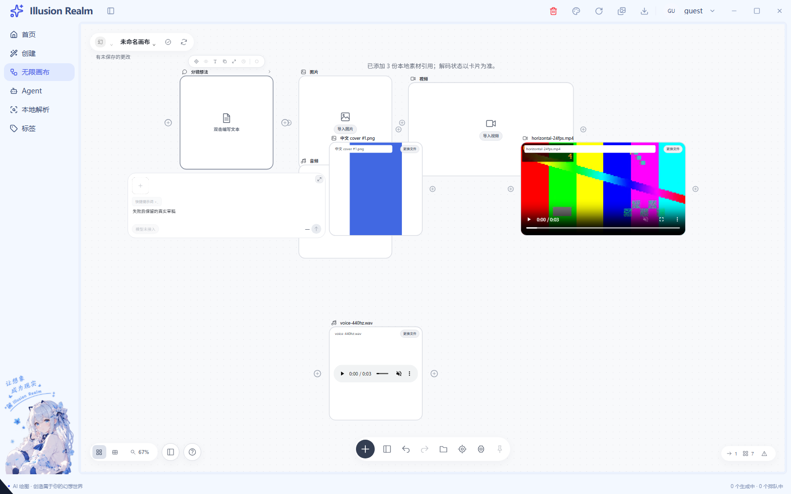
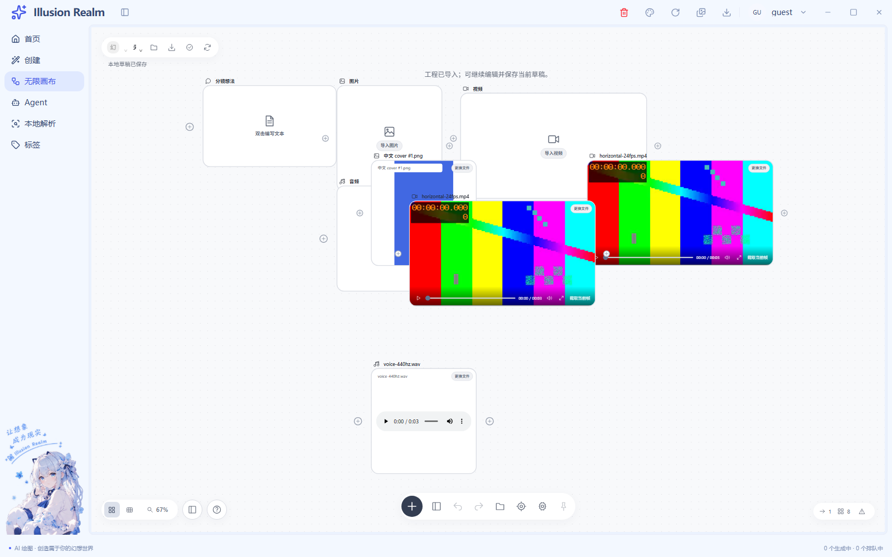
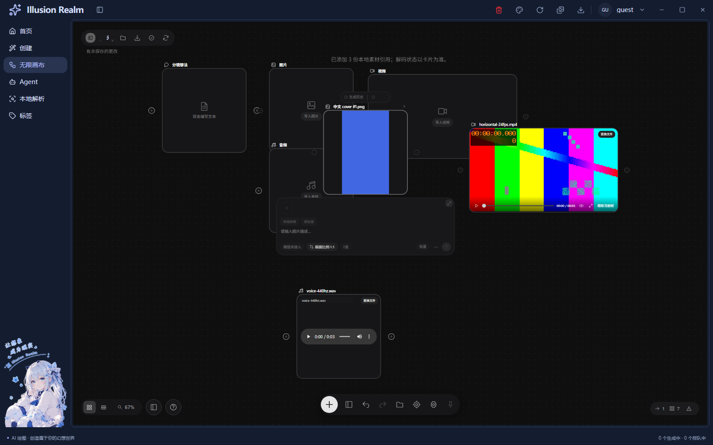

# 无限画布：组件样式库追加优化

更新日期：2026-11-06。正式入口 `/canvas`，导航位于“创建”下方，画布填满可用主区。

**状态：画布名称显示与拖动更新优化完成，本轮静态 Electron 回归 104/104；人工项待验，全仓词条门禁仍有既有失败，不标记全部验收通过。历史媒体轮次静态与开发模式各 100/100 保留；本轮没有重新运行开发模式。历史全量注释审计未达标保留，各轮增量分别统计。**

本页描述当前实现，替代早期“离开不保留”“没有保存恢复”的说明。30、39、91 项属于历史回归结果，当前结果以 [verification.md](verification.md) 为准。[本轮媒体修复记录](media-fix-implementation.md)；工程格式和文件职责见 [工程与剪贴板实施记录](project-clipboard-implementation.md)。

## 当前能力

- 点阵画布、平移、Ctrl/Command + 滚轮缩放、25%–200% 缩放、恢复 100%、适配全部及小地图。
- 通过添加菜单、空白右键或双击创建文本、图片、视频、音频、合成和评论便签；菜单行为可设置。
- 选择、多选、框选、移动、Escape 取消，复制、删除及关联边清理，五十步撤销/重做。
- 双击文本/便签编写内容、修改标题，各节点独立提示词、图片比例及视频/音频模式。
- 点击或拖动真实图引擎端口连接；统一拒绝自身、重复、类型不支持及循环连接。
- 资料包节点、工具条、参数面板、添加菜单、项目头、底栏、视图控件、设置及合成器空态。
- 正常、悬停、按住、松开、业务选中、移开、失焦、键盘聚焦及原生禁用；菜单和普通按钮按各自证据处理。
- 图片比例浮层的聚焦、Escape、外部点击关闭及焦点返回；设置、帮助和合成器共享浮层生命周期。
- 节点、连接、标题及参数保存到统一用户 JSON 的 `infiniteCanvas` 段；重新打开恢复，失败保留草稿并可重试。

没有生成结果时显示真实空态。现已支持本地图片、视频、音频导入与源预览；模型生成、云端上传仍禁用，不显示虚构费用或假成功。

## 组件与业务复用

| 参考组件 / 机制 | 项目实现 | 参数差异与业务边界 |
| --- | --- | --- |
| CanvasNode / NodeActionBar / NodePort | `reference-ui/node-components.tsx`、`canvas-node.tsx` | kind、标题、选中态、内容和动作；端口适配 React Flow Handle |
| GenerationPanel | `reference-ui/generation-panel.tsx` | 节点参数和回调；四类媒体保留自己的选项，生成业务独立 |
| IconButton / CanvasChip / SegmentedControl / CanvasSwitch | `reference-ui/components.tsx` | 内容、持续状态、禁用原因、展开关系和回调；不保存业务副本 |
| AddNodeMenu / ProjectHeader / CanvasDock / ViewControls / CanvasCounters | `reference-ui/canvas-chrome.tsx` | 当前作品、历史、视口状态；正式工作区实际调用 |
| CanvasSettings / CompositionEditor | `reference-ui/canvas-settings.tsx`、`composition-editor.tsx` | 设置回调或空态；合成器未绑定媒体引擎 |
| 浮层生命周期 | `canvas-overlay.tsx` | 打开前捕获触发器、Tab、Escape、inert 和焦点返回 |
| 编辑事务 | `canvas-reducer.ts`、`use-canvas-editor.ts` | 鼠标、菜单与键盘共用，参数不直写图引擎临时缓存 |
| 用户文档 | `use-canvas-persistence.ts`、`canvas-document.ts` | 草稿复用分段合并、写盘和 schema 校验；工程交换的三个窄 IPC 另述，不新增用户设置存储层 |
| 应用外壳 | `AppShell fillViewport` | 保留标题栏、导航和状态栏，不重复计算导航偏移 |

`canvas-components.css` 是组件内部几何和状态的唯一样式来源；`canvas.module.css` 负责宿主几何与图引擎适配。Poppins 使用资料规定的候选字体栈，没有附带字体文件或声称实际加载了 Poppins。

各画布会话独立管理节点、选择、菜单及撤销状态；动作 Context 仅传回调。持久化仍是单草稿，不等同于多工程管理。生成队列、素材文件与视频编辑器工程独立，建立引用不上传文件或执行任务。

## 补充修复

1. 限定悬停规则，阻止全局轮廓叠到画布控件；保留业务选框、胶囊细边和阴影。
2. 禁用菜单不响应悬停/按下，Home/End 与方向键跳过不可用项；键盘采用淡底提示，不叠主题焦点圈。
3. 点阵、小地图和手掌模式绑定真实状态；模式选择不会因移开或失焦取消。
4. 比例浮层隔离 Escape，选完返回触发器，外部点击不抢回焦点。
5. 设置在工作区 inert 之前记录触发器，关闭后返回真实入口；隐藏/禁用控件不进入 Tab 循环。
6. 取消拖动立即释放作品事务，同次松手的迟到坐标仍被拦截，避免回跳或后续保存被挡住。
7. 保存签名固定字段顺序，修复先创建 createdAt、后编辑 mode 时“已落盘但仍显示未保存”。

## 验证与截图

当前检查结果见 [verification.md](verification.md)，组件映射、状态证据与差异见 [reference-ui-implementation.md](reference-ui-implementation.md)。

- [视频节点](runtime/reference-ui-video-parameters.png)
- [添加菜单](runtime/reference-ui-add-menu.png)
- [音频选中后失焦](runtime/reference-ui-audio-selected.png)
- [比例浮层](runtime/reference-ui-ratio-popup.png)
- [设置](runtime/reference-ui-settings.png)
- [合成器空态](runtime/reference-ui-composition.png)
- [深色外壳](runtime/reference-ui-dark-overview.png)
- [窄窗口](runtime/reference-ui-narrow.png)

截图来自正式 Electron `app://app/canvas`，不是资料包 HTML。早期截图保留深灰参考状态；本轮新增白色画布，随应用浅色/深色/系统主题切换，详见 [媒体导入与主题实施记录](media-theme-implementation.md)。

## 未接通与待验

未接模型生成、云端媒体上传、任务提交、真实结果引用传播、画布成片渲染导出、云端、批量任务、协作、导演台、3D World 和画布多轨合成。合成器链接只打开既有视频编辑器，不传节点数据或改其任务状态。

人工待验：实体拖线与重叠端口命中、触控板、完整键盘/读屏路径、中文输入法、Windows 125%/150% 缩放、多屏及长时间运行。未独立运行同时挂载两套画布的 A/B 验收；副本参数和不同媒体模式隔离已自动覆盖。旧视频/GIF/漫画完整回归未运行，本轮未修改这些公共业务实现。

性能边界：撤销最多五十份整图快照。schema 的五千节点、一万连接上限是损坏文档防护，不是流畅度承诺；大图性能尚未验收。

## 名称显示与拖动更新优化（2026-11-06）

- 项目头不再固定为210px；名称拥有可读空间，长名视觉省略，悬停保留全名，保存重开可恢复。
- 复用 React Flow 的位置更新与对象引用保留，删除逐帧嵌套查找和全节点克隆；卡片正文跳过纯位置更新。
- 动作 Context 稳定转发最新回调；拖动过程中保存状态使用起手快照，不再逐帧生成整图 JSON。松手和取消仍走原历史、签名和保存流程。
- 同一300节点模型对照，单次移动的 ID 读取从90,600降为301。该指标是算法证据，不代表实际 DOM 帧率；用户大工程和硬件手感仍待验。

[实施记录](title-drag-implementation.md) · [模型对照](title-drag-model-comparison.json) · [增量注释审计](title-drag-comment-audit.json)

## 注释审计

重新统计全部新增文件，包含此前遗漏的 `reference-ui`、schema、持久化和新增测试，没有把继续工作当成新的低代码基线。已有文件仅计可确认的画布接入行。见 [comment-audit.json](comment-audit.json)，旧审计保留在 [comment-audit.initial.json](comment-audit.initial.json)。

**早期全量业务与测试均未达到 70%，此历史审计保留。** 后续请求按各自开始前快照统计增量，不把已有代码重复计入；本轮结果见 project-comment-audit.json。

## 白色主题与本地媒体（2026-11-06）

- 复用资料组件、节点内容插槽和既有主题机制，补齐白色画布、卡片、浮层、端口及连线；不复制另一套画布。
- 底栏文件夹、添加菜单、空媒体节点可选择本地文件；工作区支持多选导入及文件拖入。节点可更换来源，缺图/解码失败保留引用并可重试。
- 图片完整显示；音频使用原生控件，视频现已接入真实事件驱动的紧凑底栏与截帧。同工作区播放互斥，离开选择、隐藏与卸载时停止。
- 草稿仍只保存路径、名称、类型与字节数。素材默认复制到 user/[画布目录]/video、Picture、Audio；视频现可明确选择移动，完成后移除原位置文件，不上传。早期只引用路径及仅复制的证据保留在历史记录。
- 本轮自动回归、截图、限制与增量注释率见实施记录和 verification。此前全量注释审计未达标的历史状态不改写。

## 工程文件、剪贴板与卡片尺寸（2026-11-06）

- 选中连线可右键删除或 Delete 删除；复用创建页公共级联菜单。
- Ctrl/Command+C、X、V 为真实复制/剪切/粘贴；复制不立即创建副本，没有节点底稿时菜单不显示粘贴。Ctrl+D 保留立即创建副本。
- 同一节点外壳支持正方形、长方形、自定义尺寸；自定义表单确认前不写入作品。
- 视频加载接通首帧事件与 15 秒错误上界，保留重试和更换；紧凑底栏支持真实播放、定位、静音、全屏和本地截帧。
- 顶部文件夹导入 `.ircanvas`，下载图标导出带媒体正文的工程包；取消和失败保留当前画布。保存按钮仍只保存当前用户草稿。
- 资产默认落在现有软件默认 user 根下，按画布归属目录与三类媒体分开；同名不覆盖，改标题不搬目录。

[功能与工程规范表](project-clipboard-implementation.md) · [验证记录](verification.md) · [增量注释审计](project-comment-audit.json)

## 图片拖动、视频显示与导入方式（2026-11-06）

- 正常图片只显示完整画面，移除内层重复文件名和常驻“更换文件”；保留节点外标题，缺图时仍提供恢复按钮。
- 从图片正文可直接抓取移动，复用 React Flow 的坐标与历史，不新增一套拖动实现。
- 修复媒体 effect 清理移除 src 后再次安装未恢复来源的问题，开发模式重新挂载可真实解码、播放。
- 系统选择和外部视频拖入共用复制/移动确认，每批默认复制，取消不写文件。图片、音频仍复制；受管工程视频拒绝移动。
- 移动采用完整复制后删除来源，来源删除失败会尝试撤回本次目标；图撤销不撤回磁盘移动。

[实施与限制](media-fix-implementation.md) · [增量注释审计](media-fix-comment-audit.json)

