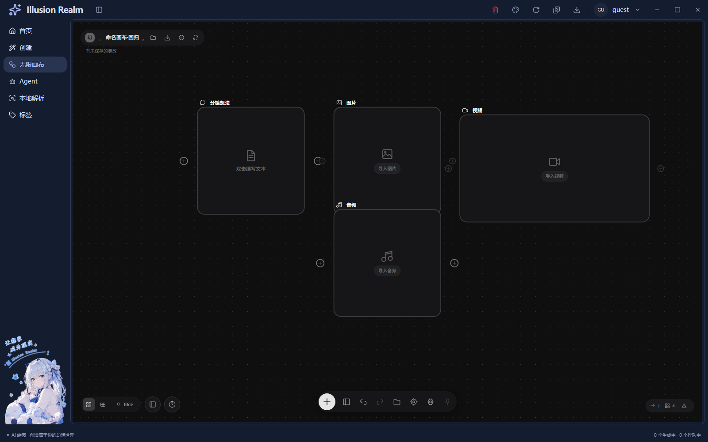
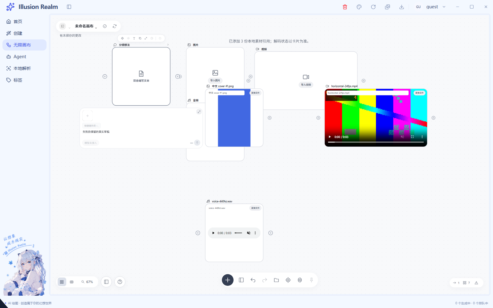
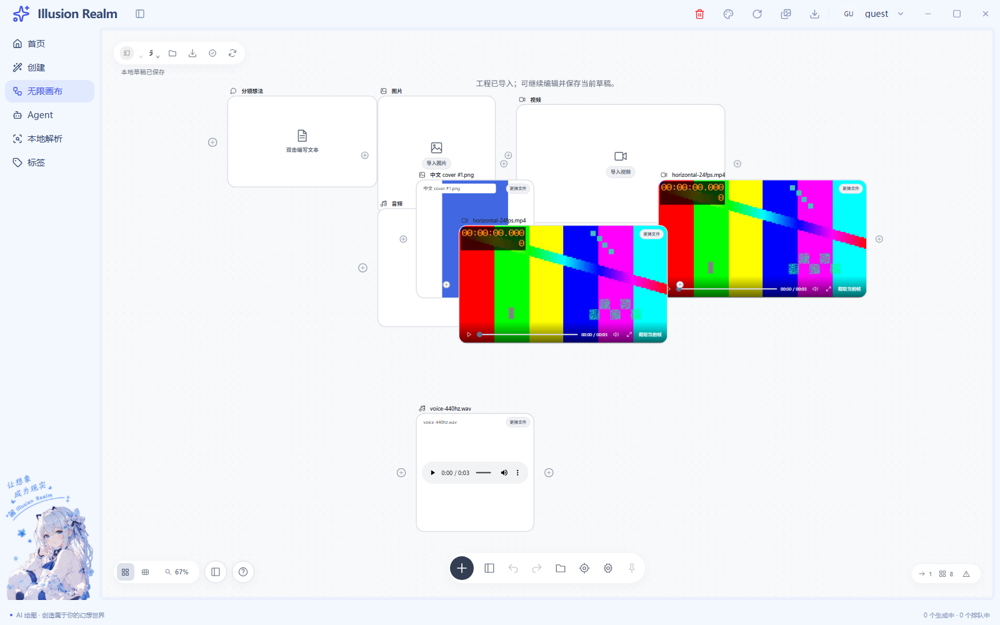
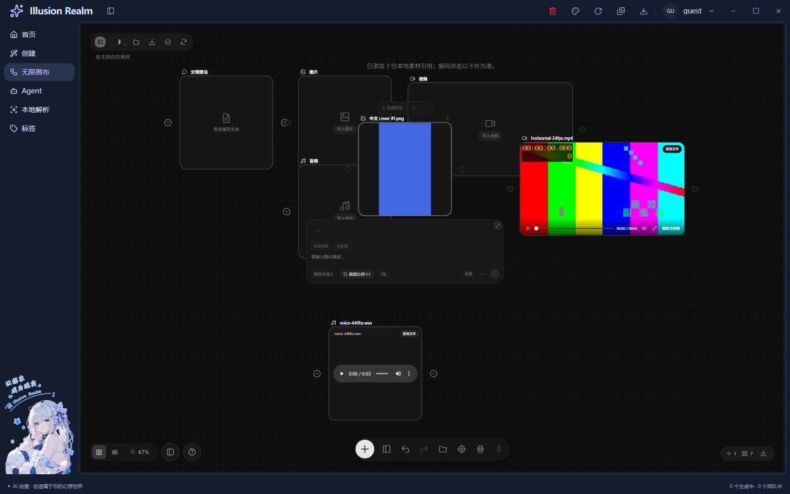

# 无限画布：组件样式库追加优化

新增：MiniMax 图片、视频、音频引用共用官方标记转换；↑ 左侧可预览最终提示词，右下角转换助手同样收到 `<Picture N>` / `<Video N>` / `<Slot N>`。支持原稿撤销、缺失资源拦截及迟到结果保护，复用原创作输入、转换正文与参数浮层。[本轮实现、截图、验证与注释审计](canvas-reference-preview-implementation.md)。历史文档中的 `<Audio N>` 为旧阶段记录，本轮以 `<Slot N>` 为准；此前人工待验继续保留。

新增：右键 **图像 → 对比图像** 创建独立只读节点。左原图、右处理图，拖动分界只改变露出范围；支持两张普通图片，或单接图片超分节点自动找到原图和结果。复用原媒体组件、级联菜单、节点网预览与SQLite保存。[实现、截图、验证与限制](image-compare-implementation.md)。专项15/15；人工与真实超分画质待验，全仓既有检查失败保留。

新增：双击节点正文打开节点网预览，默认查看当前节点；底部显示沿连线双向关联的全部节点，可用左右键、缩略条切换或定位返回。文字与便签继续沿用原编辑动作，预览不改工程。独立超分卡内左上固定 SeedVR2 7B ×2，底部“一键启用”；图片超分开关移至画质右侧。[实施、真实截图、验证与限制](node-network-preview-implementation.md)。人工待验与既有检查失败保留。

最新：画布生成与超分直接保存到 `user/Infinite Canvas/<工程>/Picture、video、Audio` 对应分类目录，登记同工程文件不再复制，避免图库与工程双份保存。创作页继续使用原图库，旧文件不搬迁、不清理。[本轮改动、实际验证与限制](project-output-implementation.md)。下方历史“图库后复制”记录保留阶段含义，以本次路径规则为准。

新增：图片生成可选 SeedVR2 7B 超分，默认关闭、×2；原图落盘后再顺序提交第二次请求。图片/视频拉线可创建独立超分节点，只有配置、没有提示词，运行反馈位于对应卡片。Minimax H3 图片编辑侧栏直接复用原组件并增加左右留白。请求接线、隔离文件与固定媒体自动回归已验证，真实模型推理、画质与人工项目待验。[实施、截图、限制与审计](seedvr2-upscale-implementation.md)。

新增：创作页文字改图默认 **MiniMax H3**，Anima 第二项；无限画布复用相同 H3 设置与执行队列，支持 1–8 张参考。删除全局按钮悬停额外描边，文字改图生成/停止收为一行，等待文字隐藏。真实服务推理待验，自动验证与截图见 [实施记录](minimax-image-edit-implementation.md)。

帧率最新交互：黑底横向 **10 / 20 / 25 / 30 / 60 / 自定义**；自定义只有下划线数字输入，回车或失焦提交。帧率、时长和图片比例共用原浮层与横向组件，数值隔离。[复用、截图与验证](fps-strip-implementation.md)。

最新交互：MiniMax百万像素改为0.1～1.0滑块；图片/视频共用横向比例条。深色浮层统一画布黑底，浅色继续适配，移除灰色内层与外框。[实际截图、检查与复用记录](minimax-slider-implementation.md)。

## MiniMax：比例＋0.1～1.0百万像素（2026-11-12）

MiniMax视频节点选择创作页原比例和十档面积，实时显示32像素对齐后的宽高，并写入两个原H3模板的生成节点。每个节点独立保存、复制、撤销和重做；旧明确尺寸保留，图片原画质规则不变。正式静态Electron专项24/24、原画布149/149、真实SQLite18/18；160种工作流组合通过。视频执行器仍未接、人工待验，统一检查仍有既有词条门禁失败。[实现、截图、检查与注释审计](minimax-megapixels-implementation.md)。下方720p/1K说明为前阶段规则，MiniMax现以此节为准。

## 最新：图片铺满、边缘缩放与手掌恢复（2026-11-11）

图片卡片四边及右下角复用原图引擎缩放，铺满显示，原媒体不变；撤销、取消、SQLite保存重开接通。工具箱分类悬停不加矩形轮廓，键盘焦点保留。正式静态Electron专项6/6、原画布149/149；四边实拖与非100%画布缩放通过，人工手感与系统缩放待验。

[完整实施、实际截图、迁移结果与检查失败项](../../design/sqlite-migration-2026-11-11.md)。当前注释要求已按用户更新为20%–30%参考；下面70%记录保留历史含义。

更新日期：2026-11-11。正式入口 `/canvas`，导航位于“创建”下方，画布填满可用主区。

图片输出端拖到空白可选择“图片生成 / 视频生成”，确认后新卡与连线一起创建、一步撤销。图片/视频比例直接读取创作页 IMAGE_SIZE_PRESETS 的八项静态参数，原画质计算与工程格式不变。专项27/27、原画布149/149、视频配置17/17；统一检查仍有既有门禁失败，人工待验保留。[本次复用、截图与验证](connection-ratio-implementation.md)。

视频现已直接复用图片的比例和画质浮层，提供480p、720p、1K（1080p）、自定义像素，以及节点独立FPS和2/5/10/自定义时长。时长显示x.x秒；帧数已由用户确认指每秒帧数FPS。视频生成仍未接。创作页模式标签悬停只高亮文字/图标，不再出现通用按钮轮廓，键盘焦点提示保留。[本次实施、实际截图与限制](video-output-implementation.md)。

## 最新追加：请求、配置、引用与公共卡片

图片请求接入原队列，单图回填、多图新增独立节点；画质、像素宽高和调度器共用原配置。视频只复用创作页主模型、扩展、模型加载三个原组件，画布菜单使用 MiniMax 系列，暂不提供 Wan2.2。视频生成仍未接通。

图片引用显示固定方形缩略图和文件前缀名；图片节点改标题走原图库实际文件改名，当前工程同源节点、引用与历史同步新路径。创建页分类和模型版本继续共用原卡片，文字区固定高度、长文本省略、原按钮贴底；图片文件管理操作条改为单行浮动。

本次正式静态 Electron：原画布149/149、图片生成及名称21/21、视频配置8/8、卡片选择17/17、图片管理31/31、创建编辑62/62、首页20/20，均为独立专项，**不累加为一个通过率，也不等同于人工或真实模型推理验收**。类型、lint与Next静态构建通过；统一检查和Meta检查仍有失败，详见验证记录。历史人工待验与早期注释审计未达标状态保留。

[图片请求与画质](generation-quality-implementation.md) · [视频原组件与首页](video-settings-home-implementation.md) · [图片引用和改名](media-reference-name-implementation.md) · [公共卡片固定高度](resource-card-height-implementation.md) · [单行浮动条](history-floating-implementation.md) · [本次证据](runtime/generation-quality-2026-11-11/) · [检查明细](verification.md)

**上一阶段：原视频合成器已直接嵌入，三类素材、剪辑保存/重开、本地成片与画布结果回填已接通。专项21/21、原画布146/146；人工项待验、该阶段注释率未达70%，完整统一检查仍有既有失败。**

本轮详见 [原视频合成器接入记录](original-video-composition-implementation.md)。此前侧栏见 [节点文生图侧栏实施记录](workflow-sidebar-implementation.md)。节点微交互历史见 [原实施记录](node-interaction-implementation.md)：标题箭头展开时顺时针转 90°；端口边缘外约 20px 范围内轻微跟随，屏幕位移最多 15px；连接目标内容板轻微倾斜。选框统一为主题浅色 1px；左键短按允许展开参数，250ms 长按或移动至少 4px 只搬卡，不弹输入，右键保持菜单语义。减少动态时关闭跟随与倾斜。

本页描述当前实现，替代早期“离开不保留”“没有保存恢复”的说明。30、39、91 项属于历史回归结果，当前结果以 [verification.md](verification.md) 为准。[本轮媒体修复记录](media-fix-implementation.md)；工程格式和文件职责见 [工程与剪贴板实施记录](project-clipboard-implementation.md)。

## 当前能力

- 点阵画布、平移、Ctrl/Command + 滚轮缩放、25%–200% 缩放、恢复 100%、适配全部及小地图。
- 通过添加菜单、空白右键或双击创建文本、图片、视频、音频、合成和评论便签；菜单行为可设置。
- 选择、多选、框选、移动、Escape 取消，复制、删除及关联边清理，五十步撤销/重做。
- 双击文本/便签编写内容、修改标题，各节点独立提示词、图片比例及视频/音频模式。
- 点击或拖动真实图引擎端口连接；统一拒绝自身、重复、类型不支持及循环连接。
- 资料包节点、工具条、参数面板、添加菜单、项目头、底栏、视图控件、设置及直接运行的原视频合成器。
- 正常、悬停、按住、松开、业务选中、移开、失焦、键盘聚焦及原生禁用；菜单和普通按钮按各自证据处理。
- 图片比例浮层的聚焦、Escape、外部点击关闭及焦点返回；设置、帮助和合成器共享浮层生命周期。
- 节点、连接、标题及参数保存到统一用户 JSON 的 `infiniteCanvas` 段；重新打开恢复，失败保留草稿并可重试。

没有生成结果时显示真实空态。现已支持本地图片、视频、音频导入与源预览；模型生成、云端上传仍禁用，不显示虚构费用或假成功。

## 组件与业务复用

| 参考组件 / 机制 | 项目实现 | 参数差异与业务边界 |
| --- | --- | --- |
| CanvasNode / NodeActionBar / NodePort | `reference-ui/node-components.tsx`、`canvas-node.tsx` | kind、标题、选中态、内容和动作；端口适配 React Flow Handle |
| GenerationPanel | `reference-ui/generation-panel.tsx` | 节点参数和回调；四类媒体保留自己的选项，生成业务独立 |
| IconButton / CanvasChip / SegmentedControl / CanvasSwitch | `reference-ui/components.tsx` | 内容、持续状态、禁用原因、展开关系和回调；不保存业务副本 |
| AddNodeMenu / ProjectHeader / CanvasDock / ViewControls / CanvasCounters | `reference-ui/canvas-chrome.tsx` | 当前作品、历史、视口状态；正式工作区实际调用 |
| CanvasSettings / 原视频合成器 | `reference-ui/canvas-settings.tsx`、`view/video-composition/composition-editor.tsx` | 设置与合成业务分离；iframe直接运行原Vue/预览/编码模块 |
| 浮层生命周期 | `canvas-overlay.tsx` | 打开前捕获触发器、Tab、Escape、inert 和焦点返回 |
| 编辑事务 | `canvas-reducer.ts`、`use-canvas-editor.ts` | 鼠标、菜单与键盘共用，参数不直写图引擎临时缓存 |
| 用户文档 | `use-canvas-persistence.ts`、`canvas-document.ts` | 草稿复用分段合并、写盘和 schema 校验；工程交换的三个窄 IPC 另述，不新增用户设置存储层 |
| 应用外壳 | `AppShell fillViewport` | 保留标题栏、导航和状态栏，不重复计算导航偏移 |

`canvas-components.css` 是组件内部几何和状态的唯一样式来源；`canvas.module.css` 负责宿主几何与图引擎适配。Poppins 使用资料规定的候选字体栈，没有附带字体文件或声称实际加载了 Poppins。

各画布会话独立管理节点、选择、菜单及撤销状态；动作 Context 仅传回调。持久化仍是单草稿，不等同于多工程管理。生成队列、素材文件与视频编辑器工程独立，建立引用不上传文件或执行任务。

## 补充修复

1. 限定悬停规则，阻止全局轮廓叠到画布控件；保留业务选框、胶囊细边和阴影。
2. 禁用菜单不响应悬停/按下，Home/End 与方向键跳过不可用项；键盘采用淡底提示，不叠主题焦点圈。
3. 点阵、小地图和手掌模式绑定真实状态；模式选择不会因移开或失焦取消。
4. 比例浮层隔离 Escape，选完返回触发器，外部点击不抢回焦点。
5. 设置在工作区 inert 之前记录触发器，关闭后返回真实入口；隐藏/禁用控件不进入 Tab 循环。
6. 取消拖动立即释放作品事务，同次松手的迟到坐标仍被拦截，避免回跳或后续保存被挡住。
7. 保存签名固定字段顺序，修复先创建 createdAt、后编辑 mode 时“已落盘但仍显示未保存”。

## 验证与截图

当前检查结果见 [verification.md](verification.md)，组件映射、状态证据与差异见 [reference-ui-implementation.md](reference-ui-implementation.md)。

- [视频节点](runtime/reference-ui-video-parameters.png)
- [添加菜单](runtime/reference-ui-add-menu.png)
- [音频选中后失焦](runtime/reference-ui-audio-selected.png)
- [比例浮层](runtime/reference-ui-ratio-popup.png)
- [设置](runtime/reference-ui-settings.png)
- [当前原视频合成器](runtime/original-video-composition-2026-11-10/01-original-compositor-dark.png)；[早期空态（历史）](runtime/reference-ui-composition.png)
- [深色外壳](runtime/reference-ui-dark-overview.png)
- [窄窗口](runtime/reference-ui-narrow.png)

截图来自正式 Electron `app://app/canvas`，不是资料包 HTML。早期截图保留深灰参考状态；本轮新增白色画布，随应用浅色/深色/系统主题切换，详见 [媒体导入与主题实施记录](media-theme-implementation.md)。

## 未接通与待验

原视频合成器已接通节点媒体、原剪辑快照、本地编码导出和结果回填；不再只展示空态或跳转工具箱。模型生成、云端任务、协作与3D World不由本轮接通。导演台状态见其独立记录；工具箱原视频编辑器保持独立。

人工待验：实体拖线与重叠端口命中、触控板、完整键盘/读屏路径、中文输入法、Windows 125%/150% 缩放、多屏及长时间运行。未独立运行同时挂载两套画布的 A/B 验收；副本参数和不同媒体模式隔离已自动覆盖。旧视频/GIF/漫画完整回归未运行，本轮未修改这些公共业务实现。

性能边界：撤销最多五十份整图快照。schema 的五千节点、一万连接上限是损坏文档防护，不是流畅度承诺；大图性能尚未验收。

## 名称显示与拖动更新优化（2026-11-06）

- 项目头不再固定为210px；名称拥有可读空间，长名视觉省略，悬停保留全名，保存重开可恢复。
- 复用 React Flow 的位置更新与对象引用保留，删除逐帧嵌套查找和全节点克隆；卡片正文跳过纯位置更新。
- 动作 Context 稳定转发最新回调；拖动过程中保存状态使用起手快照，不再逐帧生成整图 JSON。松手和取消仍走原历史、签名和保存流程。
- 同一300节点模型对照，单次移动的 ID 读取从90,600降为301。该指标是算法证据，不代表实际 DOM 帧率；用户大工程和硬件手感仍待验。

[实施记录](title-drag-implementation.md) · [模型对照](title-drag-model-comparison.json) · [增量注释审计](title-drag-comment-audit.json)

## 注释审计

重新统计全部新增文件，包含此前遗漏的 `reference-ui`、schema、持久化和新增测试，没有把继续工作当成新的低代码基线。已有文件仅计可确认的画布接入行。见 [comment-audit.json](comment-audit.json)，旧审计保留在 [comment-audit.initial.json](comment-audit.initial.json)。

**早期全量业务与测试均未达到 70%，此历史审计保留。** 后续请求按各自开始前快照统计增量，不把已有代码重复计入；本轮结果见 project-comment-audit.json。

## 白色主题与本地媒体（2026-11-06）

- 复用资料组件、节点内容插槽和既有主题机制，补齐白色画布、卡片、浮层、端口及连线；不复制另一套画布。
- 底栏文件夹、添加菜单、空媒体节点可选择本地文件；工作区支持多选导入及文件拖入。节点可更换来源，缺图/解码失败保留引用并可重试。
- 图片完整显示；音频使用原生控件，视频现已接入真实事件驱动的紧凑底栏与截帧。同工作区播放互斥，离开选择、隐藏与卸载时停止。
- 草稿仍只保存路径、名称、类型与字节数。素材默认复制到 user/[画布目录]/video、Picture、Audio；视频现可明确选择移动，完成后移除原位置文件，不上传。早期只引用路径及仅复制的证据保留在历史记录。
- 本轮自动回归、截图、限制与增量注释率见实施记录和 verification。此前全量注释审计未达标的历史状态不改写。

## 工程文件、剪贴板与卡片尺寸（2026-11-06）

- 选中连线可右键删除或 Delete 删除；复用创建页公共级联菜单。
- Ctrl/Command+C、X、V 为真实复制/剪切/粘贴；复制不立即创建副本，没有节点底稿时菜单不显示粘贴。Ctrl+D 保留立即创建副本。
- 同一节点外壳支持正方形、长方形、自定义尺寸；自定义表单确认前不写入作品。
- 视频加载接通首帧事件与 15 秒错误上界，保留重试和更换；紧凑底栏支持真实播放、定位、静音、全屏和本地截帧。
- 顶部文件夹导入 `.ircanvas`，下载图标导出带媒体正文的工程包；取消和失败保留当前画布。保存按钮仍只保存当前用户草稿。
- 资产默认落在现有软件默认 user 根下，按画布归属目录与三类媒体分开；同名不覆盖，改标题不搬目录。

[功能与工程规范表](project-clipboard-implementation.md) · [验证记录](verification.md) · [增量注释审计](project-comment-audit.json)

## 图片拖动、视频显示与导入方式（2026-11-06）

- 正常图片只显示完整画面，移除内层重复文件名和常驻“更换文件”；保留节点外标题，缺图时仍提供恢复按钮。
- 从图片正文可直接抓取移动，复用 React Flow 的坐标与历史，不新增一套拖动实现。
- 修复媒体 effect 清理移除 src 后再次安装未恢复来源的问题，开发模式重新挂载可真实解码、播放。
- 系统选择和外部视频拖入共用复制/移动确认，每批默认复制，取消不写文件。图片、音频仍复制；受管工程视频拒绝移动。
- 移动采用完整复制后删除来源，来源删除失败会尝试撤回本次目标；图撤销不撤回磁盘移动。

[实施与限制](media-fix-implementation.md) · [增量注释审计](media-fix-comment-audit.json)

## 导演台接入（2026-11-07）

- 在既有添加菜单和节点内容插槽接入场景导演台；原视频合成器独立保留。
- 复用用户文档保存、图片保存和工程包，完成真实人物移动、机位跟随、退出保存和重开恢复闭环。
- 导演台自动回归25/25，DPR自动回归25/25；原画布115/115。
- 本地功能已接入，但注释率、逐状态对照和人工项目未完成，**不标记完整验收通过**。

[导演台实施及验证](../director/README.md)

## 默认横卡与工作流选择（2026-11-09）

- 图片、视频默认共用502×285横卡；已有显式尺寸继续优先，不改源文件或生成比例。
- 图片可选ANIMA、SDXL、图片编辑·文字改图；视频复用创建页登记列表。图片默认ANIMA，视频沿用创建页默认值。
- 每节点独立保存工作流身份，支持原撤销与重开；配置沿用原模板，不复制另一份CLIP/VAE或采样参数。仅选择配置，生成继续禁用。
- 最终正式Electron自动回归126/126；类型、lint、Next构建通过。完整工程格式脚本有旧输入失败，任务前脚本复现同一错误，不标记全部检查通过。人工待验保持原状态。

[横卡实施](media-card-default-implementation.md) · [工作流实施与检查明细](workflow-selection-implementation.md) · [验证记录](verification.md)

## 黑白主题与 LoRA 配置（2026-11-09）

- 工作流、提示词转换菜单和配置页采用黑白配色，原创建页转换工具条直接接入每个节点输入框。
- 点击工作流选项打开默认配置，复用原 LoRA 选择器；支持权重、移除与分工作流保存，复制节点后参数独立。
- 修复 LoRA 内存序列化导致的真实保存失败；不放宽两端校验，默认继承和显式清空分开。
- 最终正式 Electron 自动回归 **140/140、退出 0**；类型、lint、Next 构建、语言键和 i18n 基线通过。完整 check 与工程格式脚本仍有既有失败，人工项待验。
- 业务有效增量注释率 **70.52%**，仓库测试 **70.37%**；不包含先前工作区修改。

[实施、复用与限制](workflow-lora-theme-implementation.md) · [真实截图与日志](runtime/workflow-lora-theme-2026-11-09/) · [详细验证](verification.md)

## 工程工作区、挂起与统一尺寸控制（2026-11-12）

- 无限画布入口先到工程库；工程与受管素材放在用户数据目录的 `Infinite Canvas/`，支持分类、搜索、多选、全选、取消、批量移动和软删除。
- 左上角工程菜单支持挂起/关闭返回；导航可切回挂起画布。各实例的图、历史、参数和任务独立，隐藏实例不响应快捷键。
- 所有七类节点共用四边和右下角缩放，去掉蓝色边线/方块。右键固定单个尺寸；画布设置复用原开关，固定全部时恢复类型默认尺寸并禁止缩放。
- 仍需人工验收，不把自动注入、HTTP 服务夹具或参考截图写成人工通过。

[本轮实施、数据位置与限制](project-library-suspend-resize-implementation.md) · [检查与真实截图](verification.md) · [增量注释审计](project-library-comment-audit.json)

## 新建画布应用失败修复（2026-11-12）

修复旧素材目录缺失导致整个工程库迁移失败、新建无法应用的问题。保留旧节点与引用，归属检查继续有效；存储8/8、正式界面8/8通过，人工待验与既有完整检查阻塞保留。[实施与截图](canvas-create-fix-implementation.md)。

## 删除画布释放资源（2026-11-12）

本轮替代此前软删除行为：确认后实际删除自有工程文件夹及专属素材；跨工程引用阻止删除。新增“清理已删画布资源”处理前版本残留。删除前关闭其他打开/挂起画布，外部原文件保留。存储13/13、界面9/9、原画布149/149通过，人工待验与既有check阻塞保留。[使用、边界与证据](canvas-delete-implementation.md)。

## 新建连点与画布内删除失败（2026-11-12）

修复旧删除记录占用同名目录、自动找回的小数时间写入整数列，以及创建后刷新失败被误报为创建失败。增加会话退出防重入与新建失败目录回收；合法未登记工程可找回，保留归属与共享引用保护。最终存储17/17、正式工程库10/10、原画布149/149通过，类型/lint/静态构建通过；完整check仍有既有文案阻塞，人工项待验。[原因、验证、截图与限制](canvas-library-retry-implementation.md)。

## 工程资源管理与节点网预览（2026-11-13）

修复切图时main外围浅色框：节点网预览打开时临时去掉外层边线与留白，关闭恢复；静态及开发环境自动回归均48/48通过。[修复边界、截图与记录](preview-frame-implementation.md)。

节点网main展示区支持滚轮上下缩放，沿用原10%–400%范围与工具栏状态；正式自动回归44/44通过。[滚轮行为与验证](preview-wheel-implementation.md)。

图片查看已支持原尺寸、缩小及旋转后按住拖动；节点网和创作页原大图预览共同复用图片手势，松开/失焦/切图/退出均结束抓取。[本轮复用、回归与截图](preview-pan-implementation.md)。

后续修正：查看工具的鼠标触发范围覆盖整个main展示区（含四周留白）；导航和底部资源条不触发。深浅主题自动回归30/30通过。[本轮实施和证据](preview-main-hover-implementation.md)。

先完成资源管理，再完成预览UI。手放与旧未登记文件原位显示为未知归属，不回收；受管副本成功保存并关闭、无任何工程依赖才进入统一temp，24小时后再核对。支持素材库筛选、直接复用、保留与恢复；打开/挂起工作区统一延迟清理。

预览复用原媒体和对比组件，增加紧凑胶囊、居中/横滚缩略条、图片圆角、背景虚化、信息、缩放旋转和共用黑色提示。真实SQL/文件回收9/9、资源UI4/4、预览20/20、原画布149/149、生成23/23、超分25/25通过。完整check仍有既有文案与Meta阻塞，人工项保持待验。

[本轮规则、九宫格关系与实施记录](resource-management-preview-implementation.md) · [截图与日志](runtime/resource-management-preview-2026-11-13/) · [增量审计](resource-management-preview-comment-audit.json)

## 画布音频与视频 LoRA（2026-11-13）

音频节点直接复用原提示词输入与 ↑ 生成，MiniMax H3 设置入口打开创作页同一音频表单的参数部分；支持文本/参考音频、独立节点参数、批量、取消、播放与工程内保存。视频扩展继续使用图片原选择器，修复 MiniMax 大小写、深层子目录及同目录多个权重遗漏。音频配置和参考资源随 SQLite 工程及便携归档保存。

音频/LoRA专项18/18、创作音频19/19、原画布149/149、原生成23/23通过；真实推理和音质未验，完整check仍有旧词条阻塞。[复用、边界、检查与截图](canvas-audio-lora-implementation.md)。

## 音频统一节点输入（2026-11-13追加）

侧栏移除重复提示词、音频载入和生成区，节点下方直接复用图片同一个输入壳、附件加号、批量与 ↑。支持 Shift+Enter；侧栏仅设置参数，创作页默认完整表单不变。最终专项22/22、原创作音频19/19、原画布149/149、原生成23/23通过，真实推理和人工项仍待验。[实施、截图与增量审计](canvas-audio-inline-implementation.md)。

## 音频紧凑参数（2026-11-13最新调整）

替代上节的音频批量入口：固定单份，“参数”打开原模型与高级设置，侧栏移除秒数，节点复用原2/5/10秒与自定义浮层。正文160px减为80px，长文本内部滚动。专项27/27、原创作音频19/19、完整画布单独重跑149/149通过；入口首次被公告遮挡和测试输入失焦问题均保留记录。[当前行为、截图与验证](canvas-audio-compact-implementation.md)。
