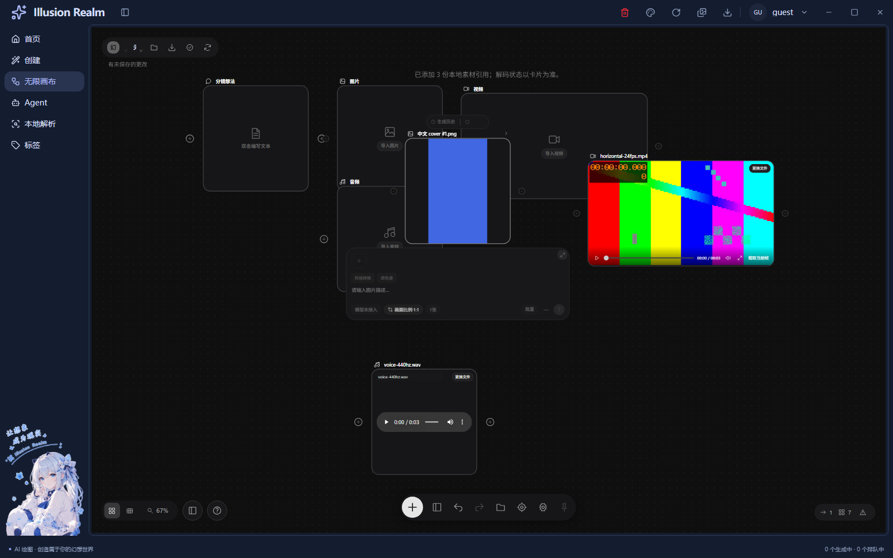
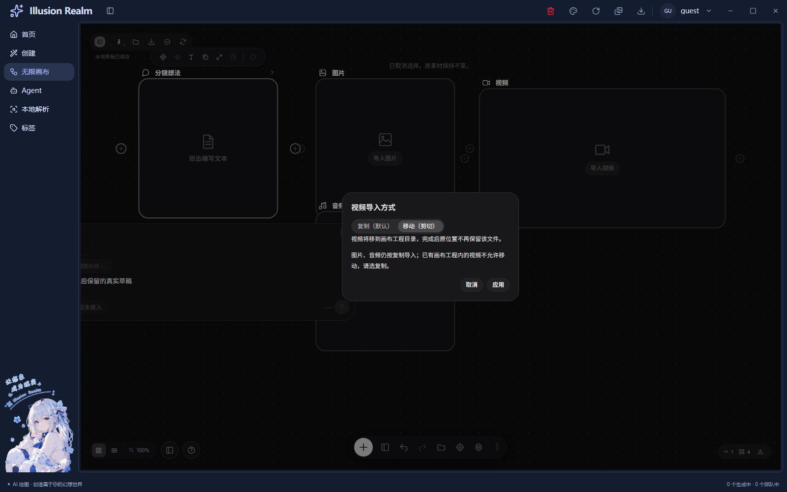
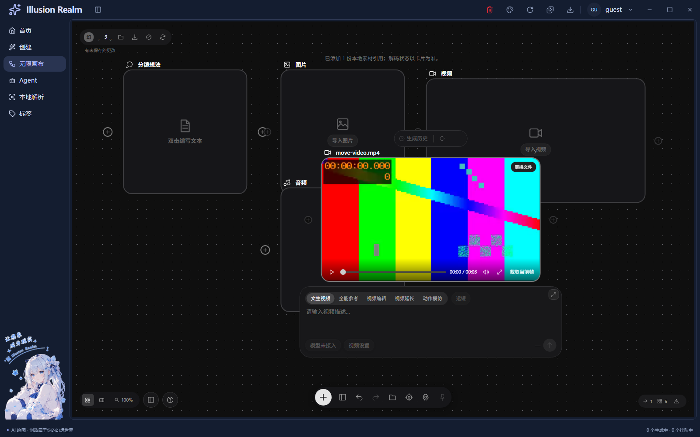

# 无限画布媒体显示与导入方式修复

日期：2026-11-06。范围仅为本次图片展示/拖动、视频资源恢复及视频复制/移动导入；保留已有工作区修改。

## 问题与实现

1. 图片正文的 `nodrag nopan` 原本与音视频控件共用，导致从图上无法抓取节点。现只对音视频正文保留隔离，图片继续 `draggable=false` 关闭浏览器文件影子，节点拖动交 React Flow。错误恢复按钮单独隔离。
2. 正常图片不挂载内层文件名条与“更换文件”按钮，保留外部节点标题及完整 contain 画面；缺图时显示错误与恢复入口，不用不可见按钮占键盘焦点。
3. 媒体 effect 清理会移除 src 并 load 释放缓冲；React 开发模式安装/清理重放时，DOM 属性未变化不会由 React 自动补写。现在每次资源安装检查 src 缺失并恢复本会话来源，已有来源不反复 load。卸载仍暂停、清来源、清监听；真实加载事件才进入 ready。
4. 系统选择和外部拖入统一进入 `useVideoImportChoice`。含视频先确认，每批默认 copy，不保存危险模式；取消不调用磁盘服务。待确认期间背景 inert，Delete/C/V 等画布入口不穿透。
5. 既有 `CanvasImportMediaSchema` 增加可选 `mode: copy | move`，旧请求省略仍复制。主进程同值手写校验，沿用原 registerHandle、IpcResult、preload 方法与 shared 推导类型，不新增通道或裸文件权限。
6. move 只作用于视频，图片/音频仍复制。先完整异步 copyFile，再核对来源身份、大小、修改时间并 unlink；失败尝试回滚本次目标，保留原图。不是跨文件的原子事务，混合批次保留已成功项并列出拒绝项。
7. 拒绝来源文件符号链接，向祖先检查 `.canvas-owner`，防止搬走已有工程的资产。受管来源仍允许复制。同盘也使用复制后删除，不承诺瞬间重命名性能；跨盘同样不把正文读进内存。

## 复用关系与文件

| 文件 | 职责与复用 |
| --- | --- |
| `canvas-media.tsx` | 原节点插槽与 HTML 媒体元素，修复抓取边界、资源重放和图片覆盖控件 |
| `use-canvas-media-import.ts` | 原 File → getPathForFile → IPC → 图事务，增加短期确认会话 |
| `canvas-import-choice.tsx` | 复用 CanvasOverlay、SegmentedControl、CanvasChip，注入确认/取消与焦点引用 |
| `infinite-canvas-page.tsx` | 原页面装配确认框，待确认隔离背景与快捷键 |
| 双语 `canvas.ts` | 导入方式、源文件去向、混合批次及受管来源说明 |
| `canvas-project.schema.ts` / `project-validation.js` | 两端同义可选 mode 枚举，默认兼容旧调用 |
| `project-assets.js` | 复用 copyAsset，移动来源与保护/回滚边界 |
| `verify-canvas-project.js` | 两端枚举反证、真实临时文件复制/移动/拒绝检查 |
| `check-canvas-media.js` | 生产 UI 导入确认、真实视频解码与图片正文鼠标注入 |
| `smoke-infinite-canvas.js` | 保留静态默认；单独 dev 开关检查开发资源生命周期 |

没有另建节点壳、画布坐标、保存层或按钮体系。copy/move 是磁盘行为，与图节点 Ctrl+X、撤销/重做独立；撤销导入节点不会把原文件搬回原位置。素材不会上传网络。

## 实际验证与证据

- `pnpm typecheck`、`pnpm lint`、Next 静态构建、双语键检查、Node 格式检查通过。lint 为 33 个既有警告；函数有效行扫描本次逻辑不超过 30 行。
- `pnpm check` 重新执行，退出 1，停于既有三个未引用翻译词条；不是本轮全部门禁通过。详情见 verification。
- 静态最终 **100/100**，开发模式 **100/100**；独立、串行 Electron。真实媒体来自 bundled FFmpeg 生成的本地短样本，不是返回值 mock。移动仅使用另建临时 MP4。
- 视频移动原路径消失，受管正文与原始基准逐字节一致，Chromium 解码出真实 320×180；默认复制保留来源；取消保留原图/文件；同源独立节点、错误重试、保存恢复及工程包交换均继续通过。
- 图片正文鼠标注入后实际节点 transform 改变，并核对正常态无内层文件名/更换按钮；没有直接 setNodes 伪造位置。
- 开发运行命令：先 `pnpm --filter @illusion-realm/next dev`，另行 `$env:CANVAS_SMOKE_DEV='1'; pnpm exec electron scripts/smoke-infinite-canvas.js`。正式静态运行不设置该变量。测试服务已停止。

## 未验证与限制

未拿到截图中具体失败视频，不能保证未知容器/编码受 Chromium 支持；未自动转码。不支持编码仍准确进入原错误路径。开发模式真实回归证明当前样本的资源重放可用，并不声称复现了用户源文件的全部原因。

未人工操作 Windows 系统框、资源管理器拖入、扬声器试听、完整键盘/读屏/IME、触控板、系统缩放和多屏；没有把 CDP 或合成 DragEvent 当人工证据。未单独同时挂载 A/B、未完整跑旧视频/GIF/漫画或安装包，本次未改其公共业务组件。

未实测大文件、跨盘性能、Windows 真实文件锁与 unlink 回滚故障。复制与删除之间没有外部程序独占锁；身份/大小/修改时间检查降低来源被替换的风险，不能当成并发写入的完整内容校验。取消只发生在确认前，已经开始的搬运不提供伪取消；卸载后目标资产保留。受管资产删除回收仍未接通。

## 注释统计

本轮开始前快照 `C:/Users/18305/AppData/Local/Temp/ir-canvas-media-fix-baseline-yys4pegz`。已有文件仅新增/替换后行、新文件全文；混合行计 B，排除空行、定界符、纯类型标记与完全重复说明。逐项按真实机制和限制复核，详见 `media-fix-comment-audit.json`。

业务 **C=239、B=102，70.09%**；测试 **C=173、B=72，70.61%**。示例：资源 effect 注释解释“安装→清理→再安装为何丢失 src”；移动流程用“搬完再退租”说明先复制再删源与失败回滚。历史全量未达标审计保持原状态。
