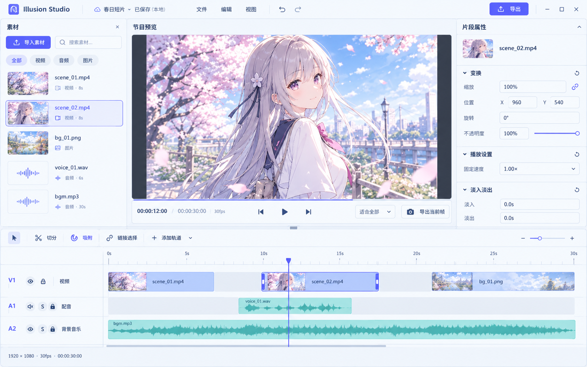
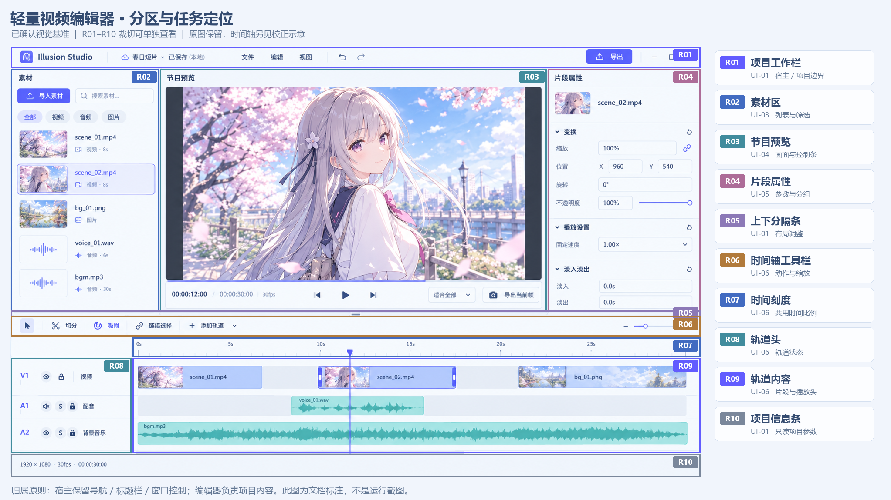
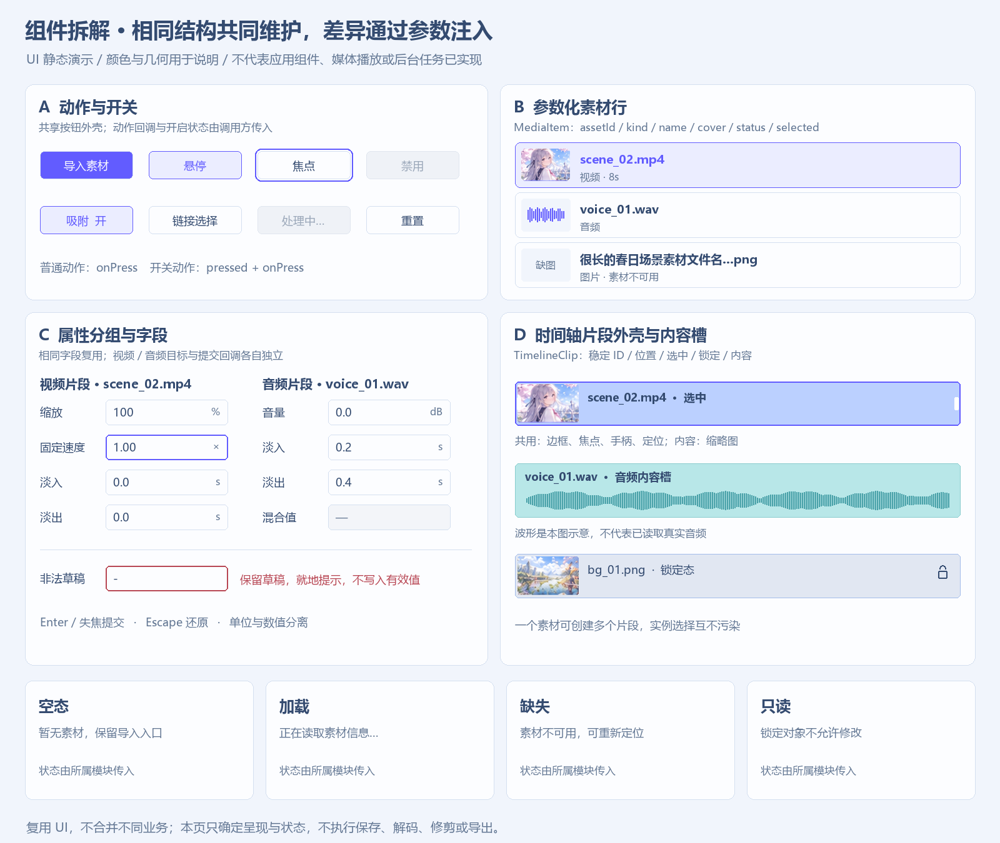
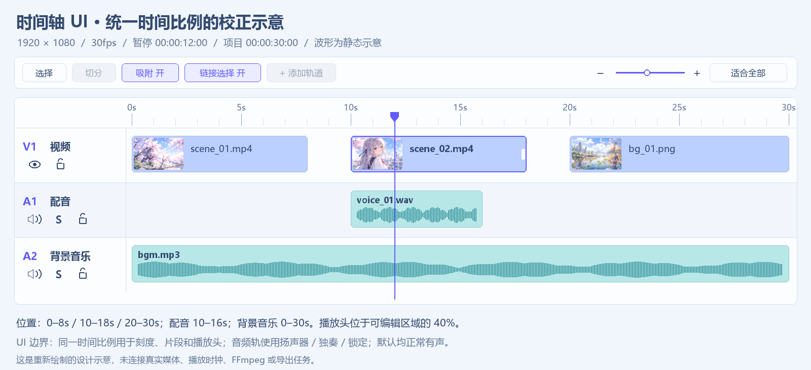

# 轻量视频编辑器：UI 拆解与执行清单

最新追加（2026-11-05）：[参考片段样式与共用级联菜单](reference-ui-implementation.md)已接入。视频74px/40px方格帧带、音频52px深蓝上包络、细浅选框、紧凑轨道头和裸图标工具条；十二分类固定间距与左右溢出翻页；五项画面工具仅随时间线视觉片段显示。右键基础编辑与创建页翻译**实际共用CascadeMenu**，侧向展开、边缘换向、窄窗返回和方向键导航。最终真实视频213/213、翻译78/78；公共UI139/139。类型、lint（0错误/33既有警告）和构建通过；check仍在三个既有词条失败。**功能自动回归完成，人工项待验，注释质量门槛未通过**：业务/测试候选上限23.3831%/22.8070%，不冒充有效率。[截图与日志](runtime/reference-ui/evidence-manifest.json)。此前人工缺项不改为通过，未接业务维持禁用；下方保留各阶段历史结果。


最新追加（2026-11-05）：[片段基础工具、关键帧与固定方格](timeline-edit-tools-implementation.md)已接入正式入口。定格在播放头插入独立3秒片段；倒放、镜像、旋转与画布拖框裁剪真实生效；五种属性记录关键帧并线性插值。六分类素材库、薄框公共工具菜单、分割/左右删除、剪贴板和撤销/重做复用原工程；帧带固定56×56，不随缩放拉大格子。真实视频 **202/202**、公共UI **139/139**、系统框/Explorer自动操作 **20/20**；类型、lint与构建通过。**功能自动回归完成，人工项待验；本轮注释质量门槛未通过，不能标记全部完成。** 业务/测试注释候选上限 **29.4484% / 31.7901%**，未冒充有效率；check三个既有词条和Meta失败另保留。[截图、构建和日志](runtime/timeline-edit-tools/evidence-manifest.json)。系统自动操作不等于人工，UI-08历史人工项继续待验；未接保存、导出、混音和文本等类别业务。本轮到此停止，不继续后续开发。

前一阶段（2026-11-05）：[多视频轨合成预览](multi-video-composition-implementation.md)三个任务已连续实施，**自动验收完成，人工项待验**。节目按明确轨序与工程播放头显示多个真实视频，统一时钟持续经过重叠区、片段边界与黑场；原属性/画布/时间线复用，轨道隐藏可用，节目强制静音、素材查看保留试听。该阶段真实媒体 **180/180**、公共UI/A-B/原视频/GIF宿主 **139/139**、LIVE-01选择结果夹具 **19/19**。类型、lint与Next构建通过；check的三个既有词条及独立Meta扫描失败分别保留。该阶段业务/测试有效增量注释率 **70.0329% / 70.0587%**。[真实截图与播放证据](runtime/multi-video-composition/evidence-manifest.json)。COMPOSE-01预览自动验证完成；COMPOSE-02、混音、真实图片导入、保存和导出仍待办，UI-08人工缺项不改为通过。下方日期段落保留各轮历史快照。

最新追加（2026-11-04）：[时间线三层片段与真实波形](timeline-three-layer-implementation.md)已接入正式入口。顶部名称/时间码、中间连续帧、底部真实音轨包络；左右修剪同步源区间。最终真实媒体160/160、公共UI139/139。UI-08人工待验项不变，保存/导出等未接能力不变；以下为各轮历史快照。

本轮追加（2026-11-04）：[素材区与播放器比例调整](../../create-tags-move-video-layout-2026-11-04.md)已完成；桌面多栏播放器减少约三分之一，素材卡固定140×148，真实视频回归145/145。没有推进新的编辑能力，历史人工限制不变。以下进度段落保留各轮快照。

日期：2026-11-05｜当前状态：UI-01–UI-08 已实施，UI-08与合成预览自动验收完成、人工项待验｜范围：视频编辑器主工作区。以下 UI-05–UI-07 说明为2026-11-04历史阶段记录。

最新进度：按用户授权连续完成 [UI-05 属性检查器](ui-05-implementation.md) → [UI-06 时间轴](ui-06-implementation.md) → [UI-07 深浅主题与响应式](ui-07-implementation.md)。复用现有 LIVE 工程与媒体能力，正式未接效果字段继续禁用，独立 A/B 样板验证草稿/混合值；缩放、fit、锁轨、真实播放书签、紧凑面板和分隔调整已接通。最终 UI **139/139**、LIVE **75/75**；完整检查与剩余人工项见 [verification](verification.md)。本轮止于 UI-07，UI-08 保持待办。

正式 `/tools/video/editor` 已保留 LIVE-01 导入/单源预览、LIVE-02 入轨/移动与 LIVE-03 工程音轨分离/复制/删除。用户要求的碰撞贴边已在 UI-06 更新为最近完整合法空位，严格原子校验仍保留。LIVE-03 的人工实机限制没有因本轮自动检查通过而取消。画布拖动、X/Y 双向同步、项目像素中心、上轨覆盖、不透明度和未来预览/导出一致规则列入 [独立功能待办](canvas-transform-composition-requirements.md)，本轮未实施。下方旧日期段落均为历史快照。

UI-02 已整理共享控件并增加独立状态样板，正式素材区可局部选择、属性分组可折叠；真实媒体业务继续禁用。复用关系、截图、检查与边界见 [UI-02 实施记录](ui-02-implementation.md)。

2026-10-30 按当前实际实现补齐 UI-02：素材与片段分别持有选择状态，图片无封面和解码失败均回落占位，按钮独立关联禁用/等待原因，浮点字段确认后才校验并避免同值重复提交。真实运行回归 **55/55**。

2026-10-30 完成 UI-03 素材面板：搜索与视频/音频/图片分类取交集，素材选择保留稳定 ID 且不改变片段、属性或节目预览；默认五项演示数据与 A/B 状态样板共用 `MediaPanel`、`MediaItem`、`EditorAction` 和 `EditorPlaceholder`。真实导入、探测、播放仍禁用；异常样例和运行截图见 [UI-03 实施记录](ui-03-implementation.md)。

2026-10-30 完成 UI-04 节目预览：默认选中片段映射静态封面、项目比例与时间码，素材选择继续独立；独立 A/B 样板覆盖片段切换、横/竖项目、30/24fps、空态、黑场、缺失、加载、错误、损坏封面、长名称和带返回入口的素材查看。真实 Electron 回归 **97/97**；主时间轴继续只读，播放、跳帧、拖动播放头、缩放与导出均未接入。详见 [UI-04 实施记录](ui-04-implementation.md)，本轮停在 UI-04 等待验收。

2026-10-30 新增[真实视频导入与拖拽演示需求](ui-04-live-demo-requirements.md)，供另一个 AI 分步实施。当时拆分为 LIVE-01 导入/源预览 → LIVE-02 素材入轨/片段移动 → LIVE-03 实机验收。当前进度见上方最新说明及补充需求第 7 节。UI-05–UI-08 的状态保持不变。

2026-11-04 完成 LIVE-02，停在本项等待验收。正式工程与 `DEMO_ASSETS` / `DEMO_CLIPS` 分离，外部 Files 落到 V1 仍只导入素材。真实 Electron：LIVE-02 **34/34**、LIVE-01 回归 **19/19**、静态样板与原视频/GIF 宿主 **97/97**。原生选择框和资源管理器人工拖入未在本轮实测，自动化证据边界见实施记录。

## 1. 基准与使用方法

- **视觉以本目录保存的最新原图为准。** 保留配色气质、三栏上区、单节目预览、底部时间轴、控件密度与素材风格。
- [V1.1 需求提案](../../requirements/lightweight-video-editor-v1.1.md)继续约束功能语义；其中早先的 250/270px 侧栏、时间轴 40%–45% 高度建议，不再作为本轮视觉验收的硬尺寸。
- 原图的时间轴位置、音频图标和“适合全部”的归属存在误差：UI 使用第 5 节的统一数据和校正图。修正语义，不重新设计整套视觉。
- 原图中的 Illusion Studio 为概念标识；接入项目沿用 Illusion Realm 的品牌与外壳。
- `images/` 内 PNG 是设计资料，`runtime/` 内 PNG 是实际 Electron 运行截图。下文组件名是职责建议，UI-01 的实际文件和复用关系以实施记录为准，不能据此宣称已有真实多轨功能。

先看总览，再按 R01–R10 看裁切，最后按 UI-01–UI-08 执行。每一步使用同一组演示数据，验收完成后再更新任务状态，不同时搭建多套相似实现。





## 2. 分区裁切与归属

原图为 **1585 × 992px**。下表坐标是原图裁切边界，格式为 `(左, 上, 右, 下)`，右/下边界不包含；仅用于定位参考，不直接变成 CSS 固定定位。

| 编号 | 区域与裁切图 | 原图边界 | UI 职责 |
| --- | --- | --- | --- |
| R01 | [项目工作栏](images/r01-project-bar.png) | `(0, 0, 1585, 51)` | 项目名、保存状态、菜单、撤销/重做、导出；品牌和窗口控制归宿主 |
| R02 | [素材区](images/r02-media-panel.png) | `(0, 51, 342, 613)` | 导入入口、搜索、分类、可滚动素材列表 |
| R03 | [节目预览](images/r03-program-preview.png) | `(342, 51, 1232, 613)` | 标题、等比预览、时间码、播放/逐帧、适应、帧导出 |
| R04 | [片段属性](images/r04-clip-inspector.png) | `(1232, 51, 1585, 613)` | 选中对象信息、可折叠分组、数值与滑杆 |
| R05 | [上下分隔条](images/r05-workspace-splitter.png) | `(0, 607, 1585, 625)` | 可调整区域的视觉抓手；裁切含上下文 |
| R06 | [时间轴工具栏](images/r06-timeline-toolbar.png) | `(0, 620, 1585, 669)` | 选择、切分、吸附、链接选择、加轨、缩放与适合全部 |
| R07 | [时间刻度](images/r07-timeline-ruler.png) | `(279, 669, 1585, 716)` | 主次刻度、标签、播放头起点；与片段共用横向坐标 |
| R08 | [轨道头](images/r08-track-headers.png) | `(0, 716, 279, 937)` | 轨道编号、名称、按类型显示的状态按钮 |
| R09 | [轨道内容](images/r09-track-lanes.png) | `(279, 716, 1585, 937)` | 视频/图片片段、音频波形、选中边框、修剪手柄与空隙 |
| R10 | [项目信息条](images/r10-project-status.png) | `(0, 937, 1585, 992)` | 分辨率、帧率和项目时长；不复制全局通知与任务状态 |

### R01：项目工作栏

编辑器内部只负责项目操作，不复制原图的品牌、最小化、最大化与关闭按钮。项目名长时省略并可查看全名；保存状态预留“未保存 / 保存中 / 已保存（本地）/ 保存失败”的展示样式。本地项目使用文件/项目图标，云朵不作为同步能力暗示。

UI 阶段用状态样例展示保存结果，导出、文件系统和撤销历史尚未接入时禁用对应动作，不出现模拟成功提示。

### R02：素材区

顶部操作固定，列表独立滚动；视频/图片使用缩略图，音频使用小波形或音频图标。文件名一行省略，次行显示媒体类型和有效时长；图片不显示虚构时长。筛选外观统一，素材行由同一组件传入类型、名称、封面和状态。

素材选择与时间轴选择独立：点选素材只改变素材高亮，不自动改右侧片段属性。预留空列表、搜索无结果、探测中、缺图与不可用素材样式。

### R03：节目预览

预览始终维持项目宽高比，剩余区域为中性深色；不通过拉伸图片填满容器。底部控制顺序沿用原图，预览缩放标签用“适应”，时间轴的“适合全部”放在 R06。

静态样例画面可以切换到不同示例片段，但不得伪装为实际解码或播放。加载、黑场、素材缺失、失败使用不同视觉状态；节目预览和素材查看必须有明确标题及返回入口。

### R04：片段属性

视频、图片、音频、无选择和多选共用属性面板外壳，根据选中对象组合有效分组。视频显示变换、固定速度、淡入淡出；图片显示变换和时长；音频显示音量与淡入淡出；无选中显示项目参数，多选显示共有字段及混合值“—”。

字段标签、输入高度、单位、错误和重置位置统一。输入允许临时草稿，Enter/失焦提交，Escape 还原；非法值保留草稿并就地提示。音频与视频的淡入淡出共用字段 UI，各自保留目标与回调。

### R05：上下分隔条

抓手视觉细，命中区域至少 8px；支持指针、焦点和方向键调整。拖动只改变布局，收起侧栏不重置片段选择。最终上下限在实际宿主高度下验证，保证预览控制和至少一行轨道可用。

### R06–R09：时间轴

工具栏固定；轨道头固定在左，时间内容横向滚动；轨道头和内容共用纵向滚动位置。刻度、片段、波形、播放头共用同一时间坐标。视频轨显示“可见、锁定”；音频轨显示“静音、独奏、锁定”，默认均未静音、未独奏、未锁定。

视频/图片与音频片段共用定位、边框、选中和手柄外壳，内部内容分别组合。空隙保持真实宽度，不画成隐式拼接；选中不能只靠颜色。播放头覆盖轨道区时不截获片段按钮事件。

UI 阶段只需要示例位置、选中、悬停、锁定和拖动草稿外观；真实修剪、碰撞、吸附、音画联动、撤销和播放留给功能阶段。

### R10：项目信息条

使用紧凑的只读参数，不塞入第二套导出、通知或全局任务中心。窄容器优先保留分辨率/帧率，完整信息可通过提示查看。项目时长跟随演示项目数据，不通过素材总时长相加推算。

## 3. 视觉与布局约定

| 项目 | 本轮约定 |
| --- | --- |
| 整体结构 | 上区素材 / 节目预览 / 属性，下区时间轴；面板用细分隔，不堆浮卡片 |
| 原图比例 | 上区左栏约 21.6%、中区约 56.2%、右栏约 22.3%；下区连信息条约占窗口 38% |
| 尺寸使用 | 原图比例用于宽容器比对；真实布局以宿主 main 的可用尺寸为准，禁止整图缩放 |
| 间距 | 4/8/12/16px 为基本梯度；同级字段、按钮和素材行共享间距 |
| 字体 | 沿用现有应用字体；正文 13–14px，辅助信息 12px，面板标题 14–16px；时间码用等宽数字 |
| 控件 | 常规按钮/输入约 32–36px 高，图标约 16–18px，圆角约 6–8px；命中区域不得随窄屏缩成小点 |
| 色彩 | 冷中性浅底、深灰蓝文字、蓝紫强调；视频蓝、音频青绿；封面内容不作为面板背景 |
| 主题来源 | 使用现有 `themeSignals` 和全局语义变量；必要的编辑器语义色局部补充，不另建全局主题状态 |
| 建议局部色名 | `editor-video-fill`、`editor-audio-fill`、`editor-playhead`；落地时映射现有 token，缺项再补 |
| 对比度 | 普通文字目标至少 4.5:1，关键控件边界与焦点至少 3:1；后续以实现颜色测量 |
| 图标 | 沿用 lucide-react；可见、静音、独奏、锁定按语义区分，图标按钮有名称和状态 |

宽度以**编辑器容器**计算，下表为待 UI 原型验证的初始收缩规则，不修改应用最小窗口，也不照搬创建页断点。

| 可用宽度 | 展示策略 |
| --- | --- |
| ≥1280px | 三栏；侧栏参考原图比例，素材宽约 280–342px，属性宽约 300–353px，中间占剩余 |
| 1040–1279px | 素材 + 预览，属性默认收起，由“属性”入口在上区临时展开 |
| <1040px | 预览优先；素材、属性按需在上区打开，临时面板互斥，时间轴和导出入口仍可达 |

临时面板只使用编辑器上区，不越过宿主导航，不盖住下方轨道；关闭后焦点回到入口。轨道头在紧凑模式可收窄到约 176px，标签省略但按钮可辨认。高度不足时轨道纵向滚动，不压扁预览和字段。具体最小高度由 UI-07 在真实宿主中确定。

## 4. 组件层次与参数边界

组件像积木：外壳、间距和连接方式相同就共用一块，内容通过参数更换；两个按钮长得一样，不代表它们都应该保存同一份数据。拆分依据是独立职责、稳定共性和状态归属，不是把每个标签都变成文件。

### 4.1 已核对的现有基准

以下均位于 `apps/next/src/`，先复用真实实现，再按必要性适配；本轮只记录，不修改。

| 现有文件 | 复用判断与边界 |
| --- | --- |
| `components/AppShell.tsx`、`window-titlebar.tsx`、`window-caption-controls.tsx` | 沿用导航、标题栏和窗口控制，编辑器不创建第二套 |
| `view/toolBox/tool-page-frame.tsx` | 当前路由的工具页框架；内部有返回栏、padding 与 overflow-auto，接入全高编辑器前需核对几何，不能直接假定已支持专注布局 |
| `components/SimpleSelect.tsx` | 复用选项模型及下拉交互；当前没有 disabled 参数，禁用场景需受控补充并回归原调用方 |
| `components/CollapsiblePanel.tsx` | 复用属性分组折叠内容；标题、重置按钮和字段仍由编辑器组合 |
| `components/LocalFileImage.tsx`、`ResourceCoverImage.tsx` | 核对后用于本地封面与缺图回退，示例 PNG 不等于已生成媒体缩略图 |
| `components/videoEdit/PreviewStage.tsx` | 视频和 GIF 共用，绑定单片段、trim 与原视频事件；新节目预览仅提取适用的展示部分，不把旧接口改名冒充多轨合成 |
| `components/videoEdit/TimelineScrubber.tsx` | 视频和 GIF 共用的源片段修剪轴；不能直接当作新多轨工程轴 |
| `components/videoEdit/ClipPlaylist.tsx`、`ExportPanel.tsx` | 现有片段列表与处理参数可参考，布局和业务语义不同，不整体塞进新素材区/属性区 |
| `components/SimpleNumberCombobox.tsx` | 当前按整数 parseInt/round，且存在固定输入 id；不直接用于 1.00×、0.2s 或多个实例的浮点属性字段 |
| `app/globals.css`、`app/workspace-shell.css`、`utils/layout.ts` | 复用语义色、焦点、边框及宿主布局机制；不另造全局样式覆盖层 |

### 4.2 建议的最小组件树

```text
VideoEditorView                         页面装配与演示数据边界
├─ ProjectToolbar                       项目操作，不含宿主品牌/窗口按钮
├─ EditorUpperWorkspace                 三栏与临时面板布局
│  ├─ MediaPanel                        工具区 + 筛选 + MediaList
│  │  └─ MediaItem                      共用行外壳 + 封面/音频内容
│  ├─ ProgramPreview                    PreviewSurface + TransportBar
│  └─ ClipInspector                     对象标题 + PropertySection
│     ├─ TransformFields                视频/图片共同变换字段
│     ├─ FixedSpeedField                视频固定速度
│     ├─ VolumeField                    音频音量
│     └─ FadeFields                     共享布局，各对象注入值与回调
├─ WorkspaceResizeHandle                上下区调整
├─ EditorTimeline                       工具栏 + 时间轴视口
│  ├─ TimelineToolbar                   动作组 + 缩放 + 适合全部
│  ├─ TimelineRuler                     共用时间比例
│  ├─ TrackRow                          TrackHeader + TrackLane
│  │  └─ TimelineClip                   共用片段外壳 + 内容槽 + 手柄
│  │     ├─ VisualClipContent           视频/图片缩略图
│  │     └─ AudioClipContent            波形展示
│  └─ TimelinePlayhead                  同坐标的贯穿线
└─ ProjectInfoStrip                     只读参数
```

新 UI 默认放在视频编辑器所属目录内；只有出现至少两个真实使用点且契约一致时再提取公共部分。现有 GIF 等调用方不在本轮迁移范围。

### 4.3 原子与组合组件的最小输入

下表是 UI 契约，不是 IPC 或持久化格式；回调表达用户意图，由业务层决定实际执行方式。

| 组件 | 注入内容 | 共同维护的部分 |
| --- | --- | --- |
| EditorActionButton | 图标、label、tone、size、disabled、busy、onPress；开关动作另有 pressed | 高度、图标间距、焦点、禁用和反馈；复用于导入/帧导出、播放/重置等适配场景 |
| MediaItem | assetId、kind、name、thumbnail、durationLabel、status、selected、onSelect、onOpen | 行高、缩略图槽、文件名截断、选中和缺图；不包含磁盘删除 |
| PropertySection | title、open、onToggle、resetAction、children | 分组标题、折叠、分隔和重置入口 |
| NumberField | id、label、value、unit、precision、min/max、mixed、disabled、error、onCommit | 草稿、对齐、单位、提交与错误表现；允许小数和负数，按字段规则提交 |
| FadeFields | inValue、outValue、disabled、各自 onCommit | 两行时长字段的结构；视频/音频的参数目标由外部绑定 |
| TrackHeader | trackId、kind、name、locked、visible 或 muted/solo、独立事件 | 布局与按钮样式；视频和音频的有效控制由明确类型分支组合 |
| TimelineClip | clipId、起点/长度的展示值、selected、locked、onSelect、内容槽 | 位置、选中边框、修剪手柄、焦点；图片不伪装成有波形的视频 |
| StatePlaceholder | title、description、icon、可选动作、展示密度 | 空态/加载/缺失的容器；实际错误与重试动作从所属模块传入 |

不为这些字段先搭通用表单引擎或组件注册框架。属性分组只共用已经相同的字段排列，速度、音量、变换、项目设置分别组合。

### 4.4 状态与功能分块

| 模块 | UI 阶段持有内容 | 后续独立接入的业务 |
| --- | --- | --- |
| 布局与焦点 | 面板开合、分隔比例、活动区域、焦点回退 | 布局偏好是否持久化另定 |
| 素材库 | 查询、筛选、selectedAssetId、素材状态样例 | 文件选择、探测、代理与引用管理 |
| 节目预览 | 预览模式、演示画面、时间码、适应方式 | 时钟、解码、seek、合成、帧导出 |
| 属性检查器 | selectedClipIds 的展示模型、字段草稿、混合值 | 参数校验、命令提交、撤销、链接对象更新 |
| 时间轴 | 视口缩放/滚动、演示选择、拖动草稿状态 | 项目时间模型、碰撞、吸附、修剪、音画链接 |
| 项目与导出 | 保存状态样例、导出设置的展示入口 | 文件存储、恢复、真实进度、取消与输出校验 |

素材、轨道、片段分别使用稳定 ID；同一素材的多个片段实例可独立选中。演示状态在页面实例内隔离，公共组件不读取另一场景的全局选中值；需要跨组件共享时沿用项目 Zustand，不新增全局 Context。



## 5. 统一演示数据与时间轴校正

所有分区、状态和后续截图使用同一示例工程：**春日短片，1920 × 1080，30fps，时长 30 秒，暂停在 12 秒**。两个视频均无内嵌音轨；A1 配音、A2 背景音乐独立存在。

| 轨道 | 内容 | 时间范围 | 样例状态 |
| --- | --- | --- | --- |
| V1 | scene_01.mp4 | 0–8 秒 | 未选中 |
| V1 | scene_02.mp4 | 10–18 秒 | 选中；预览、属性均对应它 |
| V1 | bg_01.png | 20–30 秒 | 未选中 |
| A1 | voice_01.wav | 10–16 秒 | 未静音、未独奏、未锁定 |
| A2 | bgm.mp3 | 0–30 秒 | 未静音、未独奏、未锁定 |

V1 保留 8–10、18–20 秒空隙；两个视频的展示宽度相同。播放头从轨道内容起点计算，位于 0–30 秒宽度的 40%，不能从整张图左边计算。

时间像一把共用的尺子：刻度、片段和播放头都量同一条轨道内容区。展示坐标按 `内容起点 + 秒数 × 每秒像素 − 横向滚动量` 计算，宽度按 `时长 × 每秒像素` 计算。缩放只改每秒像素，不改示例时间。坐标模型先用于 UI，不能据此推定真实媒体已同步。

下面是**校正后的静态时间轴示意**：保留原图视觉方向，明确实际区间和有效图标。图内波形仅为示意，不来自媒体解码，不作为音量或音频内容证据。



## 6. 状态演示与可操作边界

| 对象 | UI 阶段必须有的样例 | 可本地演示 | 尚未接通时的处理 |
| --- | --- | --- | --- |
| 按钮 | 默认、悬停、按下、焦点、禁用、加载、开关开启 | 焦点、开关样式、面板打开/关闭 | 保存/导出等显示禁用原因，不伪造完成 |
| 素材列表 | 视频、图片、音频、长名、选中、加载、缺图、不可用、空/搜索无结果 | 查询、筛选、样例选择 | 导入不触发真实文件选择 |
| 预览 | 正常、黑场、加载、缺失、失败、素材查看 | 模式切换、静态样例画面 | 播放、逐帧和帧导出不显示虚假结果 |
| 属性 | 视频、图片、音频、无选中、多选混合、锁定、非法草稿 | 分组折叠、演示值编辑、重置 | 仅更新演示模型，不写真实项目 |
| 时间轴 | 选中/未选中、锁定、空隙、不同类型、拖动有效/无效落点 | 示例选择、视口缩放和滚动 | 切分/修剪/吸附执行暂不接入 |
| 项目信息 | 未保存、保存中、已保存、失败 | 通过样例切换查看 | 不把定时动画当保存进度 |

状态演示使用独立预览入口或显式样例控件；演示说明放在演示页，不进入正式编辑器产品界面。默认工作区按原图展示，不堆叠全部错误与加载提示。

深色复用同一 DOM、示例和状态，只换主题值；这份交付尚无已确认深色稿，不以给原图整体盖暗色滤镜代替主题设计。

## 7. 按顺序执行的任务

当前追加编辑能力及质量状态以页首和[基础工具实施记录](timeline-edit-tools-implementation.md)为准。下方各阶段“定格/倒放/裁剪/切分/撤销未接”等为当时快照，不覆盖本轮已接通的功能，也不取消历史人工待验项。

左右边缘源范围追加修复：右侧最多恢复原视频结尾，左侧在原源内容内调整入点，修正小数倍速下的尾格/入点取整误差。继续复用统一修剪模型，最新自动回归 **151/151**；[实施、边界与未验证](trim-source-bounds-implementation.md)。

最新追加样式已实施：首帧紧凑素材卡、右上角时长、左下文件名、1px选中框；宽屏素材区上限420px，播放器接收剩余宽度，覆盖此前播放器缩小的要求。真实视频 **148/148**、公共UI **139/139**；[实施、截图与检查边界](compact-media-card-implementation.md)。UI-08人工项继续待验。

LIVE-03 状态：代码与自动回归完成，人工实机项部分未验证；[实施、截图和限制](ui-04-live-03-implementation.md)。固定轨道拖动、工程音轨分离、复制/删除和公共右键 UI 继续正常。其旧碰撞拒绝策略在 UI-06 按后续用户要求增加最近完整合法空位解析，未缩短片段迁就碰撞。

当前 UI-01–UI-08 已实施。UI-08 状态仍为**自动验收完成，人工项待验**，详见 [实施记录](ui-08-implementation.md)。单源画布变换及[媒体交互](timeline-media-interaction-implementation.md)之后，本轮已接通[连续多视频轨合成预览](multi-video-composition-implementation.md)：独立变换、固定轨序、显隐、统一工程时钟、跨片段/黑场、最新定位与解码错误清理。节目静音，混音、真实图片导入、保存与导出仍未接通。LIVE 与 UI 历史检查按各自证据级别保留，自动拖放不等于人工资源管理器拖入，DPR=1 不等于系统 125%/150% 缩放已测。

| 顺序 | 任务 | 依赖 | 本步产出 | 验收条件 |
| --- | --- | --- | --- | --- |
| UI-01 | 已完成 · 宿主与布局骨架 | 本文 | 路由内的项目栏、三栏上区、分隔条、时间轴和信息条；只读样例；[实施与截图](ui-01-implementation.md) | 单 AppShell/标题栏/窗口按钮；workspace 宿主和内部滚动明确；导航可用；原视频/GIF 回归通过 |
| UI-02 | 已完成 · 最小组件与状态样板，等待验收 | UI-01 | 按钮、素材行、分组、浮点字段、片段外壳、占位状态；局部 token 映射 | 共享组件接入默认工作区与独立 A/B 样板，本轮 55/55 运行检查通过；见实施记录 |
| UI-03 | 已完成 · 素材区，等待验收 | UI-02 | 导入入口（禁用）/搜索/筛选与五个素材样例，空/异常样例 | 单份 MediaItem 渲染不同媒体；切换素材不污染片段选择；长名/缺图不破布局；真实运行 77/77 |
| UI-04 | 已完成 · 节目预览，等待验收 | UI-03 | 参数驱动等比静态预览、时间码、控制条与独立 A/B 预览状态样板 | scene_02 默认画面对应；节目/素材模式与返回明确；片段选择与素材选择独立；未接通操作禁用；97/97 运行检查通过 |
| UI-05 | 已实施 · 属性检查器，等待验收 | UI-04 | 类型交集、默认/确认/混合值、草稿/重置、A/B 样板；[记录](ui-05-implementation.md) | 正式跟随片段选择；后续已接五种真实构图、视频片段速度及数值拖调，淡入淡出效果仍禁用 |
| UI-06 | 已实施 · 时间轴 UI，等待验收 | UI-05 | 单坐标、缩放/fit、锁轨、合法边界放置、真实书签；[记录](ui-06-implementation.md) | LIVE 75/75；完整长度/22帧间隙反证保留；无多轨合成 |
| UI-07 | 已实施 · 深浅主题与响应式，等待验收 | UI-06 | 六组尺寸主题、紧凑面板/焦点、上下分隔；[记录](ui-07-implementation.md) | UI 139/139；文字对比度抽测达标，人工系统缩放等仍未验证 |
| UI-08 | 自动验收完成，人工项待验 · 页面装配与 UI 验收 | UI-07 | 正式真实工程集成、拖放遮罩/黑画布修复、目标轨锁校验；[记录](ui-08-implementation.md) | 自动与人工证据分开；完整check仍有未引用词条失败；Explorer拖入、人工键盘/缩放/试听待验 |

追加媒体交互最新回归：LIVE **143/143**、UI **139/139**、LIVE-01 选择结果夹具 **19/19**、旧视频 **58/58**、GIF **50/50**、漫画 **54/54**；额外 C站内容访问回归有一项失败，`pnpm check` 与独立 Meta 失败按 [核查记录](verification.md) 保留。业务/测试有效增量注释率 **70.28% / 70.03%**。胶片带是有界真实采样，非逐一显示所有源帧；定格/倒放/裁剪/切分/吸附等仍禁用。人工状态不因自动回归通过改写。

每步只动当前编辑器及必要公共依赖。若改公共组件参数，接通本次相关调用方并回归原用法；不因这份任务书顺便迁移 GIF、创建页或全站组件。

### 后续授权：单源画布变换（2026-11-04）

三个任务已连续实施并自动验证，等待验收：片段独立变换数据 → 原属性组件接入 → 真实节目视频画布拖动/取消/锁轨与集成回归。100% 表示完整 contain 基础适配，X/Y 为项目像素中的画面中心；真实帧与操作选框分层，源查看保持原始画面。图片具备模型与共享渲染支持，正式导入仍沿用视频入口，未把图片纯模型测试写成实机图片导入证明。

最终真实视频/画布 **109/109**、UI **139/139**、原生系统框 **19/19**、旧视频 **9/9**、GIF **50/50**、漫画 **54/54**。类型、lint（0 错误/33 既有警告）与 Next 构建通过；全量 check 仍有三个既有词条失败，Meta 单独补跑另有原扫描问题。业务增量有效注释率 **70.06%**，测试 **70.86%**。

[实施与变换前后截图](canvas-transform-implementation.md)、[检查与未验证](verification.md)、[证据和哈希](runtime/canvas-transform/evidence-manifest.json)。这是单源画布阶段的历史记录；本轮 COMPOSE-01 已完成真实多视频连续预览自动验证，见[最新实施记录](multi-video-composition-implementation.md)。UI-08 人工项原状态不变；COMPOSE-02、混音、保存、导出保持待办。选择单个片段显示出来不等于多轨合成已完成。

导出设置弹窗、音频选中细化、空工程和缺失素材的独立高保真稿，可在主工作区 UI-08 后继续补；当前先用状态样例确定容器与反馈位置，不扩大成全部产品流程设计。

## 8. UI 验收清单

- [ ] 默认大容器与确认原图视觉一致，只有一个节目预览，编辑器内容不包含第二套系统外壳。
- [ ] 视频与图片素材共用素材行；音频/视频淡入淡出共用字段结构，修改一次样式可同时生效。
- [ ] 素材选择、片段选择和字段草稿归属清楚；点击素材、切换片段、折叠面板不串状态。
- [ ] 样例时间线准确；缩放/滚动后刻度、播放头和片段仍对齐，轨道头与轨道行纵向一致。
- [ ] 深浅主题同布局、同数据；预览内容不随主题被染色；对比度按实现颜色检查。
- [ ] 至少比较 1600×1000、1280×800、960×720 三种编辑器容器；这些是 UI 样例尺寸，不承诺系统窗口最小值。
- [ ] 在真实宿主下检查导航开合及 100%/125%/150% 系统缩放；缩放以真实环境验证，不能靠缩截图代替。
- [ ] 键盘可到达按钮、字段、分隔条和时间轴；焦点可见，输入文字时不误触播放/删除快捷键。
- [ ] 长文件名、缺图、空态、加载、错误、多选混合和锁定有样例；隐藏面板不参与 Tab 导航。
- [ ] 正式界面未接通的动作显示禁用与原因；样例不被描述为实际保存、播放或导出成功。

## 9. 图片资料与本轮核查

| 文件 | 用途 | 性质 |
| --- | --- | --- |
| `images/00-reference.png` | 用户确认的原图，后续裁切的共同源 | 原样复制，1585×992 |
| `images/01-region-map.png` | R01–R10 分区、归属与后续任务定位 | 原图上叠加编号与图例 |
| `images/r01-…png` 至 `r10-…png` | 单独查看各区的视觉细节 | 原图直接裁切，保留已知概念误差 |
| `images/02-component-states.png` | 按钮、素材行、属性、片段的原子与状态关系 | 静态重绘示意，非可运行组件 |
| `images/03-timeline-demo.png` | 校正时间轴比例与音频图标，统一演示数据 | 静态重绘示意，波形非真实数据 |

资料阶段及当前实现核查见[交付核查记录](verification.md)，UI-01 的文件、截图、注释率与检查限制见[实施记录](ui-01-implementation.md)。后续实现仍须按根目录 [AGENTS.md](../../../AGENTS.md) 与相关技能执行；新增功能、测试和脚本遵守大白话/类比、有效注释率至少 70% 与禁止废话注释的要求。
