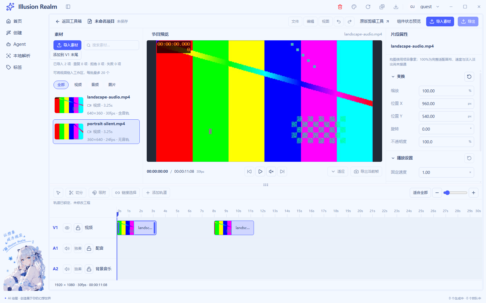
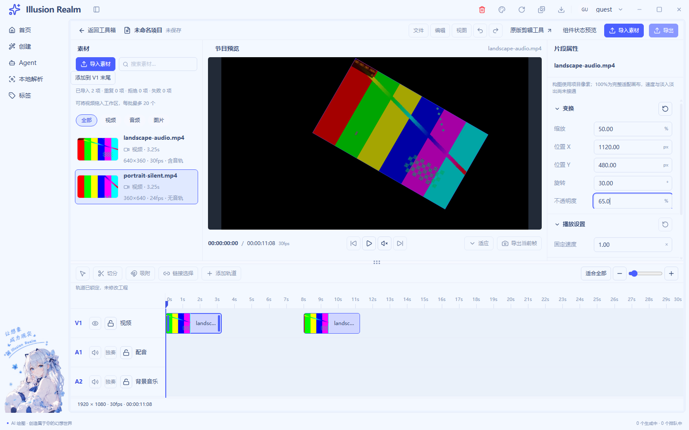
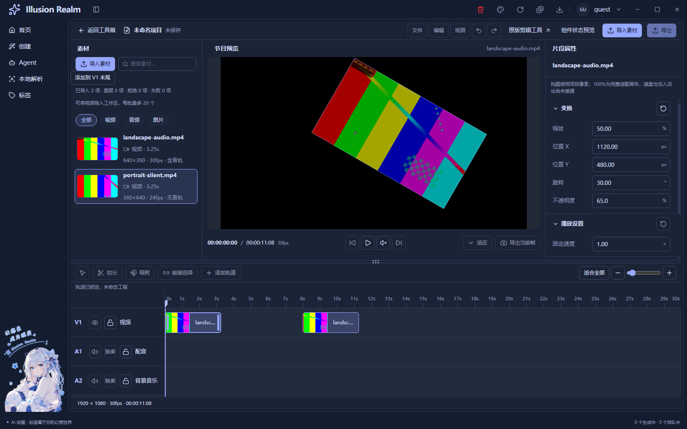
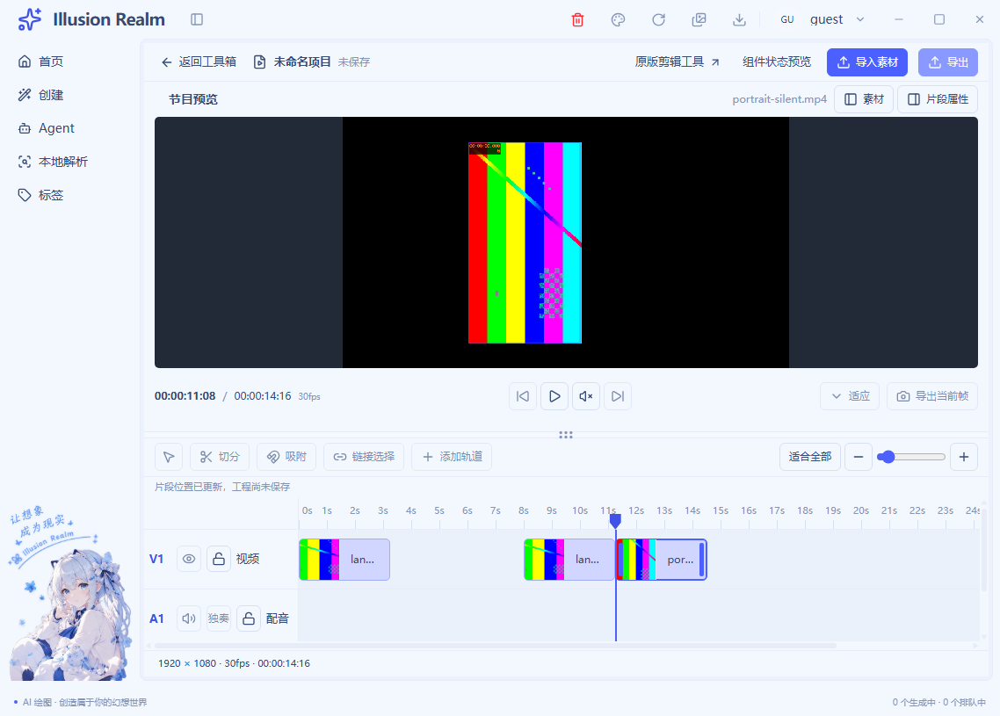

# 节目画布变换实施记录

日期：2026-11-04。按本轮授权连续完成变换数据、画布交互和集成回归，停止在单源变换阶段。**代码与自动验证完成，人工项待验**。UI-08 原有人工限制保持不变，没有将自动事件改写为人工验收通过。

## 1. 数据、坐标和边界

每个视频/图片片段通过独立 `transform` 保存五个参数；素材不保存片段构图。历史样板未带此字段时只读默认值，正式创建视频片段时写入新的独立默认对象。复制片段复制嵌套变换值，分离出的音轨清除画面变换。

| 参数 | 单位与范围 | 默认值 |
| --- | --- | --- |
| X、Y | 项目像素，左上原点，向右/向下增加；±100000，2 位小数 | 项目宽/高的一半 |
| 等比缩放 | 百分比，沿用检查器范围和 2 位精度 | 100% |
| 二维旋转 | 顺时针度数，±36000，2 位精度 | 0° |
| 不透明度 | 0–100%，1 位精度 | 100% |

位置表示**完整源画面的中心**，1920×1080 工程默认 (960,540)。允许负坐标和画面越界，由项目边界裁切最终可见内容。

100% 表示先将整个源按比例完整放入工程画布（contain）的基础尺寸，再乘片段缩放；不是源像素与屏幕像素一比一。640×360 源在 1920×1080 工程中基础尺寸为 1920×1080；360×640 源为 607.5×1080。旋转不会重新计算基础适配尺寸，改变预览窗口不会改工程构图。

字段、拖动、重置共用 `updateClipTransform`：重新检查片段身份、媒体类别、轨道锁、有限数字、字段范围和精度，整份补丁全部合法才替换目标片段。其余片段保留，起止时间、源区间、素材文件和工程时长不变。检查器沿用临时字符串草稿、Enter/失焦提交、Escape 恢复与就地错误；非法值不进入确认数据。

## 2. 复用和实际接入

| 实现 | 接入方式与边界 |
| --- | --- |
| `ClipInspector → InspectorSection → EditorFloatField` | 传确认值、五个可编辑键、锁、提交和重置回调；未复制数字输入或校验体系。样板仍独立演示其他字段，正式速度/淡入淡出继续禁用 |
| `ProgramPreview` | 保留唯一标题、项目相框、时间码和控制条；图片节目分支与真实视频适配共同使用 `ClipCanvas` |
| `LiveSourcePreview` | 原真实 video 节点作为内容注入，保留解码、播放/暂停、切源和清理；变换只更新几何，不把视频替换成封面 |
| `useLiveTimeline`、`live-timeline-model` | 原片段数组拥有确认值，原创建/复制/分离/移动契约继续使用；没有第二套工程时间数组 |
| `useClipTransform` | 只拥有一次手势候选，向媒体与属性提供同一个临时值；失选、对象替换、锁定后候选失效，不是全局工程仓库 |
| `ClipCanvas` | 按项目尺寸渲染百分比，视频/图片共享基础几何；内容裁切层与操作选框分开，透明度不影响选框可见性 |

新建三个职责文件：`clip-transform-model.ts`、`use-clip-transform.ts`、`clip-canvas.tsx`。修改当前编辑器的 inspector、panels、property-model、timeline 类型、time-ruler、live-source-preview、live-timeline-model、use-live-timeline、video-editor-view 和局部 CSS；双语增加画布操作名与真实能力说明。没有改 IPC、preload、主进程、全局存储或旧视频/GIF 的业务状态。

纯模型和共享图片渲染支持图片片段；**正式素材导入入口仍为既有视频导入，不新增图片导入**。图片的非默认变换实机画面没有本轮证据，不能把图片模型断言称为真实图片导入或解码验收。真实像素专项使用两个本地视频，独立图片样板仍与真实工程隔离。

## 3. 画布手势与抖动修复

点击画面就地选择对应片段，不定位到源开头，不改变素材高亮；即使节目书签与属性选择暂时属于不同片段，也能在首次按下时选中并完成同一拖动。

按下时记录当前中心、抓取点与“项目尺寸/相框实际 CSS 尺寸”的轴向比例；后续使用客户区位移差，所以预览居中留边不需要再扣一次。对象缩放或旋转不改变项目 X/Y 方向，抓取偏移保持。移动只更新候选，松手再计算末端并提交，Escape、失焦、指针取消、对象变化和真实尺寸变化丢弃候选。锁轨同时禁止开始、字段提交、重置和最终命令写入。

媒体像素在项目裁切层内，选框是独立操作层，不作为画面内容，也未增加自由变形手柄。无论是否选中都不调整轨道叠放顺序。

播放头抖动的反馈路径一并修复：显式定位关闭工程媒体回报，旧的暂停/seek `timeupdate` 不再覆盖新书签；真实 `play` 打开回报，正常暂停和结束先交最终进度再关闭回报。播放头焦点使用 `preventScroll`，避免浏览器焦点滚动与指针定位竞争。初次过度屏蔽暂停事件曾造成最终进度回归，已修正并重新跑完整套件；没有只引用局部通过结果。

## 4. 自动验证与证据等级

最终 Next 静态导出指纹：`3f64e256366224472a3550cced7714a3d8fb31f63b050ebbfa75e0bcf26703a8`（863 个输入）。Electron 全部串行运行，未关闭用户应用。证据和哈希见 [清单](runtime/canvas-transform/evidence-manifest.json)，源媒体独立探测见 [参数](runtime/canvas-transform/media-facts.json)。

| 检查 | 结果 | 实际覆盖 |
| --- | --- | --- |
| `pnpm typecheck` | 通过 | 渲染与主进程类型 |
| `pnpm lint` | 0 错误，33 个既有警告 | 没有新增 lint 错误 |
| Next 构建 | 通过 | 静态导出与源码指纹 |
| LIVE-02 + 画布专项 | **109/109** | 真实 H264 视频、生产探测/协议/媒体事件、实际帧像素；CDP 画布指针、DOM 字段和键盘；含纯模型反证 |
| 编辑器 UI | **139/139** | A/B 状态、原属性草稿、素材/片段独立、主题、三容器、紧凑面板与宿主 |
| LIVE-01 原生系统框 | **19/19** | UIAutomation 操作真实多选/取消；无 chooser 返回值替换；Explorer 拖入明确 SKIP |
| 旧视频区间 | **9/9** | 实际区间排序与导出回归 |
| GIF | **50/50** | 原预览、导出和宿主 |
| 漫画 | **54/54** | 公共标题/宿主及原画布功能 |
| 双语键、i18n 中英基线、冒烟规则 | 通过 | 新增键对齐，未增加文案基线问题 |
| 新增/修改 JS 语法 | 通过 | 三个本轮脚本 `node --check` |

真实媒体：横屏 640×360、30fps、含音轨；竖屏 360×640、24fps、无音轨。均从磁盘实际编码文件导入并由生产 ffprobe 探测。LIVE-02 的按钮返回路径是明确夹具，LIVE-01 单独使用真实系统框，二者未混报。

画布专项覆盖五字段及非法草稿、真实 video 节点不重建、变换前后实际像素黑场比例、旋转/缩放后位移、抓取偏移、候选同步、松手保留、Escape、首次点击未选画面的连续拖动、同源副本继承/独立、锁轨/重置、竖屏基础比例、源查看原始画面、窄窗不改构图、变换后深色画面、播放头连续向右与暂停旧事件反例。原套件继续验证真实播放/暂停、导入、时间线横滚/拖动/移动/碰撞/复制/删除/分离和资源清理。

截图人工复核曾发现新增深色专项仍呈浅色：直接改单边 nativeTheme 被应用偏好覆盖。已改为操作生产外观菜单，等待 data-theme、实际媒体查询和换肤动画三项一致，再截图；重新执行完整套件并替换证据，没有保留错误命名截图作为通过依据。

自动输入没有操作用户桌面鼠标；暂停旧 `timeupdate` 是显式负向夹具；图片冻结对象属于纯模型证据。这些均不等于人工实机操作。

## 5. 失败与尚未实测

重新执行 `pnpm check`：**退出 1**，类型与 Electron 模块通道先通过，门禁仍报三个原有未引用词条：`auth.verifySuccess`、`common.localeNameSelf`、`create.generationTasks.active`。没有为通过检查删除不属于本轮的词条。

单独补跑 Meta：**退出 1**，仍是扫描器把未改动 `MetaFieldRow.tsx` 的中文 JSX 注释识别为字段字面量；真实语料 golden baseline 缺少，被脚本标为跳过。其余单独补跑结果见日志，不能合称全量 `check` 已通过。

人工资源管理器拖入、完整真人鼠标/键盘路径、系统 125%/150% 缩放、多显示器、真实前台遮挡、扬声器试听和操作录屏未验证；UI-08 原限制保持不变。真实图片导入和带非默认变换的真实图片实机画面也未验证。截图是实际 Electron `capturePage`，没有操作录屏。

## 6. 注释与函数核查

基线为本轮开始前工作区快照，保留已有修改；新增文件全文、修改文件只统计本轮新增/替换行，删除与未变上下文排除。C 为纯有效注释，B 含代码和混合行。候选统计后人工复核契约、坐标、锁、取消、资源与证据边界，保守剔除业务 18 行、测试 32 行重复概述。

- 业务 **C468/B200，70.06%**。
- 测试 **C406/B167，70.86%**。

[逐文件与剔除行](canvas-transform-comment-audit.json)、[函数长度](canvas-transform-function-audit.json)。TypeScript printer 去注释正常展开后，本轮涉及的普通函数最大 27 行；JSX 装配单独豁免，内部事件单独核查。有效说明包括“把照片平移，不随照片旋转改变项目轴”和“透明纸候选，松手才抄回工程”，对应实际坐标与提交机制。

## 7. 截图和停止边界

变换前：

变换后（X1120、Y480、缩放50%、旋转30°、不透明度65%）：

仍未接通：多轨画面合成/自动连续接播、工程保存/导出/云端、关键帧、自由变形手柄、修剪/切分、跨轨移动/新增视频轨、撤销系统、速度/淡入淡出真实效果、轨道可见/静音/独奏、独立图片/音频导入与真实波形。没有用当前选中单源画面冒充合成。

后续合成契约不变：时间线上方视频轨覆盖下方，按不透明度合成，选择/点击/导入/拖动顺序不改变叠放；预览与未来导出采用相同规则。[COMPOSE-01/02](canvas-transform-composition-requirements.md) 保持待办。本轮停在单源画布变换，不自动推进合成。
