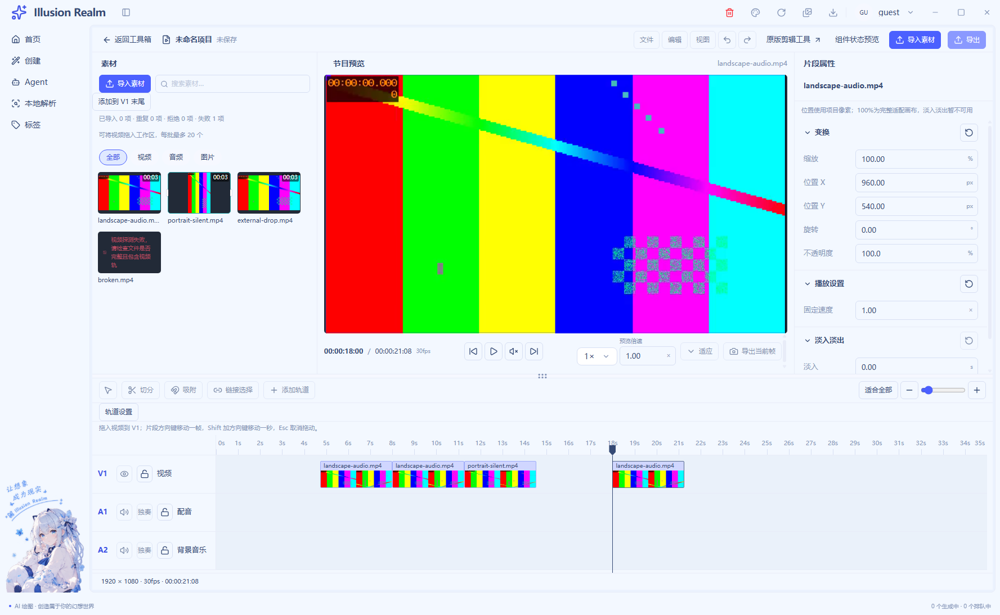
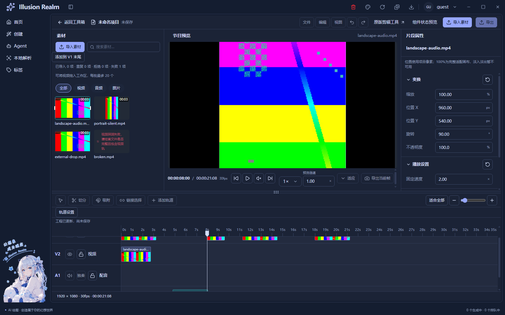

# 紧凑素材卡与宽屏播放器（2026-11-04）

已实施并完成自动回归，等待视觉验收。本轮按用户最新两张参考图覆盖此前“播放器缩小三分之一”的比例要求；UI-08 人工项继续待验。

## 效果与复用

- 素材卡固定 112×94px，封面 112×74px。使用源第一帧，横竖视频完整 contain 显示，时长位于封面右上角，文件名位于下方左侧，长名省略并保留完整 title。
- 选中仅显示 1px 青色封面框和左右短白线，卡片背景透明。键盘焦点也显示细框；装饰线和时长不拦截拖动。
- 宽屏素材区为 `clamp(300px,25cqw,420px)`，属性区仍为 300–353px，其余宽度交给播放器。双栏素材区 280–340px；紧凑面板入口继续使用原互斥与焦点返回逻辑。
- 继续复用 `MediaPanel → MediaItem`，通过既有 `layout="cards"` 参数注入外观，列表样板保留原元数据显示；卡片辅助文本仍包含真实探测信息。复用原 `formatTime`，没有新增时间模型或卡片/播放器实现。
- `live-video-import.ts` 原有首帧提取、超时、取消和媒体清理保持原样。素材/片段选择、预览时钟、工程变换和时间线业务仍独立；封面不跟随节目播放、修剪或旋转。

## 修改文件

| 文件 | 职责 |
| --- | --- |
| `apps/next/src/view/toolBox/Tool/video/editor/editor-panels.tsx` | 共用素材行中的分秒角标、完整封面及卡片信息层级 |
| `apps/next/src/view/toolBox/Tool/video/editor/editor.module.css` | 固定卡片、选框、时长和宽屏上区比例 |
| `scripts/lib/check-video-filmstrip.js` | 实际几何、选中样式和独立首帧像素反证 |

以上以本轮任务开始时的工作区快照为基线，保留其他已存在修改。

## 实际验证

- `pnpm typecheck`、`pnpm lint`、Next 静态构建通过；lint 为 0 错误、33 条既有警告。
- 串行 Electron 静态导出回归：真实视频 LIVE **148/148**、公共 UI/独立 A/B/legacy/GIF 宿主 **139/139**。覆盖搜索、选中、拖入轨道、播放、修剪、变速、轨道锁、窗口尺寸、导航开合、缺图/错误、长名及浅深主题。
- 使用本轮实际生成的横屏 640×360/30fps/含 AAC 和竖屏 360×640/24fps/无音轨视频，走真实探测及浏览器解码。卡片尺寸在 1600 与 1440 窗口保持不变，播放器比有上限的素材区更宽。
- 独立 FFmpeg 解出源第 0 秒与第 1 秒，与经过播放/编辑后的真实 JPEG 封面比像素。平均通道误差分别 **0.8084 / 9.7743**，符合首帧且明显不同于后续帧；未复用产品截图函数制造期望。
- 首次 LIVE 运行停在帧带 ready 等待：前序用例留下的横纵滚动使目标片段处于屏外，按需解码不会生成就绪标记。测试通过正常 `scrollIntoView` 恢复可见前提后，完整重跑 148 项通过；未改变采样业务或放宽成功条件。
- 重新运行 `pnpm check` 退出 1，在三个既有未引用词条 `auth.verifySuccess`、`common.localeNameSelf`、`create.generationTasks.active` 处停止。前置类型及 Electron 模块/通道检查通过；后续链未执行，不写成全量通过。
- 构建源码指纹：`d6aefc2f4e1700144c1d354ffa85a04a4ceeedfe78e94064cc3f1cf48ee58e0d`，872 输入。最后修改仅为测试说明和文档，无渲染源码变化。

真实视频回归使用系统选框回执夹具、DOM/CDP 自动操作；并非人工系统选择、资源管理器 OLE 拖入或真实鼠标验收。人工完整键盘路径、系统 125%/150% 缩放、多屏、扬声器试听和操作录屏继续未验证。没有新增真实导入类型、剪辑业务、保存或导出能力。

## 真实截图

截图由本轮 Electron `capturePage` 生成，已实际打开核对。浅色图选择竖视频卡片，节目预览仍显示独立选中的横屏片段；此差异用于保留素材与片段选择隔离。

[窄窗口真实工程](runtime/compact-media-card/narrow-real-video.png)。运行摘要同步于 `logs/smoke-runs.log`；具体日志和图片哈希见 [证据清单](runtime/compact-media-card/evidence-manifest.json)。

## 注释与函数核查

本轮快照 `ir-compact-media-baseline-pkcpm5be/baseline.json`；修改文件仅统计新增/替换后的物理行，纯注释 C、非空代码和混合行 B。人工核对数据来源、几何边界、首帧反证及失败语义，删除 12 行重复说明。

业务 **C56/B16，77.78%**；测试 **C74/B30，71.15%**。例如用“固定相框”说明面板增宽只增列数，用“独立冲印的第0秒/第1秒”反证内容而非只检查角标。普通逻辑函数正常打印最大 **17 行**，JSX 装配独立列出。

[逐文件注释审计](compact-media-card-comment-audit.json)、[函数审计](compact-media-card-function-audit.json)。本轮到此停止，不推进后续合成、保存或导出。
