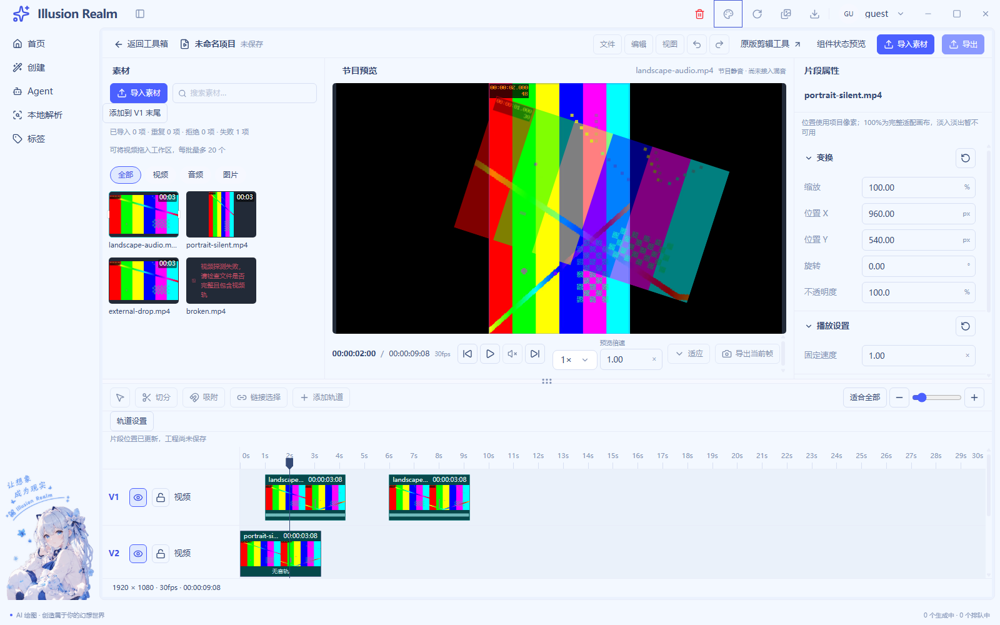
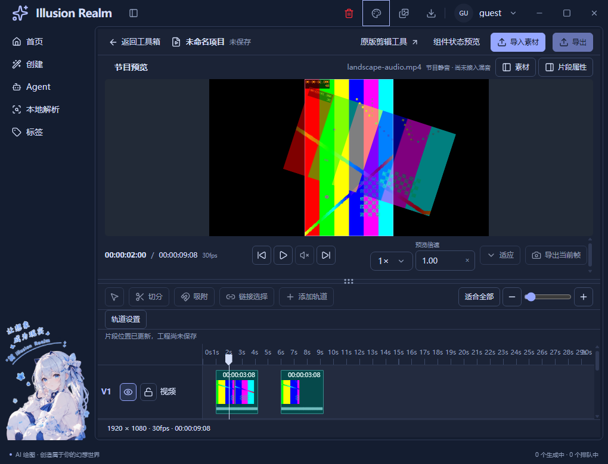

# 多视频轨合成预览实施记录

日期：2026-11-05（Asia/Shanghai）。三个任务已连续实施并完成自动验证，停在合成预览阶段等待验收。**自动验收完成，人工项待验**；UI-08 此前人工未验项目原样保留。本轮未接保存、导出、混音或真实图片导入。

## 1. 轨道与合成规则

沿用 `useLiveTimeline` 的唯一片段数组、轨道列表和共同编辑校验。原实现已有拖向下方候选视频轨创建 V2 的入口，默认视频/音频分别最多五轨，轨道设置可调整，无须新增第二套加轨系统。实际回归通过公开拖动建立 V1/V2，而非向内部状态插入测试片段。

- `tracks` 数组从上到下决定覆盖顺序。装配时排除音轨与隐藏视频轨，绘制时仅反转临时数组形成从下到上的内容栈。DOM 挂载、导入、片段选择和最近点击均不改变轨道顺序。
- 当前时间满足 `start <= time && time < end` 的片段参与画面；同轨禁止重叠继续由原创建、移动、修剪共同规则保证，跨视频轨允许时间重叠。
- 片段继续持有独立 X/Y、等比缩放、旋转、不透明度和原源区间。基础适配仍为 contain，100% 和项目像素中心定义不变。
- 上层缩小、移开、旋转或半透明后可以看见下层；没有有效画面则为黑场。隐藏排除解码，锁定只阻止编辑，锁层继续显示与推进。
- 音轨可延长工程时长，但不加入画面层级，也不在节目中发声。

任务一先以生产纯模型核对轨序、半开区间、隐藏、音轨排除、非零源入点与短片段边界，再以实际双视频安排反证跨轨重叠没有缩短片段。

## 2. 复用与文件职责

| 实现 | 本轮复用或注入差异 |
| --- | --- |
| `ProgramPreview` | 保留唯一节目容器、项目相框、标题、时间码、逐帧和控制条；通过现有 `live.surface`、`controls`、`rateControl`、`headerActions` 注入节目内容与动作。空隙仍保留工程控制，故 `live.asset` 允许为空 |
| `ClipCanvas` | 新增 `plane` 参数：默认 `all` 保留静态调用，`picture` 仅媒体内容，`operations` 仅操作层；三个分支共享原 `canvasStyle`、测量、指针捕获、草稿、取消和提交方法，不复制坐标换算 |
| 原检查器/字段/重置 | 确认值与草稿仍按片段 ID 独立；当前播放层不替代检查器选中目标。锁保护仍走原共同提交模型 |
| `attachSource` | 从原素材播放器导出共用安装器；事件先安装再设置 src，加载有 15 秒上限，卸载暂停、移除监听/超时、清 src 并调用 load 释放媒体 |
| `LiveSourcePreview` | 保持原始素材查看、真实媒体事件、播放与试听；删除旧单源节目适配和重复的局部视频层。素材/节目互斥挂载 |
| `PreviewRateControl` | 提取现有倍率选择和手动数值字段，素材与节目共同使用；不新增第二套输入校验，不扩展片段变速编辑能力 |
| 原时间线/轨道头 | Eye 接通会话内显隐；锁、复制、删除、分离音频、同类轨移动、源修剪、胶片带和真实波形继续沿用原业务 |
| `EditorAction` / `EditorPlaceholder` | 继续呈现播放、暂停、禁用声音、加载、解码错误与重试，不另建按钮和状态体系 |

新增四个职责文件（均位于 `apps/next/src/view/toolBox/Tool/video/editor/`）：

- `program-clock.ts`：源时间映射、半开区间、下一边界与真实媒体就绪/错误判断，纯时间规则可供未来输出侧消费，但没有建立编码框架。
- `use-program-playback.ts`：实例内统一工程时钟、最新定位、媒体登记、播放意图、有限等待与清理。
- `program-composite-preview.tsx`：将多个真实媒体与独立操作平面装入原节目容器。
- `use-program-visibility.ts`：读取当前浏览器可见事实，通知隐藏时卸载节目媒体；返回后按书签重新解码并保持暂停。

另修改 `clip-canvas.tsx`、`editor-panels.tsx`、`editor-timeline.tsx`、`editor.module.css`、`live-source-preview.tsx`、`timeline-track-model.ts`、`use-clip-transform.ts`、`use-live-timeline.ts`、`video-editor-view.tsx` 和双语 `toolBox.ts`。移除不再使用的选中/音频优先节目分支及对应参数。没有改 IPC、preload、主进程、持久化、公共 AppShell 或旧视频/GIF 业务契约。

测试新增 `scripts/lib/check-video-composition.js`，接入原 `smoke-video-live-02.js`，复用既有字段、CDP 鼠标、截图和标尺定位 helper；相应 helper 仅补导出。原分离音轨断言改为检查新节目静音契约，仍验证音轨安排/复制/删除/锁，不再错误要求音轨选择替换节目画面。

## 3. 工程时钟与媒体生命周期

工程秒到源秒统一为 `sourceIn + (projectTime - start) * speed`，末尾限制在可读取的源范围；已有片段速度参与原映射，预览观看倍率只改变工程步长与原生播放倍率，不重复乘进源目标。调度不以选择对象或任意一个 video 的 `timeupdate` 驱动。

一个实例只有一根工程时钟，40ms 检查一次单调经过时间；所有当前视频均满足首帧、请求号、非 seeking 和源目标距离条件才推进。遇到下一入点/出点先停在精确边界，待新增层就绪后接播；没有活动视频时工程仍可经过黑场并接到后段。等待不补算成播放时间，错误结束播放意图，不后台无限重试。

显式定位接收外部递增版本，只应用最新目标，暂停旧播放；旧 seeked 不能仅凭事件到达把新请求标成完成。UI 请求键含定位版本、活动片段和源区间，在新请求提交后立即遮住旧 ready 画面。空间变换/选择不进请求键，拖画布不会反复装源。等待或失败时整摞内容隐藏，显示准确状态，不拿已就绪下层或滞留上层冒充完整合成。

每个活动片段有独立真实 video、当前源时间和截止线，同源不同片段也不共享节点。暂停定位容差为 `.6 / projectFps`，播放过程中超过 0.2 秒的源偏差会停源重新对齐。加载/定位连续等待上限 15 秒；play 拒绝除正常 AbortError 外会成为错误。旧 play Promise 返回时核对实例身份与意图，不能切源后再次后台启动。

节目所有 video 在声明及安装时均强制静音，声音按钮禁用并显示“节目静音 · 尚未接入混音”。素材查看继续提供单源试听。切去素材时整个节目卸载，回来使用原书签暂停重建；页面隐藏卸载节目源，恢复不自动播放；退出路由停止时钟、监听与源读取。当前使用原 localfile URL，没有本轮创建的 Blob URL。

任务二通过一次连续播放覆盖双层、黑场和后段，直接读取真实 `currentTime/paused/muted/readyState`；不靠选择下一片段接播，不用定时器假造媒体状态。

## 4. 画布交互与自动验证证据

内容平面只放真实帧，操作平面按同一固定轨序放选框/命中按钮。点击优先最上方可编辑矩形，锁层和零透明度层放行指针；被遮挡片段仍可在时间线选择并改属性，内容不会临时置顶。操作提示不属于合成内容，项目边界裁切继续由原画布负责。

实际测试源由 FFmpeg 在随机本地目录生成，之后经过生产导入、探测、封面、localfile 与 Chromium 解码；并非 DEMO 图片或假播放器：

| 源 | 真实探测事实 | 使用场景 |
| --- | --- | --- |
| landscape-audio.mp4 | H.264，640×360，30fps，含 AAC，3.25s | V1 从 1s 开始；同源独立后段从 6s 开始 |
| portrait-silent.mp4 | H.264，360×640，24fps，无音轨，3.25s | V2 从 0s 开始，与 V1 跨轨重叠 |
| compose-unsupported.mkv | FFV1，320×240，25fps，3.24s | 生产探测成功、真实浏览器解码失败、重试与删除坏引用恢复 |

前两源在 30fps 工程中每段占 98 帧（3.266667s），没有缩短来迁就验证。V1 上层 55% 缩放、X1100/Y500、旋转18°、透明度50%；下层默认中心与100%适配。最新证据可独立核对：

- 连续播放时工程 **1.600600s**：竖屏源 **1.618962s**，横屏源 **0.524740s**；两台均播放、静音、非 seeking、readyState=4。采样有控制节拍/原生解码差异，不宣称逐帧离线同步。
- 同一播放进入工程 **4.625967s**：活动视频为空，正常黑场仍 ready；没有额外黑图或片段选择。
- 后段暂停在工程 **6.515200s**：同源新片段源 **0.515198s**、真实 paused，验证工程/源偏移及跨空隙接播。
- 快速连续定位 2.8 → 0.5 → 6.5 → 1.4 → 2s，最终上层源1s、下层源2s；精确末尾不残留视频。
- 覆盖上层点击、下层时间线选择、锁层命中穿透、隐藏上层/全部黑场、主题、窄窗口、切素材、退出清理、错误/重试恢复；原套件继续验证画布拖动、取消、复制独立、时间线移动、修剪、分离音轨和导入。

真实合成截图（已打开逐张核对主要画面；文件未后期染色）：

[双层实际播放](runtime/multi-video-composition/compose-playing-two-real-videos.png)、[持续播放经过黑场](runtime/multi-video-composition/compose-playing-black-gap.png)、[全部隐藏黑场](runtime/multi-video-composition/compose-hidden-black.png)、[真实解码失败](runtime/multi-video-composition/compose-real-decode-failure.png)。[媒体时间原始记录](runtime/multi-video-composition/compose-playback-evidence.json)、[独立 ffprobe 事实](runtime/multi-video-composition/media-facts.json)、[构建/文件哈希清单](runtime/multi-video-composition/evidence-manifest.json)。没有操作录屏。

## 5. 实际检查与问题修复

最终静态导出指纹 **52b9513fbe9f15e2fc8576c547f3432a014881aa0c1499618fa3136c0f8233c0**，878 输入、28 路由，2026-11-04T16:03:34.624Z 构建（本地 11月5日）。后续仅修改独立测试与文档，最终冒烟再次通过构建指纹校验。

| 检查 | 实际结果 |
| --- | --- |
| 类型检查 | 通过；最后代码还经 `pnpm check` 首阶段重新通过渲染/主进程类型 |
| `pnpm lint` | 退出0，0错误/33既有警告 |
| Next 静态构建 | 通过，使用正式 app:// 导出产物回归 |
| 串行 Electron 真实媒体/原画布/时间线/合成 | **180/180**，最终 run `2026-11-04T16-12-13-715Z-29784`；无 renderer/hydration 错误 |
| 串行 Electron 公共 UI/A-B/原视频与 GIF 宿主 | **139/139**，run `2026-11-04T16-10-05-258Z-20188`；六组主题/目标容器、导航、紧凑面板和焦点 |
| 串行 Electron LIVE-01 | **19/19**，run `2026-11-04T16-11-16-149Z-29460`；选择结果夹具，真实读取/探测/解码，Explorer 明确跳过 |
| 双语键、中英文文案基线 | 通过；zh 硬编码21/基线66，en 未翻译771/额度内；不扩大语言迁移 |
| 输出路径、目录计数、locale决议、初始语言参数、脚本引用与冒烟规则 | 分别补跑通过 |
| `pnpm check` | **退出1**：check:gates 的三个既有未引用词条 `auth.verifySuccess`、`common.localeNameSelf`、`create.generationTasks.active`；前置类型/Electron模块通道通过。早停后续项未冒充链内通过，已按上表独立补跑 |
| 独立 `pnpm check:meta` | **退出1**：既有 `MetaFieldRow.tsx` 中文 JSX 注释被扫描器当成字段字面量；真实 golden 语料缺少而跳过。未修改该文件，不宣称全量 check 通过 |

成功套件按现有 harness 仅留摘要，不虚构全量成功日志；[摘要](runtime/multi-video-composition/smoke-summary.log)、[check失败输出](runtime/multi-video-composition/compose-check.log)、[lint输出](runtime/multi-video-composition/compose-lint.log)已归档。失败日志仍保留在仓库 logs。

开发中实际修正及失败记录：

1. 初次专项把 DOM 中 V1两段/V2一段的顺序误当创建顺序，导致两个断言失败；改为按实际轨道身份识别，不改时长或预期。
2. 节目静音说明最初塞入控制条挤窄按钮，移动到原标题插槽，控制组保持不收缩。lint 同时发现 render 中读 performance.now，改为事件/effect 读取。
3. 原音轨复制断言要求不存在的节目“开启声音”按钮，完整套件在102项后报异常；按明确静音契约修正，而非启用混音迁就旧测试。
4. 前序真实波形验证把时间轴放大到256px/s，合成安排6s落点在屏外，两个完整运行在158项后因空命中失败；先恢复“适合全部”及滚动前提，每次公开删除等待落地，再完整通过。没有改工程1/0/6s起点，也没短缩片段。
5. 交付截图人工核对发现最初名为 light 的图仍是深色：专项只写 nativeTheme 未校验应用主题。测试改走正式外观菜单、等待主题快照和过渡结束、关闭菜单，再完整重跑 **180/180**；本记录只使用最终真实浅色/深色证据。

## 6. 证据分层、未验证与性能限制

- **真实自动运行**：实际本地编码文件、生产探测、浏览器解码/视频纹理、媒体事件、源时间、CDP鼠标命中和正式字段/菜单操作。截图来自当前 Electron 客户区，属于真实媒体自动证据。
- **纯模型/夹具**：时间规则加载生产 TS 转译结果；系统选择返回路径替换不代表手动系统框；可见性组临时覆盖 document.hidden 并发送通知，再检查真实旧节点释放。可见性夹具不等于实测 Windows 最小化/前台遮挡，也未覆盖可见性事件永久丢失。
- **人工**：本轮没有人工桌面完整操作、录屏或扬声器试听。UI-08 遗留 Explorer OLE 拖入、完整人工鼠标/键盘、系统125%/150%缩放、多屏、前台遮挡及试听继续待验；没有借用历史原生框19项来声称本轮人工通过。
- 公共 A/B 样板、同源独立复制、切源/返回空会话覆盖状态隔离；两个完整真实合成工程并排压力运行未测试。三目标容器六组布局与独立合成窄窗均为实际浏览器运行，DPR=1，不是系统缩放证明。
- 每个当前可见活动视频占一台原生解码器；无整文件读入 JS 或 Base64。片段边界按需装源会出现真实短加载，不预加载所有未来文件。默认五轨不承诺五路4K实时；未测GPU/CPU峰值、高码率慢盘、磁盘拔出/改名或内存耗尽。
- 40ms控制周期、每步最多接收0.1s经过时间、线性层/边界扫描和工作区时间更新在重负载下可能减速或等待；0.2s播放漂移门槛是预览策略，不是帧精确输出/采样级混音保证。
- 命中使用变换后的矩形，普通H.264源已验；透明编码逐像素alpha拾取未实现/未验。空间/源时间/层序规则可复用，未来真实编码输出逐帧一致性仍属 COMPOSE-02。

## 7. 增量注释与停止边界

基线为本任务开始前工作区快照 `ir-compose-baseline-n5gxi_kk/baseline.json`，不是包含大量既有修改的 HEAD。新增文件全文、旧文件仅新增/替换行，删除和未改上下文不计；混合注释代码行仅计 B。独立 JSX 注释与 CSS 注释按语法归类。只增导出的 timeline helper 以恢复原导出行还原前态。

人工复核候选注释后，业务剔除20行、测试剔除22行重复概述/泛化说明：**业务 C638/B273 = 70.0329%；测试 C358/B153 = 70.0587%**。正常打印的普通函数最长29行，无超30行项；JSX展示装配单独识别，事件和调度仍按限制。[逐文件增量与剔除行](multi-video-composition-comment-audit.json)、[函数核查](multi-video-composition-function-audit.json)。

有效说明示例：“像过站换乘，先停在片段边界，等新列车开门后再走”对应边界解码闸门；“旧组件清理只删除自己的表项”解释同ID重试时防止迟到清理误删新节点。两者均补充真实机制与生命周期边界。

本轮到此停止。保存/导出、音频混音、转场、淡入淡出、关键帧、真实图片导入与离线合成仍未接通；本轮没有新增这些能力，也不继续下一阶段。已有片段速度等前轮能力保留，不把这轮预览调度称为新增变速完成。
