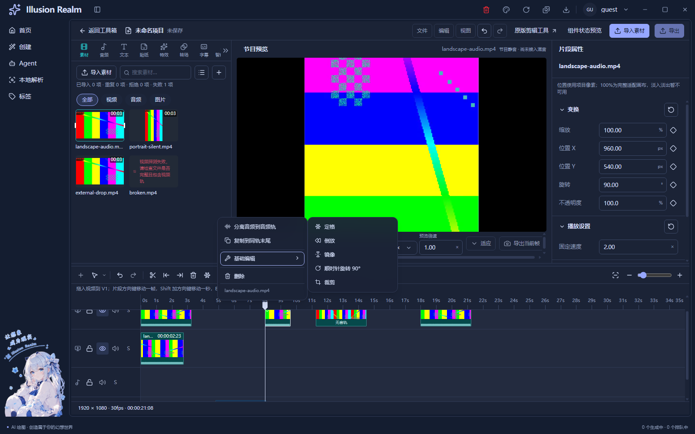
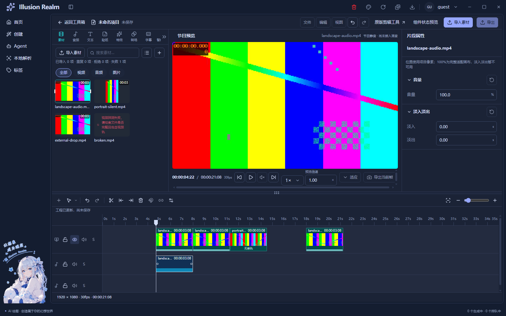
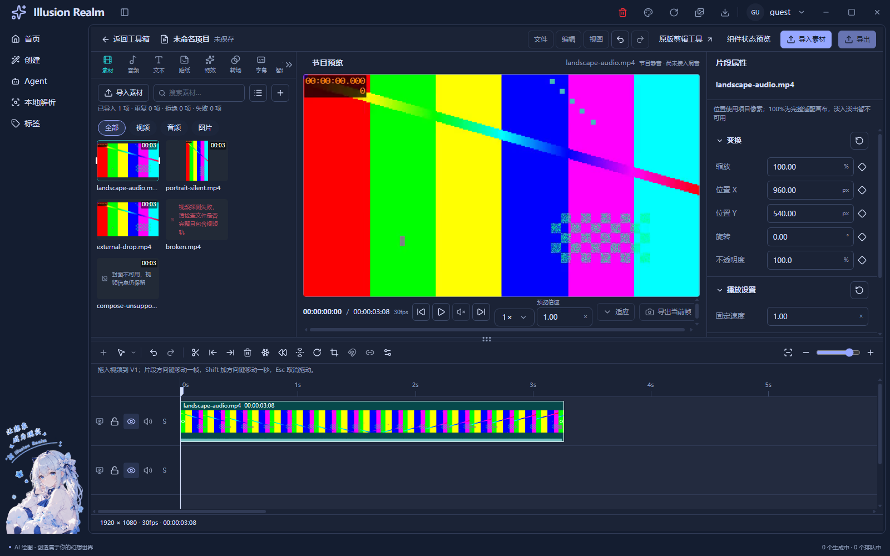

# 片段参考样式与共用级联菜单

日期：2026-11-05。正式入口：`/tools/video/editor`。

本轮按最新图片替换视频/音频块、轨道头、工具条与素材分类布局，并落实追加的右键要求：基础编辑采用创建页翻译菜单的侧向展开方式。保留此前工程、导入、解码、变换、关键帧、剪贴板和撤销业务，不推进保存或导出。

## 实现与复用

- 创建页 `AssistantMenu` 与视频 `LiveClipMenu` 实际共同调用 `components/cascade-menu.tsx`。原翻译菜单的列结构、薄边圆角、悬停、独立滚动和定位进入共享展示；旧内联基础编辑子项删除。
- 菜单内容通过 `CascadeMenuItem[]` 注入，包含名称、图标、禁用原因、选中、危险项、分隔和动作。翻译预设的独立编辑按钮继续保留，不会顺带选中预设。翻译保存、密钥、错误提示与片段编辑命令保持独立。
- `useCascadePosition` 保留原锚点上弹，新增指针定位参数；根列保持位置，子列向有空间一侧展开。窗口不足一列时采用原逐级返回。支持点击、鼠标悬停、上下/首尾选择、右进左退、Escape关闭及外部关闭；关闭后的片段焦点仍由原会话恢复。
- 视频和音频继续共用 `EditorClipShell`。正式视频块74px：16px标题、40px方形真实抽样帧、16px真实振幅包络和两像素边框；音频块52px，深蓝底与向上波形。不是把振幅称作音高分析。
- 视频轨88px、音频轨68px，同一grid自动对齐轨道头和内容；轨道头160px，类型/锁/显隐/音量/S紧凑排列。轨道身份保留在可访问名称和title。
- `EditorAction` 增加 `appearance="plain"` 和可选单字符 `glyph`，时间线和轨道头实际接入；普通项目栏保持原参数。图标没有边框盒子，hover用浅底，键盘仍有1px焦点线。无回调动作继续原生禁用。
- 五项工具只在选中时间线视觉片段时挂载；音频和无片段选择不显示，锁轨则保留上下文但禁用。素材高亮不作为工具目标。
- 素材分类为参考中的十二项，44px固定槽、2px间距；仅选中图标和文字变青色。超宽由一对按需出现的左右箭头移动可见窗口，不均分、不缩小整条UI。未接资源业务继续给出真实说明。
- 轨道设置复用 `ContextMenuShell` 浮层与原字段，避免工具条横滚裁掉字段；关闭恢复入口焦点。设置只改本次会话上限，不写新存储。

## 改动文件

| 位置 | 职责 |
| --- | --- |
| `apps/next/src/components/cascade-menu.tsx` | 共享级联展示、方向键、关闭与子列 |
| `components/prompt-assistant/assistant-menu.tsx`、`use-cascade-position.ts` | 原翻译业务适配与共同定位 |
| `video/editor/live-clip-menu.tsx` | 原工程命令适配为菜单数据 |
| `editor-controls.tsx`、`editor-timeline.tsx`、`editor-clip-shell.tsx` | 公共动作参数、轨道头与原片段外壳接入 |
| `clip-basic-tools.tsx`、`timeline-edit-tools.tsx`、`video-editor-view.tsx` | 裸图标工具及随片段选择显示 |
| `media-library-tabs.tsx`、双语 `toolBox.ts` | 十二分类、固定间距、溢出翻页 |
| `video-filmstrip.tsx`、`clip-waveform.tsx`、`editor.module.css` | 40px真实采样、音频上包络和参考布局 |
| `timeline-settings.tsx` | 原字段在公共浮层中呈现 |
| `scripts/lib/check-video-filmstrip.js`、`check-video-edit-tools.js`、`check-video-waveform.js`、`scripts/smoke-video-live-02.js` | 新几何、侧列、键盘、溢出与音频状态回归 |

表内未带前缀的组件路径分别相对 `apps/next/src/` 或 `apps/next/src/view/toolBox/Tool/video/editor/`。本轮工作区已有大量未提交改动，按首次编辑前快照区分，未还原或吸收它们作为本轮成果。

## 检查与证据等级

检查结果及截图见下方收尾记录。媒体由真实本地编码文件提供，横屏640×360/30fps/AAC，竖屏360×640/24fps无音轨。探测、协议、preload、浏览器实际解码使用生产实现。

系统选择返回值仍是夹具；内部拖动为CDP/DOM自动事件，菜单和键盘同样是自动事件。创建页翻译回归使用受控供应商响应与本地兼容服务，不证明线上供应商当前可用。截图是Electron `capturePage`，不是重绘设计稿。

首次完整回归因轨道设置迁入Portal后旧查询找不到输入而失败，补齐浮层标记后原锁轨/限额反证通过，未减弱数值和业务断言。截图发现轨道头136px会让末项溢出，修正160px。定位hook按职责拆出测量函数，正常展开的本轮普通函数最多28行，JSX装配单独分类。

## 注释与质量状态

基线：本轮首次编辑前工作区快照；公共菜单在首次编辑前另补快照。新增文件全文、修改文件只计新增及替换行；删除及未变上下文不计。详见 `reference-ui-comment-audit.json` 与归档快照。

业务候选 **C94/B308，上限23.3831%**；测试候选 **C13/B44，上限22.8070%**。这是纯注释扫描上限，未经逐行认证，不能冒充有效率；即使全部有效也不足70%，本轮注释质量门槛未通过。没有把旧上下文的大量注释算作本轮成果，也没有复制说明凑数。

已补充的有效解释包括：级联像并排打开的抽屉，父列留在原地、子列独立滚动；音视频轨道同grid但按类型决定行高，不需要两套纵滚追赶；方格像固定格距胶卷尺，修剪只改变源窗口，缩放只改变每格覆盖的秒数。

仍未验证：完整人工鼠标/键盘路径、系统125%/150%缩放、多屏、扬声器试听、操作录屏、长GOP/多路4K压力、两个真实工程并排压力。UI-08历史人工缺项保持待验。

仍未接通：保存、导出、云端、混音、真实图片/独立音频导入、文本/贴纸/特效/转场/字幕等资源业务、淡入淡出、通用吸附和链接选择；禁用动作不模拟成功。帧带是有界抽样概览，不是同时显示全部源帧，缓存与解码性能边界沿用前阶段。

## 最终结果与真实截图

- 最新静态构建指纹：`998c7596e1362e5c1dd9a2c564e517c4569e8ed9d912a21f060a677d4c8fab41`，888输入。
- 真实视频完整链 **213/213**，创建页翻译 **78/78**，均在最终构建串行完成。公共UI **139/139**，在最终等价定位hook拆分前的构建完成；A/B、深浅主题、1600×1000/1280×800/960×720、导航、紧凑面板、减少动态效果、旧视频/GIF宿主均覆盖。
- 类型检查通过；全量lint为0错误/33既有警告，最终定位组件另跑定向lint通过；Next静态构建通过；纯编辑模型、双语键、中英文文案基线、冒烟规则、脚本引用通过。
- 重新运行 `pnpm check` 退出1，仍在三个既有未引用词条 `auth.verifySuccess`、`common.localeNameSelf`、`create.generationTasks.active` 停止；其后检查不能视为全链通过。此前独立Meta问题本轮未复跑，不复述为本轮检查结果。
- 普通函数按正常展开代码审计，最大28行，未发现超过30行；JSX装配另外归类。注释质量仍未通过，如上文所述。
- 四秒/八秒移动保留两段各98帧：`[4,7.2666666667)` 与 `[8,11.2666666667)`，间隙22帧，无重叠，没有缩短片段迁就碰撞。

[浅色前移](runtime/reference-ui/live-02-before-move-light.png)、[浅色移动后](runtime/reference-ui/live-02-after-move-light.png)、[创建页同组件](runtime/reference-ui/prompt-assistant-light.png)、[窄窗返回](runtime/reference-ui/prompt-assistant-narrow.png)、[证据与哈希](runtime/reference-ui/evidence-manifest.json)。截图已实际打开核对，未修改或后期重画。

状态为**功能自动回归完成，人工项待验，注释质量门槛未通过**，不能写成全部验收完成。本轮到此停止。
