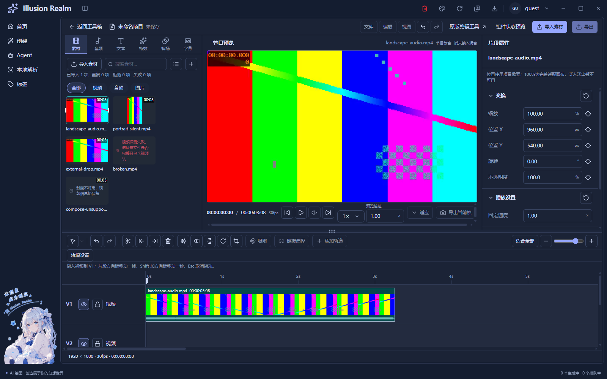
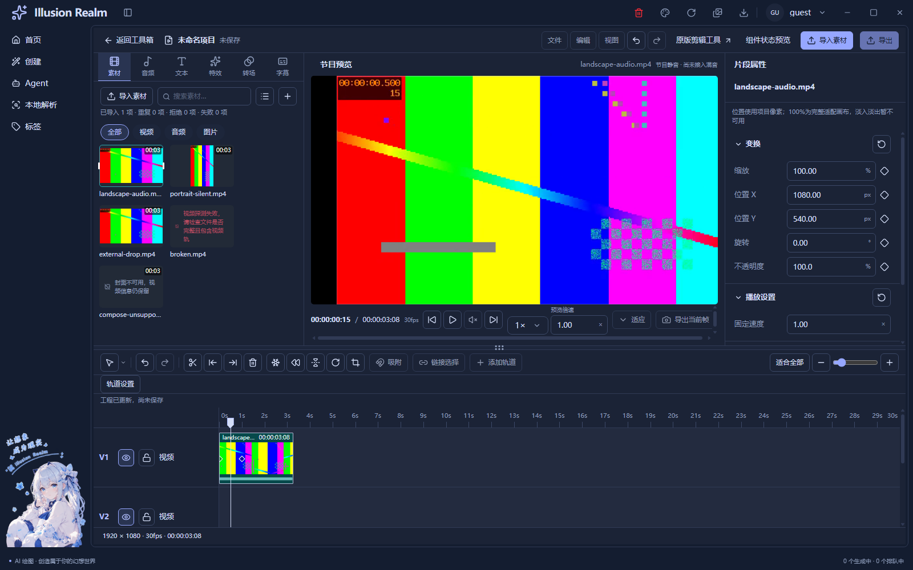
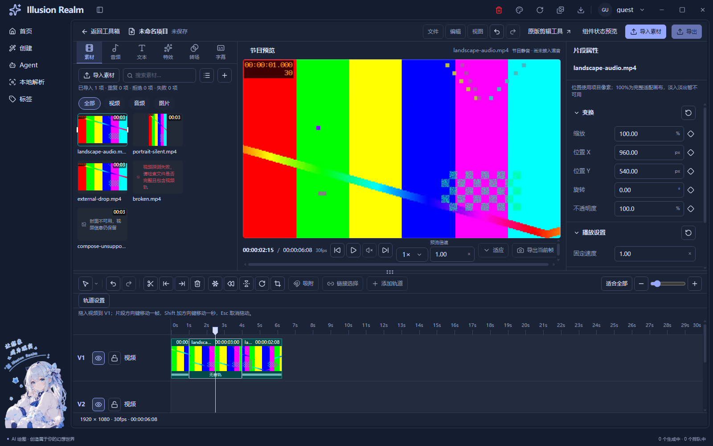
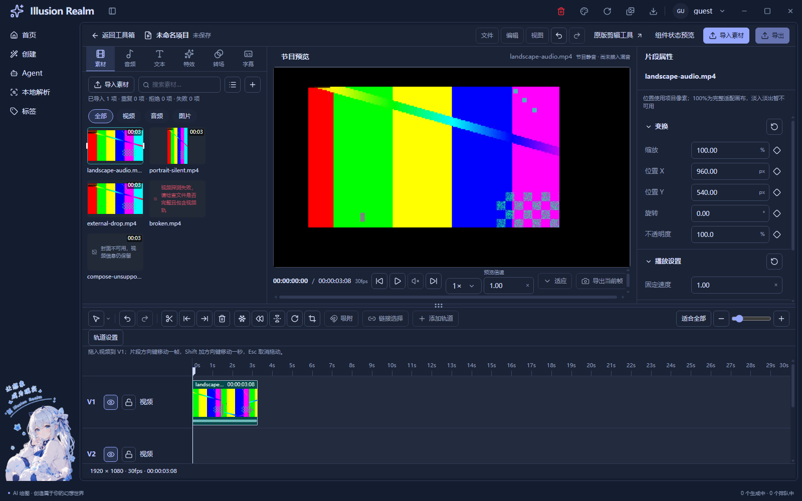

# 片段基础编辑、关键帧与固定方格帧带

日期：2026-11-05。范围为本轮最终授权的素材库布局、工程编辑工具、五项真实片段工具、属性关键帧和时间线帧带；不继续保存、导出或其他新功能。

**当前状态：功能自动回归完成，人工项待验；注释质量门槛未通过，不标记本轮全部完成。** 业务和测试增量的注释候选比例都低于70%，详见本文末尾。UI-08历史人工状态保留，不改写成全部通过。

## 已接通的行为

| 能力 | 正式工作区行为与边界 |
| --- | --- |
| 素材库与预览比例 | 节目相框外不再铺灰色垫板，按真实可用高度计算节目宽度，余宽给素材库；紧凑面板沿用原焦点与互斥机制 |
| 素材分类 | 素材、音频、文本、特效、转场、字幕共六个入口；未接业务的类别显示原因，不生成假资源 |
| 工具选择 | 选择、分割刀、向左全选、向右全选；图标和光标消费同一工具状态，复用创建页公共菜单 |
| 工程编辑 | Delete删除、Ctrl+C复制、Ctrl+X剪切、Ctrl+V在播放头粘贴；Ctrl+Z撤销、Ctrl+Shift+Z或Ctrl+Y重做 |
| 分割与左右删除 | 按播放头和选中实体处理，不删除未选中的其他轨道内容，不作波纹推移；分割后的两段可独立选择 |
| 定格 | 在选中片段覆盖播放头的有效帧插入3秒独立静帧，保留前后视频，同轨后续片段顺延；其他轨不移动 |
| 倒放 | 对选中片段的源区间反向读取，保留工程长度；统一工程时钟驱动真实视频反向寻帧，不给浏览器设置负播放倍率 |
| 镜像与旋转 | 真实内容层水平镜像、每次顺时针90度；旋转同时平移整条已有角度动画，保持累计圈数 |
| 裁剪 | 节目画布拖框，确认提交、重置草稿、Escape取消；比例随窗口保持，源文件不变 |
| 属性关键帧 | X、Y、等比缩放、二维旋转、不透明度按片段局部工程帧记录并线性插值；当前标记实心，其他帧空心 |
| 帧带 | 格子固定56×56 CSS像素，取真实视频采样；缩放改变每格代表时间，不放大格子；修剪只移动源窗口 |

同轨继续禁止重叠，跨视频轨可重叠。粘贴精确落在播放头，冲突时整批拒绝，不擅自寻找别的空位。拖动仍沿用既有共同落点校验。锁轨后字段、工具、鼠标、键盘和菜单写入都受模型保护。输入框保留原生文字复制、删除和撤销含义。

复制、分割和粘贴以片段ID建立独立实体，保留同一个素材引用；嵌套变换、裁剪和关键帧深复制。剪贴板只属于当前编辑器会话，不是系统文件剪贴板，不执行磁盘剪切。撤销最多保留100步工程结构，不把播放进度、搜索和单独选择写成剪辑历史；恢复时媒体定位版本递增。

定格快照继承当帧插值构图、镜像、裁剪，并移除动画、关闭声音。默认3秒为当前实现约定，支持之后通过现有片段编辑调整工程区间；未新增定格时长设置弹窗。倒放构图动画仍沿工程方向播放，源内容反向读取，二者时间基不混用。

## 复用与文件职责

| 文件或组件 | 本轮职责 |
| --- | --- |
| `timeline-edit-model.ts` | 片段深复制、选区、分割、左右删除、粘贴与共同碰撞检查 |
| `timeline-history.ts` | 实例内确认历史、锁轨恢复保护、定位版本递增 |
| `use-timeline-editing.ts` | 公共编辑命令与快捷键，输入框、菜单及组合输入保护 |
| `timeline-edit-tools.tsx` | 原EditorAction与ContextMenuShell/ContextMenuItem装配，不另造菜单体系 |
| `clip-basic-edit-model.ts` / `clip-basic-tools.tsx` | 五项工具的实际命令与原按钮外壳接入 |
| `clip-crop-overlay.tsx` | 独立裁剪草稿、指针逆旋转换算、确认/取消与焦点归还 |
| `clip-transform-model.ts` | 原五值变换增加关键帧、线性求值和带动画字段提交 |
| `timeline-track-model.ts` / `timeline-edit-model.ts` | 裁边保留窗口外动画；分割重新建立局部帧号并保持切点连续 |
| `program-clock.ts` / `use-program-playback.ts` | 原统一时钟、源时间映射与媒体生命周期扩展倒放和定格 |
| `editor-inspector.tsx` / `editor-property-model.ts` | 原属性字段旁注入菱形，字段范围仍为共同来源 |
| `editor-timeline.tsx` / `editor-clip-shell.tsx` | 原片段壳内合并绘制同帧标记，传入动作和选择状态 |
| `video-filmstrip.tsx` / `clip-waveform.tsx` | 固定方格真实采样，倒放波形反向，静帧没有声音槽假数据 |
| `media-library-tabs.tsx` / `use-preview-layout.ts` | 素材分类UI与正式宿主宽度预算 |
| `editor-panels.tsx` / `editor-chrome.tsx` / `editor-workspace.tsx` / `video-editor-view.tsx` | 在现有工作区注入数据、命令和布局参数 |
| `live-timeline-model.ts` / `live-clip-menu.tsx` / `use-live-timeline.ts` / `use-clip-transform.ts` / `clip-canvas.tsx` | 原模型、右键和画布调用方共同接通，不留第二套旋转或复制规则 |
| `editor.module.css` / 双语`toolBox.ts` | 局部布局、细框、光标、方格槽和双语说明 |

素材查看保持原始单源预览；工程节目仍按轨道顺序合成并静音，选中下层不会置顶。操作框属于独立UI层，真实视频内容采用同一构图和裁剪值。切换、隐藏和卸载继续暂停并拆监听、清源，不缓存整段视频文件。

测试新增 `scripts/verify-video-edit-tools.js`、`scripts/lib/check-video-edit-tools.js`，接入原LIVE-02；复用既有多轨鼠标/字段/截图工具与时间线定位助手。相关改动还涉及 `check-video-filmstrip.js`、`check-video-waveform.js`、`check-video-ui-timeline.js` 和外层 `smoke-video-live-02.js`。

## 实际验证与证据等级

两个本地真实编码源：横屏640×360、30fps、有AAC音轨；竖屏360×640、24fps、无音轨。使用生产协议、preload、文件探测和浏览器实际解码。视频由测试生成，未采集用户私人素材。

| 检查 | 最终结果 | 证明范围 |
| --- | --- | --- |
| 纯模型编辑反证 | 通过 | 源秒/工程秒、复制独立、分割连续、关键帧、倒放/定格映射、裁剪合法性、撤销/重做；不证明媒体解码 |
| LIVE-02 | 202/202 | 真实视频、原导入/源范围/多轨/合成/清理，加本轮编辑工具、实际帧动画、倒放连续播放、裁剪及固定方格 |
| 公共UI | 139/139 | A/B状态、深浅主题、1600×1000/1280×800/960×720、导航、紧凑面板/焦点、原视频和GIF宿主 |
| LIVE-01 | 20/20 | Windows系统框实际多选与取消、实际Explorer OLE文件拖入，生产探测和播放/暂停；脚本驱动系统操作，非人工 |
| 类型检查 | 通过 | 渲染层与主进程TypeScript |
| 全量lint | 通过，0错误/33既有警告 | 最终全仓lint与编辑器定向lint；不能把警告数写成0 |
| Next静态构建 | 通过 | 最新指纹见归档；后一次只补源码注释，重新构建并复跑真实视频套件 |
| 双语键、中英文文案基线、脚本引用、冒烟规则 | 通过 | 分别独立运行，不依赖被提前终止的check链；硬编码扫描21处，低于既有66处基线 |
| `pnpm check` | 失败，退出1 | 三个既有未引用词条：`auth.verifySuccess`、`common.localeNameSelf`、`create.generationTasks.active`；在门禁停止，后续链未全部运行 |
| 独立Meta | 失败，退出1 | 未修改的`MetaFieldRow.tsx`中文JSX注释被扫描判为文案；真实golden语料不存在，按脚本跳过，不是golden通过 |

LIVE-02内部拖动/键盘为CDP或DOM自动事件，系统选择返回值由夹具提供；取消、锁、错误和动画数值还包含纯模型反证。LIVE-01则真的操作系统框和Explorer，日志含 `Native picker confirmed 2 files` 与 `Explorer OLE drag released`。二者与人工操作分开报告，自动系统操作没有取消UI-08人工待验状态。

历史4秒/8秒移动反例本轮仍读出首段`[4,7.2666666667)`、第二段`[8,11.2666666667)`，两段各98帧，间隙22帧；没有缩短片段迁就碰撞。原始区间见归档`placement-facts.json`。

开发中修复了旧纯模型加载器对新增依赖和ES2022 Set展开的支持；旧倒放禁用断言按本轮实际能力更新。片段槽原少算两像素边框，修正为16px标题＋56px帧＋16px波形＋两像素边框，共90px，轨道行104px。没有改源视频长度或弱化碰撞断言。

## 真实运行截图

[系统框导入](runtime/timeline-edit-tools/live-01-import-light.png)、[实际Explorer拖入](runtime/timeline-edit-tools/live-01-explorer-drop.png)、[证据、构建与文件哈希](runtime/timeline-edit-tools/evidence-manifest.json)。截图为Electron capturePage，已实际打开核对；不是HTML重画的设计稿。

## 注释质量与未验证

本轮开始前工作区快照为基线，不以HEAD吸收既有未提交工作。新增文件全文、修改文件只统计新增及替换后的行；删除和未变上下文不计。补充快照中两处单行旧值依据已知变更恢复，其余使用首次编辑前原文。基线、逐文件差异范围和哈希见归档及 [注释审计](timeline-edit-tools-comment-audit.json)。

**业务候选 C331/B793，上限29.4484%；测试候选 C103/B221，上限31.7901%。这些是扫描候选上限，不冒充已完成逐行人工认证的有效注释率；即使全部有效仍未达到70%。** 已补充源映射、单轨定格顺延、动画插值、旋转逆变换、取消/焦点恢复和测试证据边界，仍不能把本轮质量门槛标为通过。没有把历史大量上下文注释算作本轮，也没有压行或复制注释凑数。

有效说明示例：“定格在同轨插入三秒静照，后续同轨片段顺延而其他轨不动”；“关键帧像标有里程的路牌，当前帧按两点距离求值，倒放只倒源内容、不倒工程动画”。前者说明实际编辑边界，后者对应共同线性求值机制。函数审计按正常展开物理行复核，当前普通函数最大30行，JSX装配单独归类；[逐函数记录](timeline-edit-tools-function-audit.json)。

未验证：完整人工鼠标/键盘操作链、真实系统125%/150%缩放、多显示器、前台遮挡/最小化的真实系统过程、扬声器试听、操作录屏；同时镜像/旋转后的裁剪组合和两套真实编辑工程并排压力未完整实测。自动A/B公共控件与纯模型不能补写成以上人工项目通过。

性能边界：倒放是逐次寻帧预览，不是提前反向转码；高码率、长GOP、多路4K流畅度未测。帧带只采当前滚动视口附近，固定56px方格不是同时显示所有源帧；缓存最多64张160×160缩略图，该像素预算不代表整个Electron进程或显存的总占用。标题、采样帧和包络独立，波形表示振幅，不是音高分析。

仍未接通：工程保存、导出、云端、音轨混音、真实图片/独立音频导入、文本/特效/转场/字幕业务、淡入淡出、通用吸附、链接选择、曲线缓动和自由变形手柄。分类入口仅为UI，禁用动作不模拟成功。本轮到此停止，不继续后续开发。
