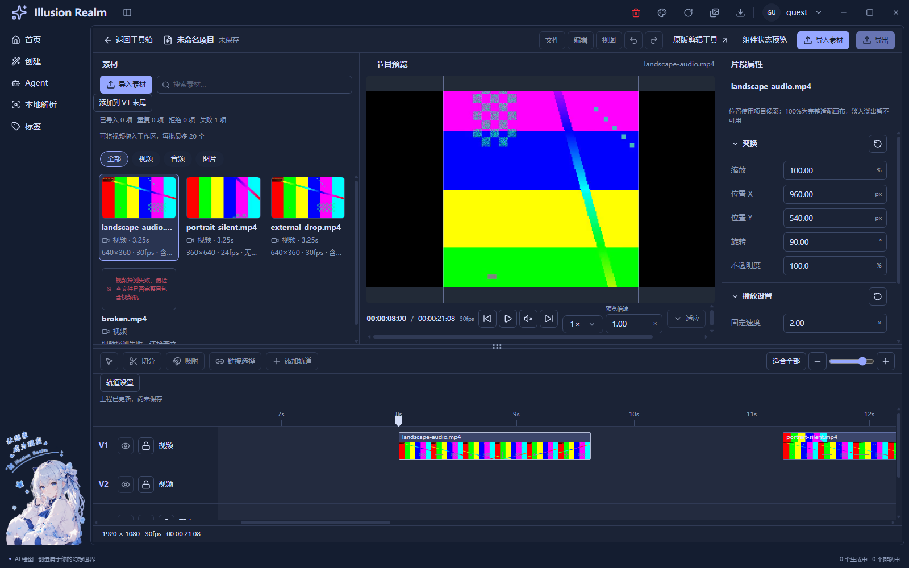
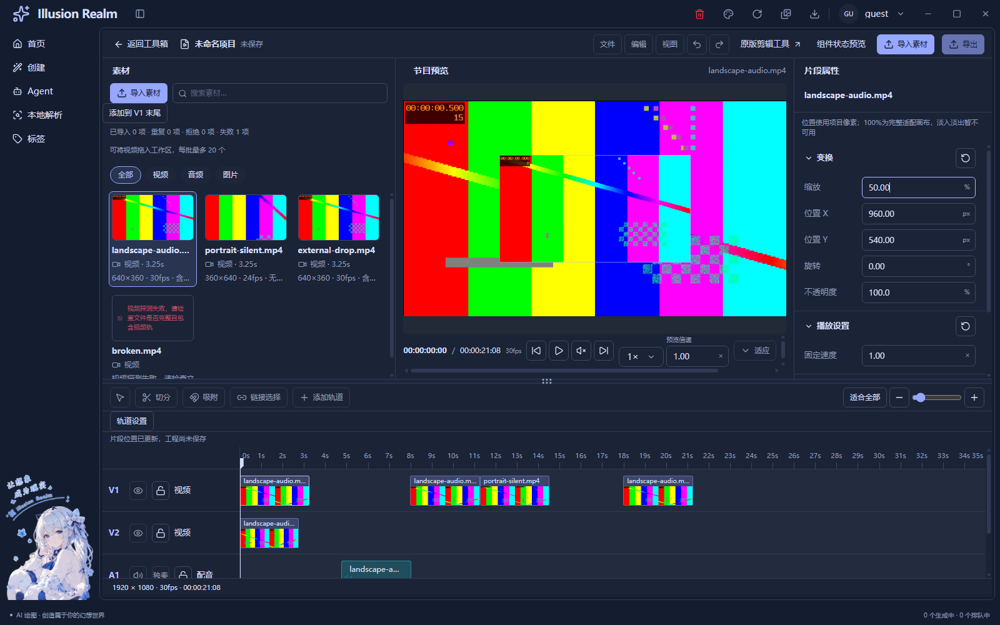
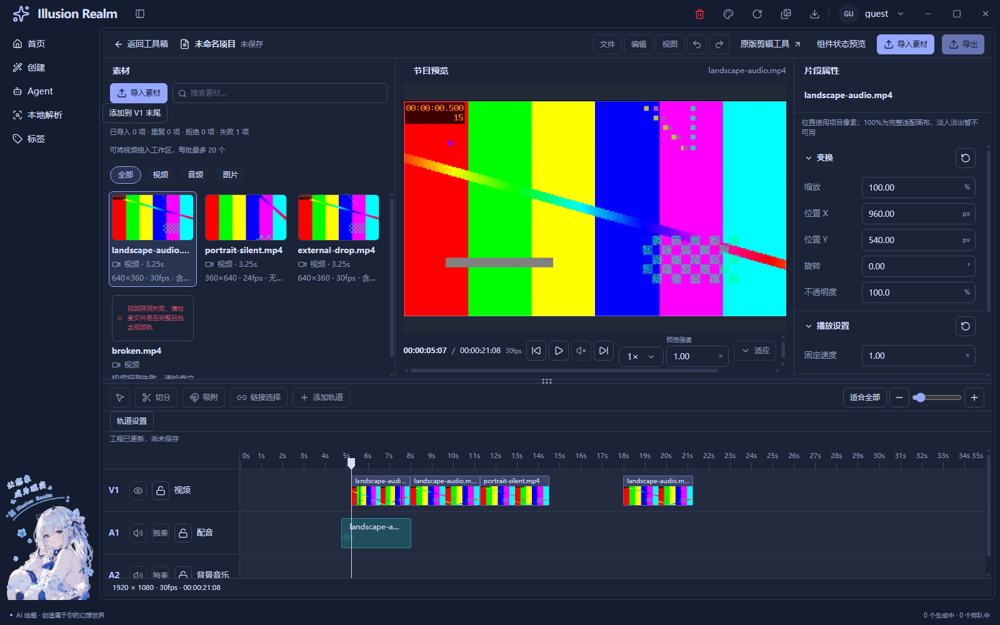

# 时间线媒体交互与片段外观实施记录

日期：2026-11-04。范围：UI-08、画布变换之后追加的数值拖调、边缘修剪、同类多轨、倍速、真实帧带与细选框。保留原工作区修改；UI-08 仍为“自动验收完成，人工项待验”。

## 本轮行为

- 点击片段后，选中外框持续保持 1px 细浅线；移开鼠标不会消失，悬停与焦点不再叠粗光圈。
- 左右各保留 12px 透明修剪热区，光标分别为带竖线的左/右箭头，接近 `<|`、`|>`；SVG 黑线配白描边，不支持时回退 w-resize/e-resize。主体继续用于移动，不把整块改成修剪光标。
- 拖边缘改变源入点/工程区间，不改速度、不改文件。源剩余内容和同轨邻居共同夹限，至少保留一工程帧；Escape、失焦、尺寸变化取消，松手统一复核锁与边界。左右键一工程帧、Shift＋左右一秒，均走同一模型。
- 属性数值左键按住上下拖调，四像素阈值区分点击；上移增加、下移减少，松手提交，Escape 恢复。范围、精度和业务回调复用原字段，漫画原双击解锁保持独立。
- 视频/音轨可移至同类轨道；向同类区域下方拖动出现候选新轨，成功落下才分配。默认各最多 5 条，可在当前会话“轨道设置”改为 1–20；取消不消耗名额，调低上限不删除已存在片段。
- 当前时刻覆盖的多条视频轨用真实解码视频叠放：时间线上方覆盖下方，缩小上层可露出下层，透明度逐层应用。选择、点击和拖动不会改变层序。此项仅完成当前覆盖区间的视觉层，不等于连续跨片段节目调度与混音完成。
- 片段速度允许 0.25–4 倍手动输入；保持源入点与使用内容，按工程帧重算长度。减速撞邻居时整体拒绝，不缩短源、不挤开邻居。预览“适应”旁另有预设与自定义倍速，只改变观看速度；实际媒体倍率为片段倍率×预览倍率。
- 前后帧按钮先暂停，再从确认工程时间按项目 fps 定位；素材查看按源 fps 定位。进度仍来自真实媒体事件，避免暂停回执覆盖新定位产生回退。
- Ctrl＋滚轮在时间线内缩放，复用原视口入口和鼠标下时间锚点；不改片段时间。胶片带从真实视频有限采样，缩小时减少格数，不重复封面冒充视频帧。
- 素材区加宽并用同一素材组件的 cards 参数排列，播放器相应收窄；导入主按钮悬停同时设置前景和背景，修复文字不可见。
- 右键复用创建页公共菜单，基础编辑已接镜像与顺时针旋转 90°。定格、倒放、裁剪显示禁用原因，不报告假成功。

## 复用关系及文件

| 复用基准 | 本轮接入与差异 |
| --- | --- |
| `EditorFloatField`、属性分组/重置 | Inspector 注入 scrub 与原确认回调；预览倍率注入 stacked 布局，默认 inline 不变；漫画继续使用同一字段及原解锁规则 |
| `EditorClipShell`、`TrackRow`、原时间线坐标 | 参数注入边缘指针/键盘回调；正式轨与候选轨共享行高、滚动和投放校验，不另建时间模型 |
| `MediaItem`、`MediaPanel` | `layout="cards"` 只改变排列；样板保留 list；导入、查询、选择仍归原 LIVE 素材会话 |
| `ProgramPreview`、源播放器、`ClipCanvas` | 控件槽接倍率/步进；当前覆盖层复用播放器生命周期、项目像素变换与取消规则 |
| `SimpleSelect` | 倍速预设沿用统一下拉，Portal 避免预览控制条裁切；自定义值加入选项，共用一个 rate 状态 |
| `ContextMenuShell` / Item | 视频基础编辑与创建/漫画同一菜单；忽略 input/textarea 内部文字滚动，真实页面/列表滚动仍关闭菜单 |
| 现有统一按钮与主题变量 | 按用户授权统一细线 hover/focus；局部输入外槽负责唯一边框，避免内部 input 再叠一圈 |

主要改动位于 `apps/next/src/view/toolBox/Tool/video/editor/`：`editor-clip-shell.tsx`、`editor-controls.tsx`、`editor-panels.tsx`、`editor-timeline.tsx`、`editor.module.css`、`use-live-timeline.ts`、`live-timeline-model.ts`、`use-clip-transform.ts`、`live-source-preview.tsx`、`clip-canvas.tsx`、`live-clip-menu.tsx`、`use-timeline-viewport.ts` 和正式宿主。新增纯模型/手势：`timeline-track-model.ts`、`clip-speed-model.ts`、`use-clip-trim.ts`、`use-number-scrub.ts`、`timeline-settings.tsx`；辅助解码展示为 `video-filmstrip.tsx`。共享改动为 `context-menu-shell.tsx`、`globals.css`；文案同步中英 toolBox。

测试新增 `scripts/lib/check-video-multitrack.js`、`check-video-filmstrip.js`，接入原 LIVE-02；按新细线契约更新原 UI/漫画断言，保留选中、只读、错误和独立性检查。逐文件增量见注释审计，未将全部已有工作区改动记入本轮。

## 时间、资源与取舍

修剪采用普通非破坏入出点规则，[Adobe 普通修剪说明](https://helpx.adobe.com/premiere-pro/using/trimming-clips1.html)作为交互参考；没有实现波纹、滚动编辑或速率伸缩。五轨默认上限是本项目规则。

工程时间与源时间分别计量：`源时间 = sourceIn + (工程时间 - start) × speed`。片段速度参与工程长度，观看倍率不参与。创建/移动/修剪/变速继续使用同一工程帧和半开碰撞区间；实际效果与源文件字节分离，同源副本独立。

抽帧只有一条串行辅助队列，可见片段才申请任务，尺寸变化合并 120ms；单次最多 48 格，单画布最大 4096×64，64 张 160×90 缓存约 3.6MiB 原始像素。这不是整个进程或显存的实测占用。缓存有界 FIFO，最后订阅卸载即清除；取消/失败/五秒媒体事件超时都卸载辅助源。重采样先撤销旧 ready 标记，失败回退封面；该标记不能沿用上次成功掩盖空白画布。不创建整个视频 Blob，也不声称逐帧遍历长源。当前缩略格固定比例，仅用于识别源内容，不代表最终构图或真实波形。

## 实际检查与证据级别

| 检查 | 结果及边界 |
| --- | --- |
| typecheck | 渲染与 Electron 类型通过；最终 `pnpm check` 也先完成类型与模块/通道验证 |
| lint | 0 错误、33 个工作区既有警告 |
| Next 静态构建 | 通过；869 输入，指纹 `f1bfe1111e021cd3f6db2a4ca5dadfc97f47a259a75643505babccfe60b43d90` |
| 真实视频 LIVE-02 | 143/143；生产 FFprobe、本地真实视频解码、公开 DOM 与 CDP 自动事件、纯模型反证分别记录 |
| UI / A/B / 主题容器 | 139/139；浅深主题、1600×1000 / 1280×800 / 960×720 容器、面板/焦点/旧宿主 |
| LIVE-01 | 19/19；系统选择结果夹具、真实视频字节与生产探测；Explorer 实际拖入明确 SKIP |
| 原视频工具 | 58/58；包括原区间与真实 FFmpeg 导出，属于旧功能回归，不代表新编辑器导出已接 |
| GIF | 50/50 |
| 漫画 | 54/54；首轮旧断言仍要求额外 1px outline，改为验证 1px 边框且内外不叠圈后重跑通过；只读锁与双击解锁继续验证 |
| C站内容访问额外回归 | 失败：`enabled search sends nsfw=true and renders permitted fixture previews`；夹具还缺 window:control / agent:catalog handler。未定位到与本轮按钮/菜单的关联，不称既有原因已被完整证明，也不列为通过 |
| `pnpm check` | 退出 1：三个既有未引用词条 `auth.verifySuccess`、`common.localeNameSelf`、`create.generationTasks.active`；本轮没有修改这些键，不报告全量通过 |
| 独立 Meta 补跑 | 退出 1：未改的 `MetaFieldRow.tsx` 中文 JSX 注释被当字段字面量；真实 golden 语料缺失而跳过 |
| 双语键、i18n、脚本语法/引用与冒烟规则 | 通过，完整日志归档；不能据此覆盖上面失败项 |

测试源：横屏 640×360 / 30fps / AAC 与竖屏 360×640 / 24fps / 无音轨，另有错误文件、取消、重复与解码失败分支。固定六秒反例验证减速撞邻居整体拒绝，不能缩短片段迁就测试；2倍速左修剪一工程秒必须前进两源秒。

运行截图来自正式路由的真实 Electron 静态导出，已打开检查。素材按钮选择路径返回值由夹具提供，拖动/数值/滚轮由 CDP 或 DOM 自动触发；这些均不是人工资源管理器拖入或真实桌面完整键盘路径。UI-08 遗留人工状态不变。

## 注释及函数核查

基线为本轮动手前工作区快照，已有文件只统计新增/替换行，新增文件全文，JS/TS/JSX/CSS 纯注释候选人工核对，混合行只计代码。补入共享菜单/漫画测试基线时均在首次修改前保存，不采用整个 Git HEAD 差异。

业务有效 C1362 / B576，**70.28%**，人工剔除 55 行重复说明；测试有效 C631 / B270，**70.03%**，剔除 28 行逐字重复和交付范围概述。[逐文件、基线哈希与剔除行](timeline-media-comment-audit.json)，[函数审计](timeline-media-function-audit.json)。普通函数按正常 TypeScript 打印格式最多 30 行，JSX 装配单列不机械计限。

有效解释示例：修剪用“先铅笔标线、确认才裁切”解释候选与确认工程分离；胶片带用“一台冲印机”说明串行辅助解码。单位说明已随变速同步，左修剪一工程秒不再错误解释成总是一源秒。

## 继续禁用及未验证

未接：定格、倒放、画面裁剪、切分、吸附、撤销、淡入淡出实际效果、音频波形采样/混音、连续跨片段多轨调度、新编辑器工程保存/导出/云同步/AI 操作、关键帧与自由变形。正式导入仍只扩展真实视频，不声称图片/纯音频导入完成。

未人工验证：资源管理器 OLE 拖入、完整人工鼠标/键盘、真实系统 125%/150% 缩放、多屏、前台遮挡、扬声器试听、长源/长 GOP 性能及任意编码音画同步。无操作录屏。没有以短视频有限采样证明所有机器无卡顿。

当前覆盖区间的双视频层属于 COMPOSE-01 部分进展，持续跨片段时钟/边界切换/混音仍待办；COMPOSE-02 预览与未来导出规则验证保持待办。本轮完成后停止，不启用未接通能力。
