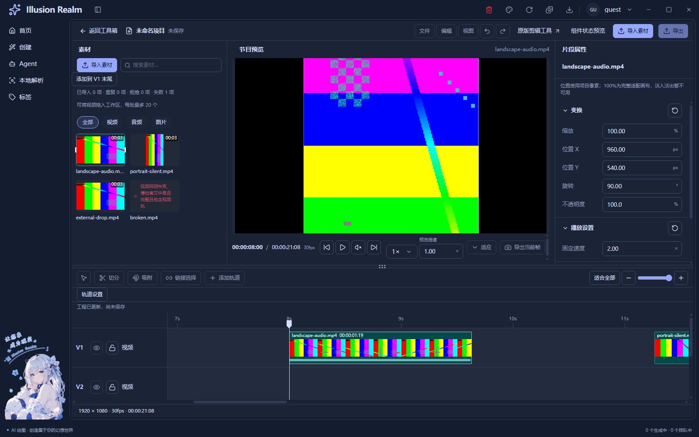
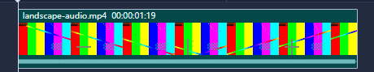

# 时间线三层片段与真实源波形

日期：2026-11-04｜范围：按最新参考调整正式时间线片段，并接入真实声音包络。自动回归完成，原人工项目仍待验。

## 行为与复用

正式片段为74px高：16px名称/持续时间码、40px连续帧、16px底部波形，加上下各1px边框。名称与时间码靠左，长名称省略，选中保留细框。正式轨道共同使用90px行高，头部与内容同一grid纵滚；静态样板不启用此变体。

继续复用 `EditorClipShell`、`TimelineClip`、`VideoFilmstrip`、唯一时间模型和原左右修剪手柄，通过可选timecode及sourceIn/span注入差异。右边最多恢复到源结尾；左边向右裁掉头部、向左恢复源内容，仍受工程零点、同轨邻居、锁轨和原最短帧限制。修剪不修改素材库文件或制造额外源帧。帧带改为锚定源时间网格，修剪时移走/恢复边缘帧格，不把剩余内容每次重新均分。

底部是**真实音频振幅波形，不是音高分析**。视频内嵌音轨与分离后的音轨共用 `ClipWaveform` 和同源摘要，各自保留片段入点与倍速后的源跨度。无音轨、加载、读取失败与就绪独立表达；失败不清空素材或片段。视频音轨分离后仍显示源摘要，不代表该视频实例取消静音。

新 `videoWaveform` 最小桥接沿用 `registerHandle`、`IpcResult`、shared schema和等价主进程校验。主进程复用FFprobe及FFmpeg，8kHz单声道逐窗求峰值，约2048窗、返回上限4096点、统计文本上限1MiB；不把整段PCM搬入渲染层，也不生成临时WAV。请求具有30秒截止，取消覆盖探测及解码，窗口销毁同样清理；非法输入先返回INVALID_ARGUMENT。渲染同源读取串行、按借用者管理取消，最后一个声音组件退出清空会话摘要。新通道不是任意命令执行入口。

## 修改文件

| 层次 | 文件与职责 |
| --- | --- |
| 共享片段及时间线 | `editor-clip-shell.tsx` 可选时间码；`editor-timeline.tsx` 注入真实波形与源区间；`editor.module.css` 三层高度及细框；`video-filmstrip.tsx` 固定源时间网格 |
| 渲染声音 | 新增 `clip-waveform.tsx` 源区间到SVG包络；新增 `source-waveform.ts` 请求、同源去重与生命周期 |
| 主进程 | 新增 `apps/electron/src/main/modules/ffmpeg/waveform.js`；`ffmpeg/index.js` 接原模块注册；`ffmpeg/probe.js` 增加可选AbortSignal，旧调用保持兼容 |
| 契约及桥接 | shared/common两份 `ipc-channels`、shared `electron-api.ts` / `media.schema.ts`、`preload/index.js` 同步 |
| 文案 | 已登记zh-CN/en的 `toolBox.ts` 增加读取中与不可用提示 |
| 回归 | 新增 `scripts/lib/check-video-waveform.js`；原 `check-video-filmstrip.js` 接入；`smoke-video-live-02.js` 修复纵滚前提和真实首帧等待 |

以上渲染文件均位于 `apps/next/src/view/toolBox/Tool/video/editor/`。导入、素材选择、工程选择、播放器、裁剪命令和保存/导出边界仍独立，没有复制第二套时间轴。

## 实际检查

- `pnpm typecheck` 通过，渲染strict及主进程类型均完成。
- `pnpm lint` 通过，0错误/33条原有警告。
- Next静态构建通过；最终指纹 `3cf2ae3a4d018f63b3ec001e90c1e3a20d71b0f2ebf9bfd8b180f80f4fb74010`，874输入。
- 最终构建下串行Electron：正式真实视频 **160/160**；公共UI/A-B状态、浅深主题、1600/1280/960容器、原视频/GIF宿主 **139/139**。
- 正式媒体样本为实际本地编码的640×360/30fps/AAC与360×640/24fps/无音轨视频，经生产探测、媒体解码及实际时间轴。真实媒体测试包含导入、播放/暂停、修剪、源定位、恢复边界、倍速、锁轨、音轨分离、移动、取消及退出清理。
- 波形独立反证：将0、0.02、0.4振幅的三个时段编码成真实AAC视频，经生产IPC解码后在源0.4/1.2/2秒读到 **0 / 0.0197455 / 0.3950621**。额外核对schema/主进程一致、-inf静音解析、缺统计拒绝、非法URL、无音轨及立即取消。
- 实际DOM验证74px三层不重叠、底部波形16px、帧带与波形共用同一修剪源区间。截图来自实际capturePage，已打开核对；下方局部图只裁切完整截图，没有重新绘制。
- 脚本引用、冒烟规则、双语键、中文与英文文案基线均通过。

`pnpm check` 重新执行退出1：类型、Electron模块与84通道一致性通过，在既有三个未引用词条 `auth.verifySuccess`、`common.localeNameSelf`、`create.generationTasks.active` 停止，后续链未执行；没有称全量通过。上面的文案/脚本项为单独补跑结果。

本轮保留两次早期失败：第一轮159/160，新增轨高使测试A1落点在视口外；初次局部修正只滚到A1，未恢复V1，下一轮70/72后异常退出，同时发现预览文字快照早于首帧就绪。最终共同lanePoint只滚动真实视口使目标可见，每次重读矩形；截图快照先等真实媒体与页面ready。没有放宽原无效轨道、同一预览或精确工程时间断言。修正后完整160/160，最终源码构建后再次完整160/160。

最终日志：`logs/smoke-video-live-02-2026-11-04T14-40-58-280Z-27072.log`，公共UI摘要见 `logs/smoke-runs.log`。

## 实际截图

[截图来源、构建与哈希](runtime/timeline-three-layer/evidence-manifest.json)。彩条是测试视频本身，连续帧为真实解码采样，不能从缩略格数反推源帧总数。本截图的源为恒定测试音，所以包络接近平直；不同振幅的数值反证在上面单独列出。

## 证据边界与未验证

按钮导入使用系统选择结果夹具；内部拖动前段为CDP驱动Chromium原生载荷，后段为公开DOM事件；外部文件路径由CDP进入真实File与preload解析。它们是自动运行证据，不是人工系统选择或Explorer OLE拖入。纯模型、schema反例和真实编码信号也分别报告，不当作人工操作。

UI-08既有人工项原状保留：资源管理器真实拖入、完整人工键盘/左右边缘手感、真实系统125%/150%缩放、多屏及扬声器试听。没有录屏，没有测极长媒体性能、磁盘拔出或同路径热替换。下混单声道可能抵消反相立体声，有限窗口不提供逐样本编辑或音高检测。固定160×90帧缓存、最多约49格/任务及4096px画布继续限制辅助采样，极大缩放不是无限源帧常驻。

切分、吸附、撤销、新编辑器保存、导出、混音及淡入淡出仍未接通；本轮没有将波形显示冒充这些能力完成。

## 增量注释与函数核查

基线是任务开始前工作区快照 `ir-timeline-wave-baseline-ywzpk41r/baseline.json`；新文件全文、修改文件新增/替换行参与统计。smoke主脚本的两处补充以精确去除本轮改动还原基线，没有将旧工作区算成本轮成果。纯类型JSDoc及重复说明经人工剔除，混合行只计代码。

业务 **C443/B186，70.43%**；测试 **C144/B60，70.59%**。[逐文件注释审计](timeline-three-layer-comment-audit.json)、[函数审计](timeline-three-layer-function-audit.json)。例如用“固定格距胶卷尺”说明修剪时源帧锚定，用“每格最高水位”说明只传小峰值摘要，不传整段音频。

新增普通函数按AST正常展开不超过30行。既有聚合注册 `registerVideoToolIpc`（185行）及原探测 `probeVideo`（34行）仍是原有长函数，本轮只接注册和可选取消参数，没有以压行或全仓重构处理；未宣称这些历史函数已满足30行规范。
