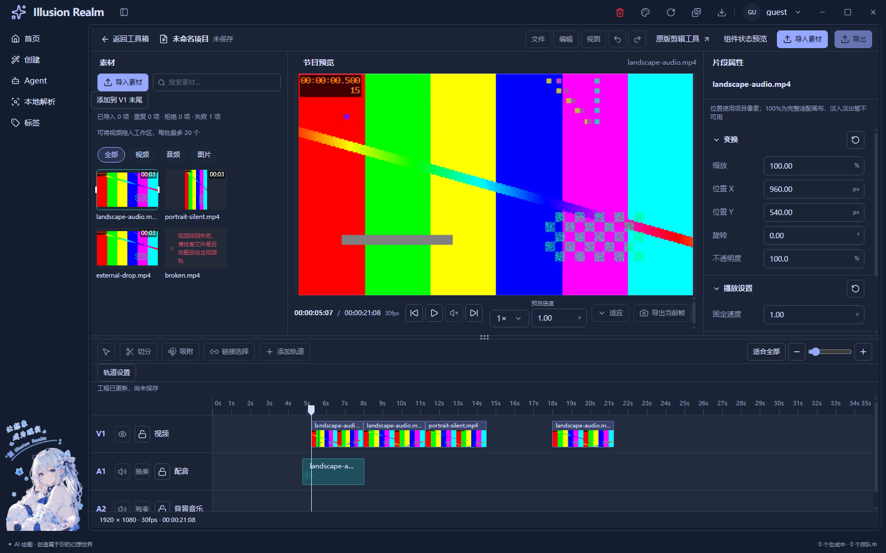

# 左右修剪的源内容边界（2026-11-04）

用户确认本轮指时间轴视频块的左右边缘，在原视频范围内调整起止内容。

## 交互规则与复用

- 右边缘最多恢复到源视频结尾；后面有同轨片段时先停在邻居边缘。
- 左边缘向右拖，源入点随之向后移动，右边结束画面保持；向左拖恢复之前裁掉的源内容，最多恢复到源起点，并受工程零点和前方邻居限制。
- 这是非破坏修剪，保留原素材库文件和时长，不改变播放速度，不移动邻居。鼠标草稿、松手和键盘继续共用原 `trimClip`，没有新增第二套手柄或时间模型。

## 本轮修复

修改 `apps/next/src/view/toolBox/Tool/video/editor/timeline-track-model.ts` 的三个计算行：源入点保留精确秒数；右边最高位置从工程起点和可用源长直接计算。

修复前的独立复现：3.25秒源、1.37倍速、30fps工程、起点4秒，右侧从6.4秒缩到5秒后，只能恢复到6.3666667秒。左侧向右修剪到4.1秒后再次零位移提交，源入点从0.137漂移到0.1333333秒。

修复后，右侧恢复到6.4秒并停止，左侧入点稳定在0.137秒。源结尾不足一工程帧仍占最后一格，与创建/变速的取整契约一致，这格不代表生成额外画面。左侧源入点不再跟着项目帧二次取整。

`scripts/lib/check-video-multitrack.js` 增加三个反例：小数倍速尾格恢复与上限、左侧源入点零位移稳定、向左恢复到源零点。使用生产函数，期望数值手算，冻结输入并核对未被改写。

## 实际验证

- 类型检查、lint、Next静态构建通过；lint为0错误/33条既有警告。
- 最新静态导出串行Electron回归 **151/151**，包括真实横屏640×360/30fps/AAC及竖屏360×640/24fps/无音轨的导入、修剪后源定位、Escape恢复、锁轨、移动、变速、图层、首帧封面和资源清理，以及上述三个纯模型反例。
- 额外算术扫描0.25–4.00倍速（步长0.01，共376种），左侧修剪0.1工程秒后恢复源起点，未发现漂移。此为额外自动诊断，不当作376项人工或媒体操作。
- 静态导出指纹：`d65136b5cd5c100b43a5553ed02cfa87afa990d3ba6c6c4fb40b124ab820c6ef`，872输入。
- 重新`pnpm check`退出1：类型和Electron模块/通道通过，在三个既有未引用词条 `auth.verifySuccess`、`common.localeNameSelf`、`create.generationTasks.active` 停止。后续链未执行，不宣称全量通过。

真实视频部分使用CDP/DOM自动操作与系统选择结果夹具；新增1.37倍速边界反例是纯模型测试，没有声称人工系统操作或这个小数速度的完整媒体试听已验收。UI-08原人工拖入、完整键盘路径、系统缩放、多屏和扬声器试听仍待验；本轮无录屏。

截图已实际打开核对，视频源画面自身叠印0.500秒。它证明现有真实修剪/定位链，新增小数倍速精度由独立反例证明，二者分开报告。[截图哈希及运行摘要](runtime/trim-source-bounds/evidence-manifest.json)。

## 增量注释与边界

以本轮开始的 `ir-trim-bounds-baseline-43vxzgf2/baseline.json` 为基线，只计两个修改文件新增/替换行，纯注释C、非空代码/混合行B，人工复核内容与断言。

业务 **C12/B3 = 80.00%**，测试 **C28/B12 = 70.00%**。用“胶卷与遮挡纸板”解释非破坏修剪，用72/71帧的独立数值解释为何旧算法丢尾格。普通函数正常展开最多16行。[逐文件注释审计](trim-source-bounds-comment-audit.json)、[函数审计](trim-source-bounds-function-audit.json)。

本轮仅修复源范围计算，原卡片/播放器布局和其他工作区修改保留。没有新增切分、波纹编辑、滑移工具、保存或导出。
