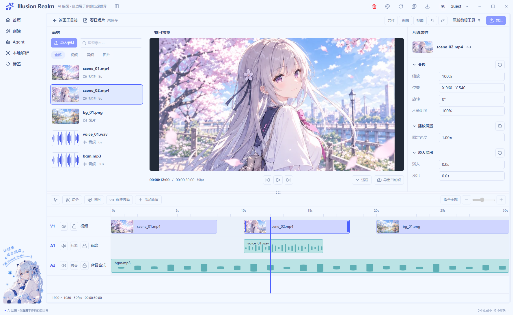
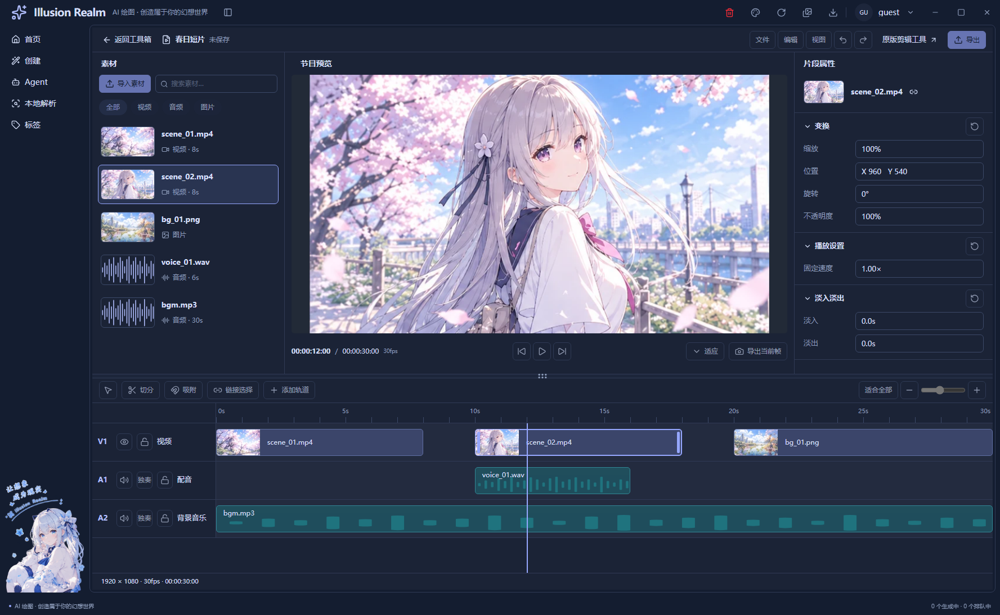

# UI-01：宿主与布局骨架实施记录

日期：2026-10-27｜状态：已完成 UI-01；UI-02–UI-08 保持待办。

## 实现与入口

`/tools/video/editor` 现展示独立演示工作区，按原图结构划分项目栏、素材、单节目预览、属性、上下分隔条、时间轴和项目信息条。保留应用既有 AppShell、导航、窗口控制与全局状态栏，编辑器内不复制系统外壳。

演示工程为“春日短片”：1920×1080、30fps、总长 30 秒，暂停在 12 秒。V1 为 0–8、10–18、20–30 秒，A1 为 10–16 秒，A2 为 0–30 秒。刻度、片段和播放头共享轨道内容列坐标；播放头在该列的 40%，排除左侧轨道头宽度。波形为静态占位，不读取音频采样。

原来的真实视频工具保留在 `/tools/video/editor/legacy`，新项目栏有可用链接。旧 `/toolBox/video` 兼容跳转继续进入视频编辑器；GIF 路由和业务组件保持原用法。

新 UI 的导入、搜索、筛选、播放、逐帧、属性修改、切分、加轨、缩放、保存、导出均未接通，使用原生 `disabled` 与原因提示。分隔条当前仅为 8px 视觉槽位，标记 `aria-disabled`，不能拖动或通过方向键调整。未创建真实媒体会话、项目文件或保存成功提示。

## 修改文件与复用

| 文件 | 本轮职责 |
| --- | --- |
| `apps/next/src/app/tools/video/editor/page.tsx` | 原入口装配 workspace 宿主与新视图 |
| `apps/next/src/app/tools/video/editor/legacy/page.tsx` | 新增原版真实工具入口，继续装配原 VideoToolPage |
| `apps/next/src/view/toolBox/tool-page-frame.tsx` | 新增可选 `mode="workspace"`；默认普通工具布局保持原样 |
| `apps/next/src/view/toolBox/Tool/video/editor/video-editor-view.tsx` | 宿主、上区、分隔条、时间轴和信息条装配 |
| 同目录 `editor-demo.ts` | 五个素材、五个片段和工程参数的单一只读来源 |
| 同目录 `editor-chrome.tsx` | R01/R10；共享 EditorAction 用于项目、预览、属性和时间轴 |
| 同目录 `editor-panels.tsx` | R02/R03/R04；共享素材行、属性组/字段和示意波形 |
| 同目录 `editor-timeline.tsx` | R06–R09；共享轨道头/行/片段，统一时间坐标 |
| 同目录 `editor.module.css` | 局部主题映射、区域几何、滚动与容器收缩 |
| `apps/next/src/assets/video-editor-demo/*.webp` | 三张从已确认原图裁出的静态样例，随 Next 导出 |
| `apps/next/src/i18n/locales/{zh-CN,en}/toolBox.ts` | 同步新增编辑器文案与禁用原因 |
| `scripts/smoke-video-editor-ui.js` | 新 UI 的真实 Electron 静态产物回归与截图 |
| `scripts/smoke-video-{editor,split,reframe,ranges,clip-effects}.js` | 五个原回归入口指向 legacy，原业务断言保留 |

复用现有 ToolPageFrame、Next Link/Image、Lucide、i18n、主题语义变量与 AppShell。ToolPageFrame 的模式由调用方显式选择，不根据文件名猜测；GIF 继续使用默认返回栏、padding 与内容滚动。

已核对 Video/GIF 共用 PreviewStage、TimelineScrubber、ClipPlaylist、ExportPanel 的调用关系。它们绑定真实源媒体、修剪和导出，本轮没有将这些单源契约强行改成多轨工程，也没有修改这些公共组件。新预览只呈静态图片，后续业务在各区域内部接入。

EditorAction 在多个区域实际共用；MediaItem 服务视频、图片和音频；PropertySection/PropertyRow 服务变换、速度和淡入淡出；TrackRow/TimelineClip 服务不同类型的轨道与片段。仅共享展示结构，不合并导入、播放与导出的业务副作用。

## 高度与滚动归属

| 区域 | 初始布局和滚动边界 |
| --- | --- |
| 总宿主 | 填满 AppShell 可用主区；仅此路由取消展示层额外 padding，保留应用外框色带/圆角 |
| R01 项目栏 | 固定 44px，不随素材或轨道滚动 |
| R02/R03/R04 上区 | 剩余高度与时间轴按 1.65:1 分配，上区下限 260px；侧栏参考原图比例并约束最小/最大宽度 |
| R02 素材 | 标题、导入/搜索、分类固定，列表独立滚动 |
| R03 预览 | 40px 标题、可收缩等比画面、64px 控制行；画面 contain，中性深底留边；控制行必要时内部横滚 |
| R04 属性 | 标题与选中对象固定，属性体独立滚动 |
| R05 分隔条 | 固定 8px，目前禁用调整 |
| R06–R09 时间轴 | 下限 202px；工具栏固定，轨道头和内容共用一个横纵滚动区，轨道头左侧 sticky，刻度顶部 sticky |
| R10 信息条 | 固定 30px，位于时间轴滚动区外 |

工作区最小总高 544px，更低时宿主整体纵滚，避免关键区域被裁没。轨道行高 68px，片段高 48px；内容列最小宽 720px，窄容器允许时间轴内部横滚。正常高度不让素材或属性内容撑出第二条页面滚动条。

按实际编辑器容器宽度收缩：≥1280px 三栏，1040–1279px 保留素材/预览，<1040px 预览优先。收起区域不保留空列，临时面板入口仍禁用；完整展开交互与焦点回退留 UI-07。

## 真实运行截图

截图来自新鲜静态导出的 `app://` 页面，使用生产 preload、协议、应用外壳与真实主题切换路径。测试 Electron 窗口使用 offscreen 模式；不是浏览器设计稿，也未后期合成。尺寸指编辑器容器，整张图片还包含导航、标题栏和底部全局状态。

- [浅色 1600×1000](runtime/ui-01-light-1600.png)
- [浅色 1280×800](runtime/ui-01-light-1280.png)
- [浅色 960×720](runtime/ui-01-light-960.png)
- [深色 1600×1000](runtime/ui-01-dark-1600.png)

已人工查看四张截图，确认区域、留边、单预览、主题、选中外观与窄布局没有额外空列。1280×800 时素材/属性可内部滚动；960×720 时时间轴最后一行需要内部纵滚查看，项目信息条始终可见。这是当前骨架的滚动归属，不代表临时面板或全部响应式交互已完成。

## 实际验证

| 检查 | 结果和边界 |
| --- | --- |
| `pnpm typecheck` | 通过，含 Next 与 Electron |
| `pnpm lint` | 通过，0 errors；33 项既有 warnings |
| `pnpm --filter @illusion-realm/next build` | 通过，静态导出包含新入口与 legacy；冒烟再次检查构建指纹新鲜度 |
| `pnpm exec electron scripts/smoke-video-editor-ui.js` | 33/33；三个容器尺寸、额外 800px 横滚、区域边界、40% 播放头、禁用/零媒体调用、导航开合、同 DOM 深色、原工具/GIF 宿主、无渲染错误 |
| `pnpm exec electron scripts/smoke-video-editor.js` | 58/58，原视频真实 FFmpeg 处理及导出回归 |
| `pnpm exec electron scripts/smoke-gif-editor.js` | 50/50，GIF 真实导出、尺寸/帧率/帧数、自定义前缀、同名避让等 |
| `pnpm check:locale-keys` | 通过，双语键一致 |
| `pnpm check:i18n:en` | 通过，历史待迁移 867，未超过基线 |
| `pnpm --filter @illusion-realm/next check:i18n` | 通过，硬编码 34，基线 66，本轮未增加 |
| `node scripts/check-script-refs.js` | 通过 |
| `node scripts/check-smoke-rules.js` | 通过 |
| `pnpm check` | 未全通过：typecheck 与 Electron verify 已通过，随后 check:gates 因三个既有未引用词条失败，中止后续链路 |

现有门禁失败项为 `auth.verifySuccess`、`common.localeNameSelf`、`create.generationTasks.active`，均非本轮新增的 `toolBox.editorUi`。不为通过 UI-01 检查而删除其他功能词条，也不将被中止的其余检查写成已通过。

Electron 冒烟顺序执行，测试文件/浏览器数据使用隔离临时目录，完成后只销毁本轮窗口。运行摘要追加在 `logs/smoke-runs.log`。新 UI 的回归使用媒体调用计数替身，证明未接通动作没有执行；真实处理由旧视频和 GIF 套件另行验证。

未运行其余四个只改入口的 split/reframe/ranges/clip-effects 专项、安装器打包、真实系统 125%/150% 缩放、遮挡窗口维度、完整键盘流程、实测对比度与 UI-02–UI-08 状态矩阵。新工作区的真实媒体导入/播放/剪辑/保存/导出不在本轮实现或验收范围。

## 注释率与代码约束

基线为本轮开始时的工作区快照，而非 Git HEAD；已有大量未提交修改不计作本轮成果。新增文件统计全文，修改文件仅统计本轮新增/替换后的物理行。删除行、未改上下文、Markdown 和图片不参与。

通过 TypeScript AST 注释范围识别 TS/TSX/JS，PostCSS 识别 CSS；混合代码/注释行只算 B，纯注释定界符和空行不算 C。逐文件核对注释与实际职责、禁用状态、坐标和测试前提，人工检查有效性后按业务/测试分别汇总。普通业务与事件函数未超过 30 行有效代码，展示 JSX 装配按根规则豁免。

| 文件（编辑器目录内简称） | C 有效注释 | B 非空代码 |
| --- | ---: | ---: |
| editor-chrome.tsx | 66 | 28 |
| editor-demo.ts | 45 | 18 |
| editor-panels.tsx | 112 | 50 |
| editor-timeline.tsx | 85 | 37 |
| editor.module.css | 247 | 100 |
| video-editor-view.tsx | 34 | 17 |
| tool-page-frame.tsx（变更行） | 19 | 4 |
| editor/page.tsx（变更行） | 5 | 2 |
| editor/legacy/page.tsx | 12 | 5 |
| zh-CN/toolBox.ts（变更行） | 47 | 15 |
| en/toolBox.ts（变更行） | 31 | 15 |
| **业务合计** | **703** | **291** |
| smoke-video-editor-ui.js | 225 | 108 |
| smoke-video-editor.js（变更行） | 8 | 1 |
| smoke-video-split.js（变更行） | 8 | 1 |
| smoke-video-reframe.js（变更行） | 8 | 1 |
| smoke-video-ranges.js（变更行） | 8 | 1 |
| smoke-video-clip-effects.js（变更行） | 8 | 1 |
| **测试合计** | **265** | **113** |

业务：703÷994＝**70.72%**；测试：265÷378＝**70.11%**，分别达到 70%。

注释示例：`editor-demo.ts` 用“共用的尺子”解释工程秒数与展示坐标的关系；冒烟解释 DOM 已卸载不等于合成器已提交最新帧，截图采用有上限的主进程间隔，避免后台 rAF 停止或拍到旧浮层。注释不把静态布局通过解释为真实解码、播放或保存通过。

## Webpack 构建兼容修正（2026-10-27）

用户在开发入口遇到 CSS Module 的 pure selector 错误：原来的全局父层选择器没有包含局部 class/id。此前默认构建使用 Turbopack，验证没有覆盖开发脚本使用的 Webpack，这是原验收的遗漏。

将编辑器路由的父层 padding 规则从 `editor.module.css` 移至既有 `apps/next/src/app/workspace-shell.css`。该全局文件已经由 `globals.css` 引入；规则继续精确匹配 `/tools/video/editor`，legacy/GIF 的普通工具布局不变。编辑器内部仍由原 CSS Module 管理，没有复制外壳或改动公共组件契约。

本次修正以修正前工作区为基线，仅增加 4 行有效说明与 1 行 CSS，业务注释率 **80%**；删除内容不计入，测试没有修改，测试注释率不适用。说明分别解释宿主边界、路由隔离、规则归属及 Webpack 限制。

实际验证：`pnpm --filter @illusion-realm/next exec next build --webpack` 完整通过，随后更新构建指纹并运行 `pnpm exec electron scripts/smoke-video-editor-ui.js`，**33/33 通过**，包括新编辑器三种容器尺寸、深浅主题、导航开合及 legacy/GIF 默认宿主。截图已替换为本次 Webpack 产物的运行图。该修正未重新执行真实视频/GIF 导出专项，也未重跑整套 `pnpm check`。
