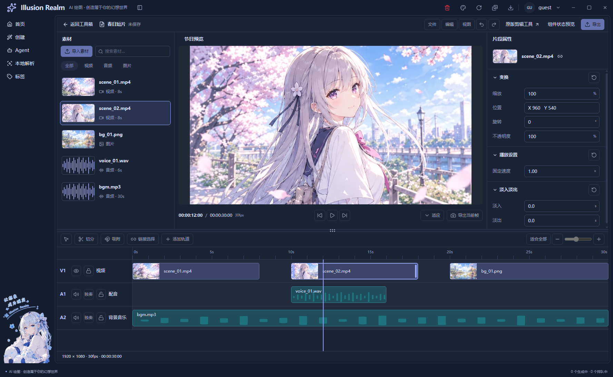
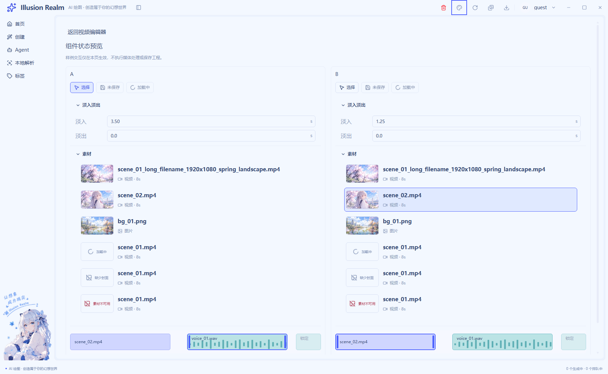
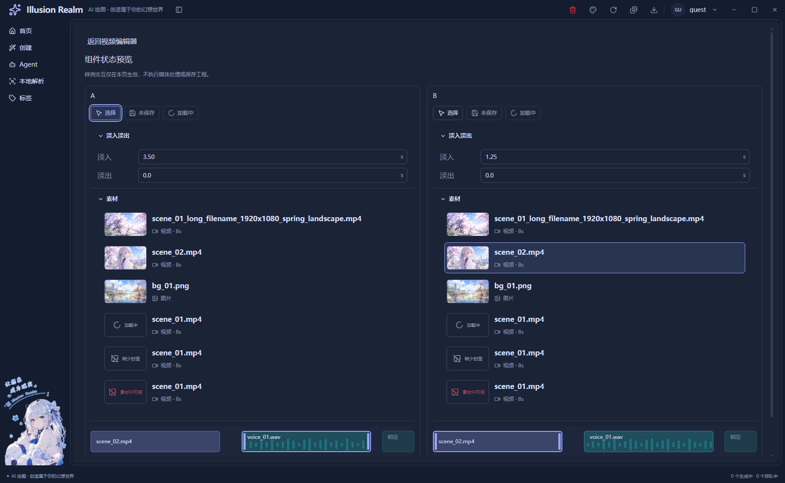
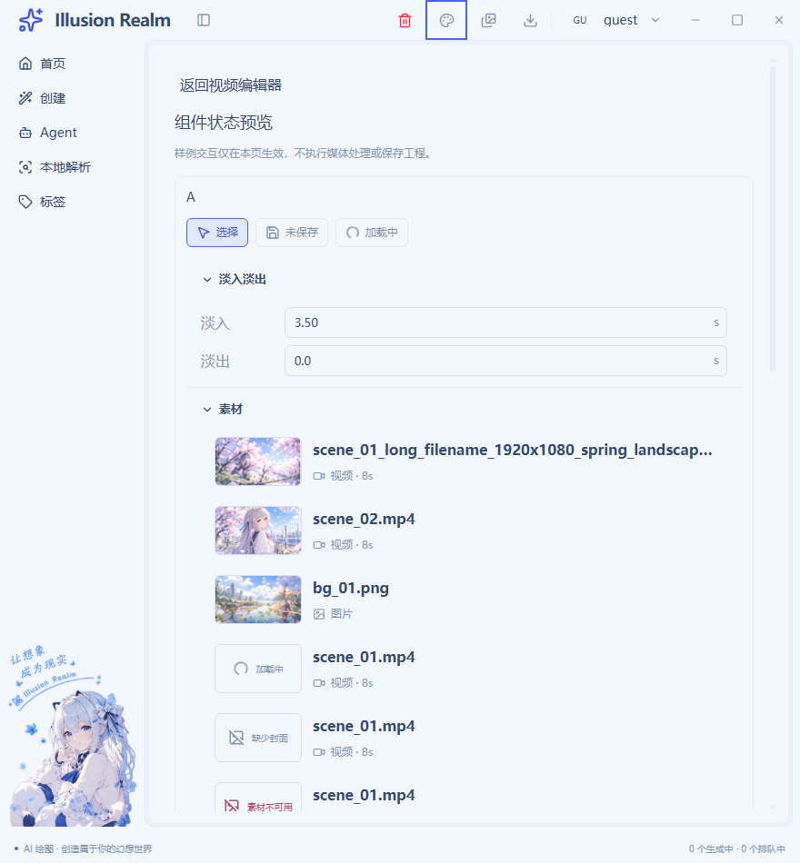
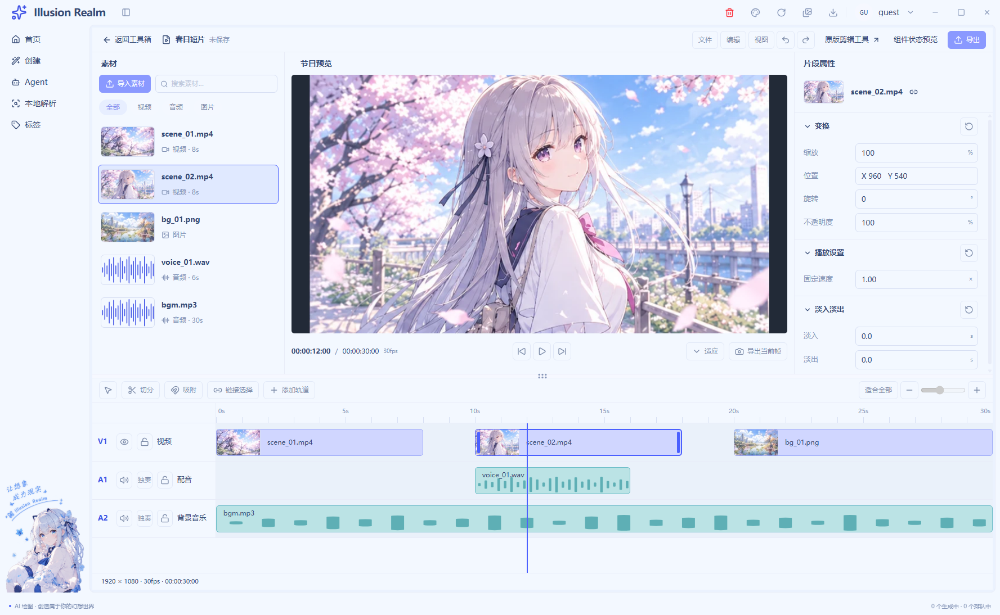
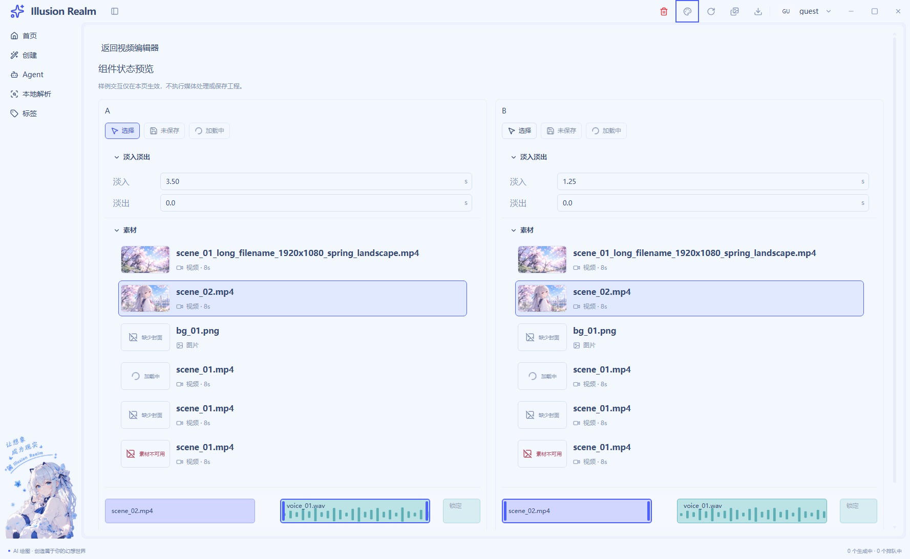
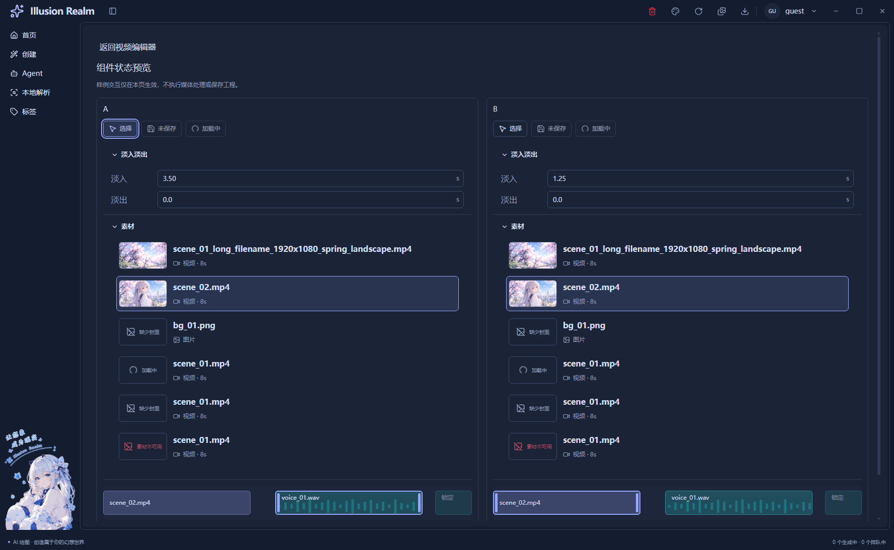

# UI-02 实施记录

2026-10-28。仅完成最小共享组件与状态样板；UI-03–UI-08 保持待办，停在本项等待验收。

## 复用与接入

工作区继续使用 UI-01 的 R01–R10、AppShell、ToolPageFrame workspace 模式、统一演示数据与局部主题变量。核对过资料库 Card、公共弹窗、原 PreviewStage、整数输入和 GIF 调用方后，没有把媒体业务不同的控件强行迁入同一实现。

下表路径相对 `apps/next/src/view/toolBox/Tool/video/editor/`。

| 文件与组件 | 已接入位置 | 注入差异与边界 |
| --- | --- | --- |
| `editor-controls.tsx`：EditorAction | 项目栏、节目控制、属性重置、时间轴、A/B 样板 | 图标、标签、主要操作、pressed、busy、禁用原因、回调；无回调默认禁用 |
| 同文件：EditorGroup | 变换、播放设置、淡入淡出、A/B 样板 | 标题、内容、重置动作；每组独立开合，复用现有 CollapsiblePanel 与 inert |
| 同文件：EditorFloatField | 正式数值属性、A/B 淡入淡出 | 单位、精度、范围、onCommit；正式属性继续禁用，样板只更新局部值 |
| 同文件：EditorPlaceholder | MediaItem 的异常封面、样板空态 | empty/loading/error/missing、文案、密度；不模拟恢复成功 |
| `editor-panels.tsx`：MediaItem | 默认五份素材、A/B 各种状态 | 类型、封面、时长、选择、状态；选择不改变节目和片段属性 |
| `editor-clip-shell.tsx`：EditorClipShell | 主时间轴五段、A/B 视频/音频/锁定片段 | 工程时间、媒体类型、选择、内容槽和回调；正式时间轴仍只读 |

`editor-chrome.tsx` 重新导出原 EditorAction 名称，已有调用方与新实现共用一套按钮。没有复制相似 CSS、另建全局组件框架或修改 GIF 的 PreviewStage 契约。

## 交互与状态

- 可用控件统一悬停和焦点；选中使用边框与可访问状态共同表达。
- 数值保存字符串草稿：键入不动态矫正，Enter/失焦验证并提交，Escape 还原；非法值保留并显示关联错误。
- 分组标题支持原生 Enter/空格，收起保留草稿并排除隐藏焦点。内容采用 flow-root，修正实际截图发现的末行被折叠测量裁切问题。
- 素材行处理长名、封面失败、缺图、加载和错误；加载/错误不可操作。busy 按钮防止重复激活。
- `/tools/video/editor/samples` 提供 A/B 两个独立实例，从工作栏“组件状态预览”进入。所有演示值都留在页面实例，离开即释放。

项目导入、搜索/筛选、播放、帧导出、保存、工程导出、修剪、轨道状态和分隔拖动尚未接入，继续原生禁用并提供原因。没有假成功反馈。默认主时间轴保留 clip-02 的选中状态，避免只改边框却仍显示旧节目与属性；真实选择留给 UI-06。

## 实际验证

Webpack 静态导出成功并记录源码指纹。真实 Electron `app://` 冒烟 **49/49 通过**：UI-01 原几何、工程坐标和滚动归属；默认业务零媒体请求；导航开合；深浅主题；A/B 草稿/错误/选择/折叠隔离；原生按键；inert；末行完整可见；窄窗口；返回后的默认工程隔离；legacy 与 GIF 普通宿主。

`pnpm typecheck` 通过；`pnpm lint` 无错误、保留 33 个既有警告；双语键、中文/英文文案基线、Electron 模块校验、脚本引用、冒烟约定、输出路径和语言初始化检查通过。

`pnpm check` 在既有门禁停止：`auth.verifySuccess`、`common.localeNameSelf`、`create.generationTasks.active` 三个未引用键。补跑 Meta 检查发现既有 `MetaFieldRow.tsx` 的 JSX 中文注释被检查器当成字符串；本轮未修改该文件。对 HEAD 的整仓文案保留检查也受到此前删除的 gallery 等文案影响，未通过；本轮未搬迁旧中文文案。这些失败没有记为通过，也没有为消除它们扩大修改范围。

未验证：真实导入/解码/播放/剪辑/保存/导出、GIF 实际输出、真实 Windows DPR 与遮挡维度、完整读屏软件、逐色对比度测量。样板的错误和加载为显式演示状态，不能视作真实网络恢复验收。

## 真实运行截图

以下来自同一次最终静态导出的 Electron capturePage，已查看实际图像；不是概念图重绘。

## 注释统计

基线为本轮任务前定向快照，保留工作区原有修改；新增文件全文、已有文件仅新增/替换行参与，删除和上下文不计。JS/TS/JSX 使用 TypeScript 语法识别并屏蔽字符串内符号，CSS 按注释边界识别；混合行只计代码，复核职责、原因、边界和测试前提。

UI-02 专属范围：业务 **C=340、B=142，70.54%**；测试 **C=201、B=76，72.56%**。双语新增词条另列在本轮合并审计中。本轮安装修复、模型目录与 UI-02 合并范围：业务 **70.13%**、测试 **70.32%**，逐文件数据见 [本轮审计](../../design/implementation-2026-10-28-comment-audit.json)。

例如：共享字段用“先写便签再确认”解释草稿与提交分离；运行测试解释隐藏窗口的焦点模拟与原生字符事件，避免把缺失的测试环境事件误判为产品失焦错误。普通逻辑函数的非空有效代码检查未发现超过 30 行项；JSX 装配按职责边界保留。

## 2026-10-30 本轮复核与补齐

开始时工作区已有上述 UI-02 实现和 49 项检查，本轮以修改前定向快照为基线保留它们，核对 UI-01、原图、状态图及实际调用方后补齐问题，未重新实现一套组件。

| 本轮文件 | 补齐内容 | 复用与独立边界 |
| --- | --- | --- |
| `editor-controls.tsx` | 按钮独立说明 ID、准确等待/禁用原因；字段禁用提示、舍入后范围校验、同值不重复提交 | 项目、预览、属性、时间轴与 A/B 共用；图标、单位、精度、回调由调用方注入 |
| `editor-panels.tsx` | 视频/图片无封面时显示缺图，不再误用音频波形；显式加载/错误优先 | 正式素材区与样板共用 `MediaItem`；失败只影响固定封面槽，不改素材身份 |
| `editor-samples.tsx` | 素材选择与片段选择分开；无封面与真实坏字节样例 | A/B 各持有素材、片段、数值与开关状态；不写用户文档或正式工程 |
| `editor.module.css` | 可用按钮/素材按下状态、可用片段悬停描边 | 局部语义变量与原比例保持，锁定/禁用不产生可操作反馈 |
| `scripts/lib/check-video-ui-controls.js` | 空草稿、同实例两种选择隔离、缺封面、解码失败、说明 ID 检查 | 追加到现有串行 Electron 套件，不复制窗口或样板组件 |

`EditorGroup` 继续复用 `CollapsiblePanel`，保留独立开合、草稿与 inert；片段壳继续用 children 区分视觉与音频。未修改全站 Card、`SimpleSelect` 或旧视频/GIF 的 `PreviewStage`、`TimelineScrubber`：后者绑定真实源媒体 trim，不能与本轮静态节目预览强行合并。`ToolPageFrame` 普通模式与 workspace 模式保持原边界。

### 本轮实际验证

- 静态导出构建通过，指纹 `6c212606f9be1961459b79e378187fbc3f6f76c9ac632055088dce648d3c8701`；Electron `app://` 真实运行 **55/55**，包含原 49 项和本轮新增 6 项。
- 验证工程坐标、唯一应用外壳、内部滚动、导航开合、1600/1280/960 主区与窄时间轴、深浅主题、焦点圈、Enter/Space/Escape、分组 inert、A/B 隔离、同实例素材与片段互不串选、坏字节触发的图片回退、禁用/等待说明 ID、返回后的工程隔离及 legacy/GIF 普通宿主。
- `pnpm typecheck`、`pnpm lint`（0 错误、33 个既有警告）、双语键、中英文文案基线、脚本引用与冒烟约定检查通过。`pnpm check` 中类型与 Electron 模块校验通过后，仍在既有未引用词条门禁停止：`auth.verifySuccess`、`common.localeNameSelf`、`create.generationTasks.active`，其后链路未运行。
- 对 HEAD 的全仓文案保留检查仍因此前移除的 `galleryPaintings.ts` 32 条文案失败；本轮没有搬迁词条或改该文件，未将该检查记为通过。
- 截图已打开复核，以下均为本轮真实 `capturePage`；原先截图保留。样板加载/错误是显式演示，坏图回退使用固定坏字节，不能当作真实素材处理验证。

另见[主工作区深色](runtime/ui-02-2026-10-30/ui-01-dark-1600.png)与[窄窗口样板](runtime/ui-02-2026-10-30/ui-02-samples-narrow.png)。

未验证真实导入、解码、播放、修剪、项目保存、导出或 GIF 实际输出；也未跑本轮 Windows DPR、遮挡、完整读屏和逐色对比度测量。所有未接通业务继续原生禁用且提供原因，没有真实文件操作或假成功反馈。UI-03–UI-08 保持待办，本轮停在 UI-02 等待验收。

### 本轮增量注释率

以 `ir-ui02-review-baseline-_44zovn2` 定向快照为基线，仅统计本轮新增/替换物理行；未变化的旧代码、文档与截图不计。TypeScript 语法注释范围、JSX 注释容器和 CSS 块注释分别识别，混合行只算代码，并人工核对职责、前提、状态优先级与失败边界。

| 文件 | 有效注释 C | 代码 B |
| --- | ---: | ---: |
| `editor-controls.tsx` | 14 | 8 |
| `editor-panels.tsx` | 9 | 2 |
| `editor-samples.tsx` | 11 | 5 |
| `editor.module.css` | 6 | 2 |
| 业务合计 | 40 | 17 |
| `scripts/lib/check-video-ui-controls.js`（测试） | 33 | 14 |

业务 **70.18%**，测试 **70.21%**。注释以“货架原件与工作台副本”解释素材/片段选择为何分别持有；缺图注释明确 loading/error 优先、音频空封面不报错的边界。普通逻辑函数按格式化后的非空代码复核，状态样板检查函数为 25 行，字段提交为 16 行，均未超过 30 行；JSX 装配按职责保留。
