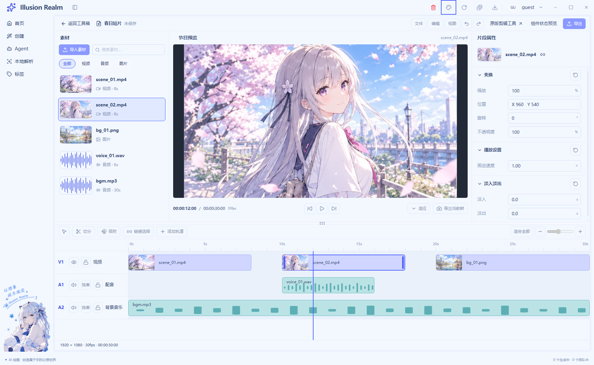
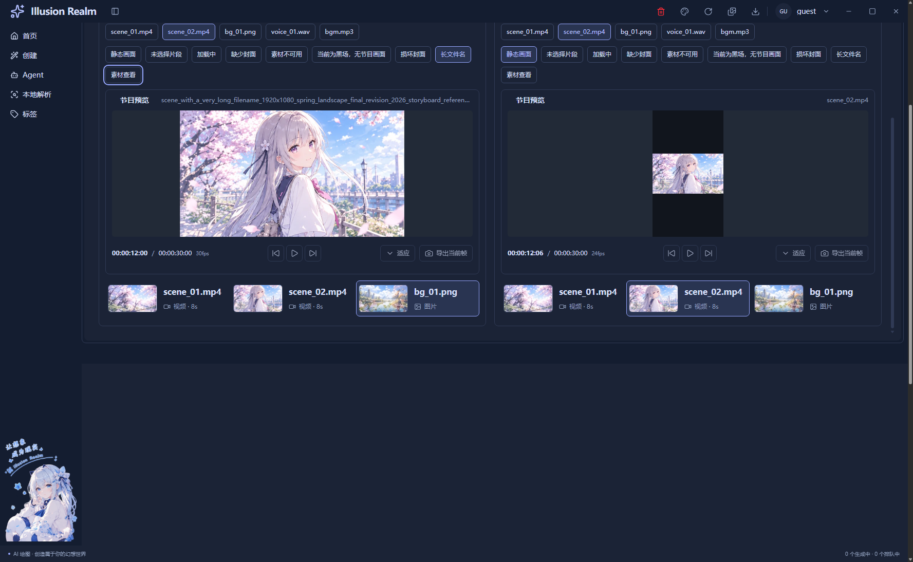

# UI-04 节目预览区实施记录

日期：2026-10-30｜状态：已完成，等待验收｜范围：R03 节目预览

## 实现与复用

沿用 UI-01–UI-03 的 `ProgramPreview`、预览容器、固定走带条、`EditorAction` 和 `EditorPlaceholder`。预览改为传入 `clip`、`assets`、`project`、`currentTime`、`state`、`mode` 与 `onBack`，按片段的 `assetId` 获取素材封面；画布按项目宽高保持比例，源封面使用 contain，剩余空间为中性留边。当前时间与总时长使用同一帧时间码格式化方法。

默认工作区明确传入 `DEMO_CLIPS[1]` 和统一工程参数，保持原图 scene_02、1920×1080、30fps、12/30 秒与主时间轴的固定选中一致。主时间轴的交互选择仍属于 UI-06，右侧属性仍为 UI-05 前的固定样例；本轮没有为了展示预览联动而让它们出现互相矛盾的可编辑目标。

在既有 `/tools/video/editor/samples` 追加 A/B 两个 `PreviewSample`。片段按钮只更新 `selectedClip`，素材行只更新 `selectedAsset`，状态样板与查看模式也各自保存。样板直接引用正式 `ProgramPreview` 和已有 `MediaItem`，没有复制预览或素材行 JSX。A 使用横屏 30fps，B 使用竖屏 24fps 和四分之一秒帧尾，验证展示参数并非写死。

| 文件 | 本轮变化与接入关系 |
| --- | --- |
| `apps/next/src/view/toolBox/Tool/video/editor/editor-panels.tsx` | 最小片段/项目展示接口、片段到封面映射、项目比例、帧时间码、模式与状态；默认宿主和 A/B 共同使用 |
| `apps/next/src/view/toolBox/Tool/video/editor/editor.module.css` | 继续使用原预览三行结构；补充项目比例框、标题省略、固定样板高度；不修改全局主题 |
| `apps/next/src/view/toolBox/Tool/video/editor/video-editor-view.tsx` | 显式传入默认片段与工程参数，阶段标记更新为 UI-04 |
| `apps/next/src/view/toolBox/Tool/video/editor/editor-preview-samples.tsx` | 新增独立状态样板，调用同一 `ProgramPreview`、`EditorAction` 与 `MediaItem` |
| `apps/next/src/view/toolBox/Tool/video/editor/editor-samples.tsx` | 只追加节目样板入口，原 UI-02/UI-03 实例保持原来的生命周期 |
| `apps/next/src/i18n/locales/{zh-CN,en}/toolBox.ts` | 同步节目/素材查看、返回、空态、黑场、音频无画面、禁用原因和样板标签 |
| `scripts/lib/check-video-ui-preview.js`、`scripts/smoke-video-editor-ui.js` | 复用同一个串行 Electron 冒烟窗口，追加节目参数和状态回归 |

旧版 `components/videoEdit/PreviewStage.tsx` 绑定真实视频、trim、seek 和媒体事件，仍由 legacy/GIF 使用，本轮没有改变其接口或将其强行改名为新节目预览。没有新增 IPC、文件存储或媒体业务层。

## 状态与业务边界

- 无片段显示“未选择片段”，当前时间回到起点；引用不存在或没有视觉封面显示缺失。
- 图片解码失败按当前实例的失败地址回落；换回有效封面后恢复，不把坏图标记写到共享素材对象。
- 整体等待/错误优先于旧封面；加载标记 busy，错误使用公共 alert，所有状态维持相同控制栏位置。
- 音频无画面与素材损坏分开提示；黑场有明确说明，不伪造已解码出的黑色帧。
- 素材查看有独立标题和返回入口，显示片段局部时间与长度；返回节目恢复工程时间，片段与素材选择均保持。
- 长文件名标题单行省略并保留完整 title；窄窗口保留等比画布，控制条沿用自身横向滚动。
- 播放、跳帧、适应缩放和帧导出均原生禁用，原因说明静态预览边界；没有计时器、隐藏播放器或模拟成功反馈。播放头拖动仍未接入。

## 实际验证

- Next.js 静态导出构建通过；源码指纹 `4d0b997222ecbb0083a7f86ea38360b686b62967ee88eb6b1b97b5ec43081946`，771 个输入文件。
- `pnpm typecheck` 通过；`pnpm lint` 通过，0 错误、33 个既有警告。
- `pnpm exec electron scripts/smoke-video-editor-ui.js` 最新运行 **97/97** 通过，保留 UI-02/UI-03 的原有 77 项并追加 UI-04 检查。
- 实际检查：默认宿主 1600×1000、1280×800、960×720；素材/片段独立；A/B 映射与状态隔离；横屏 16:9、竖屏 9:16；24fps 的 `00:00:12:06` 帧尾；空态归零；等待 busy；错误 alert；黑场；未知素材引用；坏字节触发实际图片错误并恢复；长名实际溢出与省略；原生 Enter 进入素材查看、返回后的工程/局部时间；五个处理按钮禁用与说明；浅深主题；700px 窄窗口比例和边界；返回后默认工程与 legacy/GIF 宿主。
- `pnpm check` 中类型与 Electron 模块检查通过后，在既有未引用词条门禁停止：`auth.verifySuccess`、`common.localeNameSelf`、`create.generationTasks.active`。后续统一链路未运行，未将它描述为通过。单独运行的双语键、中文/英文文案基线、脚本引用和冒烟规则检查均通过。
- 首轮只剩长名反证失败：原样例在宽列仍可完整容纳。已加长独立样板的文件名并保留实际溢出断言；重建后完整复跑通过，未放宽判据。

真实运行截图已保存并打开复核。主工作区保持一份节目画面；样板的 B 竖屏相框完整容纳横向封面，保留黑边，不裁切或拉伸原图。

另见[默认深色](runtime/ui-04-2026-10-30/ui-04-default-dark.png)、[错误与正常实例对照](runtime/ui-04-2026-10-30/ui-04-preview-error-dark.png)、[浅色样板](runtime/ui-04-2026-10-30/ui-04-preview-samples-light.png)与[窄窗口样板](runtime/ui-04-2026-10-30/ui-04-preview-samples-narrow.png)。

未验证真实视频/音频解码、播放时钟、seek、节目合成、播放头拖动、实际导出、真实文件导入、完整读屏软件、Windows 125%/150% DPR、遮挡生命周期或逐色对比度测量。GIF/legacy 此轮只回归宿主入口，没有重新执行真实输出。静态图片错误处理通过不等同于真实视频解码恢复。

## 本轮增量注释率

以本轮前 `ir-ui04-baseline-auywx9du` 定向快照为基线：已有 UI-03 内容不计，修改文件只统计新增/替换行，新文件统计全文，删除行、文档和截图不计。按 JS/TS/JSX/CSS 注释语法区分纯注释与代码，混合行只算代码，再人工复核职责、状态优先级、映射和验证前提。

| 文件 | 有效注释 C | 代码 B |
| --- | ---: | ---: |
| `editor-panels.tsx` | 111 | 47 |
| `editor.module.css` | 18 | 7 |
| `editor-samples.tsx` | 3 | 2 |
| `video-editor-view.tsx` | 7 | 3 |
| `zh-CN/toolBox.ts` | 9 | 4 |
| `en/toolBox.ts` | 9 | 4 |
| `editor-preview-samples.tsx` | 80 | 31 |
| 业务合计 | 237 | 98 |
| `scripts/smoke-video-editor-ui.js` | 3 | 1 |
| `scripts/lib/check-video-ui-preview.js` | 177 | 75 |
| 测试合计 | 180 | 76 |

业务 **70.75%**，测试 **70.31%**。注释以“节目单记录与素材货架号码”解释片段引用映射，以“先把尺子统一换成毫米”解释整数帧时间码；错误说明明确失败缓存只属于当前预览，不能修改共享素材。普通逻辑函数按格式化后的非空代码核对，新预览回归编排为 23 行、时间码格式化为 6 行；展示 JSX 按职责保留，不机械拆包装器。

本轮停在 UI-04 等待验收，UI-05–UI-08 保持待办。
