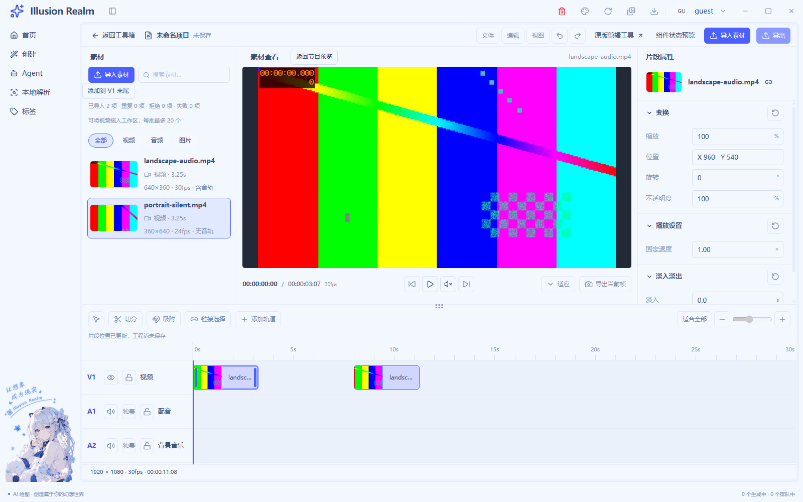
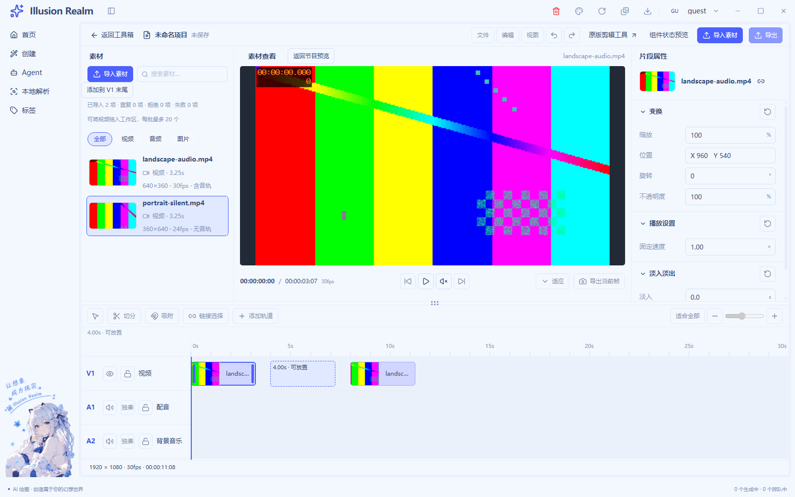
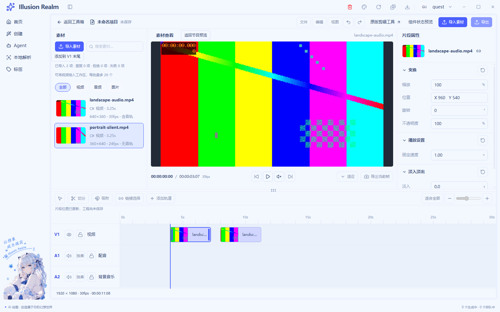

# UI-04 · LIVE-02 实施记录

日期：2026-11-04｜状态：代码完成，等待验收｜范围：正式入口素材入 V1、独立实例、选择与同轨移动

## 实施前核对与复用

已读取根 AGENTS.md、四项相关技能、UI-04 实施记录与 LIVE 补充需求，并核对 LIVE-01 实际代码。仓库没有独立的 `ui-04-live-01-implementation.md`；现有 `use-live-video-session.ts`、`live-video-import.ts`、`live-source-preview.tsx` 已接通真实导入、探测、取消与单源播放，本轮保留其业务，不把缺少文档误判为需要重写。

| 现有组件/能力 | 本轮接入方式 | 保持独立的业务 |
| --- | --- | --- |
| `MediaPanel` / `MediaItem` | 可选素材拖动、结束、末尾添加回调；继续使用相同素材行、搜索、类型筛选和状态占位 | 导入批次、素材选择、路径与探测仍归 LIVE-01 |
| `EditorClipShell` | 可选选择、dragstart/dragend、keydown；受控片段选择与稳定实例 ID | 外壳不生成身份、不计算碰撞、不改源文件 |
| `EditorTimeline` / `EditorWorkspace` | 注入 clips、project、统一视口 range 与 `TimelineInteraction` | 静态样板不创建真实会话，legacy/GIF 不接入新工程模型 |
| `ProgramPreview` / `LiveSourcePreview` | 片段按 assetId 映射真实源，按 clipId 区分同源实例播放器生命周期 | 单源媒体事件继续独立；不提供工程合成播放 |
| `ClipInspector` | 只注入片段引用的素材与 clipId 更新头部 | 变换、淡入淡出等业务字段保持禁用 |
| `EditorAction` / `EditorPlaceholder` | 复用按钮与缺图/错误展示；没有第二套控件样式 | 未接通保存、导出、修剪继续禁用 |

## 实现行为

- 新 `live-timeline-model.ts`：创建与移动共用 `applyTimelineCommand`；按项目整数帧比较半开区间，前一段结束帧等于后一段开始帧合法。负起点、无效源、重复实例 ID、未知身份和同轨重叠拒绝，不先修改再回滚。
- 新 `use-live-timeline.ts`：页面独立临时工程、片段选择、草稿、会话载荷和手势资源。素材 ID 与片段 ID 分开，同一源可多次入轨，移动只替换该实例。成功选择同时更新预览与属性头，不改素材列表高亮。
- 起点由实际 lane 矩形、冻结的像素/秒比例和抓取偏移计算；矩形已包含横滚位移，不再加一次 scrollLeft。草稿、标尺、片段和播放头共用 range。主刻度与背景细分同步延长，实际总长仍只取已提交片段最晚 end。
- 右/左边缘有限自动横滚；drop、dragend、Escape、失焦、缩窗、容器宽度变化和卸载清理。导航开合不一定触发 window.resize，额外用 ResizeObserver 取消失效比例的手势；横滚不改变宽度，不误取消。
- 专用 MIME 只含 session、kind、id；drop 重读正文并核对当前手势，跨会话或伪造 ID 拒绝。A1/A2 给明确不可放置原因。外部 Files 继续汇入 LIVE-01，同样落在 V1 也只导入素材。
- 键盘替代：选素材后“添加到 V1 末尾”；片段聚焦后左右一帧、Shift+左右一秒。鼠标与键盘均经过相同命令与碰撞门槛，输入框没有全局方向键拦截。
- 未保存工程离开时确认，取消保留本页；确认后释放播放器与手势。重新进入仍为空工程，未增加保存、恢复或另一套存储。

源时长与工程占位分开：3.25 秒源在 30fps 工程占 98 帧，即 3.2667 秒；源列表仍显示 3.25 秒。向上取整只为安排表留格子，不修改源元数据，也不是补帧或转码。

## 修改文件

业务文件均在 `apps/next/src/view/toolBox/Tool/video/editor/`：新增 `live-timeline-model.ts`、`use-live-timeline.ts`；修改 `editor-clip-shell.tsx`、`editor-panels.tsx`、`editor-timeline.tsx`、`editor-workspace.tsx`、`live-source-preview.tsx`、`video-editor-view.tsx`、`editor.module.css`。双语词条位于 `apps/next/src/i18n/locales/{zh-CN,en}/toolBox.ts`。

测试新增 `scripts/smoke-video-live-02.js`，并为现有 `scripts/smoke-video-live-01.js` 增加显式 `LIVE_FIXTURE_CHOOSER=1` 离屏夹具模式，默认原生系统验证入口保留。没有改 IPC 通道、preload 接口、主进程媒体服务或用户存储契约。工作区已有修改保留。

## 真实媒体与运行检查

生产 `app://`、真实 preload、`localfile://`、随包 FFmpeg/ffprobe 下运行最新静态导出；最终构建指纹：`4b519815ba675c7f023bb8eb5953420856b1515e60c14415be247ad75fd123b0`（852 个输入文件）。

| 实际文件 | 编码/尺寸/帧率 | 时长/音轨 |
| --- | --- | --- |
| landscape-audio.mp4 | H.264、640×360、30/1 fps | 3.250 秒，AAC 音轨 |
| portrait-silent.mp4 | H.264、360×640、24/1 fps | 3.250 秒，无音轨 |

两份样本均为磁盘实际编码视频，独立 ffprobe 查询与列表展示相符。不是 mock 元数据，也不是静态样板截图。

| 检查 | 结果与范围 |
| --- | --- |
| `pnpm check` 中 typecheck | 渲染与 Electron 类型检查通过 |
| `pnpm lint` | 0 错误，33 个既有警告；新增工程 Hook 追加定向 lint 通过 |
| `pnpm --filter @illusion-realm/next build` | 静态导出通过，正式入口与样板均成功预渲染 |
| `pnpm check` 中 Electron 模块/通道检查 | ALL PASS；本轮未扩展 IPC |
| `pnpm check` 总链路 | 未通过：在既有未引用词条 `auth.verifySuccess`、`common.localeNameSelf`、`create.generationTasks.active` 停止，后续链路不能称全通过 |
| 双语键、中文/英文文案基线、冒烟规则、脚本引用 | 单独执行均通过 |
| `smoke-video-live-02.js` | **34/34**：同源两次入轨、选择隔离、中部抓取移动、有效/无效草稿、重叠松手与取消、帧移动/键盘碰撞、末尾添加、A1 拒绝、跨会话/伪 ID、横滚精确放置/移动、时长增长收缩、边缘滚动与取消、负起点、导航宽度取消、外部文件只入库、重复/取消/探测失败、真实播放暂停、深色与窄窗、返回/离开清理、重进空工程、渲染无错误 |
| LIVE-01 回归 | **19/19**：真实导入/封面/元数据、播放暂停、取消/重复/非法/损坏、切源清理、同名不同目录、真实 FFV1 解码失败保留元数据、筛选下导入、批次取消与返回空会话 |
| 静态样板与原视频/GIF 宿主回归 | **97/97**：UI-02–UI-04、A/B 隔离、主题、窄窗、滚动边界与 legacy/GIF 宿主 |

LIVE-01 与 97 项回归在 `8491379f2d8f5d45f2d331045c25cc4fc1cfcd842db5c7f47b143c655028f2bd` 构建运行；其后仅补齐 LIVE-02 无效轮廓的公共错误色回退，并在最终构建重跑 LIVE-02。未把原视频/GIF 宿主检查写成重新执行完整导出编码测试。

Electron 冒烟串行执行，摘要在根目录 `logs/smoke-runs.log`。首轮在页面加载前发 CDP Emulation 命令导致 180 秒看门狗超时，按失败记录；修正初始化顺序后重跑。离屏 CDP 取消后原生鼠标投递不可靠，保留核心原生拖动证据并显式区分后续 DOM 场景。截图人工复核还发现主题未实际应用/菜单遮挡、无效轮廓未定义错误色回退；均修正驱动或样式后重新取证，没有用后期处理图片掩盖问题。

## 证据边界与未验证项

- 两次素材入轨、中部抓取有效移动来自 Chromium 实际鼠标事件与浏览器生成的 dragstart 载荷；取消后的额外边界用例使用公开 DOM DragEvent/KeyboardEvent。它们运行生产处理器与真实媒体，但不能称为人工系统鼠标/键盘验证。
- 系统选择框返回值使用显式夹具。外部文件测试由 Chromium CDP 文件载荷形成真实 File，再走生产 getPathForFile 与探测；没有伪造路径桥接或元数据。资源管理器 OLE 手动拖入、原生系统选择框人工多选未重新实测，遵照用户此前桌面不便的限制，不抢鼠标或重问。
- 没有操作录屏、真实系统 125%/150% 缩放、跨显示器拖动、系统关闭确认、A/B 两个正式工程之间的真实拖动。左侧持续边缘自动滚动未单独实机覆盖；右侧自动滚动、横滚坐标和取消已运行。
- 未接修剪、切分、跨轨、吸附、保存、导出或多轨节目合成播放。属性业务和窄窗临时面板入口仍按 UI 骨架禁用，完整 UI-07 响应式验收继续待办。

## 实际运行截图

已打开下列原始 PNG 核对，未裁切或修改颜色。前后两图中，同源第二段保持在 8 秒，首段由 0 秒移动到 4 秒；素材列表仍选中另一份竖屏视频。

其他证据：[无效重叠轮廓](runtime/live-02/live-02-invalid-drop-light.png)、[横滚后 32 秒位置](runtime/live-02/live-02-scrolled-light.png)、[深色真实工程](runtime/live-02/live-02-final-dark.png)、[窄窗深色](runtime/live-02/live-02-narrow-dark.png)。样本独立探测数据见 [media-probe.json](runtime/live-02/media-probe.json)。

## 增量注释率与边界

以本轮开始前快照为基线，LF 归一化后按新增/替换行统计；不把已有大工作区修改纳入本轮。新增文件计全文，删除和未变上下文不计；混合行只计代码。人工核对职责、坐标实例、异常恢复与清理，并保守排除 6 行业务重复说明、8 行测试重复说明。

最终统计见 [逐文件审计](ui-04-live-02-comment-audit.json)：业务 **70.07%**（C=597，B=255），测试 **70.52%**（C=708，B=296）。普通逻辑函数去注释正常展开后均不超过 30 行；展示 JSX 装配按职责核对。

有效说明例子：`timelineDropTime` 用 32px/秒、横滚后 left 改变的数值例子解释为何不能再加 scrollLeft；测试先选竖屏素材再点横屏片段，说明为何同源选择无法反证状态隔离。片段采用“货架原件/安排表”的类比解释 source 与 clip 身份，取消采用“草稿便签/提交盖章”说明未提交不需回滚。

本轮停止在 LIVE-02，等待验收；LIVE-03、UI-05–UI-08 保持待办。
