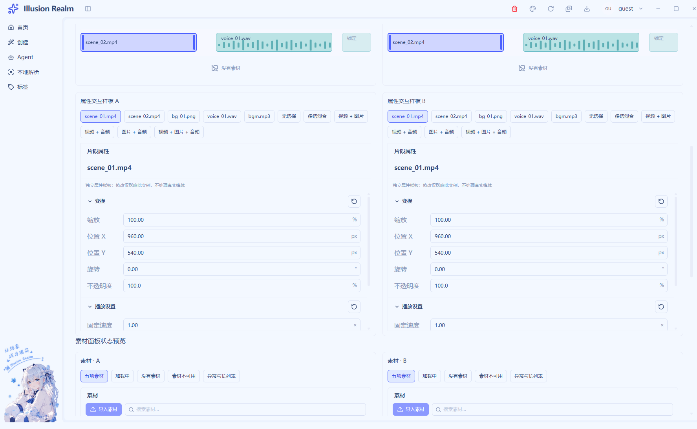

# UI-05 属性检查器实施记录

日期：2026-11-04｜状态：已实施，等待统一验收｜UI-08 保持待办

## 实现、复用与业务边界

复用 `ClipInspector → EditorGroup → EditorFloatField`，删除旧固定字符串属性行。检查器接收 `targets/project/onCommit/onReset`；正式入口只从时间线片段适配目标，不能被素材列表高亮或播放书签覆盖。目标使用片段 ID，同源多实例不合并。

| 对象 | 有效内容 | 来源与边界 |
| --- | --- | --- |
| 视频 | 变换、固定速度、淡入淡出 | 效果默认值与 `end-start` 安排长度分开 |
| 图片 | 变换、安排时长 | 不赋予虚构源时长；正式图片导入未接通 |
| 音频 | 音量、淡入淡出 | 分离音轨适配为 audio；素材库保留原视频类型和探测事实 |
| 无选择 | 项目宽高、帧率、实际总长 | 不回落到 scene_02 或已删除对象 |
| 多选 | 类型有效字段的交集 | 混合值“—”；视频+图片为变换，视频+音频为淡入淡出，其他组合可为空交集 |

默认位置为项目像素中的画面中心，例如 1920×1080 对应 X=960/Y=540，与当前预览 CSS 尺寸无关。已有确认值通过独立 `values` 覆盖，缺省才取默认值；正式工程尚无效果写入契约，因此不传提交/重置回调，字段原生禁用并解释原因。**表单完成不代表画布变换、淡化、速度或音量效果已生效。**

字段支持临时字符串草稿、单位、精度、范围与就地错误；Enter/失焦提交，Escape 恢复，非法值不污染确认状态。混合框未输入失焦不统一为零；主动输入即使等于代表值也更新目标集合。分组重置只重建内部字段，清掉错误草稿并保留分组展开。

新增 `editor-property-model.ts`、`editor-inspector.tsx`、`editor-inspector-samples.tsx` 和 `scripts/lib/check-video-ui-inspector.js`；接通原 panels、controls、正式/演示装配与双语词条。淡入淡出复用同一字段机制，提交目标和样板局部值独立。公共字段保留漫画双击/F2 解锁用法，相关调用方有回归。

## 验证与截图

独立 samples 的 A/B 检查器局部覆盖值与正式工程隔离。首轮专项 **13/13**；最终完整 UI **139/139**，覆盖非法草稿、Escape、小数失焦确认、默认重置、混合统一、类型组合、空选择、A/B 隔离及旧视频/GIF 宿主。证据为真实 Electron 的公开 DOM 输入和焦点，未冒充实际媒体效果或人工系统键盘。

实际修复默认确认值没变时重置无法清错，以及空预览样板继续传旧片段时间的问题。首次专项因隐藏窗口未启用焦点模拟，失焦前读到草稿；补齐 Chromium 前提后通过，没有修改产品预期迁就断言。

最终静态导出指纹 `9cef280dbb667f296af679f10e2317985b1913dfeb59e76946f346d31f760888`，860 输入文件。[UI 日志](runtime/ui-05-07/editor-ui.log)、[统一核查](verification.md)。

## 检查、注释与未验证

类型、Lint（0 错误/33 既有警告）、Next 构建通过；全量 check 仍被三个既有未引用词条阻断。三个任务的增量业务有效注释率 **70.00%（C1092/B468）**，测试 **70.18%（C546/B232）**；基线、逐文件范围、20 行保守剔除与哈希见 [注释审计](ui-05-07-comment-audit.json)，[函数核查](ui-05-07-function-audit.json)。例如用表格模板解释默认与覆盖，用叠在一起的不同表格解释混合框未输入不应填零。

正式工作区未接效果写入、图片/独立音频导入及时间线多选；多选属性在样板验证。画布拖动/X/Y 同步、轨道叠放及预览/导出一致性列入 [独立待办](canvas-transform-composition-requirements.md)。人工完整键盘路径、系统缩放与扬声器试听仍未验证。
