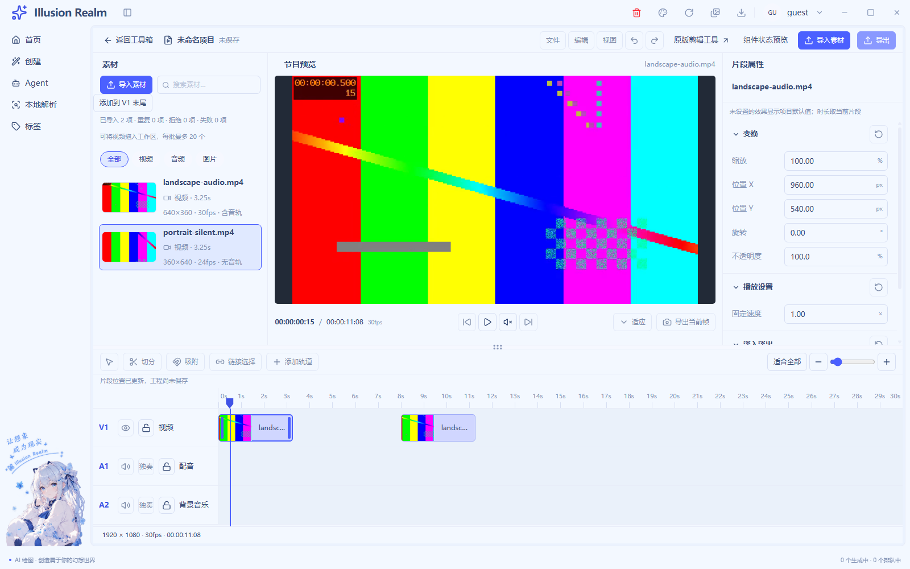
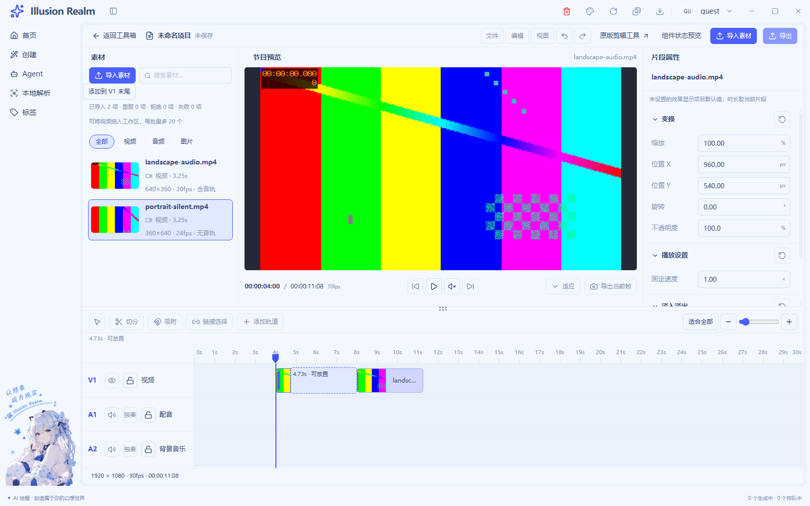

# UI-06 时间轴 UI 实施记录

日期：2026-11-04｜状态：已实施，等待统一验收｜UI-08 保持待办

## 实现与复用

沿用 `EditorTimeline / TrackHeader / TrackRow / EditorClipShell` 与 LIVE 的整数帧、片段 ID、命令和时间模型。素材入轨、移动、复制、删除与音轨分离继续调用共同校验，不创建第二套工程数组。

| 能力 | 接入 | 保留边界 |
| --- | --- | --- |
| 缩放/适合全部 | `use-timeline-viewport.ts` 改像素密度、恢复左端时间锚点；fit 用真实内容宽 | 不改片段秒数、帧率或总长；包含现有编辑余量 |
| 横纵滚动 | 标尺、片段、落点、播放头同一列；轨道头横向 sticky、纵向跟随网格行 | 不用两份 scrollTop 互相追赶 |
| 锁轨 | 同时保护拖放、键盘、右键和提交；解锁保留实例 ID | 编辑保护不等于可见/静音效果 |
| 播放书签 | 标尺点击/拖动、方向键一帧、Shift 一秒、Home/End、Escape | 工程书签、素材时钟、属性选择独立；单源查看 |
| 媒体映射 | 工程秒减 start 得源偏移，实际 timeupdate/ended 回报 | 显式定位版本防止回流重复 seek；重试加载后重新定位，不自动播放 |

新增 `editor-time-ruler.tsx`、`use-timeline-viewport.ts` 与 `scripts/lib/check-video-ui-timeline.js`；修改原时间轴、LIVE 模型/Hook、源预览、正式装配、CSS 与双语词条。菜单键盘解释与状态编排按职责拆分，普通函数正常展开不超过 30 行。

按用户前置要求接通真实播放起点，实际媒体事件推进工程蓝线。素材查看保持独立时钟；只播放当前安排，无多轨合成或自动接播，空隙黑场。复制/分离从新实例起点查看；删除末段将书签夹回新总长。缩放或锁轨先取消旧手势，防止旧比例/快照迟到提交。

## 碰撞与完整长度反证

负起点贴零，同轨碰撞找最近完整空位，等距优先较早位置；鼠标草稿、提交、键盘共用解析器。六秒片段、障碍 `[8,14)`：请求 4→**2**，-1→**0**，9→**14**，100→**100**。障碍和完整长度不变。严格 apply 仍拒绝 `[4,10)` 重叠，分离音轨不为避碰撞偷偷挪位置。这是边界放置规则，不是新增通用磁吸。

真实原案例首段移动后 `[4,7.2666666667)`，第二段 `[8,11.2666666667)`，仍为 98 帧完整占位和 **22 帧间隙**。源 3.25 秒与向上对齐的工程占位分开，未缩短片段迁就结果。[实际起止](runtime/ui-05-07/placement-facts.json)。

## 实际验证与截图

最终真实媒体回归 **75/75**，覆盖真实导入/探测、解码播放、书签映射、缩放不改秒数、fit、锁轨、同轨拖放、Escape、横滚、复制/删除/分离、音轨试听及退出清理。[运行日志](runtime/ui-05-07/live-02.log)，指纹与 [UI-05](ui-05-implementation.md) 相同。

专项在拖动 Escape 前运行：离屏 Chromium 原生拖动取消后不可靠地投递后续 CDP 鼠标，明确调整验证顺序，未替产品编造定位成功。纯模型转译 ES2022 保留 Set 迭代；非法载荷按最新合法快照核对，未放宽时间、长度或严格碰撞预期。

证据分别来自真实本地 H264/AAC、生产探测、Chromium 内部输入、DOM 键盘及纯模型反例，没有当成人工系统操作。

类型、Lint、构建通过；完整检查既有阻断见 [统一核查](verification.md)。三个任务增量业务注释率 **70.00%**、测试 **70.18%**，见 [审计](ui-05-07-comment-audit.json) 和 [函数核查](ui-05-07-function-audit.json)。停车位类比解释完整长度不能挤占障碍，信封盖章类比解释版本防止进度回流重复定位。

## 仍禁用及未验证

修剪、切分、通用吸附、加轨、链接选择、撤销、多轨合成/自动接播、保存、导出、云端未接通。轨道可见/静音/独奏继续禁用并说明原因；样板波形仅为示意，正式分离音轨用音符，不冒充真实采样。

人工 Explorer 拖入、人工鼠标/键盘完整路径、声卡试听与系统缩放未验证。LIVE-01 按钮导入和单源预览继续正常，外部文件落到 V1 仍只入库。
