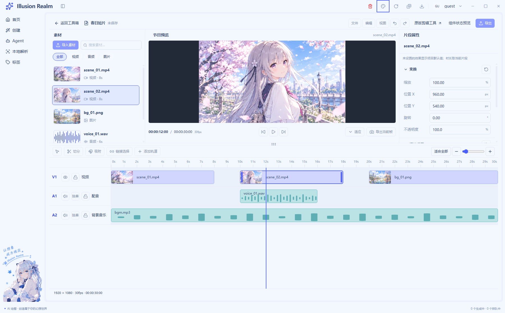
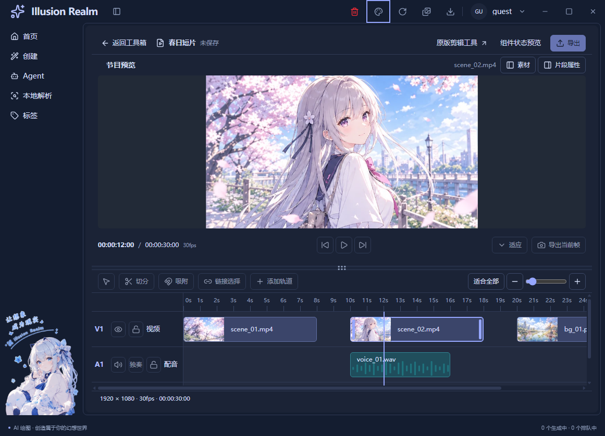

# UI-07 深浅主题与响应式实施记录

日期：2026-11-04｜状态：已实施，等待统一验收｜UI-08 保持待办

## 布局、复用与独立业务

正式入口与演示工程共用 `EditorWorkspace`、素材面板、预览、检查器、按钮和时间轴。新增 `use-workspace-layout.ts` 只持有局部开合/高度；工程数组、素材高亮、字段草稿、播放器生命周期继续独立。`EditorWorkspace` 通过 render 插槽向静态节目和真实源预览注入相同面板入口，内容/状态/动作通过参数和回调注入，没有复制窄窗专用组件。

- 容器 `<1280px` 属性临时展开，`<1040px` 素材也临时展开；依据真实 main 宽度，导航占位不重复扣除。
- 临时面板使用原 DOM 和内部滚动，仅覆盖 upper，不盖时间轴/nav，不加全窗口模态遮罩。
- 单一 open 值保证互斥。关闭回本次真实触发按钮；扩宽转常驻时焦点回节目预览，不回已隐藏入口。
- 隐藏内容 `display:none`，不参与浏览器键盘布局。自动焦点验证与人工完整 Tab 路径分开报告。
- R05 保持 8px 命中，指针捕获/取消、方向键 10px、Shift 40px、Home/End/Escape；抓在条内第 4px 首动不跳。
- 上区至少 260px、时间轴 202px、宿主 544px，固定项目栏/分隔/信息条预算 82px。窗口变矮夹回合理范围，正常高度各区内部滚动，极矮宿主整体纵滚。

## 实际主题与尺寸矩阵

沿用 `themeSignals → nativeTheme.themeSource → prefers-color-scheme` 和语义变量，同一 DOM/数据/交互切换主题，无第二套 dark 状态或暗色滤镜。焦点遵循公共语义色，不整体缩放控件。

最终完整 UI 回归 **139/139**，覆盖三容器浅深矩阵、nav 实际开合、分隔指针/键盘、面板互斥/焦点、长名称/错误样板、legacy/GIF 宿主。正式真实媒体另有回归，见 [统一核查](verification.md)。

| 目标编辑器容器 | 浅色实测 | 深色实测 | 整体横向溢出 |
| --- | --- | --- | --- |
| 1600×1000 | 1600.25×1000 | 1600.25×1000 | 均无 |
| 1280×800 | 1280.25×800 | 1280.25×800 | 均无 |
| 960×720 | 960.25×720 | 960.25×720 | 均无 |

小数来自宿主边框/实际布局；PNG 还包含 nav、标题栏和底部状态，不能用其外部尺寸代替容器。时间轴内部横滚是合法滚动，非整页溢出。[布局 JSON](runtime/ui-05-07/ui-07-layout.json)。

抽测 R03 标题、R01 项目名、R10 信息文字，按实际浏览器颜色混合和 sRGB 相对亮度计算，浅色最低 **8.24:1**、深色最低 **11.64:1**，均超过普通正文 4.5:1。仅为三类文字抽测，未声称穷举悬停和禁用状态。[浅色](runtime/ui-05-07/ui-07-contrast-light.json) / [深色](runtime/ui-05-07/ui-07-contrast-dark.json)。

减少动态通过 **CDP 媒体偏好模拟**验证：公共等待图标停止动画，保留文字。不是人工切换 Windows 偏好的证据。实测 DPR=1；Windows 125%/150%、多屏与前台遮挡未验证。

## 真实运行截图

下面是实际 Electron 静态导出像素，画面和波形属于独立演示工程，不是实际合成输出。真实视频帧见 [UI-06](ui-06-implementation.md)。

其余：[浅1280](runtime/ui-05-07/ui-07-light-1280x800.png)、[浅960](runtime/ui-05-07/ui-07-light-960x720.png)、[深1600](runtime/ui-05-07/ui-07-dark-1600x1000.png)、[深1280](runtime/ui-05-07/ui-07-dark-1280x800.png)。截图已实际打开核对。

## 检查、注释与保留边界

类型、Lint（0 错误/33 既有警告）、Next 构建通过。全量 check 仍有三个既有词条阻断，见 [统一核查](verification.md)。业务增量有效注释率 **70.00%（C1092/B468）**、测试 **70.18%（C546/B232）**，人工复核后保守排除 20 行重复概述。[逐文件审计](ui-05-07-comment-audit.json)、[函数核查](ui-05-07-function-audit.json)。用“上下抽屉的活动隔板”解释高度预算，以扩宽后旧入口隐藏解释焦点回落规则。

布局偏好不写用户 JSON、不另建持久化。未新增效果写入、修剪/切分/吸附、多轨合成、撤销、保存、导出和云端；人工键盘、Explorer 拖入、系统缩放、扬声器试听、操作录屏仍未验证。画布变换/叠放已列 [独立待办](canvas-transform-composition-requirements.md)。完成 UI-07 后停下，UI-08 不推进。
