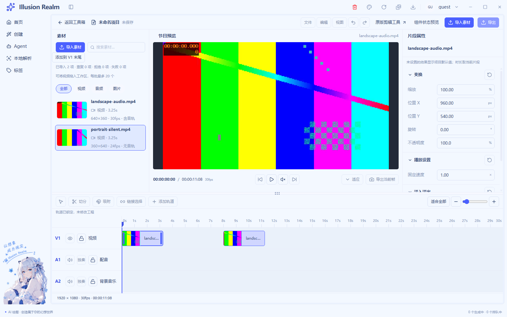
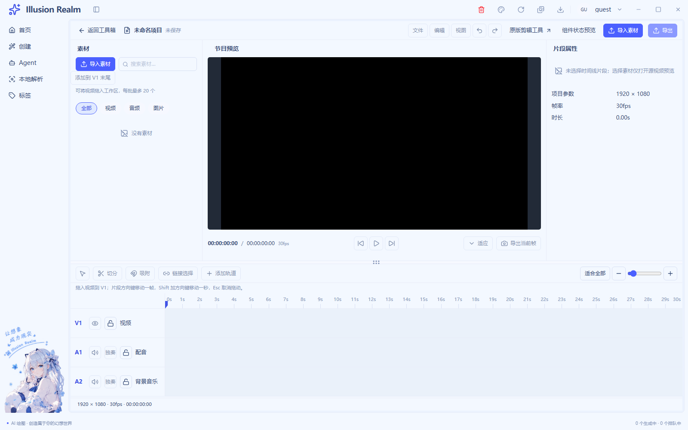
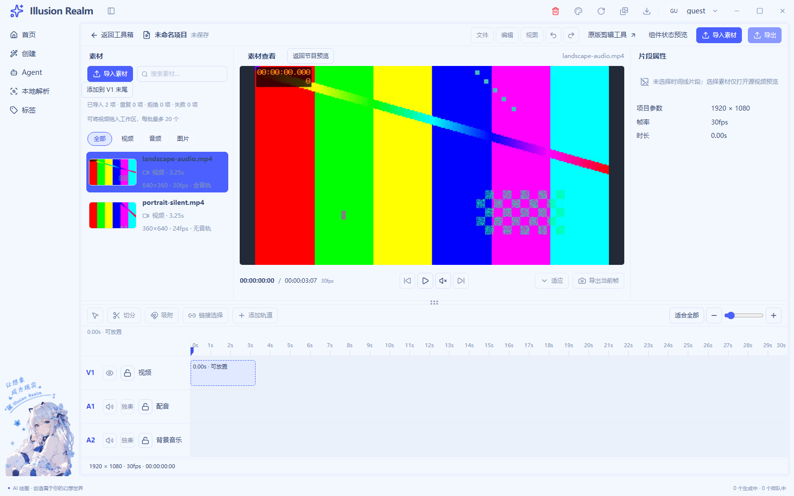
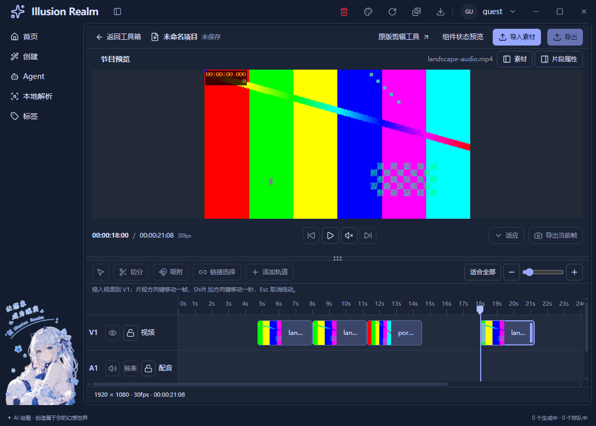

# UI-08 页面装配与 UI 验收实施记录

日期：2026-11-04｜状态：**自动验收完成，人工项待验**。完整 `pnpm check` 未通过，不能称全部验收通过。完成后停止在 UI-08。

## 范围、复用与集成修复

核对根 AGENTS、comment-coverage、nextjs-renderer、interface-ui-design、ui-parameter-reuse，以及 README、verification、UI-05–07 和 LIVE-03 实施记录与实际代码。保留已有工作区修改，没有继续开发画布变换、合成、工程保存或导出。

正式入口继续复用 `EditorWorkspace / MediaPanel / MediaItem / ProgramPreview / LiveSourcePreview / ClipInspector / EditorTimeline / EditorClipShell`，右键继续走公共 `ContextMenuShell`。没有新建第二套素材行、预览容器、按钮、工程数组或时间模型。素材、片段和属性目标按稳定 ID 关联，不按文件名猜引用；工程时长仍从实际安排的最晚 end 计算，项目信息和走带读取同一工程参数。

| 集成点 | 实际处理 | 保留边界 |
| --- | --- | --- |
| 导入遮罩残留 | 删除外层dragging状态与整页遮罩/CSS/废弃双语词条；Files仍经同一startImport和preload路径解析 | 轨道内部stopPropagation不再使上区残留“松开导入视频”；外部落V1仍只入库 |
| 无内容画布 | 公共ProgramPreview新增最小`emptyPresentation`参数；正式入口选black，空工程/黑场不挂占位图标文字且frame纯黑 | 样板默认message，加载/缺图/探测或解码错误不被安静画布吞掉；时间语义仍保留 |
| 目标轨锁漏洞 | applyTimelineEdit接收当前锁表，统一重查源锁；分离排除已锁目标轨，A1锁定可原时段进入A2，两者都锁明确trackLocked | 拒绝不静音视频、不新建音轨、不切源；可选空锁表兼容旧模型调用 |
| 素材/片段/属性/预览 | 素材高亮和源查看仍由素材会话管理；检查器跟selectedClip，节目播放对象跟工程书签 | 主动查看素材不创建安排；同源多实例独立；属性真实效果提交继续禁用 |

差异经参数、标题插槽、动作回调注入。布局开合/分隔、素材导入/选择、时间线安排/锁表、属性草稿和媒体生命周期分别保持独立；共用展示不合并这些业务状态。

## 本轮文件

- 业务：`video-editor-view.tsx`、`editor-panels.tsx`、`editor.module.css`、`live-timeline-model.ts`、`use-live-timeline.ts`；双语 `i18n/locales/{zh-CN,en}/toolBox.ts`。
- 测试：扩展既有 `scripts/smoke-video-live-02.js`，新增 `scripts/lib/check-video-ui-integration.js`；共用原启动、真实样本和公开DOM/CDP驱动，不复制启动器。
- 文档：README、verification、本记录、注释/函数审计；[画布/叠放独立任务](canvas-transform-composition-requirements.md)补齐四个任务的依赖与验收条件，全部待办。

## 自动验证与真实数据

最终静态导出指纹：`263eb096c2af7cfb384cf1c50b0ae9f2c94b46bf2e4da353eb35345dc1f4f850`，860个输入。所有Electron回归串行运行，未关闭用户应用；结束仅保留原用户Electron进程树，未留下本轮冒烟窗口。日志摘要追加到项目 `logs/smoke-runs.log`。

| 检查 | 实际结果 | 证据 |
| --- | --- | --- |
| pnpm typecheck | 通过（完整check中再次通过） | [日志](runtime/ui-08/ui08-typecheck.log) |
| pnpm lint | 0错误、33个既有警告 | [日志](runtime/ui-08/ui08-lint.log) |
| Next静态构建 | 通过，运行产物与源码指纹一致 | [日志](runtime/ui-08/ui08-build.log) |
| LIVE正式工程 | **89/89** | [日志](runtime/ui-08/ui08-live02.log) |
| UI样板/旧视频与GIF宿主 | **139/139** | [日志](runtime/ui-08/ui08-editor-ui.log) |
| LIVE-01原生选择框 | **19/19**，Explorer人工拖入SKIP | [日志](runtime/ui-08/ui08-live01.log) |
| 漫画公共字段/宿主 | **54/54** | [日志](runtime/ui-08/ui08-cartoon.log) |
| 旧视频实际FFmpeg区间/导出 | **9/9** | [日志](runtime/ui-08/ui08-ranges.log) |
| GIF真实导入/FFmpeg导出 | **50/50** | [日志](runtime/ui-08/ui08-gif.log) |
| pnpm check | **失败**，本轮重新运行；类型与Electron模块/通道先通过，在check:gates停止 | [日志](runtime/ui-08/ui08-check.log) |
| check:meta单独补跑 | **失败**，见下节，不因check早停而遗漏报告 | [日志](runtime/ui-08/ui08-meta.log) |
| check:i18n / check:i18n:en / check:locale-keys | 通过；21处硬编码低于基线66；英文未翻译771/2834在允许基线内；18命名空间键一致 | [中文](runtime/ui-08/ui08-i18n.log)、[英文](runtime/ui-08/ui08-en.log)、[键](runtime/ui-08/ui08-keys.log) |

check早停后的outputpath、foldercount、locale、smoke规则、脚本引用、初始locale注入也单独执行通过，不将其写成完整check通过。

89项正式回归覆盖：两个真实视频导入与元数据、搜索无结果/精确命中/音频筛选/恢复、素材查看与返回、同源多次入轨、片段选择与属性/素材隔离、抓取偏移、边界与碰撞、Escape、横滚落点、复制/删除、音轨分离与真实单源播放、缩放/fit、源锁与目标锁、外部Files只入库、坏文件/重复/取消/清理、主题容器与导航开合。新增反证检查内部hover期间媒体节点身份和节目文字均不变；外部文件hover也不出现整页遮罩。正式工作区扫描无样板文件名，导出和真实效果字段禁用。

两份样本是FFmpeg编码的真实磁盘视频，经生产探测/协议/Chromium媒体事件：横屏640×360、30fps、含AAC；竖屏360×640、24fps、无音轨。源容器3.25秒，工程30fps占98帧。独立 [ffprobe事实](runtime/ui-08/media-facts.json) 和 [起止/间隙](runtime/ui-08/placement-facts.json) 可核对；完整长度未被缩短迁就碰撞。

六组正式容器浅深矩阵：1600×1000、1280×800、960×720，实测宽为目标+0.25px，均无整页横溢出；导航开合、长标题、错误样板、紧凑面板互斥/焦点返回、隐藏内容、上下分隔指针/键盘边界继续通过。[浅色布局](runtime/ui-08/layout-light.json)、[深色布局](runtime/ui-08/layout-dark.json)。同组件A/B草稿/重置/混合值独立回归在139项样板中，不能当正式效果已生效。

## 失败与修正记录

- 全量check实际仍有三个未引用词条：`auth.verifySuccess`、`common.localeNameSelf`、`create.generationTasks.active`。它们不在本轮修改区域，未为通过门禁顺手删除词条。
- 独立Meta检查把 `MetaFieldRow.tsx` 中 `{/* 弹窗：当前字段全文，保持原始/JSON 选择同步。 */}` 判成中文字段字面量，失败1项。该文件/检查器本轮未改；真实语料golden baseline不存在而跳过，也不写为通过。
- 本轮新增驱动初跑两次失败：恢复“全部”后立即读第二行抢在React更新前；分离菜单标签写成了概念名而非真实aria-label。分别补有界等待、改用正式标签后重跑通过，未修改产品预期或片段长度。最终新加无演示/禁用断言后整套89/89再次通过，没有用重复重跑掩盖断言失败。

## 证据层级、人工与未验证

- **真实数据自动验证**：实际磁盘文件、生产ffprobe/协议、真实媒体loaded/timeupdate/播放暂停/切源/清理；旧视频/GIF实际输出独立探测。
- **原生系统框自动化**：LIVE-01通过Windows UIAutomation真正打开多选和取消，不替换showOpenDialog结果；这仍不是人工点选。
- **自动事件/夹具**：LIVE-02按钮选择结果为路径夹具；Chromium内部鼠标拖动、CDP外部文件载荷和DOM键盘/菜单分别记录，不等同Explorer真实拖入或人工完整键盘路径。纯模型锁/碰撞反证也不等同实机操作。
- **人工实机验证**：本轮没有新增用户手工操作证据；已打开实际capturePage图片作视觉核对，不把看截图当人工操作链验收。
- **仍未验证**：用户桌面占用条件下Explorer实际拖入、人工完整Tab/快捷键路径、系统125%/150%缩放与多屏、扬声器实际试听、前台遮挡和操作录屏。没有接管用户鼠标，没有用DOM/CDP补项后称人工通过。当前DPR=1不代表系统缩放已测，节点释放不代表已量化解码内存/显存释放。

## 正式工作区真实截图

下面为本轮Electron静态导出的真实视频画面；测试条纹已编码到本地H264视频，非设计稿或合成演示截图。截图已打开核对，保留应用壳和导航。

另见[外部文件hover无整页遮罩](runtime/ui-08/ui-08-file-hover.png)、[实际拖动后](runtime/ui-08/live-02-after-move-light.png)、[分离真实音轨](runtime/ui-08/live-03-audio-detached.png)、[解码错误保留元数据](runtime/ui-08/live-01-decode-error-dark.png)、[紧凑素材](runtime/ui-08/ui-07-compact-media.png)、[互斥属性](runtime/ui-08/ui-07-compact-inspector.png)。[来源与哈希清单](runtime/ui-08/evidence-manifest.json)记录最终套件目录、构建指纹和证据级别。

## 能力分类与停止边界

| 分类 | 能力 |
| --- | --- |
| 已实现 | 真实视频按钮多选/Files导入、探测/封面/失败元数据、搜索筛选、单源真实播放暂停、独立素材/片段选择、V1创建/移动、复制/删除、非破坏音轨分离/单源试听、工程书签、缩放/fit/横纵滚动、锁轨、公共右键、主题/紧凑面板/分隔 |
| 仅UI | 属性类型/默认值/混合值/草稿/范围错误/重置在独立A/B样板可演示；正式属性显示实际片段长度与效果默认值但效果编辑禁用；项目名/未保存标识不等于工程落盘 |
| 未接通 | 画布拖动/X/Y双向提交、不透明度实际叠放、多轨合成/自动接播、正式效果参数写入、修剪/切分/通用吸附/撤销、跨轨移动/加轨/链接选择/时间线多选、轨道可见/静音/独奏、独立音频/图片导入与真实波形、帧导出、工程保存/导出/云同步 |

未接通的现有按钮继续禁用并保留原因；没有新增占位动作或假成功提示。旧视频/GIF回归中的导出是原工具能力，不是新编辑器已经开放导出。[后续任务](canvas-transform-composition-requirements.md)的CANVAS-01/02、COMPOSE-01/02均有依赖和验收条件，本轮未实施。

## 本轮增量注释率与函数核查

以本轮开始前工作区快照为基线，新增helper全文、修改文件仅新增/替换后的行；已有UI-05–07改动不计。纯注释C、代码/混合行B，删除/空行/未变上下文排除。人工复核说明与实际行为，并保守剔除3行重复概述。

- 业务 **C46/B19 = 70.77%**。
- 测试 **C133/B57 = 70.00%**。

[逐文件审计](ui-08-comment-audit.json)、[函数长度](ui-08-function-audit.json)：正常展开后普通函数不超过30行，JSX装配按根规则豁免，内部事件仍核对。有效说明例如“锁像每个抽屉各自的封条”，解释源/目标写入权限；测试说明空闲目标轨前置，排除碰撞导致的假锁通过。临时统计工具不进入产品代码。
