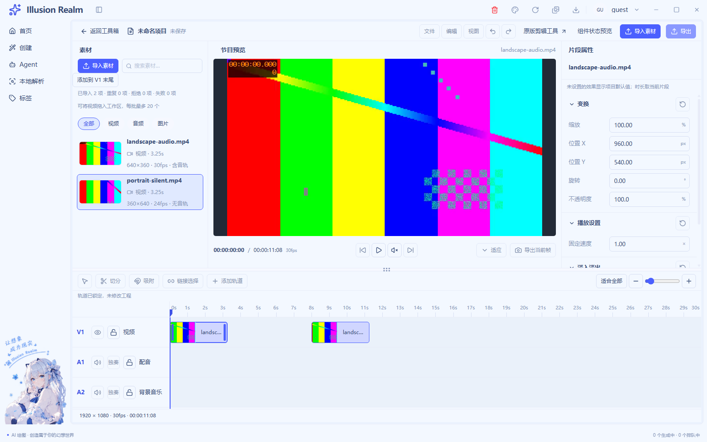
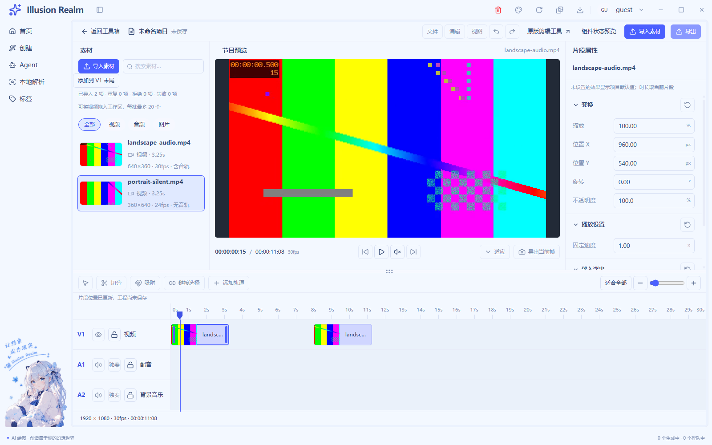
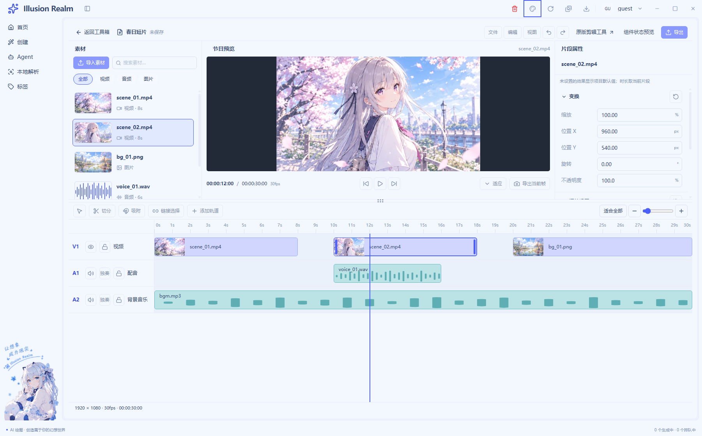
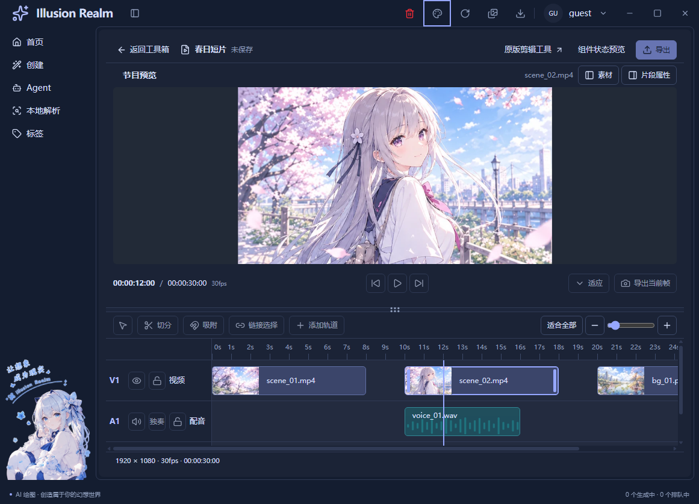

# 视频编辑器核查记录

最新追加（2026-11-05）：[参考片段样式与共用级联菜单](reference-ui-implementation.md)已接入。视频74px/40px方格帧带、音频52px深蓝上包络、细浅选框、紧凑轨道头和裸图标工具条；十二分类固定间距与左右溢出翻页；五项画面工具仅随时间线视觉片段显示。右键基础编辑与创建页翻译**实际共用CascadeMenu**，侧向展开、边缘换向、窄窗返回和方向键导航。最终真实视频213/213、翻译78/78；公共UI139/139。类型、lint（0错误/33既有警告）和构建通过；check仍在三个既有词条失败。**功能自动回归完成，人工项待验，注释质量门槛未通过**：业务/测试候选上限23.3831%/22.8070%，不冒充有效率。[截图与日志](runtime/reference-ui/evidence-manifest.json)。此前人工缺项不改为通过，未接业务维持禁用；下方保留各阶段历史结果。

## 片段基础工具、关键帧与固定方格（2026-11-05，当前结果）

正式入口已接通定格插入、真实倒放、镜像、90度旋转、画布拖框裁剪，属性菱形记录五种构图数值并线性插值。时间线固定56×56方格，缩放只改覆盖时间；标题16px、帧56px、波形16px加2px边框共90px。公共菜单、按钮、属性、片段壳和媒体时钟沿用原实现；新增工程分割/左右删除、选择工具、剪贴板及100步撤销/重做。六分类入口中未接通业务明确说明，非假资源。

**状态：功能自动回归完成，人工项待验；注释质量门槛未通过，本轮不标记全部完成。** 业务候选C331/B793=29.4484%，测试候选C103/B221=31.7901%，只是扫描上限，即使全部有效也不足70%，没有冒充人工认证有效率。按任务开始工作区快照只计新增/替换行与新增文件全文；逐文件范围、基线与哈希见[注释审计](timeline-edit-tools-comment-audit.json)。正常展开普通函数最长30行，JSX装配另列，[函数记录](timeline-edit-tools-function-audit.json)。

最终静态构建指纹 `12ef0408e8da2d0fab4cc8c67a9000e75fe88ddf7689175f3760de185d001c55`，887输入。最终串行Electron真实视频 **202/202**、公共UI/A-B/原视频/GIF宿主 **139/139**；本轮前一次构建的LIVE-01系统框与Explorer **20/20**，之后仅增源码注释和纯模型测试，未改变导入行为。真实横屏640×360/30fps/AAC与竖屏360×640/24fps无音轨均实际探测和解码；关键帧连续播放、倒放源时间减少、定格跨工程时间保留同源帧、裁剪内容层和锁轨已自动验证。

LIVE-02按键/拖动为DOM或CDP事件，选择结果为夹具；LIVE-01实际操作Windows选择框多选/取消与Explorer OLE拖入，日志记录系统动作成功。**二者都不是人工手动验收**。UI-08完整人工操作、系统125%/150%缩放、多屏、真实系统遮挡/最小化、扬声器试听和录屏继续待验，不能用自动事件补写通过。镜像并旋转后的裁剪组合、大源长GOP、多路4K压力未测。

类型、全量lint（0错误/33既有警告）、Next构建、纯模型反证、双语键、中英文文案基线、脚本引用和冒烟规则通过。最终重新执行`pnpm check`仍退出1，在既有 `auth.verifySuccess`、`common.localeNameSelf`、`create.generationTasks.active` 未引用词条处停止，未宣称后续全链通过。独立Meta补跑退出1，未修改的`MetaFieldRow.tsx`中文JSX注释扫描失败，真实golden缺少而跳过。四秒/八秒移动仍为两段各98帧、22帧间隙，没有缩短片段迁就碰撞。

[真实工作区](runtime/timeline-edit-tools/editing-final-real-workspace.png)、[关键帧](runtime/timeline-edit-tools/editing-keyframe-real-frame.png)、[定格](runtime/timeline-edit-tools/editing-freeze-real-frame.png)、[裁剪](runtime/timeline-edit-tools/editing-crop-real-frame.png)、[Explorer实际拖入](runtime/timeline-edit-tools/live-01-explorer-drop.png)、[日志/构建/视频哈希](runtime/timeline-edit-tools/evidence-manifest.json)。截图已打开核对；实现、文件、复用和限制见[本轮记录](timeline-edit-tools-implementation.md)。节目保持静音，保存、导出、混音、真实图片/音频导入、文本/特效/转场/字幕业务、淡入淡出、通用吸附及链接选择仍未接通。本轮停止，不继续开发。下方为历史记录。

## 多视频轨合成预览（2026-11-05，当前结果）

三个任务已连续实施：明确tracks顺序、半开有效区间与会话显隐 → 复用原节目/画布的真实多视频层与统一工程时钟 → 交互、错误及原场景回归。上轨覆盖下轨，选择不置顶；锁层继续显示但不可编辑。节目强制静音，素材查看保留单源试听并互斥挂载。COMPOSE-01 **自动验收完成，人工项待验**；COMPOSE-02、混音、真实图片导入、保存/导出仍待办。

最终静态导出指纹 `52b9513fbe9f15e2fc8576c547f3432a014881aa0c1499618fa3136c0f8233c0`（878输入）。串行Electron：真实媒体/画布/时间线/合成 **180/180**、公共UI/A-B/原视频/GIF宿主 **139/139**、LIVE-01选择结果夹具 **19/19**。实际640×360/30fps/AAC和360×640/24fps无音轨本地编码视频走生产探测和浏览器解码；源FFV1探测成功/解码失败单独验证元数据保留、错误遮旧帧、重试与删除恢复。真实双层播放、空隙持续走钟与后段暂停的工程/源时间已归档。浅深截图已打开核对，非静态DEMO图。

类型、lint（0错误/33既有警告）、Next构建、双语键、中英文文案基线、输出路径、目录计数、locale/初始参数、脚本引用与冒烟规则通过。重新`pnpm check` **退出1**，在三个既有未引用词条 `auth.verifySuccess`、`common.localeNameSelf`、`create.generationTasks.active` 停止；前置类型/Electron模块通道通过，后续链按独立命令补跑，不称全链通过。独立Meta检查仍**退出1**：原`MetaFieldRow.tsx`中文JSX注释误判，真实golden语料缺少跳过。本轮未修改该文件。

开发中发现：专项轨道DOM身份误判、静音说明挤窄控制、旧音轨断言不符新静音契约、前序256px/s缩放使6s落点屏外；分别修正真实布局/测试前提，不改源时长迁就错误。截图复核另发现只写nativeTheme的“light”图仍为深色，改为正式外观菜单+主题快照断言后完整重跑180/180，最终归档只用修正后的证据。

增量业务 **C638/B273 = 70.0329%**，测试 **C358/B153 = 70.0587%**；按任务开始工作区快照统计，人工剔除20/22行重复概述，普通函数正常展开最长29行。[逐文件及剔除记录](multi-video-composition-comment-audit.json)、[函数记录](multi-video-composition-function-audit.json)。

证据明确分层：CDP/DOM自动事件、选择结果与document.hidden通知夹具、生产媒体解码各有职责；本轮没有新的人工桌面验收或录屏。UI-08的Explorer OLE拖入、完整人工鼠标/键盘、系统125%/150%缩放、多屏、前台遮挡及扬声器试听继续未验证；不能把可见性通知夹具写成Windows遮挡/最小化实测。A/B公共控件与同源实例已回归，两个完整真实合成工程并排压力未测试。默认五轨/40ms节拍不保证多路4K实时或离线逐帧精确合成，性能限制见[完整实施记录](multi-video-composition-implementation.md)。

[真实叠放截图](runtime/multi-video-composition/compose-light-real-video.png)、[深色窄窗](runtime/multi-video-composition/compose-dark-real-video.png)、[播放原始媒体时间](runtime/multi-video-composition/compose-playback-evidence.json)、[独立探测](runtime/multi-video-composition/media-facts.json)、[构建与文件哈希](runtime/multi-video-composition/evidence-manifest.json)。以下记录保留历史状态，不用于覆盖当前能力或取消人工待验。

## 时间线三层片段与真实源波形（2026-11-04，最新追加）

正式片段按参考分为16px名称/时长、40px连续帧、16px真实波形和两像素细边框；轨道头/内容共用90px行高。帧带锚定源时间格，裁掉与恢复内容时和源波形同步。分离音轨复用同源峰值，无音轨/加载/失败分别表达。声音图为振幅包络，不是音高分析。原左右修剪边界、锁轨和唯一时间模型保留。

最终静态构建指纹 `3cf2ae3a4d018f63b3ec001e90c1e3a20d71b0f2ebf9bfd8b180f80f4fb74010`（874输入）。串行Electron正式真实媒体 **160/160**、公共UI/A-B/原视频/GIF宿主 **139/139**；类型、lint（0错/33既有警告）、Next构建、双语键、文案基线、脚本引用和冒烟规则通过。统一check仍因三个既有未引用词条退出1，未运行的后续链不写成通过。

真实AAC三段信号读出0/0.0197455/0.3950621，独立于页面布局断言；截图来自实际视频解码。自动CDP、DOM和选择结果夹具不等同于人工系统操作。早期失败与前置修正、源包络限制、未验证及截图见 [本轮实施记录](timeline-three-layer-implementation.md)。业务/测试有效增量注释率 **70.43% / 70.59%**。UI-08人工拖入、完整键盘、系统缩放、多屏及扬声器试听继续待验；本轮未启用保存、导出、切分、吸附、混音与淡入淡出。下方原“未接波形”等说明为此前历史能力快照。

## 左右边缘在源内容内修剪（2026-11-04）

右边最多恢复源结尾；左边调整源入点，向左可恢复被裁掉的头部，继续遵守同轨邻居与锁轨限制。原trimClip统一服务鼠标/键盘，修复小数倍速下尾格恢复少一帧和源入点被重复取整的漂移。真实媒体与模型混合回归 **151/151**；类型、lint（0错/33警告）、Next构建通过，重新check仍被三个既有未引用词条阻断。业务/测试增量注释率 **80.00% / 70.00%**。详见 [实施与证据分层](trim-source-bounds-implementation.md)，原人工未验证项不变。

## 紧凑素材卡与宽屏播放器（2026-11-04，最新要求）

按最新参考覆盖下方历史比例：素材卡固定112×94，首帧完整显示，右上角分秒时长、左下文件名，选中仅1px青框和两侧短线。宽屏素材区300–420px，其余宽度优先给播放器。复用原MediaItem、首帧提取和分秒格式，无新卡片/播放器体系。

实际串行Electron：真实视频 **148/148**，公共UI/A-B/legacy/GIF宿主 **139/139**。独立FFmpeg首帧/1秒参考对实际封面平均通道误差 **0.8084/9.7743**。类型、lint（0错/33既有警告）、Next构建通过。首次帧带等待因目标屏外前提不满足而失败，恢复正常滚动可见前提后完整重跑通过。重新`pnpm check`仍在三个既有未引用词条处退出1，后续链未执行。

业务/测试增量有效注释率 **77.78% / 71.15%**。真实截图、修改文件、复用、检查与人工未验证见 [本轮实施记录](compact-media-card-implementation.md)。UI-08人工拖入、完整键盘路径、系统缩放和试听继续待验；自动事件不写成人工验收。下方比例和尺寸为历史快照。

## 素材区与播放器比例追加（2026-11-04）

桌面多栏节目预览缩至旧余额的三分之二，空间交给素材区；卡片固定140×148，增宽只增加列数。复用原MediaPanel/MediaItem与预览，不改工程时间和构图。当前真实视频串行回归 **145/145**，包含浅深主题及1600/1280/960容器。截图、检查失败边界与注释增量见 [本轮记录](../../create-tags-move-video-layout-2026-11-04.md)。原系统拖入、系统缩放和扬声器人工项保留未验证。下方记录为此前各轮快照。

## 时间线媒体交互与细选框（2026-11-04，追加授权）

正式工作区已接通数值上下拖调、非破坏边缘修剪、同类多轨与当前覆盖区间真实视频层、片段速度和独立预览倍率、逐帧定位、Ctrl＋滚轮时间线缩放、真实有限采样帧带；选中片段持续 1px 细浅框，左右透明热区使用带竖线的方向修剪光标。基础编辑菜单镜像/旋转可用，定格/倒放/裁剪仍禁用。复用原片段壳、素材组件、字段/分组、预览容器、SimpleSelect 和创建页公共菜单，不另造工程时间模型。

最终静态导出指纹 `f1bfe1111e021cd3f6db2a4ca5dadfc97f47a259a75643505babccfe60b43d90`（869 输入）。串行 Electron：真实视频 LIVE-02 **143/143**、UI **139/139**、LIVE-01 **19/19**（选择结果夹具；Explorer 明确跳过）、旧视频 **58/58**、GIF **50/50**、漫画 **54/54**。横屏 640×360/30fps/含 AAC 与竖屏 360×640/24fps/无音轨均走真实探测和浏览器解码；DOM/CDP、纯模型和人工证据分别报告。

中间发现并修正：数字框失焦时内部文字 scroll 被公共菜单误认为页面滚动而立即关菜单；小预览倍速输入被 inline 标签挤窄，现由共享字段 stacked 参数承接；重采样清空画布前先撤销旧 ready，避免失败时掩盖封面。漫画旧断言要求额外 outline，已按共同细边框契约验证内外不叠圈并重跑通过。最终截图已实际打开检查选中框、完整真实帧带与可编辑倍率输入。

typecheck、lint（0 错误/33 既有警告）、Next 构建、双语键、i18n 基线、脚本语法/引用和冒烟规则通过。重新执行 `pnpm check` 退出 1，仍在三个既有未引用词条 `auth.verifySuccess`、`common.localeNameSelf`、`create.generationTasks.active` 停止；独立 Meta 补跑仍在未改的 `MetaFieldRow.tsx` 中文 JSX 注释识别处失败，golden 真实语料缺失而跳过。额外 C站内容访问回归同一“允许内容预览”断言两次失败（非超时），夹具还有未注册 handler 日志；未确认与本轮改动的关联，不写成通过，也不擅自扩展修复 C站业务。

业务有效增量注释率 **70.28%（C1362/B576）**，测试 **70.03%（C631/B270）**；按任务开始前工作区快照，只计新增/替换行与新增文件全文，分别人工剔除 55/28 行重复内容。普通函数正常格式最多 30 行。[注释逐文件与剔除记录](timeline-media-comment-audit.json)、[函数记录](timeline-media-function-audit.json)。

UI-08 人工项继续待验：Explorer OLE 拖入、完整人工鼠标/键盘、真实系统 125%/150% 缩放、多屏、前台遮挡、扬声器试听与录屏。当前双视频层不是连续跨片段合成调度，混音、真实波形、淡入淡出、切分/吸附/撤销、新编辑器保存与导出仍未接。完整实现/未验证、实际截图与日志见 [实施记录](timeline-media-interaction-implementation.md)、[证据清单](runtime/timeline-media-interaction/evidence-manifest.json)。下方保持历史快照，不用于覆盖最新能力或人工未验状态。

## 单源画布变换（2026-11-04，UI-08 后续授权）

片段独立 X/Y、等比缩放、旋转、不透明度已接通原检查器与真实节目视频，直接抓取、松手提交、Escape 取消、锁轨/重置和复制独立已实施；复用唯一时间线、属性字段和预览容器。项目像素以左上为原点、位置为画面中心，100% 为完整 contain 基础尺寸。图片复用数据与渲染模型，正式视频导入未扩为图片导入；图片模型证据不称实机图片画面通过。

最终静态导出指纹 `3f64e256366224472a3550cced7714a3d8fb31f63b050ebbfa75e0bcf26703a8`。串行 Electron：真实视频/画布 **109/109**、UI **139/139**、原生系统选择框 UIAutomation **19/19**、旧视频区间 **9/9**、GIF **50/50**、漫画 **54/54**。真实视频为横屏 640×360/30fps/含音轨、竖屏 360×640/24fps/无音轨；实际像素、媒体节点、字段和候选同步共同反证“只移动封面/选框”。变换后深色和窄窗截图已留存。

播放头拖动抖动的媒体回流路径同时修复，保留真实播放进度与暂停最终回执；第一轮暴露暂停同步退化，修正后重跑完整 109 项，不把局部通过当作最终结果。显式旧暂停事件是负向夹具，CDP/DOM 是自动操作；原生系统框另跑，没有与路径返回值夹具混报。

typecheck、lint（0 错误/33 既有警告）、Next 构建、双语键、中英文 i18n 基线、冒烟规则和修改脚本语法通过。重新运行 `pnpm check` 仍退出 1：`auth.verifySuccess`、`common.localeNameSelf`、`create.generationTasks.active` 三个既有未引用词条。单独补跑 Meta 仍退出 1：原 `MetaFieldRow.tsx` 中文 JSX 注释扫描问题；golden 真实语料缺少由脚本跳过。不能报告全量检查通过。

增量有效注释：业务 **C468/B200 = 70.06%**；测试 **C406/B167 = 70.86%**，按任务开始前工作区快照统计并人工剔除重复概述。普通函数正常展开最多 27 行。见 [注释逐文件与剔除行](canvas-transform-comment-audit.json)、[函数核查](canvas-transform-function-audit.json)。

**UI-08 原人工项仍待验**：资源管理器真实拖入、完整人工鼠标/键盘、真实系统 125%/150% 缩放、多屏、前台遮挡、扬声器试听与录屏。图片真实导入和带非默认构图的真实图片实机画面另未验证。本轮没有录屏，实际截图已打开核对。速度/淡入淡出、修剪/切分、保存/导出、关键帧、自由变形和多轨合成仍未接通；上轨覆盖下轨与未来预览/导出同规则继续作为独立 COMPOSE 待办。

[完整实施、文件与能力边界](canvas-transform-implementation.md)、[真实截图与日志哈希清单](runtime/canvas-transform/evidence-manifest.json)、[媒体独立探测](runtime/canvas-transform/media-facts.json)。以下历史记录保留当时状态，不用于覆盖本轮能力或把未验证改写为通过。

## UI-08 页面装配与集成验收（2026-11-04）

状态：**自动验收完成，人工项待验**。完整check未通过，不能标记全部验收通过。完成后停止在UI-08，不进入画布变换、合成、保存或导出；下方历史记录保持其当时状态。

修复外部导入遮罩残留：删除整页dragging遮罩，内部素材/片段拖动不改上区。正式无内容预览纯黑无图标文字，加载/解码错误保留。补齐分离音频目标轨锁：源锁共用提交校验，A1锁可用合法A2，两目标均锁拒绝且不静音源视频。

正式工程 **89/89**、UI/legacy/GIF宿主 **139/139**、原生系统选择框UIAutomation **19/19**、漫画 **54/54**、旧视频真实区间导出 **9/9**、GIF **50/50**；全部Electron串行。typecheck、lint（0错误/33既有警告）、Next构建通过，最终指纹 `263eb096c2af7cfb384cf1c50b0ae9f2c94b46bf2e4da353eb35345dc1f4f850`。

重新执行pnpm check仍在3个未引用词条处失败：auth.verifySuccess、common.localeNameSelf、create.generationTasks.active；类型/Electron模块通道先通过。早停后的检查单独补跑，Meta另有1项失败：扫描器把MetaFieldRow.tsx中文JSX注释判为字段字面量；该文件本轮未改。其余输出路径/目录计数/locale/冒烟规则/脚本引用/初始语言/i18n/双语键通过，不能合称完整check通过。

真实本地横/竖视频、实际媒体事件、UIAutomation系统框、CDP/DOM事件与纯模型分别记录。Explorer人工拖入、人工完整键盘、真实系统125%/150%缩放、多屏、扬声器试听与录屏仍未验证；没有以自动事件代替人工操作。

业务增量注释率 **70.77%（C46/B19）**，测试 **70.00%（C133/B57）**；按本轮快照统计并剔除3行重复概述。[实施、文件与能力分类](ui-08-implementation.md)、[注释审计](ui-08-comment-audit.json)、[证据清单](runtime/ui-08/evidence-manifest.json)。画布与叠放后续任务已补依赖/验收，全部待办。

## UI-05 → UI-06 → UI-07 连续实施（2026-11-04）

三项已实施，等待统一验收，**UI-08 保持待办**。按用户本轮授权依序推进，无逐项确认；没有把 LIVE-01–03 已接通能力重新实现。先核对根规则、四项技能、LIVE-03 记录、现有组件及真实调用方。下方各阶段段落保留当时结果，不覆盖本节最新状态。

| 任务 | 本轮完成 | 复用/独立业务 |
| --- | --- | --- |
| [UI-05](ui-05-implementation.md) | 类型交集、默认/覆盖/混合值、草稿/精度/错误/重置、A/B 样板 | 同一 Inspector/Group/FloatField；正式效果提交仍禁用；属性只跟片段选择 |
| [UI-06](ui-06-implementation.md) | 缩放/fit、单坐标横纵滚动、锁轨、最近完整合法边界、真实播放起点 | 原 LIVE 片段/命令/拖放/媒体生命周期；工程书签不混入素材时钟，不宣称多轨合成 |
| [UI-07](ui-07-implementation.md) | 同组件浅深主题、六尺寸矩阵、nav 开合、紧凑面板/焦点、上下分隔 | 原 Workspace/素材/预览/属性；差异通过参数和插槽注入，布局不写工程或用户 JSON |

### 最终检查与实际结果

最终 Next 静态导出指纹 **`9cef280dbb667f296af679f10e2317985b1913dfeb59e76946f346d31f760888`**，860 个输入文件；[构建日志](runtime/ui-05-07/build.log)、[指纹](runtime/ui-05-07/build-fingerprint.json)。Electron 冒烟逐个串行运行并各自检查产物新鲜度，未终止用户正在运行的应用。

| 检查 | 结果 | 证据和限制 |
| --- | --- | --- |
| `pnpm typecheck` | 通过 | 渲染与主进程；[日志](runtime/ui-05-07/typecheck.log) |
| `pnpm lint` | 0 错误 / 33 既有警告 | [日志](runtime/ui-05-07/lint.log)；本轮 ref 直接赋值问题已改浏览器 scrollTo |
| `pnpm --filter @illusion-realm/next build` | 通过 | 静态导出/类型/860 输入指纹，无 Next 服务端依赖 |
| `pnpm check` 内类型与 Electron 模块/通道 | 通过 | [完整日志](runtime/ui-05-07/check.log) |
| `pnpm check` 整体 | **未通过，既有阻断** | `auth.verifySuccess`、`common.localeNameSelf`、`create.generationTasks.active` 未引用门禁；后续链未全跑，不宣称全仓通过 |
| `pnpm check:smoke` / `check:refs` | 通过 | [脚本约定](runtime/ui-05-07/script-check.log)、[引用](runtime/ui-05-07/refs-check.log) |
| `pnpm check:locale-keys` | 通过 | [双语键](runtime/ui-05-07/locale-keys.log) |
| 完整 UI 与 legacy/GIF 宿主 | **139/139** | [日志](runtime/ui-05-07/editor-ui.log)；属性专项、样板、主题/容器、面板、分隔与无渲染错误 |
| LIVE 时间轴扩展回归 | **75/75** | [日志](runtime/ui-05-07/live-02.log)；真实媒体解码、定位、缩放、锁轨、拖放、复制/删除/分离、清理与纯模型反例 |
| LIVE-01 导入回归 | **19/19** | [日志](runtime/ui-05-07/live-01.log)；真实原生选择框通过 Windows UIAutomation 多选/取消，真实探测与媒体事件；未替换选择框返回值 |
| 公共 FloatField 漫画场景 | **54/54** | [日志](runtime/ui-05-07/cartoon.log)；双击/F2、草稿、原图片/模板/布局等实际调用方回归 |

实际修复包括：默认确认值没变时重置错误草稿、旧空预览样板时间、直接 ref 赋值的 lint 问题、加载重试的书签重新应用、新副本/音轨起点和删末段的书签范围、分隔抓取偏移与 aria 上下限。函数正常展开检查后按职责拆开菜单键盘与专项入口编排，不靠压行规避 30 行。

### 证据分层、尺寸与截图

- **真实媒体**：LIVE-02 用 640×360/30fps/含 AAC 与 360×640/24fps/无音轨的本地 H264 测试视频，经生产 probe/协议/播放器；LIVE-01 使用另一组真实本地六秒视频，含解码失败和错误字节。测试图由 FFmpeg 编码到磁盘，不是假元数据或设计稿。
- **系统选择框自动化**：Windows UIAutomation 真正打开原生窗口并多选/取消；不是人工点击，也未替换 showOpenDialog 的返回值。
- **自动事件**：内部拖放、CDP 指针与 DOM 键盘/焦点；不等于 Explorer 人工拖入或人工完整键盘验收。
- **纯模型反证**：六秒完整片段+`[8,14)` 障碍的最近合法边界与严格 apply；原真实首段 `[4,7.2666666667)`、次段 `[8,11.2666666667)`，间隙22帧。未缩短片段迁就错误。[起止 JSON](runtime/ui-05-07/placement-facts.json)。
- **主题矩阵**：同一实例的浅深主题各测 1600×1000、1280×800、960×720 编辑器容器，实测宽为目标+0.25px，无整体横向溢出；nav 实际开合后预览/时间轴仍在宿主内。[尺寸 JSON](runtime/ui-05-07/ui-07-layout.json)。
- **对比度抽测**：R03 标题/R01 项目名/R10 信息，浅色最低8.24:1、深色最低11.64:1。仅三类文字抽样，不外推全部控件。
- **减少动态**：CDP 媒体模拟下原 spinner 停动画且有文字，不冒称人工系统偏好；DPR=1 不外推系统125%/150%。

[A/B 属性样板](runtime/ui-05-07/ui-05-inspector.png)、[紧凑素材](runtime/ui-05-07/ui-07-compact-media.png)、[互斥属性](runtime/ui-05-07/ui-07-compact-inspector.png)、[真实导入](runtime/ui-05-07/live-01-import-light.png)、[竖屏源](runtime/ui-05-07/live-01-portrait-dark.png)、[解码失败仍保留元数据](runtime/ui-05-07/live-01-decode-error-dark.png)。实际运行截图与演示数据性质分别说明，已打开图片核对。

归档 [媒体独立探测结果](runtime/ui-05-07/media-facts.json) 与 [证据来源/文件哈希清单](runtime/ui-05-07/evidence-manifest.json)。后者记录四个最终套件临时目录、构建指纹、证据等级和未验证人工项，可区分本轮最终产物与早期阶段截图。

### 注释、未接通与未验证

以任务开始前工作区快照为基线，新增文件全文、修改文件只取新增/替换后的行；没有计入历史工作区改动。纯注释 C、代码/混合行 B，人工检查职责、数据来源、算法类比、清理及测试边界，并保守剔除20行重复概述。业务 **C1092/B468 = 70.00%**，测试 **C546/B232 = 70.18%**。[逐文件注释审计](ui-05-07-comment-audit.json)、[函数长度核查](ui-05-07-function-audit.json)。

**未接通**：正式真实效果写入、画布拖动/X/Y同步、实际不透明度叠放、修剪、切分、通用吸附、加轨、链接选择、时间线多选、撤销、自动接播/多轨合成、保存、导出、云端、独立音频导入和真实采样波形。轨道可见/静音/独奏仍明确禁用；样板可编辑不代表正式效果生效。

**未验证**：用户不方便让出前台，Explorer实际拖入继续 SKIP；人工鼠标/键盘完整路径、真实系统缩放125%/150%、多显示器、前台遮挡、扬声器试听和操作录屏没有本轮实测，不标为通过。UI-08保持待办，未宣称全部实机验收通过。

画布视频/图片拖动与 X/Y 双向同步、项目像素/画面中心、上轨覆盖下轨、按不透明度合成、选中/导入/移动顺序不影响叠放，以及未来预览/导出统一规则，已列为 [独立功能待办](canvas-transform-composition-requirements.md)，本轮仅补文档。

## LIVE-03 与本轮追加操作（2026-11-04）

代码与自动回归完成，人工实机项部分未验证，等待验收。读取4秒/8秒实例实际边界，保留完整98帧长度，间隙22帧，没有重叠；六秒反例正确拒绝。根据用户追加授权接通固定轨道拖动、工程音轨分离/单源试听、同轨末尾复制、删除和右键/键盘菜单，并将六类自定义业务右键统一到创建图片菜单公共UI。窄窗预览标题遮挡已修复。

最新静态导出实际检查：LIVE扩展 **65/65**、真实系统选择框LIVE-01 **19/19**、静态UI/GIF宿主 **97/97**、共享菜单 **7/7**、旧视频区间/FFmpeg **9/9**、蒙版专项 **134/134**。类型、lint（0错误/33既有警告）、Next构建、Electron模块通道、双语键和脚本检查通过；全量check仍被3个既有未引用词条挡住，HEAD文案扫描另有原工作区删除资源45条可疑，均未宣称通过。

资源管理器真实拖入、人工系统鼠标/键盘、系统缩放、扬声器试听、操作录屏仍未验证。真实媒体/系统框UIAutomation、CDP/DOM事件与数值夹具分开报告，不称全部实机验收通过。业务增量注释率70.38%，测试70.37%。截图、文件、失败修正及禁用能力见 [LIVE-03记录](ui-04-live-03-implementation.md)。UI-05–UI-08继续待办；下方为历史阶段快照。

## LIVE-02 素材入轨与片段移动（2026-11-04）

已完成代码，等待验收。正式入口使用真实视频和独立临时工程：素材拖入 V1、同源多实例、片段/素材选择隔离、水平移动保留抓取偏移、统一坐标、重叠/负起点/错误轨道/伪造载荷拒绝、取消清理、工程时长伸缩与键盘替代已接通。外部 Files 仍只导入，不自动建片段。

真实 Electron：LIVE-02 **34/34**、LIVE-01 回归 **19/19**、静态样板与 legacy/GIF 宿主 **97/97**。typecheck、lint（0 错误/33 既有警告）、Next 构建、Electron 模块/通道、双语键、文案基线和脚本检查通过。`pnpm check` 在三个既有未引用词条处停止，不能称全量通过。

运行截图、构建指纹、样本参数、实际鼠标/DOM 事件/选择框夹具的区别、未验证桌面操作与增量注释率见 [LIVE-02 实施记录](ui-04-live-02-implementation.md)。未找到独立 LIVE-01 历史实施记录，本轮按实际代码核对并运行回归，没有补写成历史已验收。

LIVE-03 与 UI-05–UI-08 继续待办。下方内容为各阶段历史快照。

## 实机演示需求整理（2026-10-30）

新增 [UI-04 补充需求](ui-04-live-demo-requirements.md)：真实视频导入、正式界面更新、源视频预览、外部文件拖入、素材入轨与同轨移动；拆为 LIVE-01–03，每步验收后再继续。已核对现有素材/预览/片段组件、`pickVideoFiles`、`probeVideoFile`、`VideoProbeResult` 和 preload `getPathForFile` 契约，明确演示数据隔离、碰撞规则、未接通动作及实际操作与 mock 的证据边界。

本次只修改文档，没有改业务代码、接入媒体能力或运行新增业务回归；历史 **97/97** 属于下方 UI-04 静态预览记录，不代表新增需求已通过。文档和本地链接检查结果随本次交付说明报告；代码注释率不适用。UI-05–UI-08 继续待办。

## UI-04 节目预览区（2026-10-30）

UI-04 已完成并等待验收，最新静态导出在真实 Electron 中回归 **97/97**。覆盖片段到封面的参数映射、工程/素材时间码、横/竖项目比例、24fps 帧尾、素材/片段选择隔离、A/B 状态独立、空态/缺失/图片解码失败/加载/错误/黑场、长文件名、键盘查看/返回、禁用原因、深浅主题、窄窗口与原视频/GIF 宿主。运行截图、文件、注释率及未验证边界见 [UI-04 实施记录](ui-04-implementation.md)。UI-05–UI-08 继续待办；以下为前阶段核查快照。

## UI-03 素材区（2026-10-30）

UI-03 已完成并等待验收，真实 Electron 静态导出回归 **77/77**。搜索、类型筛选、素材选择、A/B 实例隔离、空/无结果/加载/错误/缺图/长文件名、主题和窄窗口滚动均已检查；真实导入、探测、播放仍禁用。详细文件、复用边界、截图、限制与注释率见 [UI-03 实施记录](ui-03-implementation.md)。UI-04–UI-08 继续待办。

## UI-02 本轮复核（2026-10-30）

UI-02 已完成并等待验收，UI-03–UI-08 待办。基于现有组件补齐状态隔离、缺图回退与禁用说明，真实 Electron 静态导出回归 **55/55**。文件、复用关系、本轮截图、检查限制与增量注释率见 [UI-02 实施记录](ui-02-implementation.md#2026-10-30-本轮复核与补齐)。下方 UI-01 与资料准备段落保留为历史记录。

## UI-01 实现核查（2026-10-27）

- 新工作区已接入 `/tools/video/editor`，R01–R10 具备布局骨架与统一只读样例。
- Electron 静态导出运行检查 33/33 通过，覆盖三个容器尺寸、导航开合、深浅主题、滚动和时间坐标、禁用边界及宿主兼容。
- 原视频工具真实回归 58/58、GIF 工具真实回归 50/50 通过；原视频功能从项目栏的“原版剪辑工具”进入。
- 完整文件、截图、类型/lint/build 等检查结果、`pnpm check` 的既有词条阻塞及注释率，见 [UI-01 实施记录](ui-01-implementation.md)。
- UI-02–UI-08 仍待办；下方“没有实现或运行”的描述仅对应早先资料阶段。

## 资料准备阶段（保留历史记录）

日期：2026-10-27｜范围：本目录 Markdown 与 PNG，不包含应用代码

### 已完成

- 保存用户确认的 1585×992 原图；原文件与副本字节一致。
- 生成 10 张区域裁切图，边界均在原图内；尺寸、图像像素与对应原图区域一致。R05 含上下文，与相邻区域有意重叠。
- 生成并查看区域编号总览、组件状态示意、时间轴校正示意；检查中文可读性、编号、标注和内容遮挡。
- 核对文档内部图片与文件链接、引用的现有组件路径、Markdown 围栏与行尾空白。
- 核对 R01–R10 与 UI-01–UI-08 的对应关系，所有 UI 开发任务保留待办状态。
- 核对时间轴示意中的 0–8、10–18、20–30、10–16、0–30 秒区间，以及位于 40% 的 12 秒播放头。
- 核对现有 Video/GIF 共用预览、修剪轴与导出组件的调用关系；记录浮点字段与现有整数输入控件的差异。

### 当时尚未验证

- 没有实现或运行新 UI；演示图是静态设计资料，不能证明按钮、媒体播放、修剪或导出可用。
- 深色主题、真实宿主布局、窄容器、键盘、系统缩放及颜色对比度，留给 UI-07/UI-08 验证。
- 未进行保存、代理、解码、FFmpeg、音画同步、实际波形与导出验证，属于后续功能阶段。
- 未运行应用 typecheck、lint、check 或 Electron 冒烟；本轮没有修改源码和运行配置。
- 本轮交付为文档与静态图片；业务/测试有效注释率不适用。后续代码与测试仍分别满足至少 70%，不豁免大白话、类比与禁止废话注释的要求。

原图保留了生成概念稿的已知时间轴与图标误差；开发时以 [UI 拆解文档](README.md) 第 5 节和校正示意为准。原有 `docs/待办` 未改动，本次按用户指定路径创建 `docs/代办/video-editor-ui`。
