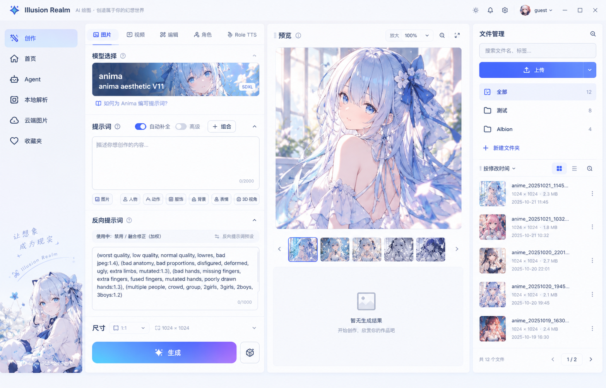
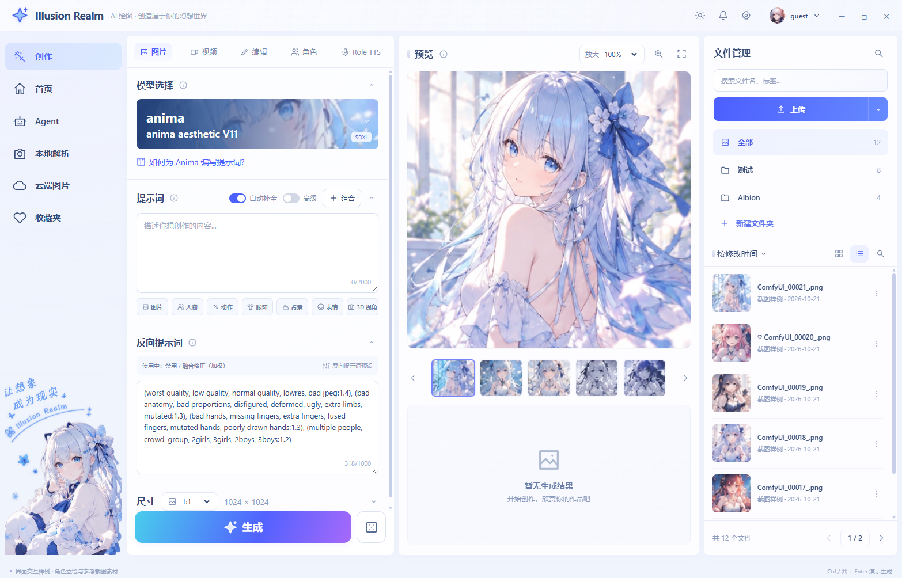
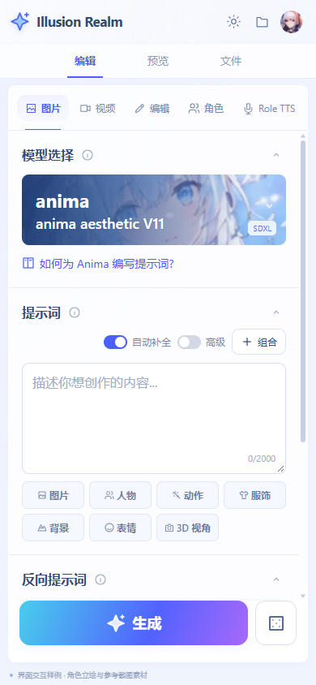
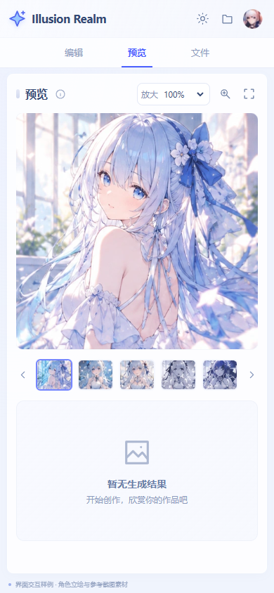

# 创建页参考图 · HTML + Tailwind CSS 实现

日期：2026-10-21。状态：独立页面与浏览器验证完成，产品接入待办。

本次以最新蓝紫色参考图为准。它是可运行的界面实现，与此前创建页布局优化示意分开保存。

## 直接查看

- [单文件 HTML](资源/anime-create/index.html)：样式、交互和图片全部内嵌，双击即可离线使用。
- [源码、运行方式和验证说明](资源/anime-create/README.md)。
- [HTML 结构](资源/anime-create/source.html)、[组件 CSS](资源/anime-create/styles.css)、[交互脚本](资源/anime-create/interactions.js)。
- [完整检查记录](资源/anime-create/verification.json)。

```powershell
node docs/待办/资源/anime-create/serve.cjs
```

访问 <http://127.0.0.1:4179/>。这是本机预览，无公网部署。

## 原图与实际效果

原始参考，1566 × 1004：



实际 HTML 浏览器渲染，1566 × 1004：



手机编辑 / 预览，390 × 844：





## 信息顺序与三项调整

首先让用户找到模型、提示词和生成操作，其次读清预览，最后管理文件。装饰保持在导航底部，不占编辑与预览区域。桌面尊重参考图四栏；中屏收起文件栏、手机分视图，保证输入控件可读可用。

| 原图中最影响使用的问题 | 本次处理 |
| --- | --- |
| 四栏固定并排，小屏容易挤压表单和预览 | 以 1450 / 1180 / 820px 为主要断点，分别采用完整导航、图标导航、文件浮层、手机分视图 |
| 表单内容和窗口高度接近，增加字段后容易让生成操作离开视口 | rail 采用 flex 列布局；内容 min-height:0 独立滚动；生成 footer 保持可见，允许长文本输入与折叠 |
| 原图列表内容与高亮网格图标不一致；反向提示词已有内容但计数为 0 | 初始列表图标正确激活；计数从文本实时计算；搜索、分页和空态由实际当前数据更新 |

主图保持约 479:468 的比例，预览列可伸缩。正文、标签和弱提示逐级区分；手机输入框为 16px。统一蓝紫 accent、边框、圆角与焦点，避免只依靠装饰表达可点击性。

## Tailwind 结构样例

下列为可复用布局模板；完整源码以 `source.html` 为准。最终 HTML 使用真实编译的 Tailwind CSS 4，并内嵌组件 CSS；无需 CDN。

```html
<div class="grid h-dvh min-h-0 grid-cols-1 gap-2 p-2
            xl:grid-cols-[68px_380px_minmax(330px,1fr)_290px]">
  <nav class="hidden min-h-0 xl:block" aria-label="应用导航">
    <!-- 导航按钮 -->
  </nav>
  <section class="flex min-h-0 min-w-0 flex-col rounded-xl bg-white"
           aria-label="创作表单">
    <div class="min-h-0 flex-1 overflow-y-auto p-4">
      <label for="prompt-example" class="mb-2 block font-semibold">提示词</label>
      <textarea id="prompt-example" maxlength="2000"
                class="min-h-32 w-full resize-y rounded-lg border
                       border-indigo-100 p-3 text-base leading-6
                       focus:outline-2 focus:outline-indigo-500"
                placeholder="描述你想创作的内容..."></textarea>
    </div>
    <footer class="shrink-0 p-4">
      <button type="button"
              class="h-14 w-full rounded-xl bg-linear-to-r
                     from-cyan-400 via-indigo-500 to-violet-500
                     font-semibold text-white
                     hover:brightness-105 focus-visible:outline-2
                     focus-visible:outline-offset-2 focus-visible:outline-indigo-500">
        生成
      </button>
    </footer>
  </section>
  <!-- 预览和文件管理：见完整源码；按钮行为由 interactions.js 提供 -->
</div>
```

## 已实现与业务边界

完成提示词编辑、补全候选、模板插入、反向预设、模型选择、尺寸比例、区块折叠、种子、图片切换、缩放、大图、下载、文件搜索、文件夹、收藏、排序、分页、视图切换、本地导入及主题切换。

“生成”使用截图素材模拟处理与结果，不调用模型。其他创作模式为说明入口。上传、收藏和文件夹只存在本次会话内；不会请求账号或后端接口。

左侧角色与文字已使用项目透明资源 `apps/next/src/assets/icon/Nav/role.png`，去除外围透明留白后转为无损 WebP，保留透明通道。已移除旧截图立绘的渐隐遮罩、混合模式和主题透明度变化，避免切换背景时出现矩形底色。

主图、头像、模型封面与缩略图仍从参考截图裁切。列表图与缩略图原始像素较少，放大后会模糊。最终产品应使用高清原图替换，而不是进一步放大截图。裁切与立绘处理见 `build.cjs`。

## 验证与后续待办

- [x] 7 组尺寸检查：1566×1004、1440×900、1280×800、1024×768、821×600、390×844、320×568。
- [x] 图片加载、根页面横向溢出、生成按钮可见性检查。
- [x] 2000 字符提示词、长文件名、含特殊字符的文件夹名称、筛选空态与本地导入。
- [x] 切图、缩放、预设、计数、折叠、主题、分页、筛选、排序、手机切换与平板文件浮层，共 26 项检查通过。
- [x] 实际查看桌面、手机及深色渲染截图。
- [ ] 用户选定后，将布局规则整合到产品现有组件，继续复用原 Zustand / IPC / i18n 业务契约。
- [x] 左侧角色与文字改用项目提供的透明 PNG 立绘。
- [ ] 用高清主图、模型封面与缩略图替换其余截图裁切素材。
- [ ] 产品接入后运行项目要求的类型、Lint、统一检查和对应 Electron 冒烟；按仓库规则一次只跑一个冒烟。
- [ ] 真机软键盘、Safari 和真实模型/API 联调。

本轮仅创建独立页面与文档，未更改产品页面。创作工作台没有 A4 打印需求，本次未做打印排版。
