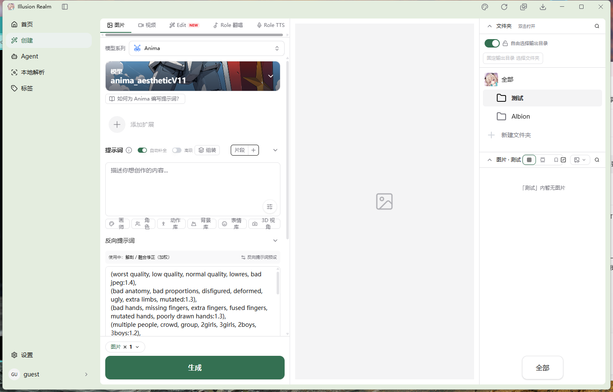

# 创建页布局、信息层级与操作体验优化待办

日期：2026-10-21  
状态：**截图与源码审查完成，设计示意已整理，产品改动待实施。**  
范围：图片创建模式的 rail（左侧表单）、stage（作品预览）与 side（作品库）；其他模式只做兼容检查。

## 1. 参考图与优化方向

### 1.1 用户提供的现状截图



截图用于判断视觉问题，不把截图物理像素直接当 CSS 尺寸。图中的目录名、用户名、提示词、模型名均不作为新增生产默认数据。

### 1.2 问题标注


### 1.3 建议布局示意


**这张是静态布局示意，尚未接入应用，也不是可交互 HTML 的截图。** 示意不绘制完整 Electron 标题栏，不构成删除现有标题栏功能的要求。绿色采用参考截图方向，正式代码必须使用已有主题变量。模型卡片的中性底色仅便于表达结构，正式界面保留真实模型封面。

可编辑图：[现状标注 SVG](资源/create/annotated.svg)、[布局示意 SVG](资源/create/proposed.svg)。

## 2. 优先改的三个问题

### 2.1 提示词区域的工具过密，文字出现拆行

截图中的“画师 / 角色 / 动作库 / 背景库 / 表情库 / 3D 视角”挤在同一行，部分标签拆成上下两行，工具变得难以扫读。标题行同时包含帮助、补全、高级开关、组装和片段入口，主编辑任务被工具打断。

改法：

- 工具使用 `whitespace-nowrap`，12px 文字，单项至少约 88px 可用宽度。
- rail 内部宽度约 340–390px 时优先使用 3 列 × 2 行，不为强塞六项缩小字号。
- 提示词标题保留在第一行，设置控件允许另起一行；低频项可归入明确的“更多”菜单。
- 自动补全开关不能再通过 `scale-[0.6]` 缩到很小；标签和开关整体形成至少 32px 高的点击区域。
- 工具重排保留现有弹窗、写入目标、i18n、title 和 `data-*` 定位器。
- “高级”开关与“组装”存在相同入口语义时，先核实两者行为；可收敛为一个明确入口，但保留已开启状态和关闭路径。

### 2.2 长反向提示词占据首屏，尺寸与高级设置被推下去

默认反向词比正向输入框更抢眼，用户还没开始创作，就先看见大量模板文本。首屏要先让用户知道“模型是什么、写什么、输出多大、怎么生成”。

改法：

- 建议反向提示词初始以“预设已应用 + 预设名 + 展开编辑”的摘要展示；用户主动展开后再编辑。
- **折叠只改变可见性，不卸载编辑器、不清空内容、不改变发给 ComfyUI 的参数。**
- 用户已经选择展开或在二创中编辑时，不因窗口缩放重新收起；是否跨重启记忆折叠属于后续选择，不默认新增落盘字段。
- 图片尺寸保留可见摘要，展开后继续使用原比例、宽高与预设逻辑。
- 高级设置默认以摘要或折叠标题出现，仍可访问采样器、步数、CFG、种子与检测边缘。
- 不删减用户的实际反向提示词来换空间；只减少默认展示占用。

### 2.3 stage 和 side 的空态缺少下一步指引

中间只显示图标，右侧显示目录无图，两块空白共同占了较大面积，却没有解释“生成后在哪里看”和“如何找其他作品”。

改法：

- stage 空态使用“等待你的第一张作品”，配一行“在左侧填写提示词，点击生成”。
- 生成中继续展示真实预览与已有状态，不编造百分比、预计耗时或假成品。
- side 当前目录为空时就地提供“查看全部”；无图、加载中、读取失败是不同状态，不能统一显示为空。
- “查看全部”改变的是浏览目录，不应悄悄修改输出目录或固定/自由输出策略。
- 已有的底部“全部”入口先核实语义与定位，避免在空态和底部留下两个重复、含义不同的按钮。

## 3. 源码事实与修改位置

以下为 2026-10-21 审查时的实现，实施前重新检查局部变化，不覆盖工作区已有未提交修改。

| 文件 / 组件 | 已核实实现 | 处理方向 |
| --- | --- | --- |
| `apps/next/src/view/CreatePage.tsx` | rail 用 `flex-1`，xl 时另设 `w-[31.25%]`；stage 为 `flex-1`；side 为 `w-[25%]` | 检查最终 flex basis 和实际尺寸，不把 width 类名当作实测占比；用明确列宽约束代替相互竞争 |
| `CreatePage.tsx` + `PromptSection.tsx` | 两处都使用 1280px 媒体查询；side 还有 `xl` CSS 可见性 | 若调整断点必须同步三处，防止组装/图库位置错位 |
| `CreateModeTabs.tsx` | 横向滚动，源码已声明隐藏滚动条 | 截图仍出现明显滚动条，先核对构建新鲜度和真实 DOM，不直接断言源代码缺少隐藏规则 |
| `PromptSection.tsx` | 标题行较密，开关采用 `scale-[0.6]` | 控件分组、提高点击区、工具响应式排布 |
| `selected-extensions.tsx` | 添加入口有 40px 图形和上下 12px padding | 无扩展时改紧凑入口；已有扩展的权重、移除与选择不变 |
| `NegativePromptSection.tsx` | 初始 `collapsed=false`；用 CollapsiblePanel 保留 DOM；生成按编辑器 id 读取 | 优先改变默认呈现，不改变内容来源或编辑器 id |
| `NegativePromptSection.tsx` | 初始化预设通过 `requestAnimationFrame` 填入 | 不得因折叠把预设初始化依赖变成不可见时不执行；这是一项需验证的既有时序风险，未据截图判定已发生 |
| `GenerateFooter.tsx` | 张数和生成按钮分两行，按钮高 48/56px；生成中标签可变为添加任务 | 可试一行布局，保留批量张数与继续提交队列行为 |
| `CreateHistorySidebar.tsx` | 文件夹区有 `h-[200px] min-h-[200px]`，图片区为剩余滚动区；选择和打开文件夹分离 | 调整文件夹高度上限，保留单击选中/双击打开/上下文菜单 |
| `Sidebar.tsx` / `data/navigation.ts` | nav 展开 220px、折叠 56px；顶栏已有收起入口 | 本任务不重做全局 nav；需要多空间时保留现有收起能力 |

## 4. 信息顺序与空间分配

### 4.1 rail 纵向优先级

```text
模式标签（固定在表单顶部）
模型系列 → 当前模型 / 更换
扩展入口（未选时紧凑，有选择时完整显示）
提示词标题与必要设置
提示词编辑器 + 助手
提示词工具（完整文字，不拆字）
反向提示词摘要 → 可展开编辑
图片尺寸摘要 → 比例 / 宽高
高级设置 → 可展开
生成条（独立固定在 rail 底部）
```

### 4.2 宽度预算：先测主内容，再定断点

建议基线：rail 360–420px，side 280–320px，stage 使用余下空间并在三栏模式至少约 360px。以参考窗口约 1200px 主内容宽度估算，可用 400 / 500 / 300 的关系，不机械追求固定比例。

| 主内容可用宽度（不含 nav） | 建议结构 | 注意 |
| --- | --- | --- |
| ≥ 1040px | rail + stage + side | 宽度允许后再常驻三栏 |
| 760–1039px | rail + stage；side 由现有图库入口访问 | 两栏只是后续候选，现行窄屏只有表单/图库子页，不可误称已实现 |
| < 760px | 单列编辑 / 主区图库子页 | 保留原表单挂载，返回后不丢提示词 |

三栏预算例：360 + 360 + 280 + 分隔线/边距余量约 40 = 1040px。nav 为 220px 或 56px 时，**相同窗口宽度可用主区宽度不同**，不能只用 viewport 决策后一律认为放得下。

实施分层：

- **P1 先保留现有 1280px 断点**，优化分组、默认展开、按钮换行和列宽上限。
- **P2 再实现按容器宽度分栏/二栏**。先统一 CSS 与 JS 的布局信号，再改断点；需要新增状态时使用现有 Zustand 或局部状态，不引入全局 Context。
- 如果某窗口实际放不下，不让列宽求和挤出横向滚动；切回更少列或使用已有 nav 收起能力。
- 编辑模式已有独立结构，不能把三栏规则无条件套到蒙版编辑器。

### 4.3 高度与视觉规范

- rail：模式标签和 GenerateFooter 固定；中间表单一个主滚动区域。不要把整个创建页和每个分组同时设成独立滚动。
- 编辑器本身可保留合理限高与滚动，但检查鼠标滚到编辑器边缘后能否继续浏览表单，避免滚轮困在嵌套区域。
- 提示词初始高度建议 144–176px；文本多时可展开，不能压缩到只有一两行。
- 模型卡片可压到约 60–72px，保留模型名对比度；提示词指南与扩展入口减少大块留白。
- 文件夹列表以实际内容决定高度，最大约 `min(240px, 28% 可用栏高)`；列表多再滚动，少量目录不固定占满 200px。
- 图片区拿剩余高度，空态居中于图片区，不居中于整个应用。
- 表单分组间距 16px，标题到内容 8px，紧密相关操作 6–8px；rail 内边距 12–16px。
- 标题和正文 14px，次要说明/工具文字 12px，状态摘要 11–12px；不靠降低到 9/10px 解决密度。
- 使用绿色主题原 token，深色正常适配；不为此页新增紫色主色或角色装饰图。
- 图标按钮可见图形 14–16px，实际点击区 32–36px；手机主要入口至少 40–44px。

## 5. 逐项可执行待办

### P0：明确参照与回归边界

- [x] 保存用户原图、问题标注与建议示意。
- [x] 核对实际创建页布局、折叠逻辑、目录区高度与相关组件。
- [ ] 用当前源码重建后复现截图问题，区分旧 out、系统缩放和当前代码。
- [ ] 记录 viewport CSS 宽高、nav 宽度、rail/stage/side 实际宽度及主区高度。
- [ ] 录制现有提示词、反向词、批量生成、目录打开、组装与二创链路基线。

### P1-A：表单阅读与操作

- [ ] 模式栏不换行；只在确实放不下时横向滚动，提供可发现的边缘/焦点反馈，不常驻粗滚动条。
- [ ] 缩减无扩展时添加区空白，已选 LoRA 的权重与移除入口保留。
- [ ] 提示词标题与设置分组；工具改响应式网格，文字不拆字。
- [ ] 补全开关扩大点击区域，保持真实 `role=switch` / `aria-checked` 语义。
- [ ] 验证“组装”和“高级”入口的语义后再决定是否合并，不直接删掉功能。
- [ ] 反向提示词用摘要起步，但编辑器保留挂载且预设可靠初始化。
- [ ] 图片尺寸摘要在默认首屏可见，真实比例与宽高一致。
- [ ] 生成条可试“张数 + 生成”一行，宽度不足时自然回到两行。
- [ ] 生成中的按钮仍能添加任务，不能误加全局 disabled 阻断既有队列。

### P1-B：预览与作品库

- [ ] stage 空态说明使用 i18n，不用假作品充当真实生成结果。
- [ ] 有图时按真实宽高完整展示；空态容器不强制变成成品图的 832:1216 比例。
- [ ] 保留大图预览、左右切图、右键、生成中预览与图库当前图片联动。
- [ ] 输出路径模式保留默认值、说明和可恢复的设置入口；无效操作说明原因而不消失。
- [ ] 文件夹列表高度随内容增长至上限；折叠后图片区能获得释放的空间。
- [ ] 将过密工具归组，网格/堆栈/收藏档位、搜索、批选和媒体筛选仍可访问。
- [ ] 空文件夹“查看全部”仅切换浏览位置；固定输出目录保持不变。
- [ ] 加载/失败/空目录分别呈现，失败有真实重试路径。

### P2：布局与兼容

- [ ] 单独建立容器宽度决策方案，再统一 CreatePage、PromptSection 与 CSS 断点。
- [ ] 检查 nav 展开/收起、窗口连续缩放、最小化恢复后的布局，不只测首帧。
- [ ] 组装面板同一时刻只保留一个有效实例；切换不能丢失正在编辑的提示词。
- [ ] 窄屏图库继续主区换页，nav 保留；不要未经确认改成遮住全局导航的抽屉。
- [ ] 视频、Edit、Role 翻唱、Role TTS 不套用仅图片适用的设置或空态文案。
- [ ] 检查 zh-CN / en、深浅色、长模型名、长目录名与长无空格提示词。

## 6. Tailwind 结构模板与接入说明

以下是实施参考，**不是已接入组件**。保留当前业务事件、i18n、contenteditable id、data 属性及组件生命周期；不要把示意数据写回 store。

### 6.1 三栏骨架（仅宽度足够时启用）

```tsx
<div data-create-layout="three"
  className="grid h-full min-h-0 min-w-0 grid-cols-[clamp(360px,33%,420px)_minmax(360px,1fr)_clamp(280px,25%,320px)] overflow-hidden">
  {/* rail：创建表单；中段滚动，生成条固定 */}
  <section className="flex min-h-0 min-w-0 flex-col border-r border-border">
    <CreateModeTabs value={createMode} onChange={setCreateMode} />
    <div className="min-h-0 flex-1 overflow-y-auto px-4 py-3">
      {/* 现有模型、扩展、提示词、反向词、尺寸、高级设置 */}
    </div>
    <GenerateFooter generating={generating} onGenerate={handleGenerate} />
  </section>
  {/* stage：完整展示预览；保留既有预览和右键行为 */}
  <article className="flex min-h-0 min-w-0 items-center justify-center p-3">
    {/* 有图分支继续使用 ImagePreviewTrigger；空态单独呈现 */}
  </article>
  {/* side：已有作品库或提示词组装 */}
  <section className="flex min-h-0 min-w-0 flex-col border-l border-border">
    {/* 复用现有高级组装 / 历史图库分支 */}
  </section>
</div>
```

这组列定义存在最小宽度要求；在不足 1040px 的主内容容器中不能原样启用。若暂不改根布局，先在现有 flex 中明确 rail 和 side 的 `flex-none`/basis，stage 使用 `flex-1 min-w-0`，不要只改一个 width 类。

### 6.2 工具网格：让每个文字标签完整显示

```tsx
<div className="grid grid-cols-[repeat(auto-fit,minmax(88px,1fr))] gap-2">
  {tools.map(tool => (
    <button key={tool.id} type="button" onClick={() => openExistingTool(tool.id)}
      className="inline-flex min-h-8 min-w-0 items-center justify-center gap-1.5 whitespace-nowrap rounded-md border border-border px-2 text-xs text-muted-foreground hover:bg-muted hover:text-foreground focus-visible:outline-2 focus-visible:outline-offset-2 focus-visible:outline-ring">
      <tool.Icon aria-hidden="true" className="size-3.5 shrink-0" />
      <span>{t(tool.labelKey)}</span>
    </button>
  ))}
</div>
```

`tools` / `openExistingTool` 是结构占位名，接入时映射到 `PROMPT_TOOLS`、`ROW_TOOL_ICONS`、现有 `openToolDialog` 等真实对象。不能新增一个没有行为的工具数组替代原入口。英文标签更长时提高最小列宽或减少列数，不能再次拆字。

### 6.3 生成条：可换行、保持底部可见

```tsx
<div className="shrink-0 border-t border-border bg-background px-4 py-3">
  <div className="flex flex-wrap items-center gap-3">
    <div className="shrink-0">
      <ImageCountDropdown value={imageCount} onChange={setImageCount} />
    </div>
    <button type="button" data-generate-button
      onClick={() => onGenerate?.(imageCount)}
      className={cn("min-h-11 min-w-[160px] flex-1 rounded-xl px-4 text-sm font-semibold", PRIMARY_BUTTON_CLASS)}>
      {t(generating ? "create.generationTasks.add" : "create.generateButton.label")}
    </button>
  </div>
</div>
```

这是 `GenerateFooter` 内的替换骨架，继续使用其当前 state/props，检查 dropdown 弹层与 safe-area padding。不能把取消、失败或连通性处理塞进布局模板里绕过原生成队列。

### 6.4 反向提示词：折叠时保留实际编辑节点

```tsx
const [collapsed, setCollapsed] = useState(true);

// 沿用现有 CollapsiblePanel 和编辑器；不写成 !collapsed && <Editor />。
<CollapsiblePanel open={!collapsed} stateAttribute="data-negative-editor-panel">
  {/* 现有 id=negative-prompt-editor 的 contenteditable 节点和助手 */}
</CollapsiblePanel>
```

初始化验证必须读取真实 `negative-prompt-editor` 内容再检查生成参数，而不只是看摘要显示了某个预设名。默认折叠、展开修改、收起后提交、二创回填都要跑；避免显示有预设、实际生成参数为空。若调整现有 rAF 初始化，采用有界/不依赖可见性节拍的方式并补对照，不在本轮文档中宣称修复完成。

## 7. 验收与回归矩阵

### 7.1 尺寸场景

| 场景 | 验收重点 |
| --- | --- |
| 1440×900，nav 展开 | 提示词工具不拆字，尺寸摘要可见，三栏不溢出 |
| 1920×1080 | rail/side 有上限，stage 获得剩余宽度，实际图不拉伸 |
| 1280×720，nav 展开/收起 | 实测主区宽度，列数与 JS 逻辑一致，不隐藏图库入口 |
| 1100×700 | 窄屏图库可进入/返回，原提示词与组装状态不丢失 |
| 960×540 | 矮屏可滚动访问尺寸和高级设置，生成条可点击 |
| 390×844、320×568 | 单列操作顺序正确，长文本不横向溢出 |
| DPR 1.25 / 1.5 | 记录 CSS 视口，工具/弹层不遮挡；如改到 3D canvas，带值单独运行相关冒烟 |

### 7.2 数据与行为

- [ ] 空提示词、长中文、长英文、无空格 token、输入法组合输入都能正常编辑。
- [ ] 编辑器 focus/caret 不因折叠、换列或打开图库被重建。
- [ ] 反向预设实际应用，折叠后内容仍进入原生成参数。
- [ ] LoRA 权重、工具写入、翻译撤销、3D 提示词与高级组装功能未改变。
- [ ] 实际输出尺寸、批量张数、种子仍来自原数据来源。
- [ ] 空库、空当前文件夹、读取失败、加载中、生成中、部分成功、队列失败分别可辨。
- [ ] 查看全部不会改变输出路径；单击选中与双击打开语义保留。
- [ ] 图片预览/详情/右键/二创能从 stage 与图库一致到达。
- [ ] 所有新增文案加入既有中英词条，不在产品组件硬编码中文。

### 7.3 检查命令和环境约定

```powershell
pnpm typecheck
pnpm lint
pnpm check
pnpm --filter @illusion-realm/next build
```

构建新鲜后，依据实际改动**一次只跑一个**相关冒烟，例如：

```powershell
pnpm exec electron scripts/smoke-characters.js
```

另外可按修改范围单独执行 `smoke-prompt-assembly.js`、`smoke-prompt-assistant.js`、`smoke-anima-workflow.js`；改到 3D 几何才加相应 DPR 维度。工作流冒烟先读脚本前置条件，不把可能调用外部服务的脚本当纯静态检查盲跑。

测试记录须写明命令、退出码、CSS 视口、DPR 和构建时间。按根目录 AGENTS.md 区分 1（断言）、2（前提）、124/125（超时）。窗口遮挡维度需要真实窗口；事件丢失维度可 headless，二者不得混称。

当前完成状态：文档、原图、标注与示意图已整理；没有因本次待办修改产品代码，因此尚未执行本轮真实页面回归，静态示意不能替代上述验收。

## 8. 可复制的任务模板

```md
### CREATE-XX：任务名称
- 优先级 / 状态：P1 / 待开始
- 区域：rail / stage / side / pin / modal
- 问题：尺寸、数据状态、可复现表现及用户影响。
- 实施文件：真实路径、组件和可复用事件。
- 修改：布局、尺寸、文字层级与状态规则。
- 保留：编辑器节点、store、事件、参数、目录策略或队列行为。
- 验收：宽窄屏 + 输入/折叠/生成 + 失败/空态。
- 证据：原图、改后图、构建时间、命令及退出码。
- 未完成：写出未测试环境，不用预计结果代替。
```

示例：

```md
### CREATE-01：提示词工具文字完整显示
- 优先级 / 状态：P1 / 待开始
- 区域：rail
- 问题：参考窗口的工具栏出现“动作库”等文字拆成两行。
- 实施文件：apps/next/src/view/create/PromptSection.tsx
- 修改：使用最小约 88px 的响应式工具网格，文字 nowrap、12px，按钮至少高 32px。
- 保留：原工具弹窗、提示词写入目标、i18n 与 data 定位器。
- 验收：nav 展开/收起和 1100/1440px 窗口不拆字；角色/背景/3D 等入口仍有效。
- 证据：待补构建后截图与针对性冒烟结果。
- 未完成：当前仅有设计示意。
```

完成定义：真实页面达到尺寸和阅读目标，原业务入口与数据不丢失，通过项目检查及必要回归，附对应真实截图。建议按表单、预览/图库、布局信号三次小变更推进，每次 PR 控制在仓库规定范围。
