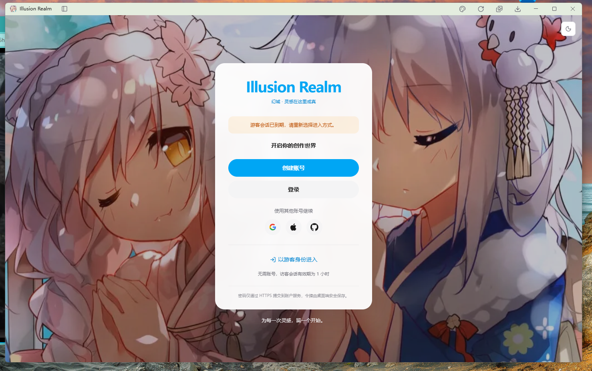
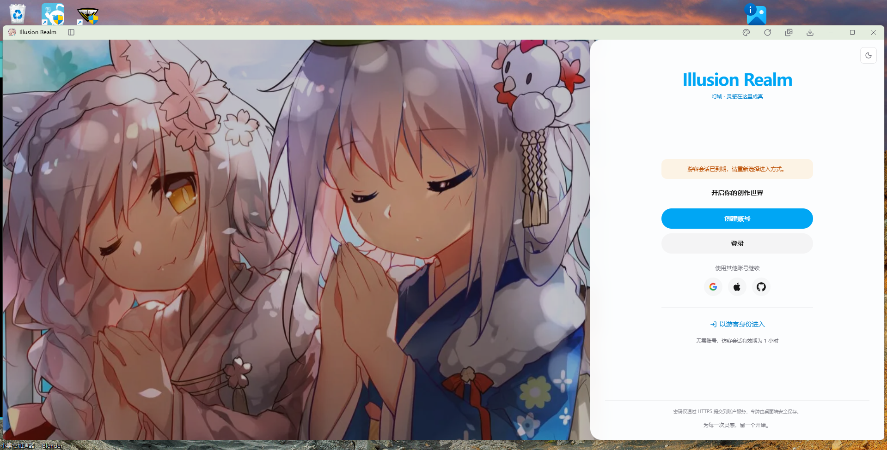
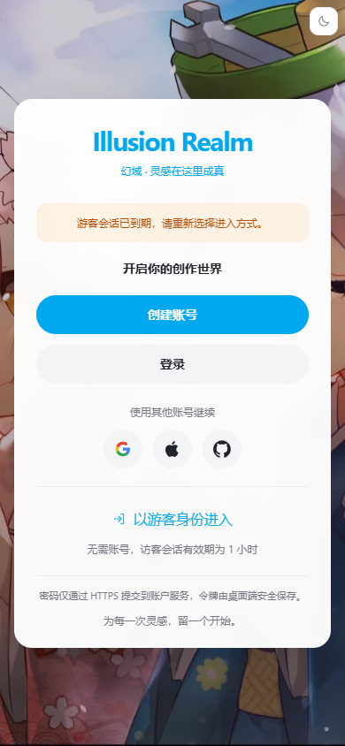
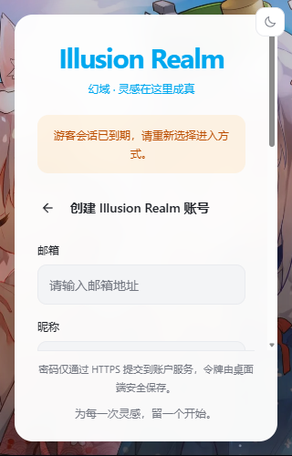

# 登录页宽高与响应式优化待办

日期：2026-10-21  
状态：**设计预览已完成，生产接入待实施。**  
范围：Illusion Realm 登录入口、登录/注册表单的宽度、高度、滚动与布局切换。

## 1. 目标与交付边界

目标：让普通桌面窗口、宽屏、矮窗口和手机尺寸下的登录入口保持一致的阅读顺序，修正宽屏右栏过宽、品牌与表单分离的问题。

- [x] 查看实际登录页、表单、媒体查询 Hook 和登录冒烟脚本。
- [x] 基于项目原插画、蓝色、供应商 SVG 和中文文案制作独立 HTML。
- [x] 实现居中、分栏、矮窗口内容滚动及预览尺寸切换。
- [x] 对独立预览执行五组尺寸检查与主要交互检查。
- [ ] 将布局接入真实 Next.js 页面。
- [ ] 更新受布局变化影响的冒烟断言。
- [ ] 完成新静态构建与真实 Electron 回归。

**预览验证不等于生产验证。** HTML 中的提交只做本地校验，不连接账户服务，不保存凭据，也不创建真实游客会话。正式页面继续使用现有 API、store、i18n 与主题机制。

本次不新增 OAuth、密码找回、账户协议或用户文档字段。不要把预览控制栏、演示反馈、设备选择器加入正式登录页。

## 2. 可复用样例

这些文件随文档保存在仓库中，不依赖个人临时目录：

| 文件 | 用途 |
| --- | --- |
| [预览控制页](资源/login/index.html) | 切换视口、居中/分栏、首页/登录/注册和过期提示 |
| [独立登录 HTML](资源/login/login.html) | 已内嵌编译后的 Tailwind CSS、原 WebP 与 SVG，可离线打开 |
| [本机预览服务](资源/login/serve.cjs) | 只在 `127.0.0.1:4178` 提供两个预览页面 |
| [普通桌面截图](资源/login/desktop-centered.png) | 1440 × 900，居中卡片 |
| [宽屏截图](资源/login/desktop-split.png) | 1920 × 1080，480px 右栏 |
| [矮窗口注册截图](资源/login/short-register.png) | 1280 × 540，分栏、表单内部滚动 |
| [手机截图](资源/login/mobile.png) | 390 × 844，居中卡片 |
| [小屏注册截图](资源/login/small-register.png) | 320 × 500，保留字号、通过滚动访问内容 |

从仓库根目录启动：

```powershell
node docs/待办/资源/login/serve.cjs
```

浏览器访问：<http://127.0.0.1:4178/>。这是本机预览地址，不是公开部署地址。端口已被同一预览占用时直接打开地址；被其他服务占用时先确认进程归属，不强制终止未知进程。停止自己启动的前台服务可使用 `Ctrl+C`。

截图与预览用于复现设计方向，正式代码不得把内嵌 base64 图片重复写入 React 模块。生产继续引用 `/images/login-background.webp`。

## 2.1 原图与预览截图对照

### 原图：居中与分栏





### 优化预览：真实 HTML 渲染截图






预览图来自独立 HTML，不是正式 Electron 登录页截图。

### 可维护的样例源码

- [HTML 结构与布局样式](资源/login/source.html)
- [独立预览交互](资源/login/interactions.js)
- [使用仓库依赖重新生成单文件 HTML](资源/login/build.cjs)
- [独立预览检查脚本](资源/login/verify.cjs)

从仓库根目录重新生成：`node docs/待办/资源/login/build.cjs`。先启动同目录 `serve.cjs`，再运行 `node docs/待办/资源/login/verify.cjs` 可检查独立预览；这不替代真实应用冒烟。
## 3. 已核实的现状

| 位置 | 当前实现 | 本次关联 |
| --- | --- | --- |
| `apps/next/src/view/auth/login-page.tsx` | `LoginPage`、`LoginCard`、`LoginContent`、游客与第三方入口 | 主要布局调整位置 |
| `apps/next/src/view/auth/account-form.tsx` | 登录/注册、密码显示、表单校验与忘记密码说明 | 保留提交和状态逻辑，检查长表单 |
| `apps/next/src/hooks/useMediaQuery.ts` | SSR 安全取值，change/resize/visibilitychange 时重读 matches | 继续复用，避免事件丢失后布局不更新 |
| `apps/next/src/components/theme-toggle.tsx` | 连接项目主题状态和换肤逻辑 | 不改为独立 DOM 主题开关 |
| `apps/next/src/i18n/locales/zh-CN/auth.ts` | 登录与游客相关中文 | 正式 UI 继续使用已有 key |
| `apps/next/public/images/login-background.webp` | 现有登录插画 | 保留素材与比例，不新增临时角色图 |
| `scripts/smoke-login.js` | 登录、游客、表单、宽窄屏与内滚动回归 | 旧布局断言需要有依据地更新 |

### 3.1 影响最大的三个问题

1. **分栏宽度随屏幕无上限增长。** 当前 `grid-cols-[minmax(0,2fr)_minmax(0,1fr)]` 让右栏占三分之一；窗口越宽，右栏越宽，表单仍限制在 328px，产生过多两侧空白。
2. **品牌与表单使用不同的垂直定位。** 品牌 `pt-16` 固定在顶部；表单在另一个 `flex-1` 区域内 `my-auto`，二者距离会随窗口高度变化。
3. **宽高规则与滚动契约耦合。** 原切换条件为 `(min-width: 960px) and (min-aspect-ratio: 2/1)`，并非单纯按宽度切换。现有冒烟还要求品牌固定、2:1 分栏，不能只换样式后继续沿用原断言。

当前卡片上限为 392px、表单为 328px。预览将两者分别调整为 420px、360px；这些值是本轮建议基线，不代表任何尺寸下的绝对最优值。

## 4. 布局与视觉规范

### 4.1 阅读顺序

```text
品牌与副标题
→ 条件显示的会话到期提示
→ 开启创作 / 登录 / 注册表单
→ 第三方入口
→ 游客入口与有效期
→ 安全说明与页脚标语
```

品牌和表单形成一个完整内容组；主题按钮位于外层右上角。宽屏把剩余宽度让给插画，不通过放大字号或按钮填满右栏。

### 4.2 尺寸基线

| 项目 | 建议值 | 实施说明 |
| --- | --- | --- |
| 居中卡片 | `w-full max-w-[420px]` | 小屏至少留 16px 左右空间 |
| 分栏右侧面板 | `clamp(420px,28vw,480px)` | 剩余宽度由插画承担，不维持固定 2:1 |
| 内部内容组 | `w-full max-w-[360px]` | 品牌、提示、表单与游客入口共用对齐线 |
| 居中内边距 | 左右 32px，小屏 24px | 不为了塞入内容缩小正文 |
| 分栏内边距 | 左右 36px，上方至少 48px | 给右上角主题控件留空间 |
| 主/次按钮 | 高 44px | 登录、创建账号保持一致 |
| 第三方按钮 | 44 × 44px | 每个按钮有可访问名称与焦点状态 |
| 卡片圆角 | 居中 24px；分栏仅左侧 24px | 复用现有登录页方向，不修改其他页面 |
| 品牌到下一内容块 | 28px；矮屏 20px | 内容组整体居中，不分别定位 |
| 普通分组间距 | 20/24px | 按内容分组，不随意插入独立间距 |
| 按钮间距 | 12px | 主次操作保持关联 |
| 游客说明间距 | 4–8px | 紧跟游客入口，不与其他分组混淆 |

字号：品牌 30–34px，操作与正文 14px，辅助信息 12px，安全说明最低 11px。小屏优先减少空白并提供滚动，不把表单正文压到 10px。

颜色：正式代码使用 `bg-background`、`text-foreground`、`text-muted-foreground`、`border-border` 与现有 sky 强调色。预览中的独立颜色变量只服务于离线示例，不新建生产主题体系。

### 4.3 布局切换建议

独立预览当前采用：

```ts
const LOGIN_SPLIT_QUERY =
  "(min-width: 1536px), (min-width: 1120px) and (max-height: 640px)";
```

- 1536px 及以上采用分栏，右栏有上限。
- 1120px 及以上的矮窗口也采用分栏，减少居中卡片外层留白。
- 其他尺寸采用居中卡片。
- 正式页面继续用 `useMediaQuery`；不要替换为仅供 hydration 后弹窗使用的 `useMediaQueryAfterHydration`。
- 媒体查询中的宽高是 **CSS viewport**；页面可用高度还要扣除 `--window-chrome-height`。DPR、截图物理像素和 CSS 像素不能混用。
- 此规则替代原宽高比条件，需覆盖断点前后与窗口恢复可见两类检查。

## 5. 高度与滚动契约：必须先决定，再实现

本轮建议采用以下契约：

1. 登录根节点高度为 `calc(100dvh - var(--window-chrome-height))`，不覆盖 Electron 标题栏。
2. 居中卡片高度随内容增长，但不超出可用空间；分栏卡片充满右栏。
3. **品牌与表单放进同一个滚动区域。** 空间足够时整体居中；空间不足时从上方开始排列并滚动。
4. 安全说明与标语放入独立 `shrink-0` 页脚，保持可见。
5. 页面根节点不滚动，只让 `data-auth-scroll` 承担纵向滚动；祖先链必须有 `min-h-0`。
6. 通过滚动能够访问提交、第三方与游客入口；不能仅通过 `overflow-hidden` 裁掉内容。
7. 不使用 `transform: scale()` 压缩正式 UI；预览控制页的缩放只是设备画布展示工具。

**与现有实现的有意差异：品牌不再始终固定。** 这是为保持品牌与表单相邻而作的取舍。在极矮窗口里品牌可以滚出视野，页脚和全局标题栏保持固定。该变化必须同步更新冒烟，不可继续声称满足旧的“品牌固定”断言。

若后续明确要求品牌也固定，应另建方案：给品牌使用有限高度、仅让表单滚动；不要把两个互相冲突的滚动契约混在一次实现中。

## 6. 分阶段实施待办

### P0：确认基线和回归判据

- [ ] 打开实际页面，记录 1440×900、1920×1080、1280×540、390×844、320×500 的现状。
- [ ] 确认上节“品牌可滚动、页脚固定”的目标，并记录到 PR 描述。
- [ ] 在 `smoke-login.js` 定位“精确 2:1”“品牌固定”“顶部至少 96px”等旧布局断言。
- [ ] 列出旧断言对应的新命题，先建立可失败的尺寸/滚动检查，再调整布局。
- [ ] 保留认证、游客时长、提交错误、持久化和重启续用的业务断言。

### P1：宽度与单实例布局

- [ ] 根网格替换为 `minmax(0,1fr) clamp(420px,28vw,480px)`。
- [ ] 居中卡片上限调整为 420px；内部内容上限调整为 360px。
- [ ] 居中与分栏仅切换容器样式，不渲染两套表单，不因 resize 改变 React key。
- [ ] 背景继续 `cover`，检查 `center 42%` 在新插画栏宽度下的人物裁切。
- [ ] 插画延伸到左圆角背后，避免圆角露出不同底色；右栏贴合顶部、底部和右边界。

### P2：高度与内容组

- [ ] 将品牌移入 `data-auth-scroll` 内，与 `LoginContent` 共用一个内容组。
- [ ] 足够高时给内容组使用 `my-auto`；内容组设置 `shrink-0`，不依赖负边距居中。
- [ ] 页脚独立 `shrink-0`；把外层重复标语收敛到页脚，避免同一句出现两次。
- [ ] 高度不足时减少品牌间距与上下 padding，不减小按钮高度和可读字号。
- [ ] 检查滚动到底能完整看到游客入口及最后一行说明。
- [ ] 主题按钮保持可点击；窄矮屏中不遮挡品牌、输入框或滚动条。

### P3：业务状态与长内容

- [ ] 检查首页、登录、注册、邮箱激活、发送验证邮件及所有错误反馈。
- [ ] 会话到期提示条件显示；错误文案换行，不固定成单行、不省略关键内容。
- [ ] 切换布局保留邮箱、密码、表单模式及反馈；模式主动切换仍遵守现有密码清空逻辑。
- [ ] OAuth 继续显示尚未接入的真实反馈；游客入口继续调用原 store。
- [ ] 保留邮箱格式、注册密码长度、确认密码和 busy 状态校验。
- [ ] 键盘 Tab 顺序与视觉顺序一致，焦点进入滚动区时控件可见。
- [ ] 深浅色使用项目主题；保留 `prefers-reduced-motion`，不增加无上限动画等待。

### P4：完成验证与交付

- [ ] 运行类型、Lint 与项目统一检查。
- [ ] 重建 Next 静态导出后，单独运行登录冒烟。
- [ ] 执行真实滚轮、键盘、遮挡后恢复、窗口缩放与主题切换检查。
- [ ] 在 DPR 1.25/1.5 环境记录 CSS 视口与实际截图尺寸，不按物理像素猜断点。
- [ ] 替换预览截图为真实应用截图，并标注对应构建与运行命令。

## 7. Tailwind / React 接入模板

以下是**放入现有 `login-page.tsx` 的结构模板**，不是新增一套认证页面。复用该文件已有的 `cn`、`useTranslation`、`APP_NAME`、`LoginContent`、`ThemeToggle` 与 store。保留原 `LoginContent`、API 调用、邮箱激活和错误处理。

### 7.1 布局条件与根容器

```tsx
const LOGIN_SPLIT_QUERY =
  "(min-width: 1536px), (min-width: 1120px) and (max-height: 640px)";

export function LoginPage() {
  const split = useMediaQuery(LOGIN_SPLIT_QUERY);
  return (
    <section data-login-page data-login-layout={split ? "split" : "centered"}
      className={cn("relative isolate grid h-[calc(100dvh-var(--window-chrome-height))] min-h-0 w-full overflow-hidden bg-[#bdd6e4]",
        split && "grid-cols-[minmax(0,1fr)_clamp(420px,28vw,480px)]")}>
      {/* 界面：登录页插画，延伸到左圆角背后 */}
      <div data-auth-background aria-hidden="true"
        className={cn("bg-cover bg-[position:center_42%]", split
          ? "relative col-start-1 row-start-1 -mr-6 min-h-0 min-w-0"
          : "absolute inset-0")}
        style={{ backgroundImage: "url('/images/login-background.webp')" }}>
        <div className="absolute inset-0 bg-slate-950/25 dark:bg-slate-950/45" />
      </div>
      <div className="absolute right-4 top-4 z-20"><ThemeToggle /></div>
      {/* 界面：登录卡片 / 右侧登录面板 */}
      <div data-auth-pane className={cn("relative row-start-1 flex min-h-0 min-w-0 items-center justify-center",
        split ? "col-start-2" : "col-start-1 p-4 sm:p-6")}>
        <LoginCard split={split} />
      </div>
    </section>
  );
}
```

根容器没有按 `split` 建两份组件树；只是改 class，表单实例不变。原 `data-auth-content`/`data-auth-stack` 是否保留，要先搜索引用；如果删掉，同步调整依赖它们的回归定位器。

### 7.2 品牌、滚动区与卡片

```tsx
function AuthBrand() {
  const { t } = useTranslation();
  return (
    <header data-auth-brand className="mb-7 text-center [@media(max-height:720px)]:mb-5">
      <h1 className="break-words text-[30px] font-bold leading-tight tracking-[-1.2px] text-sky-500 sm:text-[34px]">
        {APP_NAME}
      </h1>
      <p className="mt-1.5 text-xs text-sky-600 dark:text-sky-400">{t("auth.brandSub")}</p>
    </header>
  );
}

function AuthScrollBody({ split }: { split: boolean }) {
  const { t } = useTranslation();
  const expired = useGuestSessionStore(state => state.expired);
  return (
    <div data-auth-scroll className={cn("min-h-0 overflow-x-hidden overflow-y-auto overscroll-contain px-6 pb-5 pt-8 [scrollbar-width:thin] sm:px-8",
      split && "flex flex-1 flex-col px-9 pt-12 sm:px-9")}>
      <div className={cn("mx-auto w-full max-w-[360px] shrink-0", split && "my-auto")}>
        <AuthBrand />
        {expired && <p role="status" data-auth-expired
          className="mb-5 rounded-xl bg-amber-500/10 p-3 text-xs leading-relaxed text-amber-700 dark:text-amber-300">
          {t("auth.expired")}
        </p>}
        {/* 界面：现有账号操作、第三方入口和游客入口 */}
        <LoginContent />
      </div>
    </div>
  );
}

function AuthCardFooter() {
  const { t } = useTranslation();
  return (
    <footer data-auth-card-footer className="shrink-0 px-6 pb-5 text-center sm:px-8">
      <p className="border-t border-border/60 pt-3 text-[11px] leading-5 text-muted-foreground">
        {t("auth.privacy")}
      </p>
      <p className="mt-2 text-xs leading-5 text-muted-foreground">{t("auth.footer")}</p>
    </footer>
  );
}

function LoginCard({ split }: { split: boolean }) {
  return (
    <div data-auth-card className={cn("flex min-h-0 w-full flex-col overflow-hidden bg-background/95 text-foreground shadow-[0_16px_64px_rgba(15,23,42,0.16)] backdrop-blur-md",
      split ? "h-full rounded-l-[24px]" : "max-h-full max-w-[420px] rounded-[24px] border border-white/30")}>
      <AuthScrollBody split={split} />
      <AuthCardFooter />
    </div>
  );
}
```

接入注意：旧卡片用 `text-center` 给 `SocialLogin`/`GuestEntry` 提供了继承对齐。重构时给这些入口补 `text-center`，表单保留 `text-left`；不能让移除父级样式改变局部对齐。验证页和服务端错误也必须检查。

## 8. HTML / CSS 最小结构模板

完整可运行文件见第 2 节。下面只表达“滚动区与页脚”关系，内容占位注释需要换成真实界面，不能当作完整认证实现交付。

```html
<main class="login-layout" data-layout="centered">
  <div class="login-background" aria-hidden="true"></div>
  <div class="login-pane">
    <section class="login-card" aria-label="账号登录与游客入口">
      <div class="login-scroll">
        <div class="login-group">
          <!-- 品牌、状态提示、现有表单、第三方入口、游客入口 -->
        </div>
      </div>
      <footer class="login-footer"><!-- 安全说明与标语 --></footer>
    </section>
  </div>
</main>
```

```css
.login-layout { display: grid; height: 100dvh; min-height: 0; overflow: hidden; }
.login-pane { display: flex; min-height: 0; min-width: 0; padding: 24px 16px; align-items: center; justify-content: center; }
.login-card { display: flex; flex-direction: column; width: 420px; max-width: 100%; max-height: 100%; min-height: 0; overflow: hidden; }
.login-scroll { min-height: 0; overflow-y: auto; overscroll-behavior: contain; padding: 28px 32px 20px; }
.login-group { width: 100%; max-width: 360px; margin-inline: auto; flex-shrink: 0; }
.login-footer { flex-shrink: 0; }
[data-layout="split"].login-layout { grid-template-columns: minmax(0, 1fr) clamp(420px, 28vw, 480px); }
[data-layout="split"] .login-pane { grid-column: 2; padding: 0; }
[data-layout="split"] .login-card { width: 100%; height: 100%; }
[data-layout="split"] .login-scroll { display: flex; flex: 1; flex-direction: column; padding-top: 48px; }
[data-layout="split"] .login-group { margin-block: auto; }
```

上例省略背景定位和视觉样式，正式 Electron 高度应替换为扣除标题栏的表达式，不直接复制 `height:100dvh` 覆盖标题栏。

## 9. 回归矩阵与断言替换

### 9.1 已验证的独立预览

| CSS 视口 | 模式 | 实测卡片/右栏宽度 | 内容滚动 | 结果 |
| --- | --- | --- | --- | --- |
| 1440 × 900 | 居中首页 | 420px | 不需要 | 无横向/根节点溢出 |
| 1920 × 1080 | 分栏首页 | 480px | 不需要 | 右侧贴边，内容组整体居中 |
| 1280 × 540 | 分栏注册 | 420px | 需要 | 内容内滚动，页脚在视口内 |
| 390 × 844 | 居中首页 | 358px | 不需要 | 左右各留 16px |
| 320 × 500 | 居中注册 | 288px | 需要 | 游客入口可滚动到达，页脚固定 |

独立预览还检查：注册必填与密码不一致反馈、resize 保留输入、密码显示、主题切换、忘记密码说明、第三方未接入提示、游客演示反馈，以及预览控制页的设备切换。桌面居中、宽屏和小屏注册截图已人工查看；未据此声称真实 API 或 Electron 认证回归通过。

### 9.2 生产必须新增/更新的断言

| 旧命题 | 新命题 | 不可删除的保护 |
| --- | --- | --- |
| 右栏严格占三分之一 | 分栏右栏在 420–480px，剩余空间归插画 | 右栏贴合顶/底/右，根节点无横向溢出 |
| 品牌固定、仅表单滚动 | 品牌与表单共同滚动，页脚与标题栏固定 | 最后一个入口可完整滚动到视口内 |
| 小屏卡片至少从 96px 以下开始 | 卡片在扣除标题栏后的安全区域内 | 主题控件不遮挡内容，卡片底部不越界 |
| 宽高比为 2 时切换 | 按本轮宽度/高度规则切换 | 切换前后同一表单实例，输入不丢失 |

断点检查至少包括：1535/1536px、1119/1120px、639/640/641px。高度跨界时必须带上宽度，否则测不到同一个分支。保留不满足条件的配对对照，避免断言恒真。

媒体查询事件丢失维度复用项目现有机制，产品继续“以读为准，事件只作通知”。遮挡维度需要真实可见窗口；不要用 headless 假装已执行遮挡验证。

### 9.3 命令与顺序

```powershell
pnpm typecheck
pnpm lint
pnpm check
pnpm --filter @illusion-realm/next build
```

构建成功后单独运行：

```powershell
pnpm exec electron scripts/smoke-login.js
```

先确认并处理自己上一轮留下的 Electron 进程，再启动下一轮；不要终止正在使用的真实应用。遵守仓库“一次只跑一个冒烟”的要求。构建指纹过期时先重建，不通过改断言掩盖环境问题。

## 10. 可直接复制的待办条目模板

```md
### LOGIN-XX：任务名称
- 优先级：P0 / P1 / P2
- 状态：待开始 / 进行中 / 待验证 / 已完成
- 问题：明确窗口尺寸、当前表现、用户影响。
- 目标：写可观察的行为，避免只写“更好看”。
- 修改文件：列真实路径与组件。
- 实施：写尺寸、布局关系和使用的现有能力。
- 不改动：写本任务必须保留的业务边界。
- 验收：列尺寸、交互、长文本与失败状态。
- 证据：截图、检查命令、退出码、构建时间。
- 未完成：未跑的环境或依赖，不以“预计通过”代替结果。
```

示例：

```md
### LOGIN-01：限制宽屏右栏宽度
- 优先级：P1
- 状态：待开始
- 问题：1920px 窗口下右栏随三分之一网格增长，表单仅 328px，两侧空白过大。
- 目标：右栏 420–480px；内部表单最大 360px；插画获得剩余宽度。
- 修改文件：apps/next/src/view/auth/login-page.tsx
- 实施：替换分栏列定义，统一卡片和表单宽度；不复制表单树。
- 不改动：登录 API、账户 store、游客有效期和主题状态。
- 验收：1920×1080 右栏 480px；1280×540 右栏 420px；resize 后邮箱密码不丢失。
- 证据：待补真实应用截图和 smoke-login 结果。
- 未完成：独立 HTML 已验证，生产尚未接入。
```

## 11. 回归记录与 PR 描述模板

```md
### 回归记录
- 日期 / 提交：
- 系统 / Electron / DPR：
- CSS 视口 / 标题栏高度：
- 构建命令 / 完成时间：
- 场景：居中 / 分栏 / 矮屏 / 小屏 / 深色 / 注册 / 错误反馈
- 预期 / 实际：
- 截图路径：
- 命令 / 退出码：
- 未验证项与原因：
```

```md
### 问题与结果
宽屏右栏按三分之一增长且品牌与表单分别定位，造成过多空白。
本次限制右栏宽度，将品牌与表单合成内容组；矮窗口通过内部滚动访问完整表单。

### 行为变化
- 右栏 420–480px，表单最大 360px，居中卡片最大 420px。
- 品牌与表单共同滚动，页脚与全局标题栏固定。
- 布局切换保留表单实例及输入，认证业务复用原实现。

### 验证
- 填实际执行的命令与结果。
- 附宽屏、居中、小屏注册截图。
- 明确哪些环境尚未验证。
```

完成标准：生产代码接入、相关旧断言有依据地更新、项目检查通过、新静态构建上的登录冒烟通过，并附可复核截图。不能仅以 HTML 预览完成或待办全部打勾宣称正式页面已优化。

